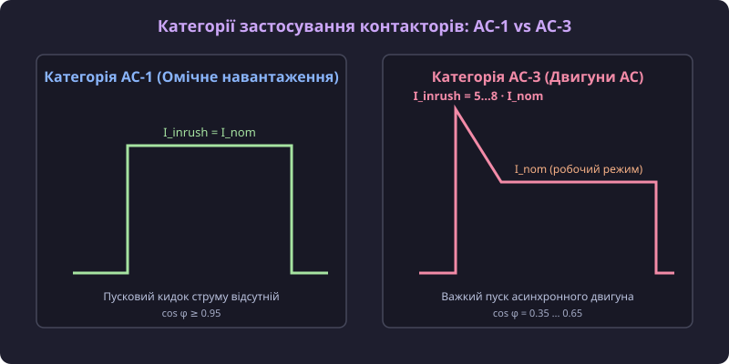
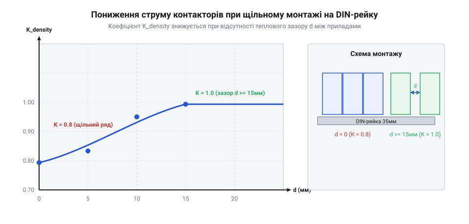

# Категорії застосування контакторів AC-1, AC-3, AC-31A

## Фізика комутації та дугоутворення

При замиканні та розмиканні силових контактів під навантаженням виникає електрична дуга (@@en|electric arc@@). Для омічного навантаження (ТЕНИ, лампи) коефіцієнт потужності дорівнює `cos φ = 1.0`, пусковий струм дорівнює номінальному `I_inrush = I_nom`, і розмикання відбувається без сплесків ЕРС. При комутації індуктивних навантажень (асинхронні двигуни) пусковий струм досягає `I_inrush = 5...8 · I_nom` при `cos φ = 0.35...0.50`. Висока індуктивність створює спалах ЕРС самоіндукції, що спричиняє випаровування металу контактів і ризик їх дугового зварювання (@@en|contact welding@@). Для зменшення дугового зносу застосовують контактні накладки з композиту оксиду срібла та олова (AgSnO2), який витримує температуру понад 1600 °C без глибокого локального розплавлення.

## Категорії застосування за IEC 60947-4-1

Для уніфікації комутаційної здатності контакторів Міжнародна електротехнічна комісія впровадила стандарт IEC 60947-4-1. Категорія **AC-1** призначена для неіндуктивних або слабоіндуктивних навантажень (`cos φ ≥ 0.95`). Категорія **AC-3** розрахована на прямий пуск та вимикання асинхронних двигунів із короткозамкненим ротором (`I_inrush = 6...8 · I_nom`, `cos φ ≈ 0.65`). Категорія **AC-31A** застосовується для побутових модульних контакторів DIN-рейкового виконання. Найважчою є категорія **AC-4** для товчкового режиму (@@en|jogging@@) та реверсування двигунів.

Для підбору комутаційного апарата в автоматичних системах перемикання джерел живлення використовують спеціалізовані [перемикачі фаз та резервного живлення](root:cat-hw-controls/phase-selector-switches).

## Розрахунок допустимого струму та дерейтінгу

Номінальний струм контактора `I_nom` вказується для відкритого повітря при 40 °C. При монтажі в закритому електрощиті допустимий струм обчислюється як `I_op = I_nom · K_temp · K_density · K_alt`. Температурний коефіцієнт `K_temp` становить 0.9 при 50 °C та 0.8 при 60 °C; при подальшому підвищенні внутрішньої температури електрощита понад 60 °C значення `K_temp` знижується лінійно (до 0.7 при 70 °C), що вимагає примусового охолодження шафи для запобігання перегріву котушки електромагніта. Коефіцієнт щільності `K_density` дорівнює 0.8 при монтажі без повітряного зазору між модулями.

При монтажі на висоті понад 2000 м застосовують висотний коефіцієнт `K_alt = 0.9` через зниження щільності повітря.

Наприклад, для контактора з номіналом `I_nom = 40 А` (категорія AC-3), який монтується у закритому електрощиті при внутрішній температурі 50 °C (`K_temp = 0.9`), у групі з 4 контакторів без зазорів (`K_density = 0.8`) на висоті 2200 м (`K_alt = 0.9`), допустимий тривалий робочий струм становить `I_op = 40 · 0.9 · 0.8 · 0.9 = 25.92 А`, що вимагає вибору контактора наступного типорозміру на 63 А для навантаження 32 А.

Для усунення термічного зниження допустимого струму між контакторами встановлюють міжмодульні вентиляційні простівки завширшки півмодуля (9 мм) або один модуль (18 мм): це відновлює нормальну конвекцію повітря навколо бічних стінок корпусів і піднімає коефіцієнт щільності монтажу з `K_density = 0.8` до номінального `K_density = 1.0`.

Підсумкове інженерне правило вибору контактора для електрощита вимагає спершу визначити категорію навантаження (AC-1 для ТЕНів, AC-3 для двигунів), після чого обчислити мінімальний номінал `I_nom ≥ I_op / (K_temp · K_density · K_alt)` із забезпеченням запасу за струмом не менше 20–25% для надійної тривалої експлуатації.

Детальні принципові схеми розпіновки клем A1-A2, схеми захисних RC-модулів та повні графіки температурного дерейтінгу наведено у [залізному довіднику розпіновки клем, схем підключення котушок та графіків дерейтінгу](root:cat-hw-controls/ac-application-categories/api-contactor-terminal-wiring-and-derating-diagrams.md).
