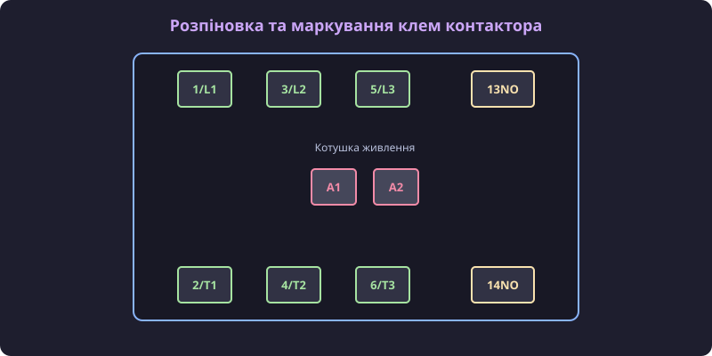
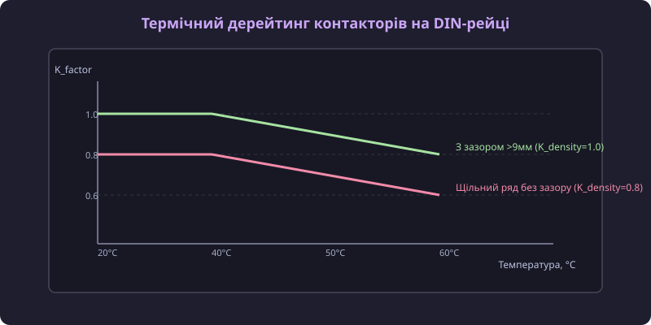

# Залізний довідник розпіновки клем, схем підключення котушок та графіків дерейтінгу

## Маркування та топологія силових і допоміжних клем

У разі помилкового підключення силових або допоміжних провідників виникає ризик міжфазного короткого замикання або виходу з ладу кола керування. Для виключення помилок монтажу всі клемні затискачі контакторів стандартизовані згідно з IEC 60947. Геометрія клемного блоку розробляється зі збільшеними ізоляційними перегородками між фазами для запобігання дуговому перекриттю між сусідніми провідниками при важких розривах дуги: мінімальний повітряний зазор (@@en|clearance distance@@) між різнойменними силовими фазами для напруги 400 В становить 3.0 мм, а поверхнева довжина шляху витоку (@@en|creepage distance@@) залежно від групи ізоляційного матеріалу корпуса CTI складає не менше 5.0 мм. Силові трифазні клеми верхньої групи позначаються як 1/L1, 3/L2, 5/L3 (для вхідного трифазного живлення), а відповідні вихідні силові клеми нижньої групи — як 2/T1, 4/T2, 6/T3 (для підключення навантаження або двигуна).

*Стандартна топологія силових, допоміжних клем та виводів котушки контактора.*

Виводи котушки живлення позначаються як `A1` та `A2`. Допоміжні контакти мають двозначну нумерацію: нормалізовано розмикаючі контакти (@@en|normally closed@@) позначаються цифрами 1 та 2 (наприклад, `21NC/22NC`), а нормально замикаючі (@@en|normally open@@) — цифрами 3 та 4 (наприклад, `13NO/14NO`).

## Схеми керування котушкою та захисні дугогасні кола

Для захисту електронних схем керування від високовольтних імпульсів самоіндукції, що виникають при розмиканні котушки A1-A2, паралельно їй підключають дугогасні елементи (@@en|suppressor circuits@@). При використанні захисного RC-ланцюга (послідовно з'єднані резистор R та конденсатор C) розсіювана на резисторі теплова потужність обчислюється як P_loss = C · U² · f, де U — робоча напруга котушки, а f — частота комутацій; для стандартизованого RC-модуля з C = 0.1 мкФ при напрузі 230 В змінного струму середня потужність розсіювання не перевищує 0.5 Вт, що гарантує відсутність перегріву захисного блоку. Час розряджання ємності C через шунтувальний резистор R описується постійною часу τ = R · C, а повне розряджання до безпечного рівня (менше 5% від початкової напруги) відбувається за час t_discharge ≈ 3 · τ = 3 · R · C (наприклад, для R = 100 Ом та C = 0.1 мкФ час t_discharge = 3 · 100 · 0.1 · 10⁻⁶ = 30 мкс), що забезпечує готовність кола до наступного комутаційного циклу. На відміну від RC-ланцюгів, які створюють додатковий ємнісний зсув фази реактивного струму, варистори зрізають амплітуду пікової перенапруги без фазового зсуву, проте характеризуються поступовою деградацією напівпровідникової структури при високій частоті комутацій. Максимальний допустимий струмовий імпульс варистора обчислюється за виразом I_peak = (U_ind - U_var) / R_internal, де U_var — напруга спрацьовування варистора (наприклад, 430 В для мережі 230 В), що обмежує піковий сплеск струму на безпечному рівні. Для котушок постійного струму DC при використанні ланцюга діод-резистор розрахунок постійної часу згасання струму описується як τ_DC = L / (R_L + R_s), де L — індуктивність котушки, R_L — її власний опір, а R_s — опір послідовного розрядного резистора; піковий сплеск напруги на вимикальному ключі становить U_spike = U_DC + I_0 · R_s + U_D (де I_0 = U_DC / R_L — стаціонарний струм котушки, U_D — прямоточне падіння на діоді), що дозволяє прискорено розряджати накопичену магнітну енергію E = 0.5 · L · I_0² за час t_off ≈ 3 · τ_DC без небезпечного уповільнення відпадання якоря.

Для котушок змінного струму AC застосовують послідовний RC-ланцюг (`R = 100 Ом`, `C = 0.1 мкФ`) або варистор. Для котушок постійного струму DC застосовують зворотний діод або диод Зенера. Це знижує амплітуду сплеску напруги з 1500 В до безпечних 50 В.

## Температурний дерейтинг та коефіцієнти щільного монтажу

При встановленні декількох контакторів на одну DIN-рейку без повітряного зазору тепловідведення погіршується, що спричиняє перегрів пристроїв. Для компенсації взаємного теплового впливу застосовують коефіцієнт щільності монтажу `K_density`: для 2 або 3 пристроїв, встановлених пліч-о-пліч, `K_density = 0.90`; для 4 або 5 пристроїв — `K_density = 0.80`; а при встановленні 6 і більше контакторів без повітряних зазорів коефіцієнт знижується до `K_density = 0.75`. При монтажі обладнання у високогірних електрощитах (понад 2000 м) коефіцієнт щільності `K_density` перемножується з висотним коефіцієнтом `K_alt = 0.95`, що сумарно зменшує допустиме струмове навантаження на контактори до 30%, вимагаючи обов'язкового встановлення вентиляційних простівок між блоками. Тепловий розрахунок тепловідведення крізь металеві чи пластикові стінки електрощита базується на рівнянні теплового балансу шафи `Q_diss = k_th · S_enclosure · ΔT`, де `k_th ≈ 5.5 Вт/(м²·K)` — коефіцієнт теплопередачі листової сталі, `S_enclosure` — ефективна площа поверхні електрощита, відкрита для конвекції, а `ΔT` — допустимий перегрів внутрішнього повітря відносно довкілля. Якщо сумарне тепловідділення котушок живлення та силових контактів усіх контакторів перевершує розрахункову потужність `Q_diss`, у щиті виникає парниковий ефект, що примушує знижувати робочий струм пристроїв додатковим температурним коефіцієнтом `K_temp` або встановлювати системи примусової вентиляції. Температурний дерейтинг котушки живлення враховує зростання її омічного опору з підвищенням температури за формулою R_coil(T) = R_20 · (1 + α_Cu · (T - 20)), де α_Cu = 0.00393 K⁻¹: при нагріванні котушки від 20 °C до 70 °C її опір зростає на 19.6%, що призводить до пропорційного падіння утримувача магнітного потоку та вимагає забезпечення мінімальної напруги живлення A1-A2 не нижче 85% від номіналу для запобігання вібрації електромагнітної системи.

При встановленні декількох контакторів на одну DIN-рейку без повітряного зазору тепловідведення погіршується, що спричиняє перегрів пристроїв. Для компенсації взаємного теплового впливу застосовують коефіцієнт щільності монтажу K_density: для 2 або 3 пристроїв, встановлених пліч-о-пліч, K_density = 0.90; для 4 або 5 пристроїв — K_density = 0.80; а при встановленні 6 і більше контакторів без повітряних зазорів коефіцієнт знижується до K_density = 0.75. При монтажі обладнання у високогірних електрощитах (понад 2000 м) коефіцієнт щільності K_density перемножується з висотним коефіцієнтом K_alt = 0.95, що сумарно зменшує допустиме струмове навантаження на контактори до 30%, вимагаючи обов'язкового встановлення вентиляційних простівок між блоками. Тепловий розрахунок тепловідведення крізь металеві чи пластикові стінки електрощита базується на рівнянні теплового балансу шафи Q_diss = k_th · S_enclosure · ΔT, де k_th ≈ 5.5 Вт/(м²·K) — коефіцієнт теплопередачі листової сталі, S_enclosure — ефективна площа поверхні електрощита, відкрита для конвекції, а ΔT — допустимий перегрів внутрішнього повітря відносно довкілля. Якщо сумарне тепловідділення котушок живлення та силових контактів усіх контакторів перевершує розрахункову потужність Q_diss, у щиті виникає парниковий ефект, що примушує знижувати робочий струм пристроїв додатковим температурним коефіцієнтом K_temp або встановлювати системи примусової вентиляції. Для вибору кулера примусового охолодження розраховують надлишкове тепло Q_excess = P_total - Q_diss та необхідну об'ємну продуктивність вентилятора V_fan = (3.1 · Q_excess) / ΔT м³/год (наприклад, при сумарному виділенні P_total = 120 Вт, природній віддачі Q_diss = 40 Вт і ΔT = 10 K надлишок Q_excess = 80 Вт вимагає кулера продуктивністю V_fan = (3.1 · 80) / 10 = 24.8 м³/год, а з урахуванням запасу 1.25 обирають вентилятор на 31 м³/год). Температурний дерейтинг котушки живлення враховує зростання її омічного опору з підвищенням температури за формулою R_coil(T) = R_20 · (1 + α_Cu · (T - 20)), де α_Cu = 0.00393 K⁻¹: при нагріванні котушки від 20 °C до 70 °C її опір зростає на 19.6%, що призводить до пропорційного падіння утримувача магнітного потоку та вимагає забезпечення мінімальної напруги живлення A1-A2 не нижче 85% від номіналу для запобігання вібрації електромагнітної системи.

*Залежність допустимого робочого струму від температури довкілля та зазору між пристроями.*

Для розрахунку граничного струму застосовують температурний коефіцієнт `K_temp` та коефіцієнт щільності `K_density`. При щільному монтажі `K_density = 0.8`, а при температурі 60 °C `K_temp = 0.8`.

Для розрахунку граничного струму застосовують температурний коефіцієнт K_temp та коефіцієнт щільності K_density. При щільному монтажі K_density = 0.8, а при температурі 60 °C K_temp = 0.8. При керуванні котушкою A1-A2 контактора від виходів мікроконтролера або PLC з обмеженою струмовою здатністю застосовують проміжне інтерфейсне реле: вихід PLC (24 В DC) підключають до клем котушки реле (A1_relay / A2_relay), а силове коло живлення котушки контактора 230 В AC розключають через нормально розімкнені сухі контакти реле (клеми 11-14 або 21-24), паралельно яким підключають дугогасний RC-ланцюг для захисту контактних накладок інтерфейсного реле від комутаційного зносу.
