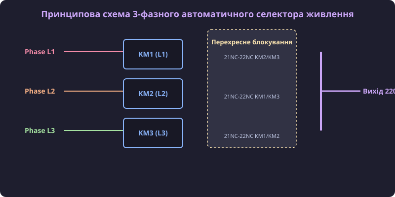

# Проєкт 3-фазного автоматичного селектора живлення на контакторах AC-31A з блокуваннями

## Постановка задачі та вибір силової топології АВР

Для забезпечення безперебійного живлення відповідальних однофазних споживачів від трифазної мережі 380/220 В застосовується автоматичний селектор фаз. Основне завдання пристрою полягає у безперервному моніторингу напруги трьох фаз L1, L2, L3 та миттєвому підключенні навантаження до найбільш стабільної фази. Поріги спрацьовування вимірювального реле налаштовуються з урахуванням допустимих відхилень ГОСТ/IEC: нижня межа відключення встановлюється на рівні 185–195 В для захисту від просідання напруги та перегріву двигунів, а верхня — на рівні 245–253 В для запобігання перенапрузі та виходу з ладу чутливої електроніки. Алгоритм пріоритезації фаз забезпечує автоматичне повернення споживача на основну фазу L1 після відновлення її параметрів, витримуючи гістерезисну часову затримку 5–10 секунд для виключення частих хаотичних перемикань при коливаннях мережі. Математично ширина гістерезисного інтервалу перемикання розраховується за умовою ΔU_hyst = U_ref_upper - U_ref_lower ≥ 2 · ΔU_ripple + U_noise, де для мережі 220 В при амплітуді пульсацій ΔU_ripple = 3 В та шумів U_noise = 2 В мінімальний гістерезис становить ΔU_hyst ≥ 8 В (наприклад, відключення при 180 В та зворотне включення при 188 В), що блокує зворотні перемикання при незначних просіданнях. Розрахунок перерізу силових мідних шин базується на виразі S = I_max / (j_allowable · K_temp · K_density), де j_allowable = 6 A/мм² — допустима густина струму для міді в закритому щиті; для тривалого навантаження I_max = 40 А при поправкових коефіцієнтах K_temp = 0.9 та K_density = 0.9 мінімально необхідний переріз становить S_min = 40 / (6 · 0.81) = 8.23 мм², що вимагає застосування стандартизованої мідної шини 15 × 2 мм (S = 30 мм²) або монтажного проводу перерізом 10 мм² для гарантування перегріву ΔT ≤ 30 K.

При виборі комутаційної апаратури критично враховувати характер навантаження: для омічних та слабоіндуктивних побутових приладів використовують модульні контактори категорії AC-31A, розраховані на постійне номінальне навантаження без важких моторних пускових струмів.

## Проєктування електричного та механічного перехресного блокування

Головним ризиком у схемах автоматичного селектора фаз є виникнення міжфазного короткого замикання (@@en|phase-to-phase short circuit@@) у разі одночасного увімкнення двох контакторів або під час прольоту дуги при перемиканні. Конструктивно механічний блокувальний модуль виконується у вигляді симетричного штовхача-коромисла, встановленого у пази між сусідніми контакторами: при входженні якоря першого контактора коромисло повертається і фізично блокує хід якоря другого контактора, унеможливлюючи замикання його силових контактів навіть при наявності напруги на котушці. Кінематичний розрахунок швидкості переміщення блокувального штовхача розраховується через кутову швидкість повороту важеля ω_arm = (s / r_arm) / t_op, де s = 6 мм — робочий хід якоря, r_arm = 15 мм — плече коромисла, а t_op = 12 мс — час спрацьовування приводу: кутова швидкість сягає ω_arm = (0.4 рад) / 0.012 с ≈ 33.3 рад/с, а лінійна швидкість блокувального зуба v_block = ω_arm · r_arm = 0.5 м/с гарантує перехоплення рухомої системи другого контактора до моменту торкання його контактних накладок. Процедура монтажу передбачає фіксацію блокувального містка в бокових технологічних пазах двох контакторів до їх остаточної затискної посадки на DIN-рейку, після чого перевіряють вільний хід штовхача вручну без подачі напруги. Електрична діаграма перехресного блокування будується за принципом послідовного включення NC-контактів: фазний дріт живлення котушки контактора KM1 пропускають через розмикальні клеми 21NC-22NC контакторів KM2 та KM3. При такій схемі топологічного з'єднання (Phase L1 -> 21NC(KM2) -> 22NC(KM2) -> 21NC(KM3) -> 22NC(KM3) -> A1(KM1)) будь-яке спрацьовування сусіднього контактора розриває коло керування першого, що створює дубльований бар'єр електричного захисту паралельно з механічним коромислом.

Для запобігання міжфазним аваріям реалізують подвійний рівень захисту:

1. **Електричне блокування**: кола живлення котушки A1-A2 кожного контактора пропускають через послідовно з'єднані нормально замкнені NC-контакти (клеми 21NC-22NC) двох інших контакторів.
2. **Механічне блокування**: між корпусами контакторів встановлюють механічне коромисло, що фізично унеможливлює одночасне притискання якорей двох електромагнітів.

## Збирання, налаштування часових затримок та випробування щита

Для виключення короткого замикання через стійку електричну дугу при перемиканні фаз керуючий контролер витримує часову затримку (@@en|dead-time delay@@) не менше 100–150 мс між зняттям напруги з котушки відключуваного контактора та подачею сигналу на вмикання наступного. Детальний алгоритм програмного моніторингу у файлі contactor_timer.cpp передбачає опитування апаратного прапорця is_nc_closed перед кожною зміною фази: контролер зчитує стан додаткового NC-контакту, і якщо прапорець показує залипання контактної групи (is_nc_closed == false), таймер блокує включення наступної фази та виставляє системний прапор помилки аварії. Усі кола живлення котушок A1-A2 та вимірювальні проходи реле напруги захищають окремими швидкісними плавкими запобіжниками або автоматичними вимикачами з номіналом 1–2 А, що гарантує миттєве відключення кожної фази керування у разі короткого замикання в котушці електромагніту. Перед першим поданням силового живлення виконують методичну перевірку відсутності потенціалу на вихідних шинах мультиметром у режимі вимірювання змінного струму та продзвонювання NC-кіл блокування при вимкненому ввідному автоматі. Регламентний алгоритм перевірки зносу силових контактних накладок після 10000 комутаційних циклів передбачає вимірювання перехідного контактного опору мікроометром методом чотирьох точок (допустима межа `R_contact ≤ 1.5 мОм`), вимірювання залишкової товщини срібного шару AgSnO2 штангенциркулем та інспекцію відсутності каверн ерозії глибиною понад 0.3 мм.

Програмну реалізацію таймера затримки та опитування зворотного зв'язку NC-контактів наведено нижче:

:::code proj-automatic-phase-selector-contactor-panel/cpp/contactor_timer.hpp
:::code proj-automatic-phase-selector-contactor-panel/cpp/contactor_timer.cpp
:::code proj-automatic-phase-selector-contactor-panel/cpp/main.cpp

Під час пусконалагоджувальних робіт перевіряють спрацьовування захисного блокування при штучному імітуванні зварювання контактів та контролюють відсутність міжфазної напруги на загальній вихідній шині.

Під час пусконалагоджувальних робіт перевіряють спрацьовування захисного блокування при штучному імітуванні зварювання контактів та контролюють відсутність міжфазної напруги на загальній вихідній шині. Для тестування апаратного захисту змикають вихідні клеми 21NC-22NC примусовим натисканням якоря вимкненого контактора: контролер повинен миттєво заблокувати сигнал увімкнення фази та згенерувати аварійне повідомлення у C++ модулі contactor_timer.cpp. Інспекцію дугогасіння виконують при комутації реактивного навантаження з cos φ = 0.4: час горіння дуги t_arc вимірюють осцилографом із струмовим датчиком Холла, і значення не повинно перевищувати 15 мс для забезпечення комутаційного ресурсу за категорією AC-3. Алгоритм тестування передбачає підключення індуктивного стенда на cos φ = 0.35…0.45 при U_e = 230 В, розмикання контактів у момент пікового струму I_peak = √2 · I_e, реєстрацію швидкості відновлення напруги dV/dt на двоканальному цифровому осцилографі та перевірку відсутності повторного пробою дугового зазору після переходу струму через нуль.

Під час пусконалагоджувальних робіт перевіряють спрацьовування захисного блокування при штучному імітуванні зварювання контактів та контролюють відсутність міжфазної напруги на загальній вихідній шині. Для тестування апаратного захисту змикають вихідні клеми 21NC-22NC примусовим натисканням якоря вимкненого контактора: контролер повинен миттєво заблокувати сигнал увімкнення фази та згенерувати аварійне повідомлення у C++ модулі contactor_timer.cpp. Інспекцію дугогасіння виконують при комутації реактивного навантаження з cos φ = 0.4: час горіння дуги t_arc вимірюють осцилографом із струмовим датчиком Холла, і значення не повинно перевищувати 15 мс для забезпечення комутаційного ресурсу за категорією AC-3. Алгоритм тестування передбачає підключення індуктивного стенда на cos φ = 0.35…0.45 при U_e = 230 В, розмикання контактів у момент пікового струму I_peak = √2 · I_e, реєстрацію швидкості відновлення напруги dV/dt на двоканальному цифровому осцилографі та перевірку відсутності повторного пробою дугового зазору після переходу струму через нуль. Регламент періодичного технічного обслуговування передбачає щоквартальну тепловізійну інспекцію силових клем 1/L1..6/T3 під навантаженням для виявлення локальних перегрівів (ΔT ≥ 15 K відносно довкілля), підтяжку гвинтових затискачів динамометричною викруткою із зусиллям 1.2–1.5 Н·м для M4 та 2.5–3.0 Н·м для M5, а також вимірювання опору ізоляції між розімкненими фазами мегомметром на 1000 В (R_insulation ≥ 100 МОм).
