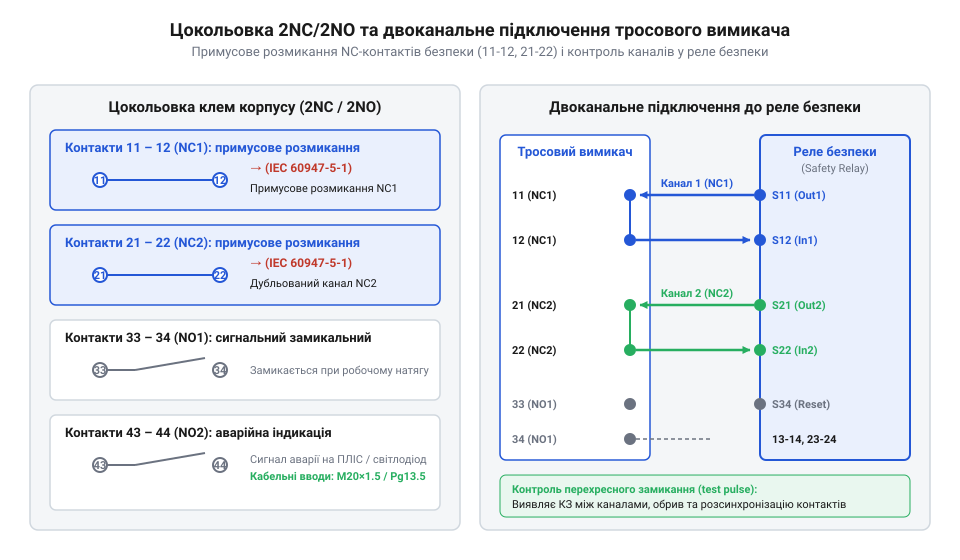
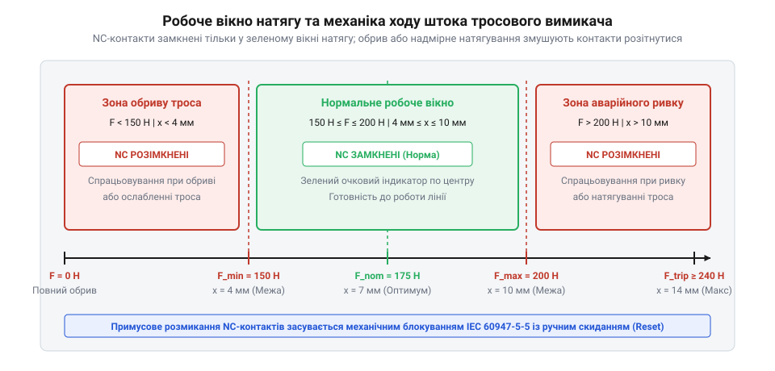

# Апаратний інтерфейс, цокольовка контактів та монтажні параметри тросових вимикачів

<preknowlist>
- [Кнопка аварійного стопу грибок та органи безпечного відключення (IEC 60947-5-5)](root:cat-hw-controls/estop-mushroom-button) — Принципи побудови ланцюгів аварійного зупинення та вимоги стандарту IEC 60947-5-5 до примусового розмикання контактів.
</preknowlist>

## Небезпека помилок монтажу тросового вимикача

Тросові вимикачі аварійного зупинення призначені для миттєвого знеструмлення протяжних технологічних ліній, конвеєрів та важких транспортерів при виникненні небезпеки вздовж усього маршруту. На відміну від локальних кнопок, трос забезпечує доступ до аварійного відключення у будь-якій точці довжиною до `50`–`100 м`. Однак спрощена або помилкова реалізація апаратного інтерфейсу та механічного монтажу тросового вимикача призводить до критичних аварійних сценаріїв.

Найгостріша небезпека виникає при застосуванні одноканальної схеми підключення. Якщо обидва розмикальні контакти вимикача з'єднати послідовно у єдину лінію або використати лише один NC-контакт, будь-яке міжфазне коротке замикання, притискання кабелю до станини чи замикання на землю `GND` унеможливлює відключення. При натисканні або натягуванні троса контакт фізично розмикається, але потенціал на вході контактора залишається через байпасний шлях замикання, і обладнання продовжує рух. Додатково критичний ризик створює фізика утворення гальванічної дуги (англ. @@en|electric arc@@) при аварійному розмиканні контактів під індуктивним навантаженням приводних двигунів. У момент розриву колізійна іонізація повітряного проміжку утворює високотемпературний плазмовий канал, який утримує проходження струму й викликає мікрозварювання ламелей. Механізм дугогасіння (англ. @@en|arc quenching@@) у контактних блок-секціях спирається на застосування термостійких срібно-нікелевих композитних матеріалів та кінематику надшвидкісного підриву контактів накопиченою пружиною, що розриває дуговий шнур за частки мілісекунди. Для остаточного усунення системних пасток промислові стандарти вимагають побудови виключно двоканальних кіл із незалежним моніторингом перехресних замикань реле безпеки, за аналогією до кіл з [органами аварійного відключення](root:cat-hw-controls/estop-mushroom-button).

Другий клас помилок пов'язаний із нехтуванням механічною кінематикою натягу троса. Трос є еластичним елементом, довжина якого суттєво змінюється під дією температури навколишнього середовища та матеріалу виконання. Стандартна оцинкована вуглецева сталь має температурний коефіцієнт лінійного розширення (англ. @@en|coefficient of thermal expansion@@, від лат. coefficiens — той, що сприяє, therme — тепло, та expansio — розширення) `α ≈ 12 · 10⁻⁶ K⁻¹`, тоді як аустенітна нержавіюча сталь розширюється значно сильніше (`α ≈ 16 · 10⁻⁶ K⁻¹`), викликаючи збільшені деформації довжини при добових перепадах. Якщо при монтажі не врахувати пружне подовження та теплове розширення каната, нічне охолодження викличе критичний натяг і хибне спрацьовування, а денний нагрів переведе механізм у зону провисання, де робочий хід штока стане недостатнім для розмикання контактної групи при ривку. Додатково ситуацію ускладнює наявність захисної полівінілхлоридної оболонки (ПВХ): вона захищає сталь від корозії, але різко збільшує коефіцієнт тертя (англ. @@en|coefficient of friction@@, від лат. frictionis — тертя) каната в проміжних направляючих вушках. Сухе тертя створює механічний гістерезис натягу уздовж траси, через який опір направляючих поглинає ручний ривок оператора у віддалених точках конвеєра, заважаючи штоку подолати поріг примусового розмикання контактів.

## Цокольовка контактних груп та електричні параметри

Електричний інтерфейс тросового вимикача містить внутрішню контактну блок-секцію миттєвої дії з примусовим механічним розмиканням (англ. @@en|positive opening action@@, від англ. positive — примусовий, та opening — розмикання). Стандартні конфігурації виводів виготовляють у варіантах 2NC/1NO (два розмикальні та один замикальний контакт) або 2NC/2NO (два розмикальні та два замикальні контакти). Маркування клем виконують за двозначним цифровим стандартом IEC 60947-5-1:
- Клеми `11`–`12` (перший канал NC1) та `21`–`22` (другий канал NC2) — розмикальні контакти безпеки з примусовим розмиканням, які гарантовано розривають коло навіть при підварюванні ламелей під дією струмової дуги.
- Клеми `33`–`34` (перший сигнальний NO1) та `43`–`44` (другий сигнальний NO2) — замикальні контакти, які замкнені у нормальному робочому стані натягу троса і розмикаються при аварії для передачі сигналів на ПЛІС або індикатори стану.


*Схема цокольовки клем 2NC/2NO тросового вимикача та його двоканального підключення до реле безпеки з примусовим розмиканням контактів.*

Електричні параметри комутації клем розраховані на промислові категорії навантаження: для змінного струму AC-15 номінальна напруга становить `240 В` при струмі `3 А`, а для постійного струму DC-13 — `24 В` при струмі `2.7 А`. Номінальна напруга ізоляції `U_i = 500 В`, а імпульсна витримувана напруга `U_imp = 6 кВ`. Гвинтові клеми розраховані на затискання провідників перерізом від `0.75 мм²` до `2.5 мм²` з обтискними гільзованими наконечниками.

При підключенні до реле безпеки (англ. @@en|safety relay@@) канал NC1 з'єднують із виводами `S11`–`S12`, а канал NC2 — із виводами `S21`–`S22`. Для виявлення коротких замикань реле подає в лінії короткі діагностичні імпульси (англ. @@en|test pulse@@, від лат. testum — випробування, та pulsus — поштовх) тривалістю `0.1`–`1.5 мс` із періодом повторення `10`–`50 мс`. Надкишковий проміжок цих імпульсів не встигає відпустити механічні якірні контактори, але дозволяє миттєво зафіксувати перехресне пробиття струму між каналами або замикання на корпус. Оскільки на протяжних трасах (`50`–`100 м`) паразитний ємнісний зв'язок між паралельними жилами може викривити формальний фронт імпульсу й спричинити хибне розпізнавання аварії, промислові норми вимагають застосування екранованого кабелю (англ. @@en|shielded cable@@, від англ. shield — екран, та cable — кабель) з витими парами та заземленням оплітки на боку шафи керування. Крім динамічного опитування ліній, реле безпеки реалізує внутрішній алгоритм діагностики часового розсинхрону (англ. @@en|discrepancy time@@, від англ. discrepancy — невідповідність, та time — час) між спрацьовуванням двох NC-контактів. Якщо при ручному ривку чи зносі механічного штовхача один розмикальний контакт відкривається із запізненням щодо іншого, розбіжність моментів розмикання фіксується внутрішнім таймером; при перевищенні допустимого вікна (типово `100`–`500 мс`) реле блокує подальший пуск системи та формує сигнал апаратного дефекту контактної блок-секції.

## Геометрія корпусу, монтаж та кабельні вводи

Корпус тросового вимикача виконують із високоміцного литого алюмінієвого сплаву або ударпрочного термопласту, розрахованого на жорсткі умови експлуатації в запилених та вологих цехах. Зовнішні габаритні розміри типового корпусу становлять `160 мм` по висоті, `65 мм` по ширині та `58 мм` по глибині. Для надійного кріплення на металоконструкції станини передбачено 4 кріпильні отвори під гвинти `M5` з фіксованим кроком `40 × 125 мм`.

Кабельні вводи у нижній або бічній частині корпусу мають стандартну нарізь `M20 × 1.5` або `Pg13.5`. Для забезпечення класу захисту `IP67` за стандартом IEC 60529 кабельний ввід (англ. @@en|cable gland@@, від англ. cable — кабель, та gland — сальник, ввід) повинен мати еластичне сальникове ущільнення з еластомеру NBR або силікону. Затягування гайки кабельного вводу виконують із моментом `2.5`–`3.5 Н·м`, що гарантує повну герметизацію камери контактів від проникнення дрібного абразивного пилу та водяних струменів під високим тиском.

Монтаж вимикача на станину здійснюють виключно на жорсткі несучі балки, які не піддаються прогину під дією робочого натягу троса. Використання тонколистових кожухів призводить до пружної деформації стінки, що спотворює межі спрацьовування механізму натягу. При дії на корпус бічного зусилля натягу `F = 200 Н` деформаційний зсув кронштейна `Δx` розраховують за формулою пружного вигину консольної балки:

```
Δx = (F · L³) ÷ (3 · E · I)      [пружний прогин кронштейна станини]
```

де `L` — плече вилету кріплення, `E` — модуль пружності (англ. @@en|Young's modulus@@) матеріалу несучої конструкції, а `I` — момент інерції (англ. @@en|moment of inertia@@) її поперечного перерізу. Якщо через низьку жорсткість металоконструкції величина зсуву `Δx` перевищує `1`–`1.5 мм`, корпус вимикача зміщується вздовж осі натягу, що виводить механічний засув із робочого вікна та викликає хибні аварійні зупинення лінії або неможливість ручного скидання важеля.

## Механічні характеристики натягу та робочий хід

Кінематика тросового вимикача суттєво відрізняється від звичайних кінцевих перемикачів наявністю двостороннього спрацьовування: контактна група розмикається як при примусовому натягуванні (ривку) троса оператором, так і при його випадковому обриві або послабленні. Механічний стан пристрою задається робочим вікном натягу (англ. @@en|operating tension window@@).


*Графік робочого вікна натягу троса із зазначенням зон норми, межі спрацьовування від натягу та зони спрацьовування від обриву.*

Основні механічні параметри кінематики вимикача:
- Початковий робочий натяг троса: `150`–`200 Н`.
- Зусилля примусового спрацьовування при натягуванні: `40`–`60 Н` понад початковий натяг.
- Робочий хід штока: повний хід штока становить `14 мм`; межа розмикання NC-контактів при натягуванні досягається при зсуві штока на `6 мм`, а при обриві троса — при зсуві на `4 мм` у протилежний бік.

Для налаштування початкового натягу трос оснащують гвинтовим натягувачем (талрепом) та оглядовим індикатором на корпусі вимикача. Натискання або обрив витискає механічний засув у заблокований стан, після чого повернення у робочий режим можливе лише після відновлення натягу та примусового витягування синього або червоного скидального важеля (скидання вручну). Для компенсації температурних коливань довжини троса на протилежному кінці траси обов'язково монтують потужну компенсаційну пружину з пружністю `15`–`25 Н/мм`. 

Жорсткість цієї компенсаційної пружини `C_sp` обирають на основі термодинамічного розрахунку деформації сталевого каната довжиною `L` при максимальному добовому перепаді температур `ΔT`:

```
ΔL = α · L · ΔT                          [подовження троса від температури]
F_temp = C_sp · ΔL                       [зміна зусилля натягу при деформації]
C_sp = F_margin / (α · L · ΔT)           [гранична жорсткість пружини]
```

Тут `α ≈ 12 · 10⁻⁶ K⁻¹` — температурний коефіцієнт лінійного розширення сталі, а `F_margin` — допустиме відхилення натягу (не більше `30 Н`), яке не повинно виводити шток за межі робочого вікна `150`–`200 Н`. Якщо на довгому конвеєрі (`L = 50 м`) при перепаді `ΔT = 40 °C` використати надто жорстку пружину (`C_sp > 30 Н/мм`), теплове видовження каната `ΔL = 24 мм` викличе падіння натягу нижче `150 Н` та спричинить помилкове спрацьовування вимикача від «обриву» в холодну пору року або заклинювання від натягу в спеку.
