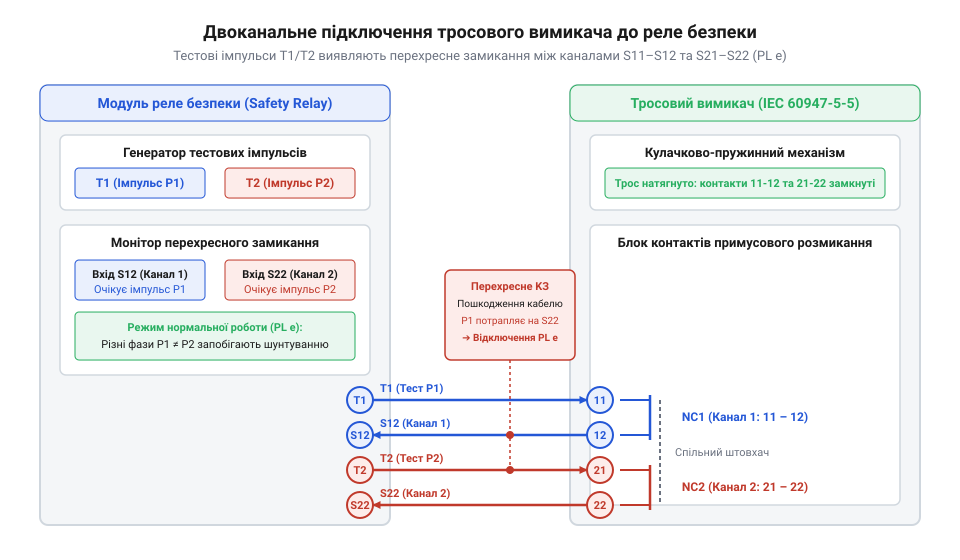

# Схеми комутації контактів, розпіновка та підключення до Safety PLC

<preknowlist>
- [Кнопка аварійного стопу грибок та органи безпечного відключення (IEC 60947-5-5)](root:cat-hw-controls/estop-mushroom-button) — Принципи примусового розмикання NC-контактів та правила побудови кіл аварійного зупинення.
</preknowlist>

## Призначення клем та конфігурація контактів

Електрична частина тросового вимикача аварійного зупинення будується на основі внутрішнього контактного блоку, призначеного для комутації кіл керування та передачі сигналів стану до систем автоматики. Маркування клем та розташування контактних груп строго відповідають міжнародному стандарту IEC 60947-5-1 (від нім. *Norm* — норма, правило; далі — @@en|IEC 60947-5-1@@). Двозначна нумерація клем однозначно визначає функціональне призначення кожної пари контактів: перша цифра позначає порядковий номер контактної групи всередині корпусного блоку, а друга цифра вказує на тип контакту.

Розмикальні контакти безпеки (від англ. *normally closed*; далі — @@en|normally closed@@) завжди маркуються закінченнями 1 та 2 (наприклад, клеми 11-12, 21-22 та 31-32). Ці контакти мають механізм примусового відкриття, у якому механічний штовхач жорстко розмикає струмопровідний місток навіть у разі його приварювання. При цьому механізм гарантує вимикання електричної дуги шляхом швидкого розведення контактних поверхонь на фіксований повітряний зазор понад 3 мм, що миттєво гасить дуговий розряд при вимкненні індуктивних навантажень категорій AC-15 та DC-13. У розімкненому стані опір ізоляції між клемами становить понад 10 MΩ (при випробувальній напрузі 500 V DC), що унеможливлює протікання струмів витоку та запобігає хибному утриманню реле безпеки. Замикальні контакти сигналізації (від англ. *normally open*; далі — @@en|normally open@@) маркуються закінченнями 3 та 4 (наприклад, клеми 33-34 або 43-44) і використовуються виключно для індикації або подачі сигналів на стандартні входи контролерів.

| Маркування клем | Тип контакту | Призначення в схемі | Наявність примусового розмикання |
| :--- | :--- | :--- | :--- |
| 11 – 12 | NC (Канал 1) | Головне коло зупинення / Реле безпеки | Так (IEC 60947-5-1) |
| 21 – 22 | NC (Канал 2) | Дублівальний канал безпеки | Так (IEC 60947-5-1) |
| 31 – 32 | NC (Канал 3) | Допоміжне коло аварійного блокування | Так (IEC 60947-5-1) |
| 33 – 34 (43 – 44) | NO (Сигнал) | Індикація спрацювання / Стандартний PLC | Ні |

Промислові тросові вимикачі найчастіше постачаються у двох базових виконаннях контактної групи: 2NC/1NO та 3NC. Конфігурація 2NC/1NO вважається універсальним стандартом для побудови дубльованих кіл аварійного вимкнення з можливістю дистанційної діагностики. У цій схемі дві пари NC-контактів (11-12 та 21-22) задіяні в двох незалежних каналах безпеки, а пара NO-контактів (33-34) видає високий рівень напруги на сигнал тривоги. Конфігурація 3NC застосовується в системах із підвищеними вимогами до ізоляції кіл живлення контакторів або при використанні триканальних схем зупинення. Усі NC-контакти розраховані на роботу в кола безпеки з примусовим розмиканням [органів аварійного відключення](root:cat-hw-controls/estop-mushroom-button), що унеможливлює зависання схеми під навантаженням.

## Стан контактів у трьох фазах троса

На відміну від стандартних кінцевих вимикачів, тросовий вимикач безпеки має три чіткі механічні стани кулачкового вала, кожен з яких відповідає визначеній конфігурації контактних груп. Нормальна робота технологічної лінії можлива лише у вузькому вікні натягу троса. Відхилення механічної сили в будь-який бік призводить до зміни стану електричних кіл.

Перший стан — робочий натяг троса. Монтажник за допомогою натяжного гвинта встановлює оптимальне зусилля (зазвичай від 80 N до 150 N), при якому стрілка покажчика на корпусі пристрою перебуває точно посередині зеленій шкали. У цьому стані внутрішній кулачок утримує силові NC-контакти (11-12, 21-22) у замкненому стані, а допоміжний NO-контакт (33-34) — у розімкненому. Коло аварійного вимкнення підготовлене до запуску обладнання.

Другий стан — аварійне потягування троса оператором. При прикладанні поперечного або поздовжнього зусилля натяг перевищує порогове значення (понад 200 N). Кулачок повертається у крайнє положення, примусово штовхає розмикальний механізм і розмикає NC-контакти (11-12 та 21-22), автоматично фіксуючи їх у вимкненому стані механічним заскочником. Внутрішній кінематичний механізм має спеціально розрахований гістерезис (від грец. *hysteresis* — запізнення, відставання) ходу кулачка: зусилля розчеплення становить понад 200 N, тоді як для зворотного повернення механізму натяг має знизитися нижче 130 N. Цей механічний гістерезис запобігає дребезгу та хибному змиканню контактів від пружних коливань і вібрацій троса після його відпускання оператором. Одночасно з цим допоміжний NO-контакт (33-34) замикається, подаючи сигнал про спрацювання на панель оператора, а відновлення замкненого стану NC-контактів стає можливим лише після повного механічного квитування (Reset).

Третій стан — обрив або провисання троса. Якщо трос перерізано, обірвано або його натяг впав нижче 50 N через температурне подовження чи послаблення затискачів, внутрішня поворотна пружина зсуває кулачок у протилежний крайній стан. Це так само примусово розмикає NC-контакти (11-12, 21-22) і замикає NO-контакт (33-34), розриваючи коло безпеки.


*Діаграма стану контактних груп перемикача у трьох механічних фазах: обрив, робочий натяг та аварійне потягування.*

| Механічний стан троса | Сила натягу F | Стан NC-контактів (11-12, 21-22) | Стан NO-контакту (33-34) | Стан кола безпеки |
| :--- | :--- | :--- | :--- | :--- |
| Обрив / Послаблення | F < 50 N | Розімкнено (Open) | Замкнено (Closed) | Аварійне вимкнення |
| Робочий натяг (Норма) | 80 N ≤ F ≤ 150 N | Замкнено (Closed) | Розімкнено (Open) | Готовність до роботи |
| Потягування (Аварія) | F > 200 N | Розімкнено (Open) | Замкнено (Closed) | Аварійне вимкнення |

## Двоканальне підключення до реле безпеки

Для відповідності високим категоріям безпеки (Cat 3 / Cat 4 згідно з ISO 13849-1) одноканальна комутація є недопустимою. Одноканальне коло з одним NC-контактом нездатне виявити коротке замикання провідника на лінію живлення +24 V DC або замикання між жилами кабелю, що залишає коло потенційно замкненим навіть при спрацюванні вимикача.

Безпечне з'єднання будується за двоканальною схемою із застосуванням спеціального реле безпеки. Два розмикальні контакти тросового вимикача (11-12 та 21-22) розключаються в два окремі ізольовані електричні ланцюги. Канал 1 підключається між тестовим тактовим виходом реле T1 (або S11) та вхідною клемою S12. Канал 2 підключається між другим тактовим виходом T2 (або S21) та вхідною клемою S22.

Ключовою функцією такої схеми є моніторинговий контроль перехресних замикань (від англ. *cross-circuit detection*; далі — @@en|cross-circuit detection@@). Реле безпеки генерує на виходах T1 та T2 прямокутні тактові імпульси зі зміщенням за фазою або різною полярністю. Якщо під час експлуатації вздовж траси конвеєра відбувається механічне пошкодження або роздавлювання кабелю, яке спричиняє коротке замикання між жилами Каналу 1 та Каналу 2, реле безпеки миттєво фіксує чужі імпульси на клемах S12 або S22. Це викликає негайне аварійне відключення вихідних контакторів ще до спроби повторного запуску системи. Для надійної фіксації коротких прямокутних імпульсів (тривалістю від 0.5 мс до 2 мс) максимальний опір петлі кабельного ланцюга `R_loop` не повинен перевищувати 50 Ω (що для мідного кабелю перерізом 1.5 мм² обмежує суммарну довжину траси 500 м). Якщо опір провідників перевищує цю межу, спад напруги та паразитна ємність лінії завалюють фронти імпульсів, через що вхідні клеми S12 та S22 фіксують просідання сигналу й викликають хибне спрацювання реле безпеки навіть при замкнених NC-контактах.


*Принципова схема підключення контактів 11-12 та 21-22 до виходів тактування T1/T2 та входів S12/S22 реле безпеки з контролем замикань.*

При послідовному з'єднанні кількох тросових вимикачів уздовж однієї довгої траси (наприклад, конвеєра завдовжки 100 метрів) NC-контакти першого вимикача з'єднуються послідовно з NC-контактами наступних пристроїв у межах відповідного каналу. Контакти 11-12 усіх вимикачів формують послідовне коло Каналу 1, а контакти 21-22 — послідовне коло Каналу 2. Спрацювання або обрив троса на будь-якому з прогонів розриває відповідний канал, що гарантує надійне зупинення обладнання.

## Інтеграція з вхідними модулями Safety PLC

У сучасних автоматизованих комплексах тросові вимикачі підключаються безпосередньо до дискретних модулів безпечних входів (від англ. *Fail-Safe Digital Inputs*; далі — @@en|F-DI modules@@) програмованих контролерів безпеки (Safety PLC). Такий підхід дає змогу реалізувати гнучку логіку аварійного зупинення окремих технологічних зон та спрощує діагностику. Детальніше про апаратну структуру та діагностику сигналів можна дізнатися в описі [модулів дискретних входів безпеки](root:cat-hw-boards/fail-safe-digital-input-modules).

Для підключення вимикача модуль F-DI виділяє дві пари клем: тестові імпульсні виходи (P1, P2) та безпечні входи (DI0, DI1). Перший розмикальний контакт вимикача 11-12 вмикається між виходом P1 та входом DI0, а другий контакт 21-22 — між виходом P2 та входом DI1. Програмне забезпечення контролера виконує функцію оцінки розбіжності каналів (від англ. *discrepancy evaluation*; далі — @@en|discrepancy evaluation@@). Контролер відстежує час між розмиканням клем DI0 та DI1. Якщо один із контактів розмикається, а інший залишається замкненим довше заданого часу розбіжності (зазвичай від 100 мс до 500 мс), Safety PLC переходить у режим апаратної відмови із фіксацією помилки каналу.

Допоміжний замикальний контакт 33-34 використовується для вирішення завдання локалізації місця спрацювання. При послідовному шлейфовому з'єднанні багатьох вимикачів кола безпеки NC розривають загальне живлення, але не вказують, який саме з десяти вимикачів уздовж транспортера був задіяний. Для цього контакти 33-34 кожного пристрою підключаються до індивідуальних входів стандартного модуля вводу PLC (Standard DI).

```
[Safety PLC F-DI Module]             [Cable-Pull Switch]            [Standard PLC DI]
    P1 (Test Pulse 1) -------------> Terminal 11 (NC1)
    DI0 (Safe Input 0) <------------ Terminal 12 (NC1)

    P2 (Test Pulse 2) -------------> Terminal 21 (NC2)
    DI1 (Safe Input 1) <------------ Terminal 22 (NC2)

    +24V DC Field Power ------------> Terminal 33 (NO)
                                     Terminal 34 (NO) -------------> Standard DI_x (HMI Alarm)
```

Коли оператор потягне за трос конкретного вимикача, контакти 11-12 та 21-22 миттєво знеструмлять безпечні входи DI0/DI1 Safety PLC, і контролер зупинить конвеєр за декілька мілісекунд. Одночасно із цим контакт 33-34 замкне коло +24 V DC на стандартному вході DI_x, що дозволить панелі оператора (HMI) вивести точне повідомлення: «Аварійне зупинення: Тросовий вимикач №3 (Зона пакування)». Така комбінована схема забезпечує найвищий рівень безпеки PL e та мінімізує час простою лінії при пошуку причин аварії.
