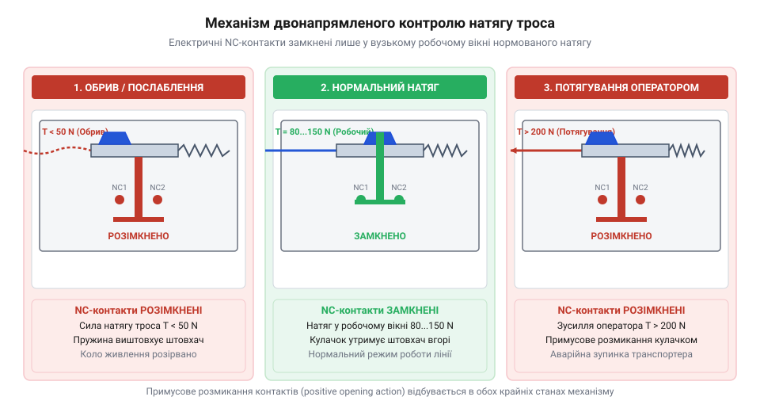
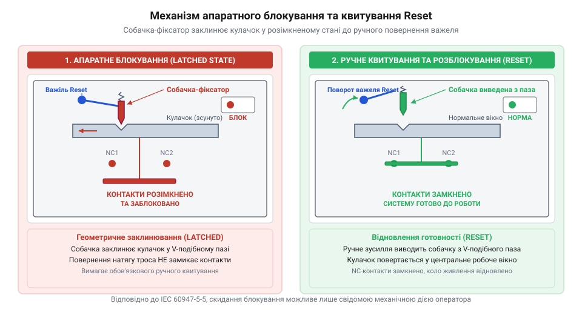
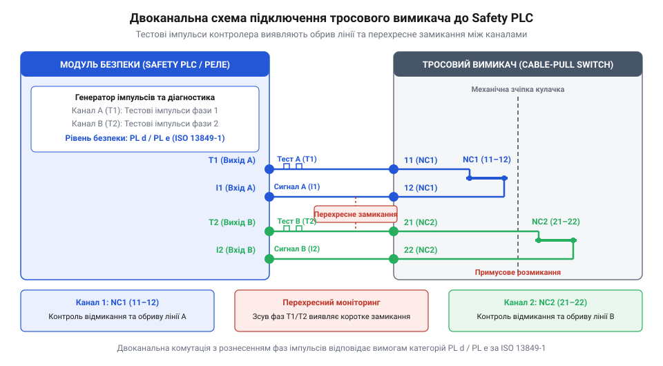

# Тросові вимикачі аварійного зупинення (IEC 60947-5-5)

<preknowlist>
- [Кнопка аварійного стопу грибок та органи безпечного відключення (IEC 60947-5-5)](root:cat-hw-controls/estop-mushroom-button) — Вимоги стандарту IEC 60947-5-5 до органів аварійного вимкнення, примусового розмикання контактів та механічного квитування.
</preknowlist>

## Небезпека протяжних зон промислових транспортерів

Уявіть довгий стрічковий конвеєр або автоматизовану лінію пакування, що простягається вздовж цеху на кілька десятків метрів. Під час роботи поруч із рухомими роликами, приводними барабанами та транспортерною стрічкою оператори постійно перебувають у потенційно небезпечній зоні. Якщо одяг або кінцівка працівника випадково потрапляє під захоплювальний елемент механізму, виникає загроза важкого травмування, яка вимірюється частками секунди. Типова швидкість руху конвеєрної стрічки становить від 1 до 5 м/с, через що при швидкості 2,5 м/с затягування предмета на відстань у пів метра відбувається всього за 0,2 секунди. Водночас природна сенсорно-моторна реакція людини — від моменту усвідомлення небезпеки мозком до фізичного руху руки — становить від 0,5 до 1,5 секунди. За цей часовий інтервал транспортер встигає протягнути оператора на кілька метрів углиб небезпечного вузла ще до того, як він зробить хоч один свідомий захисний рух.

У подібній ситуації класична грибкова [кнопка аварійного зупинення](root:cat-hw-controls/estop-mushroom-button) часто виявляється недосяжною. Якщо єдиний орган захисту розташований на віддаленому шафі керування або через кожні двадцять метрів траси, потерпілий просто не зможе до нього дотягнутися. Навіть коли поруч є колега, час на усвідомлення небезпеки та біг до найближчої кнопки призводить до затримки в кілька секунд, що в умовах працюючого обладнання є неприпустимим.

Ранні спроби розв'язання цієї проблеми зводилися до прокладання простих механічних тросиків або тяг, з'єднаних зі звичайними вимикачами. Проте детальний аналіз аварійності показав, що примітивні системи самі створюють приховані відмови при обриві чи провисанні троса. З розбором того, як виникали вимоги безпеки для протяжних об'єктів, можна ознайомитися в описі [історичного розвитку вимикачів](root:cat-hw-controls/cable-pull-switches-and-safety-rope-switches/hist-evolution-of-cable-pull-safety.md).

Ефективним розв'язком стало створення спеціального класу пристроїв — тросового вимикача аварійного зупинення (від англ. *cable-pull switch*; далі — @@en|cable-pull switch@@). Цей апарат встановлюється на початку або в кінці небезпечної ділянки, а вздовж всієї траси натягується сталевий трос у захисному оболонковому покритті. У результаті оператор отримує можливість миттєво зупинити технологічну лінію з будь-якої точки уздовж транспортера. Геометрія спрацьовування розрахована так, що примусове розмикання відбувається як при поздовжньому потягуванні вздовж осьової лінії троса, так і при боковому перпендикулярному зміщенні в будь-якому напрямку. Згідно з вимогами безпеки, внутрішній кінематичний механізм гарантує надійне вимкнення при прикладанні оператором нормованого поперечного зусилля не більше 125 N, перетворюючи бокове відхилення троса на додаткове осьове натягнення. На відміну від примітивних шнурових тяг, які спрацьовують лише при односторонньому потягуванні строго вздовж лінії прокладання, механіка вимикача розрахована на векторне підсумовування сил під довільними кутами. При боковому відхиленні троса виникає геометричний клин: поперечне зміщення створює плече важеля, яке трансформує навіть невелике бокове зусилля оператора у значне поздовжнє збільшення сили натягу на кулачку пристрою. Завдяки цьому примусове розмикання контактів відбувається однаково надійно при потягуванні вздовж траси, перпендикулярному натисканні чи відтягуванні троса під довільним кутом відносно проміжних направляючих.

## Механізм двонапрямленого контролю натягу троса

Простий кінцевий вимикач, що спрацьовує лише від натягування шнура, не відповідає сучасним вимогам промислової безпеки. Якщо трос випадково обірветься, заклинить у направляючих або провисне від перепаду температур, проста система залишиться замкненою й оператор втратить можливість зупинити обладнання у критичний момент.

Для виключення таких прихованих відмов застосовують механізм двонапрямленого контролю натягу (від англ. *bidirectional tension control*; далі — @@en|bidirectional tension control@@). Всередині корпусу вимикача встановлено збалансовану кулачково-пружинну систему. Межі робочого центрального вікна визначає конструктивний пристрій кулачка з кулісами у формі симетричних V-подібних або трапецієподібних виїмок: у центральному заглибленні підпружинений ролик розмикача спирається на рівну ділянку, а по боках її обмежують круті робочі фаски. Внутрішня калібрована пружина протидіє силі зовнішнього натягу троса, утримуючи силовий кулачок у цьому вузькому центральному положенні з допустимим механічним ходом відхилення в межах від ±2 мм до ±4 мм. Електричні розмикальні контакти (від англ. *normally closed*; далі — @@en|normally closed@@) залишаються замкненими тільки тоді, коли сила натягу перебуває в нормованому робочому діапазоні (зазвичай від 80 N до 150 N). Якщо зусилля натягу падає нижче порогового значення 50 N при обриві троса або перевищує 200 N при примусовому потягуванні оператором, кулачок зміщується вздовж куліс, ролик збігає з центральної ділянки по похилій фасці й виходить за межі нейтрального вікна, що розмикає кола живлення.

*Двонапрямлений механізм контролю натягу утримує контакти замкненими лише у стабільному центральному вікні.*

Коли оператор смикає за трос, зусилля перевищує верхню межу робочого вікна. Внутрішній кулачок повертається й здійснює примусове розмикання контактів (від лат. *positivus* — визначений, примусовий; далі — @@en|positive opening action@@), розриваючи коло живлення незалежно від стану внутрішніх пружин. Якщо ж трос перерізається, перетирається або обривається, сила зовнішнього натягу миттєво падає від робочих 100 N до нуля. У цей момент попередньо стиснута внутрішня пружина вивільняє накопичену механічну енергію і менш ніж за 20 мс прискорює штовхач кулачка у протилежний бік, який жорстко вибиває місток розмикальних NC-контактів із посадкових гнізд і надійно розриває коло живлення. З математичним обґрунтуванням сил натягу та геометрії провисання можна ознайомитися у розрахунках [математичного розрахунку натягу троса](root:cat-hw-controls/cable-pull-switches-and-safety-rope-switches/math-cable-tension-and-thermal-expansion.md).

## Апаратне блокування та механічне квитування

Коли аварійний вимикач розмикає коло живлення, виникає інша серйозна небезпека — самочинний повторний запуск ліній. Якщо оператор відпустить потягнутий трос, або якщо обірваний трос випадково зачепиться й відновить тимчасовий натяг, некероване замикання контактів призведе до раптового пуску конвеєра, на якому все ще можуть перебувати люди.

Згідно з вимогами стандарту IEC 60947-5-5, усі пристрої аварійного зупинення повинні мати обов'язковий механізм апаратного блокування у спрацьованому стані (від англ. *latching mechanism*; далі — @@en|latching mechanism@@). Внутрішня кінематика цього вузла побудована на взаємодії центрального кулачка та підпружиненої загартованої собачки-фіксатора. У нормальному черговому стані носок собачки спирається на гладкий випуклий профіль кулачка, утримуючись у напруженому стані стиснутою пружиною блокування. При зміщенні кулачка в будь-який бік (як при потягуванні троса, так і при його обриві) профільний паз кулачка суміщається з носком собачки, і пружина миттєво заштовхує собачку у заклинювальний V-подібний паз, створюючи жорсткий геометричний замок. Геометрія V-подібного паза розрахована так, що кут нахилу його граней `α` перебуває в межах `7°`–`10°`, задовольняючи умову самоблокування `α < arctg(μ)`, де `μ` — коефіцієнт тертя загартованої сталі; це повністю унеможливлює самовільний вихід собачки з паза від технологічних вібрацій чи ударних навантажень. Оскільки кут бічних граней паза забезпечує самоблокування, заскочена собачка надійно фіксує штовхач і NC-контакти у розімкненому стані. Відпускання троса чи зміна його натягу більше не може повернути контактну групу в початковий стан без свідомого механічного впливу на орган квитування.

*Механізм апаратного блокування утримує NC-контакти розмиканими до виконання ручного квитування Reset.*

Щоб відновити готовність лінії до роботи, оператор або обслуговуючий персонал мусить особисто підійти до вимикача, усунути причину аварійної зупинки та виконати ручне механічне квитування (від англ. *reset*; далі — @@en|reset@@). Перед натисканням або поворотом органу квитування регламент безпеки вимагає обов'язкового візуального контролю стану прапорця-індикатора фіксатора на корпусі пристрою та повного фізичного огляду траси транспортера по всій небезпечній зоні. Тільки переконавшись, що людей у зоні транспортера немає й причини загрози усунуто, працівник здійснює квитування. Для цього на корпусі вимикача передбачено поворотний важіль або кнопково-витяжну синю головку. Тільки при свідомому фізичному впливі на орган квитування заскочка виходить із паза, дозволяючи механізму повернутися у центральне робоче положення. Послідовність налаштування та практичної перевірки блокування викладено у [практичному проєкті монтажу](root:cat-hw-controls/cable-pull-switches-and-safety-rope-switches/proj-conveyor-rope-switch-installation.md).

## Компенсація температурних коливань та монтаж

Зміна температури у промисловому приміщенні чи на відкритому повітрі спричиняє лінійне розширення металевого троса. Сталевий канат довжиною у півсотні метрів при сезонному перепаді температури від мінусових зимових значень до літньої спеки змінює свою довжину на кілька сантиметрів, причому точна величина подовження суттєво залежить від матеріалу троса та його діаметра. Звичайна оцинкована сталь (@@en|galvanized steel@@) має коефіцієнт (від латинського *coefficiens* — той, що сприяє разом; далі — @@en|coefficient of thermal expansion@@) температурного розширення близько 11.5 · 10⁻⁶ K⁻¹, тоді як аустенітна нержавіюча сталь (@@en|stainless steel@@) демонструє вищий коефіцієнт — близько 16 · 10⁻⁶ K⁻¹, що збільшує сезонний дельта-хід троса майже на 40%. Збільшення діаметра канату (типово від 3 до 5 мм) додає власної маси та жорсткості на розтяг, що вимагає вищого початкового натягу для запобігання провисанню, а це додатково підсилює температурні коливання сили натягу на приводному кулачку. Без додаткових елементів така зміна розбалансовує вузьке вікно утримання кулачкового механізму, призводячи до хибних спрацьовувань пристрою: вимикач сприймає температурне подовження як обрив троса, а скорочення — як його потягування оператором.

Для компенсації сезонних та добових коливань на протилежному від вимикача кінці траси встановлюють компенсаційну пружину. Жорсткість пружини обирають розрахунковим шляхом залежно від довжини канату й коефіцієнта теплового розширення сталі, узгоджуючи її із власною жорсткістю сталевого троса `k_t = E · A / L` (де `E` — модуль пружності сталі, `A` — площа перерізу, `L` — довжина прогону): для ефективного поглинання теплового подовження `ΔL` жорсткість пружини `k_c` обирають набагато меншою за жорсткість троса (`k_c ≪ k_t`, зазвичай у межах від 1.5 N/mm до 3.5 N/mm), щоб зміна зусилля `ΔF = k_c · ΔL` утримувала привідний кулачок строго в межах робочого вікна натягу. Занадто м'яка пружина спричинить надмірне провисання, а занадто жорстка — не зможе компенсувати температурне скорочення без хибного спрацьовування. Початкове налаштування зеленої зони робочого натягу виконують за допомогою гвинтового натягувача (тензора, від франц. *tendeur* — натягувач; далі — @@en|turnbuckle@@). Обертанням тензора регулювальник зміщує трос доти, доки механічний індикатор на корпусі вимикача не встане точно по центру зеленої мітки ущільнювача. Додатково уздовж траси через кожні два-три метри монтують проміжні направляючі кільця або роликові опори, які запобігають провисанню троса під власною вагою та зменшують бічний люфт при поривах вітру чи вібрації транспортера.

Загальна довжина одного прогону обмежена механічними втратами на тертя в направляючих. При поворотах траси застосовують спеціальні роликові блоки, проте кожен поворот збільшує зусилля потягування через тертя оббігання. Для надійної роботи ліній кількість кутових поворотів обмежують двома, а максимальну довжину траси для одного вимикача обирають у межах від 50 до 75 метрів. Детальні формули розрахунку температурного розширення та сили натягу розібрано у вставці [механіки натягу троса й розрахунку температурного розширення](root:cat-hw-controls/cable-pull-switches-and-safety-rope-switches/math-cable-tension-and-thermal-expansion.md), а послідовність налаштування ущільнювачів описано у вставці [практичного монтажу та тестових випробувань](root:cat-hw-controls/cable-pull-switches-and-safety-rope-switches/proj-conveyor-rope-switch-installation.md).

## Двоканальна електрична комутація та інтеграція

Для досягнення високих категорій надійності аварійного вимкнення тросовий вимикач оснащують двома незалежними парами розмикальних контактів типу @@en|normally closed@@. Обидва контакти зв'язані з штовхачем кулачка механізмом примусового розмикання. Це унеможливлює зварювання контактних пластин при електричній дузі: механічний важель примусово розриває електричне коло навіть при значному зносі чи припіканні контактів. Під час пусконалагодження системи підключені [контролери Safety PLC](root:cat-hw-boards/safety-plc) виконують діагностичне тестування працездатності цих контактних груп. Пристрій безпеки подає в лінії короткі тестові імпульси для моніторингу цілісності кіл та виявлення перехресних замикань між каналами. Під час контрольного спрацьовування обидва контакти мають розімкнутися в межах суворо заданого проміжку часу неузгодженості. Якщо одна з контактних груп залипає чи розмикається із запізненням, @@en|Safety PLC@@ фіксує розбіжність каналів, реєструє відмову та блокує повторний запуск обладнання до усунення несправності.

Електричне підключення виконують за дубльованою схемою, де кожен розмикальний контакт утворює окремий канал моніторингу. Канали підключають до пристрою оцінки безпеки — спеціалізованого [реле безпеки чи контролера Safety PLC](root:cat-hw-boards/safety-plc), як і у випадках із [кнопками аварійного вимкнення](root:cat-hw-controls/estop-mushroom-button). Моніторинговий пристрій безперервно подає у кожен канал короткі тестові імпульси різної фази або частоти. Це дає змогу виявити не лише обрив лінії, а й перехресне замикання між каналами чи коротке замикання на лінію живлення до того, як виникне потреба у спрацьовуванні аварійного зупинення. Окрім силових NC-кіл безпеки, контактний блок вимикача оснащують допоміжними замикальними контактами (від англ. *normally open*; далі — @@en|normally open@@). Фізично ці NO-контакти реалізовано у вигляді окремого контактного містка, повністю ізольованого від силових NC-кіл потовщеними керамічними або полімерними перегородками із підвищеною електричною міцністю (понад 2.5 kV); така гальванічна та механічна розв'язка унеможливлює наведення завад чи коротке замикання з сигнальних мереж диспетчеризації на відповідальні канали безпеки. У довгих послідовних ланцюгах з багатьох вимикачів ці NO-контакти підключають до звичайних контролерів диспетчеризації або сигнальних ламп, що дозволяє оперативно визначити точне місцезнаходження спрацьованого вимикача на протяжній трасі.

*Принципова схема двоканального підключення тросового вимикача з перехресним моніторингом на реле безпеки.*

При спрацьовуванні будь-якого з каналів модуль безпеки миттєво знімає живлення з силових контакторів приводу конвеєра й блокує повторне включення до відновлення обох кіл і натискання кнопки квитування. Такий підхід забезпечує рівень продуктивності безпеки @@en|Performance Level@@ d або e згідно з ISO 13849-1. Докладні схемотехнічні рішення та варіанти підключення кількох вимикачів у послідовний ланцюг наведено у вставці [принципових схем розпіновки та підключення](root:cat-hw-controls/cable-pull-switches-and-safety-rope-switches/api-cable-pull-switch-wiring-and-pinout.md).
