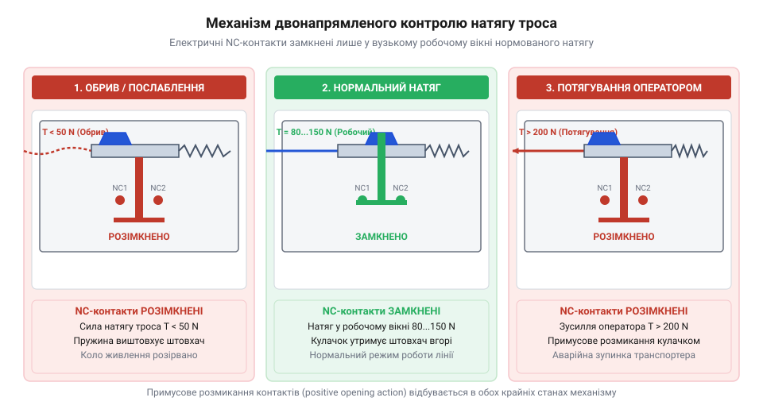

# Тросові вимикачі аварійного зупинення (IEC 60947-5-5)

<preknowlist>
- [Кнопка аварійного стопу грибок та органи безпечного відключення (IEC 60947-5-5)](root:cat-hw-controls/estop-mushroom-button) — Вимоги стандарту IEC 60947-5-5 до органів аварійного вимкнення, примусового розмикання контактів та механічного квитування.
</preknowlist>

## Небезпека протяжних зон промислових транспортерів

Промислові конвеєри та пакувальні лінії простягаються вздовж цеху на десятки метрів. Під час роботи біля рухомих барабанів та транспортерної стрічки оператори постійно перебувають у потенційно небезпечній зоні. Типова швидкість руху стрічки становить кілька метрів за секунду, тому затягування одягу чи кінцівки відбувається за частки секунди. Природна сенсорно-моторна реакція людини триває від 0.5 до 1.5 секунди. За цей час механізм встигає протягнути оператора на кілька метрів углиб небезпечного вузла.

Класична грибкова [кнопка аварійного зупинення](root:cat-hw-controls/estop-mushroom-button) у такій ситуації часто виявляється недосяжною. Якщо єдиний орган захисту розташований на віддаленому щиті керування, потерпілий просто не зможе до нього дотягнутися. Ефективним розв'язком цієї проблеми став тросовий вимикач аварійного зупинення (англ. @@en|cable-pull switch@@, від *cable* — трос та *pull* — тягти). Пристрій монтують на краю небезпечної ділянки, а вздовж усієї траси натягують сталевий трос. Оператор отримує можливість миттєво зупинити технологічну лінію з будь-якої точки транспортера шляхом поздовжнього потягування або бокового відхилення троса.

Під час бокового натискання на трос спрацьовує механізм геометричного клина (від давньоанглійського *wecg* — клин; від англ. @@en|wedge mechanism@@), який перетворює поперечний зсув у потужне поздовжнє натягнення. Завдяки векторному розкладанню сил навіть невелике відхилення натягнутої нитки під гострим кутом створює високий механічний виграш, спрямовуючи зусилля безпосередньо на приводний шток вимикача. Щоб оператор міг миттєво активувати захист у разі небезпеки, стандарти нормують граничне бокове зусилля спрацьовування (від англ. @@en|actuation force@@) на рівні не більше 125 N, що забезпечує надійну зупинку транспортера навіть при зачепленні троса одягом або тулубом персоналу.

## Двонапрямлений контроль натягу та апаратне блокування

Звичайний вимикач, що реагує лише на натягування шнура, створює приховану загрозу при обриві чи провисанні прогону. Для усунення цього ризику в корпусі встановлюють механізм двонапрямленого контролю натягу (англ. @@en|bidirectional tension control@@). Внутрішній V-подібний кулачок утримує розмикальні контакти (англ. @@en|normally closed@@, NC) замкненими лише у вузькому центральному вікні натягу. При примусовому потягуванні троса оператором або при його обриві кулачок зміщується з нейтрального положення й розмикає кола живлення.

*Двонапрямлений механізм контролю натягу утримує контакти замкненими лише у стабільному центральному вікні.*

При потягуванні троса важелі здійснюють примусове розмикання контактів (англ. @@en|positive opening action@@), розриваючи коло незалежно від стану внутрішніх пружин. Вимоги стандарту IEC 60947-5-5 зобов'язують оснащувати вимикач механізмом апаратного блокування (англ. @@en|latching mechanism@@). Загартована собачка заклинює кулачок у спрацьованому стані під кутом самоблокування. Для відновлення готовності лінії персоналу необхідно усунути загрозу та виконати ручне механічне квитування (англ. @@en|reset@@, від *re-* — знову та *set* — ставити) за допомогою важеля чи кнопкової головки.

## Компенсація температурного розширення та двоканальне підключення

Сезонні та добові перепади температури змінюють довжину сталевого троса на кілька сантиметрів. Для запобігання хибним спрацьовуванням на протилежному кінці траси встановлюють компенсаційну пружину з низькою жорсткістю. Початкове регулювання робочого вікна виконують гвинтовим натягувачем (англ. @@en|turnbuckle@@, від *turn* — повертати та *buckle* — пряжка) до суміщення індикатора з міткою на корпусі.

Електричну інтеграцію виконують за дубльованою двоканальною схемою. Обидві пари розмикальних контактів NC підключають до моніторингового реле безпеки або контролера @@en|Safety PLC@@. Модуль безпеки подає в лінії короткі тестові імпульси для виявлення обривів та перехресних замикань між каналами. Така схема забезпечує найвищий рівень надійності аварійного зупинення (англ. @@en|Performance Level@@, PL e).
