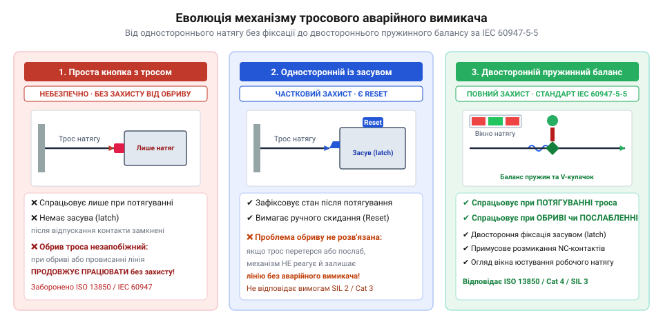
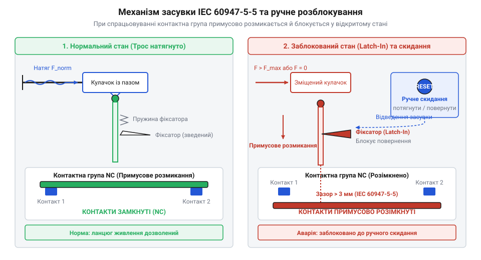

# Історія виникнення тросових вимикачів аварійного зупинення та стандарту IEC 60947-5-5

<preknowlist>
- [Кнопка аварійного стопу грибок та органи безпечного відключення (IEC 60947-5-5)](root:cat-hw-controls/estop-mushroom-button) — загальні принципи побудови ланцюгів аварійного зупинення та концепція розриву електричного кола при небезпеці
- [Тумблери, захисні ковпачки Mollie та блокування важелів (Switch Guards)](root:cat-hw-controls/toggle-switches-and-switch-guards) — базова механіка контактних груп та принцип розмикання електричних контактів
</preknowlist>

## Проблема аварійного зупинення протяжних конвеєрів

У першій половині XX століття з бурхливим розвитком важкої промисловості, гірничої справи та конвеєрних систем постала критична проблема безпеки праці. На протяжних конвеєрних лініях довжиною у сотні метрів оператор або обслуговуючий персонал перебував у постійній небезпеці затягування одягу чи кінцівок у рухомі вали та стрічки. Класична точкова [кнопка аварійного стопу](root:cat-hw-controls/estop-mushroom-button) виявилася нездатною забезпечити швидкий захист: якщо робітник спотикався чи потрапляв під барабан конвеєра на віддалі від пульта керування, він просто фізично не міг досягти кнопкового поста для екстреного відключення живлення.

Першим кустарним інженерним рішенням стало натягування звичайного сталевого дроту або троса вздовж усього конвеєра, який механічно з'єднували з важелем зміщення або [кнопковою контактною групою](root:cat-hw-controls/toggle-switches-and-switch-guards). Імпульсом до масового впровадження таких дротів стали резонансні аварії у вугільних шахтах Рурського басейну та Аппалачів початку XX століття, де затягування гірників у конвеєрні барабани призводило до численних фатальних наслідків через відсутність швидкого доступу до вимикача. Конструктивно перші вузли кріплення збирали у важких чавунних коробках: дріт пропускали крізь напрямні вушки та фіксували гвинтовим затискачем безпосередньо на подовженому важелі промислового тумблера, який утримувався у робочому замиканні противагою чи спіральною пружиною. Задум полягав у тому, що будь-яка людина у будь-якій точці лінії могла потягнути за трос і миттєво розірвати електричне коло. Проте ця первинна схема володіла смертельно небезпечною вадою. У разі випадкового обриву троса, його перетирання або ослаблення зворотна пружина залишала важіль у замкненому стані, і система втрачала механічний зв'язок із вимикачем. При виникненні аварії потягування за обірваний трос не призводило до зупинення конвеєра, створюючи хибне відчуття захищеності у робітників. Окрім того, відсутність механічного фіксатора аварійного стану дозволяла операторам пульта повторно запускати лінію без з'ясування причин зупинки, що неодноразово призводило до повторного травмування персоналу. Ситуацію ускладнювала глибока розбіжність між статичною та динамічною міцністю первинних сталевих канатів у жорстких умовах експлуатації. Якщо початкова статична міцність (@@en|static strength@@; від англ. *static* — статичний, *strength* — міцність) нового триміліметрового вуглецевого дроту витримувала розривне зусилля до `3`–`4` кН, то в агресивному середовищі вугільних шахт із високою вологістю, наявністю кислотних шахтних вод та сірководню відбувалася інтенсивна корозійна деградація (@@en|corrosive degradation@@; від англ. *corrosive* — корозійний, *degradation* — руйнування). За `6`–`12` місяців роботи поверхневі виразки корозії зменшували ефективний переріз металу, знижуючи статичний поріг на `40`–`60%`. Водночас постійні низькочастотні вібрації конвеєрної станини в поєднанні з тертям об неповоротні чавунні обойми вкрай швидко вичерпували динамічную межу втоми (@@en|dynamic fatigue limit@@; від англ. *dynamic* — динамічний, *fatigue* — втома, *limit* — межа). Тертя у заіржавілих чавунних напрямних підвищувало необхідне зусилля спрацьовування з початкових `50` Н до екстремальних `300`–`400` Н: під час аварійного ривка робітник прикладав динамічний ударний імпульс, і ослаблений корозією трос миттєво рвався біля чавунного вводу ще до того, як важіль утискав пружину тумблера.

## Механічний прорив та контроль натягу

У 1960–1970-х роках промислові інженери здійснили принциповий технологічний прорив, створивши спеціалізований двосторонній @@en|cable-pull switch@@ (від англ. *cable-pull* — потягування троса). Ключова ідея полягала в відмові від одностороннього примусового тягання на користь симетричної системи з постійним попереднім натягом троса. У цьому механізмі внутрішня пружина вимикача врівноважувала зовнішній натяг сталевого каната, утримуючи контактну групу в нейтральному робочому стані.


*Еволюційний шлях від кустарного кнопкового дрітотягу до двостороннього механізму з балансуванням пружин.*

Завдяки використанню спеціальних кулачкових та мостових контактних механізмів пристрій здобув здатність реагувати на два абсолютно протилежні фізичні впливи. Конструктивно перші серійні вимикачі спиралися на єдину центральну кулачкову пружину, яка часто викликала нерівномірність зусиль та заклинювання при бічних вібраціях конвеєра; згодом її замінили на схему з подвійними протилежними пружинами балансу, які симетрично компенсували температурне розширення сталевого каната й забезпечували чітке утримання кулачка у робочому вікні. При примусовому потягуванні за трос оператором внутрішній кулачок повертався і розмикав електричні контакти. Якщо ж трос провисав або обривався (стан @@en|slack-cable condition@@), внутрішня врівноважувальна пружина миттєво відтискала кулачок у протилежне крайнє положення, що також викликало примусове відключення живлення. Таким чином, тросовий вимикач вперше отримав функцію активного самоконтролю цілісності лінії аварійного зупинення (@@en|fail-safe mechanism@@), унеможливлюючи роботу небезпечного обладнання при пошкодженому захисному канаті.

Конструктивна різниця між цими підходами полягала в кінематиці утримання нейтральної позиції. У схемах з одинарною пружиною будь-яке температурне подовження сталевого каната прямо змінювало робочий натяг, через що вимикач сприймав сезонні коливання температури як хибний обрив або потягування троса. Перехід до системи з подвійною балансувальною пружиною (англ. @@en|dual-spring balance system@@) створив симетричний механічний диференціал: одна пружина з жорсткістю `k_1` компенсувала статичний натяг каната, а друга пружина з жорсткістю `k_2` утримувала рухомий кулачок у вузькому допусковому вікні нейтралі `±Δx_вікна`. При виникненні технологічних вібрацій транспортера з амплітудою `A` та частотою `ω` інерційна маса штока `m` створює динамічне зусилля `F_вібр = m · A · ω²`. Механічна стійкість кулачка забезпечується тим, що обоє пружин працюють зустрічно, утворюючи підсумковий диференціальний коефіцієнт жорсткості (англ. @@en|differential stiffness@@, від англ. differential — диференціальний, та stiffness — жорсткість):

```
k_диф
= k_1 + k_2              [сумарна диференціальна жорсткість зустрічних пружин]
```

Для запобігання хибним спрацьовуванням при вібраціях коефіцієнт обирають із умови `k_диф > (m · A · ω²) / Δx_вікна`. Якщо взяти симетричні пружини `k_1 = k_2 = k_0`, то сумарна жорсткість подвоюється `k_диф = 2 · k_0`, що ефективно гасить високочастотні коливання штока у межах `±2 мм`, але залишає помірним ручне зусилля спрацьовування. Це дозволило збільшити максимальну довжину одного захисного троса з 15–20 метрів до 75–100 метрів, оскільки повільна температурна деформація матеріалу рівномірно зміщувала точку рівноваги пружин, а спрацьовування відбувалося лише при різкому подоланні порога балансу.

## Стандартизація та критерії стандарту IEC 60947-5-5

Попри появу у 1970-х роках двосторонніх тросових вимикачів з контролем натягу, на промислових підприємствах продовжували ставатися важкі нещасні випадки. Причиною була відсутність механічного блокування у стані аварії: після того, як робітник потягнув трос і зупинив конвеєр, трос під дією пружин міг повернутися у вихідне положення. Якщо в цей момент оператор у центральній операторській не знав про причину зупинки, він повторно подавав напругу на лінії, що призводило до повторного травмування людей.

Сплеск аварійності спонукав Міжнародну електротехнічну комісію (@@en|IEC@@) розробити суворі єдині вимоги безпеки. У 1997 році було видано нормативний документ `IEC 60947-5-5`, який зафіксував два обов'язкові критерії для усіх органів аварійного виключення. По-перше, вимикач повинен мати примусове пряме розмикання контактів (@@en|positive opening mechanism@@), коли механічне зусилля потягування троса безпосередньо розриває зварені чи заклинені контакти без участі додаткових пружин.


*Механізм механічної засувки з ручним скидом у пристроях аварійного відключення.*

По-друге, стандарт запровадив обов'язкову механічну засувку з ручним скидом (@@en|latch-in mechanism@@ з @@en|manual reset@@). Після спрацьовування вимикача від потягування чи обриву троса засувка замикає контактну групу у відкритому стані. Зняття натягу чи повернення троса не відновлює електричне коло. Для повторного запуску обладнання оператор мусить особисто підійти до вимикача, оглянути всю довжину конвеєрної лінії та вручну повернути синю або червону кнопочну засувку. Подібний принцип механічного замикання використовується і в [кнопках аварійного стопу](root:cat-hw-controls/estop-mushroom-button), забезпечуючи повну юридичну та технічну сумісність засобів безпеки.

Важливим етапом уніфікації таких засувок став європейський стандарт EN 418 (попередник міжнародних специфікацій ISO 13850 та IEC 60947-5-5), який уперше жорстко регламентував візуальне оформлення органів аварійного відключення. Німецькі та європейські норматотворці встановили, що в умовах замилювання очей чи паніки під час аварії робітник має миттєво відрізнити орган скиду та зупинки від звичайних технологічних кнопок. Стандарт запровадив обов'язкове контрастне кольорове маркування: яскраво-червоний колір для самого елемента керування (кнопки або поворотної ручки скиду засувки) на жовтому тлі корпусу чи інформаційного поля. Окрім колірної уніфікації, під час підготовки EN 418 у першій половині 1990-х років точилися гострі інженерні дискусії щодо граничних зусиль спрацьовування засувки: надто мале зусилля викликало хибні блокування від вібрації конвеєра та сезонного розширення троса, а надмірне — унеможливлювало швидке потягування травмованим чи ослабленим робітником. У результаті компромісу норматворці уніфікували максимальне допустиме зусилля потягування троса на рівні `125..200 Н` (залежно від довжини траси) та встановили обов'язковий мінімум зусилля для гарантованого переходу засувки у заблокований стан. Згодом ці вимоги нормативу EN 418 були повністю інтегровані до стандарту IEC 60947-5-5, зробивши червоно-жовте поєднання та нормоване зусилля спрацьовування універсальним міжнародним кодом небезпеки для всіх тросових вимикачів.

## Розвінчання міфів про походження вимикачів

Навколо історії винайдення тросових вимикачів існує чимало поширених інженерних міфів. Найбільш розповсюдженою помилкою є твердження про те, що тросовий вимикач був створений у середині XIX століття для пасажирських залізничних потягів. У багатьох популяризаторських виданнях винайдення аварійного троса приписують Джорджу Вестінгаузу або залізничним механікам 1860-х років.

Проте це твердження плутає два абсолютно різних за призначенням пристрої. Залізничний мотузковий шнур (англ. @@en|communication cord@@) був лише механічним засобом подачі акустичного сигналу. Залізничний мотузковий шнур був приводним елементом для аварійного пневматичного клапана Вестінгауза (англ. Westinghouse conductor's valve). @@en|Westinghouse conductor's valve@@). Конструктивно цей клапан являв собою підпружинений бронзовий тарілчастий золотник, ущільнений у корпусі під тиском стисненого повітря гальмівної магістралі (близько `5 бар`). Потягування за шнур через поворотне важельне плече примусово припіднімало тарілку клапана, стрімко випускаючи повітря з магістралі в атмосферу, що змушувало потрійні пневмоклапани вагонів негайно затискати гальмівні колодки. Однак цей механізм був суто пневмомеханічним розвантажувальним пристроєм: він не містив жодних електричних перемикальних елементів, не виявляв обриву чи послаблення самого шнура й не мав механічного латча для електричного блокування лінії.

Справжні промислові тросові вимикачі як електромеханічні прилади захисту з'явилися лише в середині XX століття разом із масовим впровадженням автоматизованих конвеєрних ліній. Їхній розвиток був колективним результатом роботи німецьких та американських інженерів з промислової автоматизації, а не одноосібним патентом одного винахідника. Перші офіційні патенти на герметичні концеві вимикачі з підпружиненим натяжним важелем зареєстрували у 1950-х роках німецька компанія KROHNE (патенти на важільні перемикачі для важких умов гірничозбагачувальних комбінатів) та французьке підприємство Telemecanique (німецьке *KROHNE*, французьке *Telemecanique* — нині у складі @@en|Schneider Electric@@). Інженери Telemecanique створили пиловологозахищений корпус класу IP65 з двопозиційним поворотним важелем, який утримувався в нейтралі зовнішньою пружиною троса, що поклало початок серійному випуску промислових датчиків обриву та натягу каната. Сучасні [силові панелі комутації](root:cat-hw-controls/rocker-switches-and-power-toggle-panels) та органи безпеки формувалися поступово під впливом цих перших конструктивних стандартів та нормативних вимог безпеки праці.
