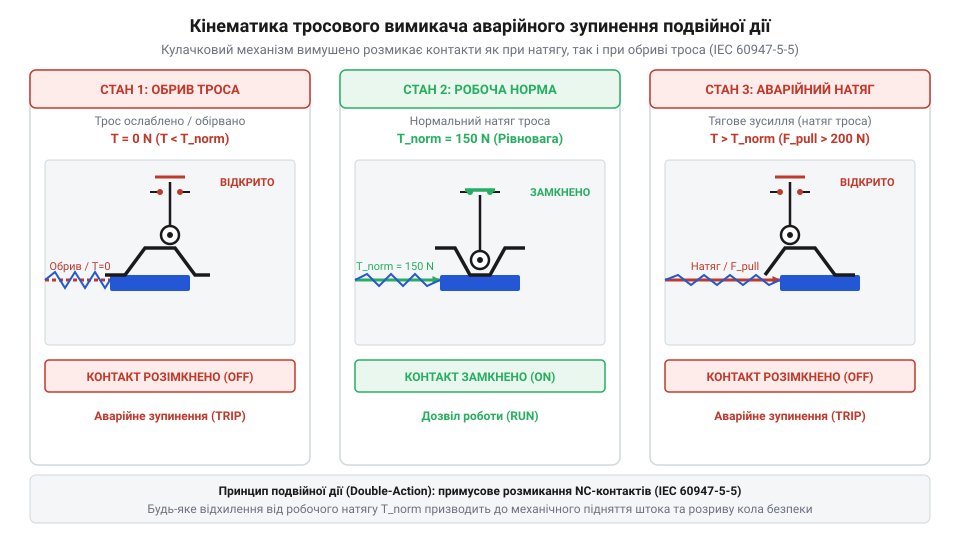
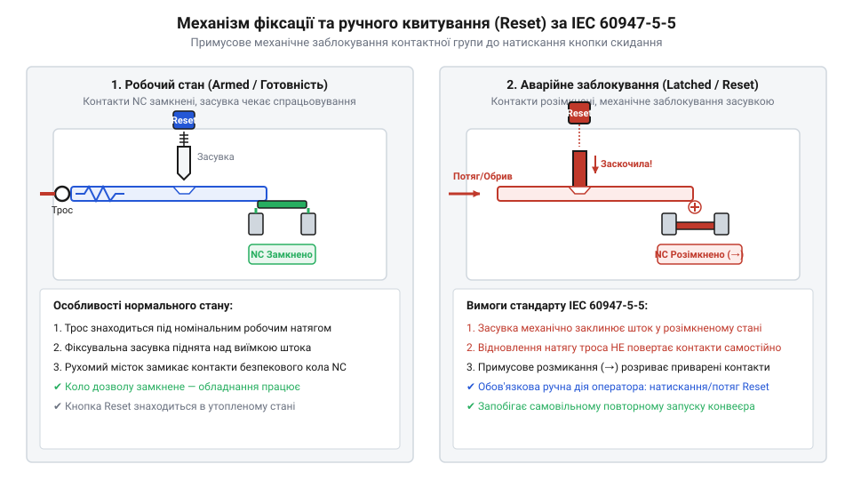

# Еволюція тросових вимикачів та виникнення стандарту IEC 60947-5-5

<preknowlist>
- [Кнопка аварійного стопу грибок та органи безпечного відключення (IEC 60947-5-5)](root:cat-hw-controls/estop-mushroom-button) — принципи прямого розмикання контактів (Direct Opening Action) та принципи засувного фіксування стану стоп
- [Трипозиційні кнопки дозволу та педалі «мертвої руки»](root:cat-hw-controls/enabling-switches-and-dead-man-pedals) — принцип побудови систем захисту оператора від людського фактора та панічних реакцій
- [Тумблери, захисні ковпачки Mollie та блокування важелів (Switch Guards)](root:cat-hw-controls/toggle-switches-and-switch-guards) — механічні способи фіксації та запобігання випадковому поверненню перемикачів у робочий стан
</preknowlist>

## Небезпека протяжних конвеєрів та перші тяги

Стрімкий розвиток гірничої промисловості, елеваторів та важкого машинобудування на початку XX століття призвів до масового впровадження протяжних конвеєрних ліній. Транспортерні стрічки завдовжки у сотні метрів рухалися з високою швидкістю та безперервно переміщували тонни матеріалу. Коли оператор потрапляв у зачеплення з рухомими роликами чи стрічкою, він не міг дотягнутися до стаціонарного пульта керування. Звичайна [кнопка аварійного стопу](root:cat-hw-controls/estop-mushroom-button), змонтована на системному щиті, виявлялася абсолютно марною на відстані десятків метрів від місця травмування.

Для вирішення цієї проблеми інженери почали натягувати сталевий дріт вздовж усього конвеєрного прольоту та кріпити його до важеля вимикача (від англ. cable pull switch; далі — @@en|cable pull switch@@). Таке рішення дозволяло робітникові смикнути за трос у будь-якій точці траси й миттєво знеструмити привідний електродвигун. Перші тросові пристрої будувалися на основі простих односторонніх поворотних важелів у вигляді відкритих чавунних куліс на сталевих штифтах із ножовою контактною групою, де оператор власноруч прикладав зусилля для подолання тертя й розмикання кола. Для тяги застосовували низьковуглецевий нецинкований сталевий дріт або м'який кований канат, який швидко вкривався корозією та піддавався пластичному витягуванню. Фіксація дроту на оконечнику важеля здійснювалася примітивними гвинтовими затискачами або скрутками, які під дією постійних вібрацій та натягу слабшали, спричиняли ковзання лінії й перетирали дріт у точці кріплення.

Однак перші односторонні тягові механізми мали критичні конструктивні вади. Вони спрацьовували виключно при примусовому натягуванні дроту рукою людини. Якщо сталевий трос обривався через корозію, перетиральну ерозію чи механічне перенапруження, важіль залишався у замкненому робочому положенні. Аналогічна відмова виникала при лінійному розширенні металу під дією літнього спекотного сонця: трос провисав, утворював вільну слабину й унеможливлював розмикання кола при тязі.

Додаткове джерело небезпеки полягало в швидкій деградації відкритого шарніра повертального важеля. У важких умовах вугільних шахт та зернових елеваторів на оголені металеві осі постійно потрапляла волога, що викликало інтенсивне іржавіння деталей. Виробничий абразивний пил осідав на змащених поверхнях, змішувався з оксидами та перетворювався на цупку кірку. Сила тертя у забитому шарнірі зростала настільки, що при тязі за трос важіль заклинював у проміжному положенні й не міг подолати механічний опір. Неповноту ходу контактів супроводжувало іскріння, спікання металевих поверхонь та остаточне блокування вимикача у замкненому аварійному стані.

Конструкція корпусів перших пристроїв лише поглиблювала цю проблему. Вимикачі монтували у масивних чавунних коробках (від нім. *Guss* — лиття та *Eisen* — залізо; англ. @@en|cast-iron enclosure@@), розрахованих на важкі ударні навантаження промислового середовища, однак герметичного ущільнення внутрішньої камери не передбачалося. Сталевий трос заходив усередину через простий наскрізний отвір у стінці без сальникових ущільнювачів (англ. @@en|stuffing box@@) чи еластомерних манжет. Через цей відкритий зазор усередину вільно потрапляли дощова вода, шахтний пил та агресивні хімічні випари. Накопичений шлам викликав прискорену корозію внутрішніх поверхонь і пружин, а в неопалювальних галереях конвеєрів узимку замерзла вода перетворювала механізм на непорушну крижану брилу.

## Еволюція підпружиненої двосторонньої механіки натягу

Масовий травматизм через непомічені обриви тяг змусив розробників докорінно змінити кінематику вимикачів. У середині XX століття з'явився механізм подвійної дії (від англ. double-acting mechanism; далі — @@en|double-acting mechanism@@), здатний реагувати на два протилежні механічні стани. У робочому режимі трос утримується під попереднім постійним натягом за допомогою протидіючої пружини компенсатора. Внутрішній шток вимикача перебуває у вузькому центральному вікні рівноваги, де електричні контакти замкнені.

Кінематика подвійного спрацьовування спирається на симетричний кулачковий або віконний шток, який спирається на дві зустрічні пружини та має профіль із симетричними V-подібними робочими фасками під кутом нахилу `30°`–`45°`. У нейтральному стані підпружинений ролик розмикача утримується в центральній заглибині штока, забезпечуючи замкнене положення контактів. Натягування троса оператором примусово зміщує шток в один бік, змушуючи ролик підніматися по похилій фасці та механічно штовхати розмикач. Обрив чи послаблення троса (від англ. @@en|cable slack@@) позбавляє шток зовнішнього утримання, після чого внутрішня повертальна пружина зсуває його в протилежний бік, де протилежна симетрична фаска аналогічно виштовхує ролик і розмикає ланцюг.

*Кінематика механізму подвійної дії забезпечує миттєвий розрив кола як при примусовому натягуванні троса оператором, так і при його розриві чи температурному послабленні.*

Завдяки центральному вікну рівноваги система набула стійкості до температурного розширення металевого троса. При лінійному коефіцієнті розширення сталі `α = 12 × 10⁻⁶ K⁻¹` подовження каната `ΔL` на прольоті довжиною `L` при добовому перепаді температур `ΔT` визначається тепловим розрахунком:

    ΔL = α × L × ΔT
       = 12 × 10⁻⁶ × 50 × 30     [підстановка значень для 50 м сталевого троса при перепаді 30 °C]
       = 0.018 м = 18 мм          [обчислення підсумкового подовження]

Отримане розширення у `18 мм` показує, що без компенсації шток неминуче вийшов би з робочого стану. Для нейтралізації цього розширення жорсткість компенсаційної пружини `k` добирається так, щоб зміна зусилля натягу `ΔF = k × ΔL` утримувала шток у межах симетричного нейтрального зазору шириною `±10 мм`. Завдяки цьому добові коливання температури не викликають помилкового вимкнення конвеєра, але будь-яка катастрофічна зміна натягу — ручна аварійна тяга або повний обрив троса — миттєво виводить шток за межі нейтрального вікна й розриває живлення.

## Стандартизація IEC 60947-5-5 та засувка Reset

Попри появу підпружинених механізмів, наприкінці XX століття частішали виробничі аварії через самовільне відновлення роботи конвеєрів після усунення перешкоди. Оператор усував заклинювання стрічки або відпускав натягнутий трос, після чого пружина вимикача самостійно повертала контакти у замкнений стан. Звичайні контурні реле одразу запускали двигуни, що призводило до травмування ремонтних бригад. Це зумовило прийняття міжнародного стандарту IEC 60947-5-5, який встановив суворі вимоги до пристроїв аварійного зупинення з тросним приводом.

Стандарт IEC 60947-5-5 сформулював дві фундаментальні безпекові вимоги: пряме примусове розмикання (від англ. direct opening action; далі — @@en|direct opening action@@) та механічне засувне блокування (від англ. @@en|latching mechanism@@). Кінематична відмінність полягає у відмові від розмикання контактів за допомогою гнучкої повертальної пружини. У звичайних вимикачах пружина розтягує контакти самостійно, але її зусилля недостатньо при зварюванні чи приплавленні металевих поверхонь електричною дугою. Натомість пряме розмикання спирається на жорсткий кінематичний зв'язок між зовнішнім штоком і контактним містком. Рух троса примусово просуває загартований геометричний кулачок, який діє як непохитний клин і фізично зриває пригорілі контакти незалежно від стану пружин. Після спрацьовування механічна засувка негайно замикає шток у розімкненому положенні та вимагає свідомого натискання синьої кнопки скидання (від англ. reset button; далі — @@en|reset button@@) безпосередньо на корпусі пристрою.

*Механічна засувка блокує контактну групу у розімкненому стані одразу після спрацьовування, унеможливлюючи повторний пуск конвеєра без ручного розблокування кнопкою Reset.*

Нормативні вимоги стандарту урівняли тросовий вимикач аварійного вимкнення з принципами, за якими будується [кнопка аварійного стопу](root:cat-hw-controls/estop-mushroom-button). Головний принцип безпеки полягає у тому, що жодне усунення натягу троса не повинно відновлювати подачу живлення. Лише візуальний огляд усієї лінії оператором та ручне розблокування механічної засувки на самому вимикачі дозволяє подати сигнал готовності до повторного пуску.

Конструктивно механізм @@en|reset button@@ виконується у вигляді натискного або поворотного штовхача з яскравим синім колірним маркуванням, яке за міжнародними стандартами позначає дію ручного відновлення готовності системи. Для запобігання несанкціонованому скиданню блокування до завершення огляду транспортера корпус кнопкового вузла оснащують вушком для опломбування або встановлення блокувального замка. Це дає змогу зафіксувати орган керування в спрацьованому стані пломбою чи індивідуальним замком оператора безпеки, унеможливлюючи випадковий натиск сторонніми особами під час ремонтних робіт на протяжній лінії.

## Розвінчання міфу про заміну кінцевими перемикачами

У промисловій практиці десятиліттями існував небезпечний інженерний міф про взаємозамінність спеціалізованих тросових вимикачів та звичайних кінцевих перемикачів (від англ. limit switch, з лат. limes — межа; далі — @@en|limit switch@@). На багатьох підприємствах задля економії на важелі звичайних концевиків підв'язували сталеві троси, припускаючи, що притягування важеля забезпечить аналогічний аварійний стоп. Таке кустарне спрощення ігнорує принципові відмінності внутрішньої кінематики та призводить до катастрофічних наслідків.

Звичайний кінцевий перемикач розрахований виключно на позиційне виявлення об'єктів і містить самоповертальну пружину без механізму фіксації Reset. Якщо трос, прив'язаний до концевика, обривається, внутрішня пружина негайно повертає плунжер у вихідне положення та хибно сигналізує системі про безпечний стан. Крім того, звичайні концевики не мають симетричного вікна рівняння, тому провисання троса не викликає їхнього спрацьовування, а поломка внутрішньої пружини призводить до неконтрольованої відмови розмикання.

Принципова різниця полягає у механіці кінематичного зв'язку між зовнішнім штоком та внутрішнім контактним містком. У звичайному кінцевому перемикачі розмикання відбувається опосередковано через стиснення однієї повертальної пружини, яка відсуває рухому пластину. Якщо ця пружина лопається чи втрачає пружність від втоми металу, контактний місток залишається замкненим. Зовнішній важіль концевика продовжує вільно рухатися, створюючи ілюзію спрацьовування, тоді як аварійне коло продовжує подавати живлення. Натомість у спеціалізованому тросовому вимикачі використовується дубльована пружинна система та жорсткий внутрішній штовхач, який примусово зміщує місток навіть при повній руйнації повертальних елементів.

Спеціалізований аварійний тросовий вимикач має суттєво складнішу конструкцію, де кожна внутрішня пружина дублюється, а розмикач з'єднаний із кронштейном жорстким кінематичним зв'язком. Висока механічна зносостійкість цих дубльованих контактних груп підтверджується жорсткими циклічними випробуваннями на розрив і натяг, де механізм витримує щонайменше `10⁴`–`10⁵` аварійних спрацьовувань без деформації фасок чи втрати тиску на зріз дуги. Використання стандартного концевика замість аварійного тросового пристрою є прямим порушенням вимог стандарту IEC 60947-5-5. Ліквідація цього міфу стала ключовим кроком до створення сучасних надійних систем захисту протяжних технологічних об'єктів.
