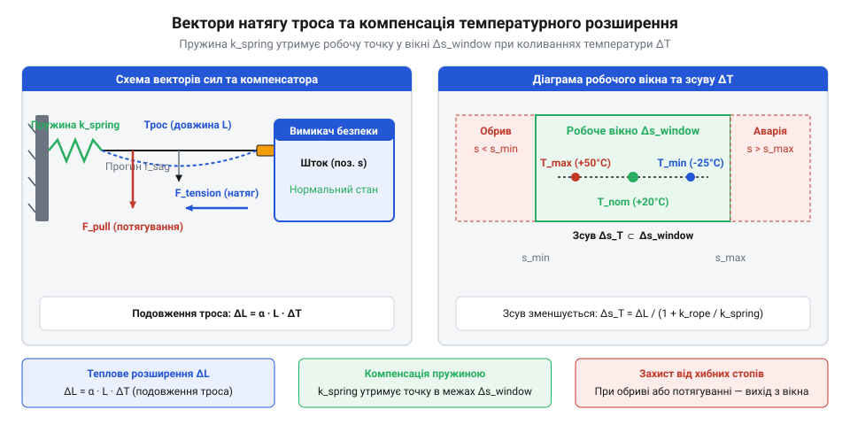

# Механіка натягу троса, температурна компенсація та розрахунок довжини прогону

<preknowlist>
- [Кнопка аварійного стопу грибок та органи безпечного відключення (IEC 60947-5-5)](root:cat-hw-controls/estop-mushroom-button) — концепція вимикачів безпеки з примусовим розмиканням контактів та вимоги до кіл аварійного зупинення.
</preknowlist>

## Проблема температурного розширення та прогину

У тросових системах аварійного зупинення (@@en|safety rope switch@@) трос слугує не просто механічним поводом, а первинним чутливим елементом кола безпеки. Промисловий трос довжиною десятки метрів натягується між анкерним кріпленням і важелем вимикача так, щоб внутрішній механізм опинився в середині вузького нормованого робочого вікна натягу. Якщо трос потягнути або якщо він обірветься чи послабне, містковий контакт примусово розмикає коло аварійного стопу.

Головна механічна проблема протяжного троса полягає у його чутливості до змін довкілля та власної маси. Натягнутий металевий дріт підпорядковується законам термодинаміки та класичної механіки. При підвищенні температури цеху чи літньому нагріванні довжина троса збільшується, викликаючи послаблення натягу та прогинання під власною вагою. При охолодженні трос скорочується, створюючи додаткове зусилля, яке може висмикнути важіль вимикача без будь-якої участі оператора. Небезпека полягає у критичній кількісній неспівмірності між геометричним подовженням троса та внутрішнім ходом комутаційного механізму. Нормований механічний хід важка вимикача від серединного стану до точки аварійного розмикання контактів становить усього `±2`–`5 мм`. Натомість для 50-метрової сталевої лінії добове температурне коливання в `50 K` викликає розширення троса на `40 мм`, що майже вдесятеро перевищує весь допустимий інтервал руху важеля. За такої пропорції (від латинського proportio — співвідношення) навіть незначний температурний зсув на `3`–`5 K` виводить важіль за межі робочого вікна. Без математичного розрахунку цих чинників лінія безпеки постійно даватиме хибні аварійні зупинки або втрачатиме чутливість до потягування, роблячи захисне відключення недієздатним.

## Температурне подовження та розрахунок пружин

Зміна довжини сталевого троса `ΔL` під дією температурного перепаду `ΔT` описується базовим рівнянням теплового розширення твердих тіл:

ΔL = α · L₀ · ΔT

де `α` — коефіцієнт лінійного теплового розширення (для нержавіючої сталі `α ≈ 16 · 10⁻⁶ K⁻¹`), `L₀` — початкова довжина троса в метрах, а `ΔT` — діапазон температурних коливань у кельвінах або градусах Цельсія (наприклад, `ΔT = 50 K` для діапазону від -10 °C до +40 °C).

Для тросової лінії довжиною `L₀ = 50 м` температурне подовження становить:

ΔL = (16 · 10⁻⁶ K⁻¹) · 50 м · 50 K = 0.04 м = 40 мм

Робочий хід важка вимикача всередині нормованого вікна натягу зазвичай не перевищує `±5 мм`. Подовження у `40 мм` без компенсації негайно змістить важіль за межі робочого вікна та призведе до спрацьовування аварійного розмикання.

Для нейтралізації цього ефекту в лінію послідовно врізають компенсаційну пружину з коефіцієнтом жорсткості `k`. Вона сприймає температурні деформації троса, зберігаючи зусилля натягу `F` у межах робочого вікна `F_min ≤ F ≤ F_max`.

Зміна зусилля натягу `ΔF` при зміні довжини троса на `ΔL` дорівнює:

ΔF = k · ΔL = k · α · L₀ · ΔT

Щоб зміна зусилля `ΔF` не перевищила половини ширини робочого вікна натягу `ΔF_valid`, жорсткість пружини `k` повинна задовольняти умову:

k ≤ ΔF_valid ÷ (α · L₀ · ΔT)

Приклад розрахунку: якщо допустиме відхилення натягу `ΔF_valid = 50 Н`, то для троса `50 м` і `ΔT = 50 K` максимальна жорсткість пружини становить `k ≤ 50 Н ÷ 0.04 м = 1250 Н/м`.

Окрім розрахунку жорсткості `k`, надійність лінії вимагає точного визначення початкового зусилля монтажного підтиску пружини `F₀` під час налаштування системи за середньої температури монтажу `T_inst`. Щоб сезонні коливання середовища в обидва боки відхиляли важіль симетрично, монтажне зусилля `F₀` встановлюють рівно посередині між мінімально припустимим `F_min` та максимально допустимим `F_max` зусиллями спрацьовування:

F₀ = (F_min + F_max) ÷ 2      [симетричне центрування робочої точки]

Отримане значення `F₀` визначає початкову деформацію пружини при монтажі `Δx₀ = F₀ ÷ k`. У разі літнього потепління до `T_max` трос розширюється на `ΔL_hot = α · L₀ · (T_max - T_inst)`, зменшуючи натяг до `F_min = F₀ - k · ΔL_hot`. При зимовому охолодженні до `T_min` трос скорочується на `ΔL_cold = α · L₀ · (T_inst - T_min)`, підвищуючи натяг до `F_max = F₀ + k · ΔL_cold`. Таке симетричне (від грецького symmetria — співрозмірність) налаштування монтажної точки забезпечує однакові механічні запаси натягу для обох температурних екстремумів.

*Діаграма векторів натягу троса та принципове утримання робочої точки в інтервалі безпечного натягу за допомогою компенсаційної пружини при температурних коливаннях.*

## Сили натягу, прогин та спрацьовування

Провис натягнутого троса під дією власної маси описується рівнянням ланцюгової лінії (@@en|catenary curve@@). На практиці для малих відношень прогину `s` до прогону `L` застосовують параболічне наближення. Максимальний прогин `s` у центрі прогону між підвісами при початковому натягу `F₀` та лінійній масі троса `q` (кг/м) обчислюється як:

s = (q · g · L²) ÷ (8 · F₀)

де `g ≈ 9.81 м/с²` — прискорення вільного падіння. Механічна проблема прогину полягає в тому, що викривлений під власною вагою трос має дугову довжину, яка перевищує відстань між підвісами. За параболічним наближенням геометричний надлишок довжини дуги провису `ΔL_sag` обчислюється через максимальний прогин `s` та довжину прогону `L`:

ΔL_sag = (8 · s²) ÷ (3 · L)      [геометричний надлишок довжини дуги прогину]

Під час аварійного потягування цей надлишок створює додатковий холостий хід вибирання провису, оскільки прикладене зусилля спочатку витрачається на геометричне випрямлення дуги в лінію, і лише після досягнення прямолінійної форми трос починає зміщувати важіль вимикача на необхідну відстань `Δx_trip`. Великий прогин зменшує реакцію системи на потягування й створює провис троса, який може зачепитися за рухомі частини конвеєра.

Коли оператор прикладає перпендикулярне зусилля `F_pull` у довільній точці прогону для виклику аварійної зупинки, трос відхиляється на кут `θ`. Зусилля натягу в тросі `F_total` зростає за вектором геометричного додавання сил:

F_total = F₀ + F_pull ÷ (2 · sin θ)

Оскільки кут відхилення `θ` на початку потягування малий, сила натягу на важелі вимикача різко зростає навіть при помірному перпендикулярному зусиллі `F_pull`.

Крім пружного опору троса та пружини, на передачу зусилля впливає тертя в проміжних направляючих люнетах чи кільцях. Якщо трос проходить через `n` проміжних направляючих із коефіцієнтом тертя `μ` та кутом перегину `ϕ` на кожному підвісі, передане зусилля зменшується згідно з формулою Ейлера для тертя гнучкої нитки:

F_transmitted = F_pull · e⁻⁽ⁿ ⁾⁻ᵐᵘ ⁻ᵖʰⁱ⁾

Сумарне зусилля, яке має прикласти оператор для спрацьовування аварійного вимикача з урахуванням усіх опорів, обчислюється як:

F_operator = (F_trip - F₀) · eⁿ ᵐᵘ ᵖʰⁱ + k · Δx_trip

де `F_trip` — зусилля спрацьовування внутрішнього механізму вимикача, а `Δx_trip` — необхідне механічне переміщення важка для спрацьовування. Отримане зусилля `F_operator` згідно з нормативами не повинно перевищувати `200 Н`, щоб оператор міг легко зупинити лінію однією рукою. Для забезпечення [примусового розмикання контактів](root:cat-hw-controls/estop-mushroom-button) механічний повод повинен передавати це зусилля без люфтів.

## Максимальна довжина прогону та топологія

Гранична довжина тросового прогону `L_max` обмежується двома протилежними чинниками: необхідністю утримати лінійне температурне розширення у вузькому робочому вікні та обмеженням максимального зусилля висмикування троса оператором.

Для односторонньої схеми, де один кінець троса закріплений на жорсткій анкерній опорі, а інший підключений до важеля вимикача з компенсаційною пружиною, накопичена пружна деформація `ΔL_elastic` під дією сили потягування дорівнює:

ΔL_elastic = (F_pull · L) ÷ (E · A)

де `E` — модуль пружності сталі (`E ≈ 200 · 10⁹ Па`), а `A` — площа поперечного перерізу сталевого каната. При надто великій довжині `L` трос поводиться як розтяжна ґума: зусилля оператора витрачається на пружне подовження троса, і важіль вимикача не зміщується на необхідну відстань `Δx_trip`. З урахуванням тертя у направляючих та пружності сталі максимальна довжина односторонньої лінії обмежується значенням `L_max ≤ 75 м`.

У двосторонній топології трос натягується між двома вимикачами аварійного зупинення, розташованими на протилежних кінцях конвеєра, або використовується один двосторонній вимикач у центрі лінії з двома пружинними компенсаторами на кінцях. У такій схемі потягування троса в будь-якій точці викликає зустрічний рух важелів і зменшує ефективну довжину пружного ділянки вдвічі:

L_eff = L ÷ 2

Завдяки симетричному розподілу натягу та зменшенню еквівалентної довжини пружного подовження, двостороння схема дозволяє збільшити загальну довжину захищеної зони аварійного зупинення до `L_max ≤ 200 м`.

Вибір між топологіями проводиться на основі розрахунку довжини лінії. Для протяжних конвеєрів довжиною понад 75 м двостороння топологія є єдино можливим математично обґрунтованим рішенням, яке гарантує дотримання норм безпеки при збереженні стабільності робочого вікна натягу. При цьому для виключення людського фактора і забезпечення надійного вимкнення застосовують [трипозиційні пристрої дозволу](root:cat-hw-controls/enabling-switches-and-dead-man-pedals) та автоматичні контролери безпеки.
