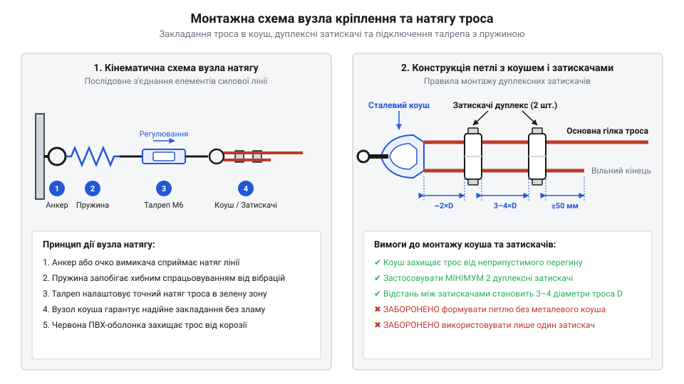
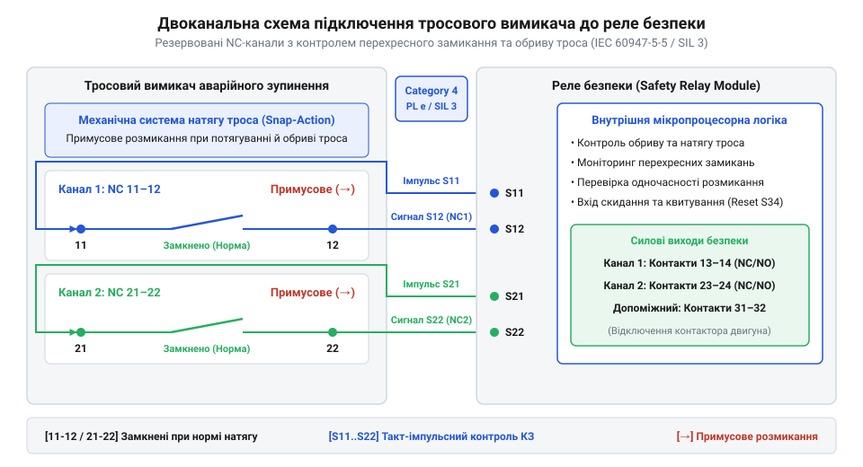

# Практичний монтаж, калібрування та тестові випробування тросової системи безпеки

<preknowlist>
- [Кнопка аварійного стопу грибок та органи безпечного відключення (IEC 60947-5-5)](root:cat-hw-controls/estop-mushroom-button) — Концепція примусового розмикання контактів та резервованих кіл зупинення
</preknowlist>

## Монтаж анкерів та проміжних направляючих

Монтаж тросових систем аварійного зупинення на промислових стрічкових транспортерах розпочинають із розгортання механічної опорної інфраструктури. На відміну від локальних кнопок вимкнення, що захищають лише окремі пультові зони, тросовий вимикач забезпечує постійну готовність до аварійної зупинки вздовж усієї довжини конвеєрної лінії. Щоб механічний імпульс потягування миттєво передавався на внутрішню контактну групу пристрою без втрат енергії на деформацію металоконструкцій, на крайніх точках траси встановлюють жорсткі анкери (від нім. *Anker* — якір; англ. @@en|anchor bracket@@). Кінцеві анкери розраховують на витримання постійного статичного натягу троса та динамічних ривків зусиллям понад `500–1000 Н` без вигину чи люфту. Їх надійно фіксують за допомогою болтових з'єднань із контргайками безпосередньо до опорних швелерів або несучих балок транспортера.

Уздовж усієї траси між крайніми анкерами трос підтримують проміжні направляючі кільця (від нім. *Öse* — вушко, петля; англ. @@en|eyebolt guide@@). Головним завданням направляючих є запобігання провисанню троса (англ. @@en|rope sag@@) під власною вагою та утримання стабільної кінематичної траєкторії. Згідно з вимогами стандарту IEC 60947-5-5, максимальний крок розстановки проміжних підвісів обирають у діапазоні `2.5–3.0 м`. Перевищення цієї відстані призводить до збільшення провисання, через що оператору доводиться прикладати значно більше зусилля для спрацьвування вимикача під час потягування убік. Направляючі кільця закріплюють строго на одній осьовій лінії з поворотним важелем вимикача, мінімізуючи тертя металевих жил об краї підвісів. Подібно до того, як [кнопками аварійного стопу](root:cat-hw-controls/estop-mushroom-button) обладнують пости керування, правильно змонтована тросова лінія створює суцільне захисне поле уздовж всього конвеєра.

При зміні напрямку траси трос спрямовують через підвісні ролики-направляючі (від англ. *deflection pulley*; далі — @@en|deflection pulley@@). Кожен кутовий поворот збільшує тертя металевих жил і зменшує граничну допустиму довжину лінії. Для розрахунку підсумкової довжини траси `L_max` від номінальної довжини `L_0` віднімають втрату `ΔL_loss` за кожен поворот. Граничну довжину з урахуванням кількості поворотів `N_bend` обчислюють за формулою:

Вибір матеріалу та вирівнювання механічної міцності крайніх анкерних кронштейнів прямо залежить від протяжності траси та умов експлуатації конвеєра. Для компактних ліній завдовжки до `30–50 м` у критих сухих цехах застосовують кутові кронштейни з конструкційної вуглецевої сталі (англ. @@en|structural steel@@) завтовшки `5–6 мм` із гальванічним цинкуванням. Проте на протяжних трасах завдовжки `50–100 м`, де статичний натяг і динамічні ривки при аварійному зупиненні створюють сумарне пікове зусилля понад `2–3 кН`, вигин кронштейна навіть на `1–2 мм` викликає хибне розмикання контактів. Для таких об'єктів та хімічно агресивних чи вуличних середовищ використовують підсилені зварні конструкції з нержавіючої сталі (англ. @@en|stainless steel@@) завтовшки `8–10 мм` із підсилювальними ребрами жорсткості (англ. @@en|gusset plate@@), які фіксують на станині транспортера за допомогою болтів M12 або M16 класу міцності 8.8.

L_max = L_0 - N_bend · ΔL_loss      [рівняння з урахуванням втрат на тертя]

**Розрахунок довжини траси при двох поворотах на 90°:**

L_max = 100 - 2 · 15                [підстановка L_0 = 100 м, N_bend = 2 та ΔL_loss = 15 м]
= 100 - 30                          [обчислення сумарної втрати довжини від тертя]
= 70 м                              [підсумкова максимальна довжина траси]

Отже, встановлення двох ролик-направляючих зменшує граничну довжину тросової лінії зі `100` до `70` метрів. Перевищення цього значення спричиняє заклинювання троса в роликах та викликає хибні спрацьовування пристрою. Таке геометричне обмеження доповнює загальні правила монтажу [кнопок аварійного стопу](root:cat-hw-controls/estop-mushroom-button), гарантуючи швидку передачу зусилля на внутрішній механізм.

## Затискання троса та регулювання талрепом

Після завершення монтажу опорних кронштейнів і направляючих кілець переходять до формування кінцевих петель троса та налаштування його механічного натягу. Для запобігання зламу й стиранню сталевих жил у місцях кріплення трос закладають у спеціальний жолобчастий осередковий коуш (від нід. *kous* — панчоха; англ. @@en|cable thimble@@). Коуш зберігає розрахунковий радіус вигину петлі й рівномірно розподіляє механічне навантаження по всьому периметру контакту. Для надійної фіксації вільного кінця троса застосовують дуплексні затискачі (від лат. *duplex* — подвійний; англ. @@en|duplex clamp@@), які складаються з притискної пластини та двох нарізних шпильок. Послідовно встановлюють щонайменше два затискачі на відстані `2–3` діаметрів троса один від одного, рівномірно затягуючи гайки з нормованим моментом для надійної фіксації без роздавлювання внутрішнього осердя.

*Монтажна схема закладання троса в коуш із дуплексними затискачами та підключення талрепа з компенсаційною пружиною.*

Точне налаштування робочої точки вимикача здійснюють за допомогою гвинтового талрепа (від нід. *taalreep* — натяжний трос; англ. @@en|turnbuckle@@) з протилежною муфтовою нарізкою та компенсаційної пружини (англ. @@en|compensation spring@@). Компенсаційна пружина, увімкнена послідовно в тросову лінію, демпфує температурне видовження металу та запобігає хибним спрацьвуванням при зміні температури довкілля на величину ΔT. Необхідний коефіцієнт жорсткості пружини k розраховують на основі максимально припустимого розширення троса завдовжки L: зміна довжини ΔL = α · L · ΔT (де α ≈ 12 × 10⁻⁶ K⁻¹ — температурний коефіцієнт лінійного розширення сталі) не повинна виводити натяг за межі робочого діапазону вимикача від мінімального утримувального зусилля F_min до порогу аварійного спрацьовування F_trip, що задає обмеження жорсткості k ≤ (F_trip - F_min) / (α · L · ΔT). Силу попереднього натягу F_pre, яку виставляють талрепом за номінальної температури, обирають по центру допустимого інтервалу як F_pre = F_min + (k · α · L · ΔT) / 2. Обертанням корпусу талрепа змінюють довжину нарізних штоків, плавно збільшуючи натяг троса до значення F_pre, доки механічний індикаторний покажчик (англ. @@en|tension indicator window@@) на корпусі вимикача не встане чітко по центру зеленого робочого вікна. Точність позиціонування покажчика істотно залежить від коефіцієнта тертя у нарізних з'єднаннях муфти (від англ. @@en|thread friction@@): при сухій або окисленій нарізці з високим тертям притискний момент викликає нелінійне пружне скручування троса замість плавної осьової зсувки. Після припинення обертання накопичена торсіонна напруга викликає ефект переривчастого ковзання (від англ. @@en|stick-slip@@), через який трос мимовільно розкручується і зміщує покажчик із центром зеленого вікна. Нанесення пластичного графітового мастила на штоки талрепа знижує коефіцієнт тертя і забезпечує плавну субміліметрову регуляцію без пружних стрибків. Збіг мітки свідчить про те, що внутрішній двосторонній кулачок перебуває в середньому стані, а обидва NC-контакти безпеки замкнені й готові до роботи.

## Двоканальне електричне підключення NC контактів

Після завершення механічного налагодження тросової лінії переходять до електричного підключення контактної групи вимикача. Корпус пристрою герметизують за допомогою компресійного кабельного введення (від нім. *Verschraubung* — різьбове з'єднання; англ. @@en|cable gland@@), що забезпечує клас захисту IP67 та запобігає проникненню вологи й пилу до внутрішніх клем. Застосування одноканального підключення у промислових системах захисту є неприпустимим: у разі приварювання контакту або короткого замикання жилу на джерело живлення лінія втрачає здатність до аварійної зупинки.

Згідно з вимогами стандарту ISO 13849-1, комутацію виконують за двоканальною схемою (англ. @@en|dual-channel wiring@@) із використанням двох незалежних нормально замкнених контактів (NC1 та NC2) з механізмом примусового розмикання. Провідники обох каналів підключають до відповідних входів реле безпеки або спеціалізованого контролера. Реле безпеки подає на контакти тестові імпульси для виявлення перехресних замикань (англ. @@en|cross-circuit fault@@) між жилами кабелю. При потягуванні або обриві троса кулачок вимикача одночасно розмикає обидва канали, розриваючи шлейф живлення силових контакторів приводу.

*Принципова схема двоканального електричного підключення NC-контактів вимикача до реле безпеки з моніторингом обриву.*

Для обробки сигналів тросового вимикача у мікроконтролерних системах реалізують програмний драйвер із контролем часової розсинхронізації каналів (англ. @@en|discrepancy time@@). Оскільки сухі механічні контакти під час комутації та вібрацій конвеєрної станини схильні до мікроскопічного брязкоту (англ. @@en|contact bounce@@), драйвер першочергово пропускає сирі сигнали через цифровий фільтр з інтервалом затримки t_debounce (наприклад, 10–20 мс). Лише після стабілізації логічних рівнів обох ліній обробник починає відлік часу розсинхронізації: якщо один із контактів розмикається раніше за інший на час, що перевищує допустимий поріг 	_discrepancy (наприклад, 50 мс), драйвер фіксує апаратну відмову лінії й блокує запуск обладнання:

Для підвищення завадостійкості та безперервного аналогового моніторингу лінії (від англ. @@en|line monitoring@@) на наявність обриву та короткого замикання (від англ. @@en|short circuit@@) схемотехніку підключення доповнюють зовнішньою резистивною матрицею окінцювання. Безпосередньо на клемах вимикача паралельно нормально замкненим контактам встановлюють шунтувальний резистор `R_parallel` (наприклад, `10 кОм`), а послідовно в сигнальну жилу впаюють обмежувальний резистор `R_series` (наприклад, `1 кОм`), що утворює оконечний модуль (від англ. @@en|end-of-line resistor@@, EOL). У замкненому стані NC-контакту струм протікає в обхід шунта лише через `R_series`, формуючи на аналоговому вході контролера або АЦП потенціал нормального стану `V_norm`. При потягуванні чи обриві троса NC-контакт розмикається, змушуючи струм іти через послідовну суму `R_series + R_parallel` зі зміщенням напруги до контрольного рівня `V_open`. Якщо ж у кабельній трасі стається фізичний обрив провідника (англ. @@en|open circuit@@), струм повністю зникає (`0 В`), а при замкненні між жилами опір падає до нуля, виводячи напругу за межі `V_norm` до `0 В` або `Vcc`. Такий двохпороговий аналоговий опис дозволяє пристрою захисту однозначно диференціювати механічне спрацьвування вимикача від електричного пошкодження кабельного шлейфу.

:::code proj-conveyor-rope-switch-installation/c/main/include/rope_switch.h
:::code proj-conveyor-rope-switch-installation/c/main/rope_switch_main.c

## Пусконалагодження та випробування лінії безпеки

Фінальним етапом введення тросової системи в експлуатацію є проведення обов'язкових пусконалагоджувальних випробувань (англ. @@en|commissioning test@@). Перевірку виконують у двох режимах: примусове потягування троса убік у кількох точках вздовж конвеєра та імітація обриву лінії шляхом послаблення натягу. При потягуванні троса у будь-якому місці траси поворотний важіль повинен негайно зміститися, перевівши контакти у розімкнений стан. Одночасно спрацьовує механічний блокувальний засув (англ. @@en|latching mechanism@@), який механічно фіксує вимикач в аварійній позиції навіть після припинення зусилля на трос. Під час випробувань миттєвим поперечним ривком перевіряють високу швидкість спрацьовування контактної групи (час розмикання NC-контактів не повинен перевищувати 15-20 мс) та механічну міцність внутрішнього фіксатора засувки, який мусить без деформацій утримувати заблокований стан під дією динамічного удару.

Після усунення причини аварійної зупинки та відновлення нормального натягу троса (коли індикаторний покажчик повертається в зелене вікно) система не відновлює роботу автоматично. Спершу необхідно виконати ручне механічне квитування (від нім. *quittieren* — підтверджувати; англ. @@en|manual reset@@) шляхом витягування або повороту синьої засувки на корпусі вимикача. Потім оператор натискає електричну кнопку `Reset` на пульті керування, подаючи сигнал відновлення кінцевому автомату програми. Подібно до того, як працюють захисні блоки з [трипозиційними кнопками дозволу](root:cat-hw-controls/enabling-switches-and-dead-man-pedals), двоступенева процедура квитування унеможливлює самовільний запуск транспортера без свідомого підтвердження безпеки персоналом:

Окрім первинного введення в експлуатацію, тросова лінія вимагає періодичного регламентного контролю технічного стану. Під час щомісячного огляду спеціалісти перевіряють відсутність злипання та електродугового зварювання нормально замкнених контактних груп. Зусилля спрацьовування вимикача контролюють за допомогою ручного динамометра (від грец. *dynamis* — сила та *metron* — міра; звідси англ. @@en|dynamometer@@). Прилад зачіпляють за трос у середині прольоту між направляючими кільцями та здійснюють перпендикулярне потягування. Згідно з вимогами стандарту IEC 60947-5-5, спрацьовування механізму має відбуватися при поперечному зусиллі не більше `125 Н`. Перевищення цього порога вказує на підклинювання троса в проміжних підвісах і вимагає повторного калібрування натягу. Регламентна перевірка гарантує безумовне примусове розмикання контактів аналогічно випробуванням [кнопок аварійного стопу](root:cat-hw-controls/estop-mushroom-button), запобігаючи відмовам пристрою під час реальної аварії.

:::code proj-conveyor-rope-switch-installation/cpp/SafetyRopeSwitch.h
:::code proj-conveyor-rope-switch-installation/cpp/SafetyRopeSwitch.cpp
:::code proj-conveyor-rope-switch-installation/cpp/sketch.ino
