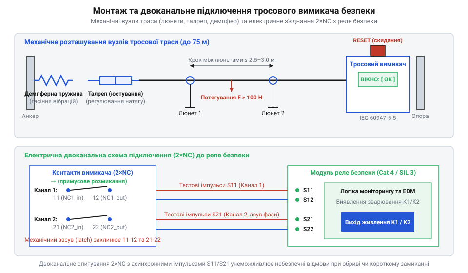

# Проєктування та монтаж системи тросового аварійного зупинення конвеєрної лінії

<preknowlist>
- [Кнопка аварійного стопу грибок та органи безпечного відключення (IEC 60947-5-5)](root:cat-hw-controls/estop-mushroom-button) — принципи примусового розмикання NC-контактів, механічна фіксація аварійного стану (latch) та ручне розблокування
</preknowlist>

## Завдання та компонування конвеєрної траси

Промислові транспортерні лінії та похилі галереї простягаються на десятки метрів, де затягування одягу чи кінцівки у рухомі ролики створює смертельну загрозу. Звичайна [аварійна кнопка стоп](root:cat-hw-controls/estop-mushroom-button) захищає лише окрему точку, тому вздовж всієї небезпечної зони встановлюють тросовий вимикач аварійного зупинення (англ. @@en|Safety Rope Pull Switch@@). Металевий канат простягають паралельно стрічці, перетворюючи всю довжину траси на суцільний сенсор вимкнення.

Компонування траси вимагає суворого дотримання геометрії. Трос із ПВХ-покриттям (англ. @@en|steel wire rope@@; від англ. *steel* — сталь, *wire* — дріт, та *rope* — трос) прогинається під власною вагою, тому через кожні 2–3 метри монтують проміжні підтримні люнети (англ. @@en|rope eyelet guide@@; від англ. *rope* — трос, *eyelet* — вушко, та *guide* — направляюча). Вони утримують канат у напрямку осі, не створюючи надмірного тертя. На кутових поворотах траси застосовують спеціальні ролик-блоки (англ. @@en|corner pulley@@; від англ. *corner* — кут, та *pulley* — шків, ролик), які спрямовують зусилля потягування без заклинювання кабелю. Проте кожен поворот під кутом α = 90° створює додаткові геометричні та фрикційні втрати сили натягу F_loss_pulley через опір підшипника та вигин ПВХ-оболонки троса з коефіцієнтом передачі η_pulley ≈ 0.85 (втрата до 15% зусилля на кожен блок):

        F_loss_pulley
        = F_pull · (1 - η_pulley)                [втрата зусилля потягування на кутовому блоку]

        ΔL_eq
        = F_loss_pulley / (μ · m_rope · g)        [еквівалентне скорочення довжини траси на один ролик]

Один ролик-блок 90° створює опір, еквівалентний додатковим ΔL_eq ≈ 10–12 м прямолінійного відрізка траси. Розрахунок максимальної довжини траси L_max на один вимикач обмежується нормативним зусиллям спрацьовування F_pull ≤ 200 Н (згідно зі стандартом IEC 60947-5-5) та сумарною силою тертя у люнетах F_fric = μ · m_rope · g · L. Значення коефіцієнта тертя μ критично залежить від матеріалу люнета: використання традиційних сталевих люнетів (μ ≈ 0.4) створює високий паразитичний опір, скорочуючи граничну довжину L_max до 30–35 м. Застосування полімерних фторопластових або тефлонових вставок зменшує коефіцієнт тертя до μ ≈ 0.15, завдяки чому для одностороннього вимикача гранична довжина прямолінійного відрізка L_max легко досягає паспортних 50 м. Установлення двох кутових блоків скорочує граничну довжину прямолінійної ділянки L_max з 50 м до 25–30 м, а при використанні вимикачів із двостороннім натягом або центральним розташуванням корпусу допустима довжина захищеної зони зростає до 100 м (2 × 50 м), за умови що кількість кутових блоків не перевищує двох на один сигнальний контур.

## Механічний монтаж та юстування натягу

Вимикач жорстко кріплять до нерухомої сталевої рами конвеєра. На протилежному кінці траси встановлюють компенсаційну демпферну пружину (англ. @@en|compensation spring@@), яка гасить вібрації від транспортера та компенсаційно поглинає сезонне теплове розширення сталевого троса.

*Загальна схема розташування механічних вузлів тросової траси та двоканальної електричної комутації до контролера безпеки.*

Для юстування робочого натягу використовують різьбовий талреп (англ. @@en|turnbuckle@@). Повільним обертанням муфти талрепа натягують сталевий канат, вибираючи слабину по всій довжині траси, доки кольоровий покажчик штока не увійде у зелене поле оглядового вікна (англ. @@en|inspection window@@) на корпусі пристрою. Візуальний контроль зеленого поля гарантує, що внутрішній підпружинений кулачковий механізм встановився у симетричне нейтральне положення, при якому нормально замкнені контакти утримуються у замкненому стані, а механічний засув не фіксує аварію. Під час налаштування враховують температурний сезон монтажу: оскільки 50-метровий сталевий канат при річному перепаді температур в `40 °C` змінює довжину на `24 мм`, під час літнього монтажу покажчик юстують ближче до правого краю зеленого вікна (з розрахунком на стискання взимку), а під час зимового монтажу — ближче до лівого краю (з розрахунком на літнє розширення). Робочий хід штока перевіряють тестовим відтягуванням троса: при виході покажчика за межі зеленого вікна пристрій миттєво спрацьовує, після чого муфту талрепа остаточно фіксують затягуванням контргайок (англ. @@en|locknut@@) для запобігання самовільному розкручуванню від вібрації.

## Схемотехнічне підключення до реле безпеки

Для відповідності категорії безпеки Category 4 / PL e (ISO 13849-1) електричне коло будують за двоканальною схемою із двома нормально замкненими (англ. @@en|NC@@) контактами (англ. @@en|dual-channel wiring@@).

Для апаратної діагностики ліній модуль безпеки видає на виходи S11 та S21 зміщені в часі тактові випробувальні імпульси (англ. @@en|pulse testing@@): перший канал 1×NC підключається між клемами S11 та S12, а другий 1×NC — між S21 та S22. У часовій діаграмі обидва виходи утримують базовий рівень 24 В, який періодично й почергово розривається короткими (тривалістю в частки мілісекунди) тестовими паузами 0 В, що не перекриваються між собою. Коли модуль формує випробувальний нуль на виході S11, вихід S21 залишається під напругою 24 В, і вхід S12 повинен зафіксувати синхронне падіння напруги; якщо ж унаслідок пошкодження кабелю виникає міжканальне коротке замикання (англ. @@en|cross-fault@@) і вихід S11 або вхід S12 електрично з'єднується з лінією S21/S22, напруга 24 В із сусіднього каналу «підтягує» лінію, і вхід S12 замість тестового нуля отримує 24 В. Порівняння часової діаграми згенерованих паузових імпульсів зі зчитаними сигналами на входах S12 та S22 дозволяє реле негайно виявити замикання й розрізнити його від звичайного аварійного розмикання контактів. Крім того, реле контролює синхронність спрацьовування: програмна реалізація обробляє розсинхронізацію сигналів (англ. @@en|discrepancy monitoring@@) — якщо один NC-контакт розмикається при потягуванні, а інший запізнюється або заварюється понад 40 мс, система заклинює аварійний стан і фіксує фатальну апаратну аварію.

:::tabs
@tab C (ESP-IDF / MCU)
:::code proj-conveyor-safety-rope-system/c/safety_rope_switch.h
:::code proj-conveyor-safety-rope-system/c/safety_rope_switch.c
:::code proj-conveyor-safety-rope-system/c/main.c
@tab C++ (OOP / FSM)
:::code proj-conveyor-safety-rope-system/cpp/cable_pull_switch.hpp
:::code proj-conveyor-safety-rope-system/cpp/cable_pull_switch.cpp
:::code proj-conveyor-safety-rope-system/cpp/main.cpp
:::

## Пусконалагодження та тестування системи

Перевірка змонтованого контуру безпеки включає чотири обов'язкові тестові кроки:

1. **Тест активного потягування.** Оператор смикає за трос у кількох точках траси (на початку, посередині й біля пружини). Кулачок повинен миттєво спрацювати, засув (англ. @@en|latch reset@@) фіксує розімкнений стан, а реле безпеки вимикає контактор двигуна.
2. **Тест обриву та послаблення.** Для імітації обриву послаблюють талреп. Пружина вимикача повертає шток у протилежний бік, що також примусово розмикає NC-контакти згідно з IEC 60947-5-5.
3. **Процедура скидання.** Після повернення покажчика натягу в зелене вікно повернення до роботи не відбувається автоматично. Оператор повинен витягнути синю кнопку ручного скидання засува на корпусі, після чого натиснути кнопку Reset на шафі керування.
4. **Перевірка розсинхронізації.** Примусове розмикання лише одного каналу має переводити драйвер у стан блокування апаратної аварії.

Якщо час між розмиканням або замиканням двох NC-каналів перевищує допустимий ліміт у 40 мс (наприклад, через зварювання контактних накладок одного з містків чи механічне заклинювання штока), модуль безпеки фіксує стан фатальної апаратної аварії (англ. @@en|discrepancy monitoring@@). У цьому стані звичайна процедура витягування кнопки засува (англ. @@en|latch reset@@) на корпусі не відновлює дозвіл роботи. Контур залишається заблокованим до повного апаратного усунення дефекту: обслуговуючий персонал повинен перевірити цілісність ліній мультиметром, усунути заклинювання контактної групи або замінити блок, переконатися у поверненні обох NC-контактів у замкнений стан і лише після цього виконати підтверджене електричне скидання Reset на шафі керування чи у прошивці контролера. Крім усунення раптових апаратних збоїв, для гарантії постійної готовності механізму та виявлення прихованих дефектів нормативний стандарт ISO 13850 вимагає проведення обов'язкових періодичних контрольних тестувань всієї траси щонайменше один раз на місяць. Під час такої щомісячної перевірки персонал примусово ініціює спрацьовування в різних точках конвеєра, контролюючи швидкість зупинення лінії, цілісність троса й надійність фіксації аварійного стану.
