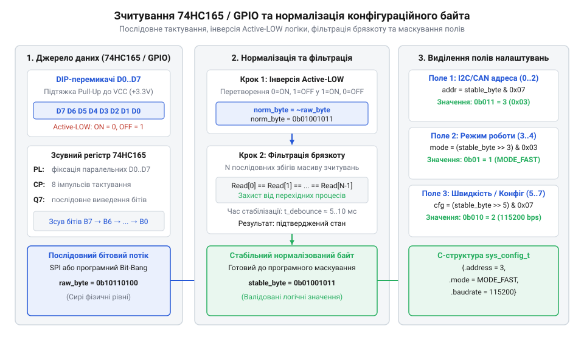
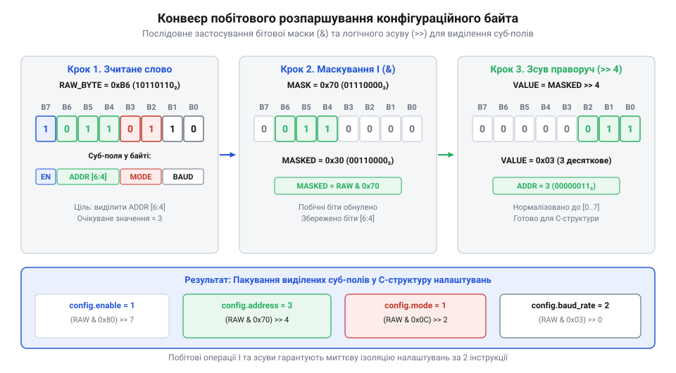

# Програмний драйвер: маскування, зсуви та розпаршування конфігураційного байта

<preknowlist>
- [Тактильні кнопки з ковпачками](root:cat-hw-controls/tactile-buttons) — принципи зчитування дискретних вхідних сигналів мікроконтролером та функціонування підтягувальних резисторів
</preknowlist>

## Схемотехніка зчитування та Active-LOW інверсія

Отримання конфігураційних налаштувань із масиву перемикачів починається з опитування фізичних дискретних вхідних ліній мікроконтролера. На відміну від випадкових натискань, характерних для роботи з [тактильними кнопками](root:cat-hw-controls/tactile-buttons), важіль DIP-перемикача тривалий час перебуває у статичному замкненому або розімкненому стані. Фізичний рівень напруги на вхідному виводі визначається схемотехнікою підтягувальних резисторів (від англійського *pull-up resistor* — підтягувальний резистор; далі — @@en|pull-up resistor@@). У найпоширенішому виконанні з внутрішньою або зовнішньою підтяжкою до лінії живлення `V_CC` розімкнений важіль вимикача залишає на вході високий потенціал (високий рівень `HIGH`, логічна `1`), тоді як замкнення контактної групи на спільну шину (землю `GND`) примусово затягує лінію до нульового потенціалу (низький рівень `LOW`, логічний `0`).

Така схемотехнічна конфігурація формує інвертовану логіку (від англійського *Active-LOW logic* — інвертована логіка; далі — @@en|Active-LOW logic@@), у якій активне увімкнене положення перемикача фізично кодується логічним `0`. Спроба обробки сирого байта безпосередньо призведе до того, що замкнені важелі сприйматимуться програмою як нульові біти, створюючи плутанину при формуванні системних адрес і режимів. Для приведення зчитаної вибірки до прямої обчислювальної логіки (де увімкнений важіль відповідає логічній `1`) застосовують первинну нормалізацію байта за допомогою побітового НЕ (від англійського *bitwise NOT* — побітове НЕ; далі — @@en|bitwise NOT@@) з подальшим виділенням молодших 8 бітів:

```
norm_byte
= (~raw_byte) & 0xFF      [інверсія всіх розрядів оператором bitwise NOT та зрізання старших бітів]
```

З одержаного виразу видно, що при сирому значенні `raw_byte = 0b11110000` (де чотири молодші важелі замкнені на землю `GND`) операція інверсії утворює нормалізований конфігураційний байт `norm_byte = 0b00001111`, у якому увімкнені канали чітко відповідають позитивним логічним одиницям. У рідкісніших схемах із зовнішньою підтяжкою до землі (Pull-Down) замкнений важіль подає напругу `V_CC` і формує пряму логіку @@en|Active-HIGH logic@@, де `norm_byte = raw_byte`, тому низькорівневий драйвер мусить враховувати схемотехнічну полярність ліній на етапі ініціалізації. Щоб уникнути умовних розгалужень у коді опитування, для уніфікованої обробки обох типів підтяжок застосовують операцію побітового виключного АБО (від англійського *bitwise XOR* — побітове виключне АБО; далі — @@en|bitwise XOR@@) з конфігураційною маскою полярності `pol_mask`. Якщо в схемі задіяно @@en|Active-LOW logic@@, масці задають значення `pol_mask = 0xFF` (інвертування всіх 8 розрядів), а для @@en|Active-HIGH logic@@ — `pol_mask = 0x00` (збереження вихідних значень), завдяки чому єдина процесорна інструкція `norm_byte = (raw_byte ^ pol_mask) & 0xFF` однаково коректно нормалізує байт для будь-якої апаратної обв'язки. Окрім нормалізації, на етапі самодіагностики драйвер реалізує програмне виявлення високоімпедансного стану (від англійського *High-Impedance state* — високоімпедансний стан; далі — @@en|Hi-Z state@@) для розпізнавання обриву лінії підтяжки чи механічного зносу контактів. Для цього вхідний вивід послідовно опитують з короткочасним перемиканням внутрішніх режимів підтяжки Pull-Up та Pull-Down: якщо важіль жорстко замикає лінію на потенціал, обидва виміри збігаються, тоді як розходження результатів (`val_pullup != val_pulldown`) однозначно вказує на плаваючий вхід та апаратний обрив кола.

## Низькорівневий API зчитування GPIO та 74HC165

Низькорівневий модуль драйвера забезпечує апаратно-незалежний інтерфейс отримання сирого конфігураційного байта незалежно від фізичного способу підключення перемикачів. При прямому паралельному зчитуванні важелі DIP-блоку підключають до окремих виводів одного порту GPIO. Драйвер виконує одночасний замір усіх розрядів за один такт шини через регістр вхідних даних порту. Якщо ж кількість вільних виводів мікроконтролера обмежена, зчитування здійснюють послідовно через [зсувний регістр 74HC165](root:cat-hw-parts/74hc165). В останньому випадку драйвер спочатку формує низький імпульс на лінії паралельного завантаження `PL_N`, фіксуючи стани 8 важелів у внутрішньому засуві, після чого подає 8 тактових імпульсів на лінію `CP` й послідовно зчитує біти через лінію даних `Q7`.


*Послідовність опитування ліній GPIO та тактування зсувного регістра 74HC165 із первинною нормалізацією конфігураційного байта.*

Для нейтралізації механічного брязкоту контактів (від англійського *contact bounce* — брязкіт контактів; далі — @@en|contact bounce@@), який виникає під час перемикання важелів оператором, драйвер реалізує часове усереднення. Функція зчитування виконує декілька послідовних вибірок із мікросекундним інтервалом затримки `t_sample ≈ 50...100 мкс` й повертає байт лише тоді, коли значення повністю стабілізувалося.

Щоб уникнути затримок виконання у головному циклі програми під час програмної фільтрації, драйвер реалізує асинхронне неблокувальне опитування через переривання таймера (від англійського *timer interrupt* — переривання таймера; далі — @@en|timer interrupt@@). Замість використання активного очікування з мікросекундними затримками, підпрограма обробки переривання (від англійського *Interrupt Service Routine* — підпрограма обробки переривання; далі — @@en|ISR@@) періодично фіксує стан вхідного порту, оновлює внутрішній лічильник збігів і виставляє прапорець готовності конфігураційного байта тільки після підтвердження стабільності сигналу протягом заданої кількості відліків, зберігаючи ресурси процесора для виконання основних задач системного контролера.

Для прискореного зчитування великих масивів конфігурації, зібраних із кількох каскадованих [зсувних регістрів 74HC165](root:cat-hw-parts/74hc165), замість програмного ногосмикання використовують апаратний периферійний модуль @@en|SPI@@ (від англійського *Serial Peripheral Interface* — послідовний периферійний інтерфейс; далі — @@en|SPI@@) у режимі тільки прийому. Лінію тактування регістра `CP` підключають до виводу `SCK` мікроконтролера, а послідовний вихід даних `Q7` — до входу `MISO`. Після генерації короткого строб-імпульсу на лінії засусу `PL_N` апаратний контролер за один виклик автоматично завантажує весь каскад байтів прямо у буфер оперативної пам'яті через прямий доступ до пам'яті (від англійського *Direct Memory Access* — прямий доступ до пам'яті; далі — @@en|DMA@@), звільняючи процесорне ядро від ручного формування тактових імпульсів.

:::tabs
:::code api-configuration-byte-bitmask-parsing/c/dip-read-gpio-raw.c
:::code api-configuration-byte-bitmask-parsing/cpp/dipswitchgpioreader.cpp
:::

## Виділення бітових суб-полів та маскування

Після отримання нормалізованого конфігураційного байта виникає задача виділення окремих параметрів із бітового слова. Замість громіздких ланцюжків перевірок окремих бітів застосовують апарат маскування за допомогою побітового І (від англійського *bitwise AND* — побітове І; далі — @@en|bitwise AND@@) та зсуву праворуч (від англійського *bitwise shift right* — зсув праворуч; далі — @@en|bitwise shift right@@). Бітова маска (від англійського *bitmask* — бітова маска; далі — @@en|bitmask@@) утворюється послідовністю одиниць у розрядах, що відповідають цільовому суб-полю.


*Схема побітового маскування, зсуву праворуч та виділення суб-полів адреси й режимів із конфігураційного байта.*

Математично бітову маску `MASK(width, shift)` для суб-поля шириною `width` бітів із зсувом відносно молодшого розряду `shift` обчислюють на основі бітових зсувів. Проте при проектуванні макросів та `constexpr`-функцій формувальник маски повинен включати статичну перевірку меж на етапі компіляції (від англійського *static assertion* — статична перевірка; далі — @@en|static assertion@@, через `static_assert` у C++11 або `_Static_assert` у C11). Помилкове задання параметрів, за якого сума ширини та зсуву перевищує розмір конфігураційного слова (`width + shift > 8`), призводить до зсуву бітів за межі 8-бітового регістра та некоректного обрізання значень (невизначеної поведінки, від англійського @@en|undefined behavior@@). Перевірка маски під час компіляції повністю виключає генерацію зайвих інструкцій у прошивці мікроконтролера й гарантує відмову збірки при виявленні виходу суб-поля за межі конфігураційного байта. Загальна формула обчислення бітової маски має вигляд:

```
MASK(width, shift)
= ((1 << width) - 1) << shift      [формування послідовності width одиниць та зсув на позицію shift]
```

Значення виділеного суб-поля `field_val` визначають шляхом накладання маски на нормалізований байт `norm_byte` із наступним зсувом праворуч на `shift` розрядів:

```
field_val
= (norm_byte & MASK(width, shift)) >> shift      [маскування операцією bitwise AND та вирівнювання зсувом]
```

Наприклад, якщо розряди `b₀...b₃` (`width = 4`, `shift = 0`) кодують I2C-адресу, а розряди `b₄...b₆` (`width = 3`, `shift = 4`) — режим роботи, то маска для режимів обчислюється як `((1 << 3) - 1) << 4 = 0b00000111 << 4 = 0b01110000 = 0x70`. Для однобітових прапорців (наприклад, `b₇`, `width = 1`, `shift = 7`) результат накладання маски конвертують безпосередньо в логічний тип `bool`.

Альтернативним підходом у мові C є використання бітових полів структури (від англійського *C bit-fields* — бітові поля C; далі — @@en|bit-fields@@), які дозволяють звертатися до окремих розрядів як до звичайних членів структури без явного виклику операторів зсуву та маскування. Проте в системному програмуванні цей підхід створює високий ризик непереносимості коду, оскільки стандарт мови C залишає порядок упакування бітів у пам'яті залежним від реалізації компілятора (від англійського *implementation-defined behavior* — поведінка, визначена реалізацією; далі — @@en|implementation-defined behavior@@). Різні архітектури процесорів або версії компіляторів можуть заповнювати розряди починаючи як від молодшого (LSB), так і від старшого (MSB) біта, а також додавати вирівнювальні падинг-біти. Саме тому для гарантованої портованості прошивки між різними платформами виділення суб-полів конфігураційного байта завжди виконують за допомогою явних побітових операцій @@en|bitwise AND@@ та @@en|bitwise shift right@@.

:::tabs
:::code api-configuration-byte-bitmask-parsing/c/dip-extract-field.c
:::code api-configuration-byte-bitmask-parsing/cpp/dipfieldextractor.cpp
:::

## Валідація режимів та пакування у C-структури

Витягнуті із бітового слова числові значення суб-полів не можна передавати в систему без попередньої валідації. Якщо розмір суб-поля `width = 3` дає `2³ = 8` можливих комбінацій, а прошивка підтримує лише `M = 5` режимів, виникнення комбінацій `5`, `6` або `7` свідчить про некоректний ввід або пошкодження контактів. Застосування невалідного значення може призвести до виходу за межі масиву налаштувань або непередбачуваної поведінки приводу, подібно до наслідків комутаційного брязкоту у [силових панелях](root:cat-hw-controls/rocker-switches-and-power-toggle-panels).

Для захисту системи драйвер перевіряє витягнуті параметри на відповідність припустимим межам. У разі виявлення зарезервованої комбінації функція валідації повертає резервний безпечний режим (від англійського *fallback state* — резервний стан; далі — @@en|fallback state@@) та виставляє відповідний код помилки. У багатобайтових масивах перемикачів додатково застосовують апаратну та програмну перевірку цілості: один із бітів масиву виділяють під біт парності (від англійського *parity bit* — біт парності; далі — @@en|parity bit@@) або обчислюють контрольне побітове виключне АБО для всього слова (від англійського *checksum* — контрольна сума; далі — @@en|checksum@@). Якщо розрахований паритет замкнених каналів не збігається з виділеним бітом перевірки, драйвер фіксує апаратний збій контактної групи й переводить пристрій у аварійну конфігурацію. Повністю оброблені, верифіковані й перевірені на цілість параметри пакуються у строковану високорівневу C-структуру `dip_parsed_config_t`.

:::tabs
:::code api-configuration-byte-bitmask-parsing/c/dip-parse-configuration.c
:::code api-configuration-byte-bitmask-parsing/cpp/dipparsedconfig.cpp
:::
