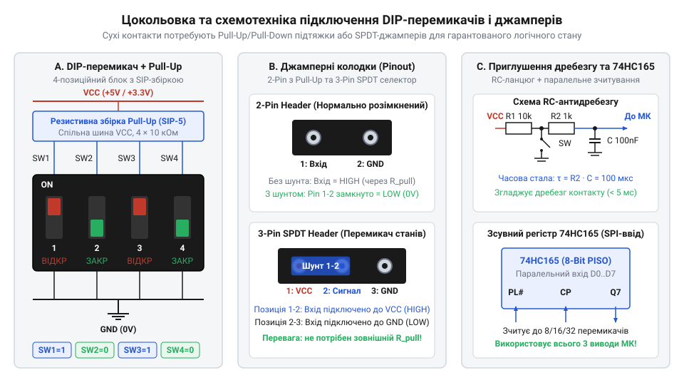
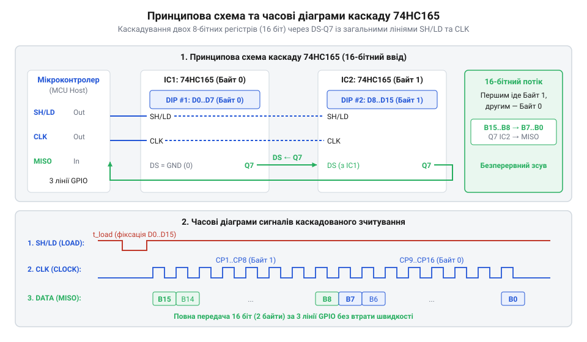

# Апаратний інтерфейс: принципові схеми, цокольовка та підтяжки ліній

<preknowlist>
- [Тактильні кнопки з ковпачками](root:cat-hw-controls/tactile-buttons) — принципи зчитування дискретних станів вводу та схемотехніка підтягувальних резисторів
</preknowlist>

## Проблема підключення та завадостійкості дискретних вхідних ліній

При прямому з'єднанні конфігураційних органів керування з цифровими виводами вводу-виводу (GPIO) мікроконтролера виникає низка схемотехнічних ризиків. Якщо підключити важіль перемикача або джампер просто між виводом МК та шиною землі без додаткових елементів, то в замкненому стані на виводі формується чіткий логічний нуль `0` (0 В). Проте при розмиканні контактів вхідний вивід залишається високономінальним підключенням у повітрі — виникає стан висячого входу (від англійського @@en|floating pin@@). Через високий вхідний опір ізольованих затворів КМОН-транзисторів (понад `10¹² Ω`) висячий вивід працює як антена, що легко накопичує статичний електричний заряд через електростатичну індукцію від рук оператора або навколишнього середовища. Накопичений заряд або високовольтні імпульсні наводки створюють на виводі перенапругу, яка перевищує шини живлення (`V_IN > V_DD + 0.3 В` або `V_IN < -0.3 В`). Це призводить до відмикання паразитної чотиришарової тиристорної структури, створеної суміжними n- та p-домішковими областями підкладки виводу. Виникає ефект засуповування КМОН-структур (від англійського *latch-up* — засуповування КМОН-структур; далі — @@en|latch-up@@), за якого між шинами `V_DD` та землі `GND` утворюється низькоомний короткозамикальний шлях. Утворений надструм викликає катастрофічне термічне руйнування кристала мікроконтролера або його повне апаратне зависання, аналогічно до виникнення хибних спрацьовувань при підключенні незахищених кіл із [тактильними кнопками](root:cat-hw-controls/tactile-buttons).

Іншою проблемою контактної комутації є механічний брязкіт контактів (англ. @@en|contact bounce@@), який виникає при перемиканні важеля DIP-перемикача або встановленні перемички. Під час замикання пружні металеві пластини відскочують одна від одної протягом `1–5 ms`, генеруючи серію хаотичних імпульсів замість одного чистого фронту. Крім того, імпульси перенапруги та електростатичні розряди (@@en|electrostatic discharge@@, від грецького *elektron* — бурштин, *statikos* — той, що стоїть) на вхідних лініях відводяться вбудованими обрізними діодами (@@en|clamping diodes@@, від англійського *clamp* — затискати, *diode* — діод). Ці крихітні напівпровідникові діоди скидають сплески на шини живлення `V_DD` й землі `GND`, однак мають суворі теплові обмеження й розраховані на струм не більше `20 mA`. При тривалій дії високовольтних завад струм зрізу викликає перевищення критичної теплової потужності (`P = V_F · I_clamp`), що спричиняє термічний пробій p-n переходу діода та незворотне пошкодження порту МК. Водночас пряме підключення великих масивів перемикачів швидко вичерпує вільні виводи, аналогічно до схем із [тактильними кнопками](root:cat-hw-controls/tactile-buttons). Без використання спеціальних схем фіксації рівня, завадостійкої фільтрації та регістрового розширення вводу побудова надійного апаратного інтерфейсу є неможливою.

## Цокольовка перемикачів та підтягувальні резистивні збірки

Для фіксації логічного рівня на розімкнених контактах застосовують підтягувальні резистори. У схемі @@en|Pull-Up@@ резистор підключається між вхідним виводом МК та шиною живлення `V_DD`, забезпечуючи стабільну логічну одиницю `1` при відкритому перемикачі. У схемі @@en|Pull-Down@@ резистор з'єднує вивід із землею `GND`, утримуючи логічний нуль `0`. Для зменшення площі друкованої плати замість дискретних резисторів застосовують резистивні збірки у корпусах @@en|SIP@@ (англ. *Single In-line Package* — однорядний корпус із спільним виводом) або @@en|DIP@@ (англ. *Dual In-line Package* — дворядний корпус ізольованих резисторів).


*Принципова схема цокольовки DIP-перемикачів, джамперів та підтягувальних резистивних збірок Pull-Up і Pull-Down.*

Конфігураційні джампери випускаються у двох основних цокольовках: 2-pin (просте замикання/розмикання лінії) та 3-pin (перемикач на два напрямки, SPDT). У 3-контактній колодці центральний вивід 2 підключається до входу МК, вивід 1 — до `V_DD`, а вивід 3 — до `GND`. Це дозволяє апаратно комутувати жорсткий рівень `1` або `0` без використання підтягувального резистора.

Типова цокольовка 8-позиційного DIP-перемикача у корпусі DIP-16 містить 8 незалежних ключів. Виводи з одного боку (`pin 1...8`) об'єднуються на спільну шину `GND`, а протилежні виводи (`pin 9...16`) підключаються до відповідних входів МК та спільних штирів резистивної збірки Pull-Up номіналом `10 kΩ`. Вибір номіналу `10 kΩ` є компромісом між струмом споживання у замкненому стані (`I = V_DD / R = 3.3 V / 10 kΩ = 0.33 mA` на один важіль) та швидкістю заряджання паразитної ємності лінії.

Спроба відмовитися від зовнішніх збірок на користь вбудованих підтягувальних резисторів мікроконтролера (@@en|internal pull-up@@) часто призводить до збоїв у промислових умовах. Внутрішні напівпровідникові резистори кристала мають великий технологічний розкид номіналів у межах від `20 kΩ` до `50 kΩ` (@@en|tolerance range@@, від англійського *tolerance* — допуск, *range* — діапазон). Такий високий опір створює занадто слабку підтяжку лінії, роблячи вхідний порт вразливим до наведених електромагнітних завад (@@en|electromagnetic interference@@, від англійського *interference* — перешкода, завада). У поєднанні з паразитною ємністю друкованих провідників високий опір збільшує сталу часу заряджання лінії й сповільнює наростання фронту сигналу при розмиканні контактів. Крім того, нерівномірний опір між сусідніми виводами одного чипа викликає розбіжність часових затримок під час зчитування всієї групи перемикачів. Тому для надійного задання апаратних режимів обов'язково встановлюють зовнішні резистивні збірки з допуском не гірше `5%`, схемотехніку яких висвітлено у матеріалах про [підтягувальні резистори](root:cat-hw-controls/tactile-buttons).

Окремим ризиком під час обслуговування 3-контактних джамперних селекторів є апаратне міжшинне замикання (від англійського @@en|bus short circuit@@), яке виникає при помилковому зміщенні перемички на штирових колодках (від англійського @@en|jumper offset misalignment@@). Якщо під час монтажу перемичку встановлено зі зсувом на один крок і вона випадково з'єднує суміжні лінії живлення `V_DD` та землі `GND` замість сигнального виводу МК, низькоомний бронзовий контакт створює прямий короткозамикальний шлях. Утворений кидок струму викликає просідання системної напруги живлення, вигоряння друкованих провідників плати або термічне пошкодження стабілізатора. Для запобігання міжшинному замиканню застосовують штирові колодки із захисним ключуванням корпусу (від англійського @@en|keyed header@@), які фізично блокують некоректне встановлення ковпачка, або вбудовують послідовний струмообмежувальний резистор номіналом `100 Ω`–`330 Ω` у лінію `V_DD` джампера, що виключає надструм навіть при повному перекритті шин за аналогією до захисту комутаційних кіл у [тумблерах та силових панелях](root:cat-hw-controls/rocker-switches-and-power-toggle-panels).

## Апаратне приглушення брязкоту та узгодження логічних рівнів

Для приглушення апаратного брязкоту контактів у коло кожної дискретної лінії вбудовують аналоговий `RC`-фільтр низьких частот. Фільтр складається з послідовного резистора `R_f` та конденсатора `C_f`, підключеного паралельно до вхідного виводу на землю. Стала часу `RC`-ланцюга `τ` (грецька літера тау) обчислюється за формулою:

```
τ = R_f · C_f                 [стала часу фільтра]
```

Щоб повністю пригнітити сплески брязкоту тривалістю `t_bounce ≈ 5 ms`, сталу часу обирають за умовою `τ ≥ 2 · t_bounce`. Для `R_f = 10 kΩ` та `C_f = 100 nF` стала часу становить:

```
τ = 10⁴ Ω · 10⁻⁷ F
= 10⁻³ s                      [1 ms]
```

Такий аналоговий ланцюг загладжує високі частоти брязкоту, перетворюючи імпульсні переходи на плавну експоненційну криву. Повільне наростання напруги на звичайному КМОН-вході викликає високе енергоспоживання через наскрізні струми, тому після `RC`-фільтра застосовують інвертори з тригером Шмітта `74HC14` з гістерезисом `V_T+` та `V_T-` для формування чітких прямокутних фронтів. Однак у момент замикання перемикача виникає інша проблема — миттєвий розряд накопиченого в конденсаторі `C_f` заряду безпосередньо через металеві контакти. За відсутності захисту піковий розрядний струм (@@en|discharge current@@) може сягати кількох ампер, викликаючи ерозію контактів (@@en|contact erosion@@, від латинського *erosio* — роз'їдання) та їхнє мікрозварювання. Подібний струмовий сплеск прискорює деградацію контактних пластин DIP-перемикачів та [тактильних кнопок](root:cat-hw-controls/tactile-buttons). Для усунення цього ефекту послідовно з ключем вбудовують струмообмежувальний резистор `R_s` номіналом `100 Ω`–`1 kΩ`. Він обмежує амплітуду струму розряду величиною `I_peak = V_DD / R_s`, що гарантує довговічність комутаційних елементів та стабільність вхідного кола.

При узгодженні логічних рівнів, якщо масив перемикачів живиться від джерела `5 V`, а мікроконтролер має толерантні до 5V входи (англ. @@en|5V-tolerant IO@@), підтяжка виконується до `5 V`. Якщо ж входи МК розраховані суворо на `3.3 V`, підтягувальні резистори підключають виключно до шини `3.3 V`, або використовують шинні буфери узгодження рівнів (наприклад, `74LVC245`).

## Каскадування зчитування через зсувний регістр 74HC165

При використанні багатьох 8-позиційних DIP-перемикачів прямої кількості виводів МК недостатньо. Схемотехнічним розв'язком є застосування 8-розрядного зсувного регістра з паралельним входом і послідовним виходом @@en|74HC165@@ (англ. @@en|PISO shift register@@, від *Parallel-In Serial-Out*). Мікросхема дозволяє засунути стан 8 перемикачів паралельно за одним імпульсом і зчитати їх послідовно через 3 виводи МК: `PL` (англ. @@en|Parallel Load@@ — паралельне завантаження), `CP` (англ. @@en|Clock Pulse@@ — тактування) та `Q7` (послідовний вихід даних).


*Принципова схема та часові діаграми каскадного підключення масивів DIP-перемикачів до зсувного регістра 74HC165.*

Каскадування декількох регістрів реалізується з'єднанням виходу `Q7` першого регістра з послідовним входом `DS` (англ. @@en|Serial Input@@) наступного. Лінії `PL` та `CP` усіх регістрів об'єднуються паралельно. Алгоритм зчитування складається з двох фаз:
1. Подача короткого низького імпульсу `PL` (`0 -> 1`), під час якого стани виводів `D0...D7` паралельно засуваються у внутрішні тригери.
2. Послідовна подача `8 · N` тактових імпульсів `CP` з опитанням лінії `Q7` на кожному позитивному фронті.

Програмна реалізація драйвера зчитування 16 бітів з двох каскадованих регістрів 74HC165 на C та C++ подана у вкладках нижче:

:::tabs
:::code api-dip-and-jumper-mcu-schematic/c/esp-idf/read-dip-switches-cascade.c
:::code api-dip-and-jumper-mcu-schematic/cpp/arduino/readdipswitchescascade.cpp
:::

Завдяки такій схемотехніці масштабування конфігураційних блоків до 32 чи 64 бітів вимагає додавання лише відповідної кількості мікросхем 74HC165 без збільшення кількості використаних виводів мікроконтролера.

Проте зі збільшенням кількості каскадованих мікросхем виникають суворі обмеження на максимальну частоту тактування (@@en|clock frequency@@, від англійського *clock* — тактування, *frequency* — частота). Кожний корпус у ланцюгу додає власну затримку поширення сигналу (@@en|propagation delay@@, від англійського *propagation* — поширення, *delay* — затримка) від входу `DS` до виходу `Q7`. Для надійного зчитування даних черговий біт повинен стабілізуватися на вході наступного регістра за час підготовки (@@en|setup time@@, від англійського *setup* — підготовка) до приходу позитивного фронту тактового імпульсу. У довгому каскаді з декількох корпусів сумарна затримка поширення накопичується, спричиняючи зчитування спотворених бітів при занадто швидкому тактуванні. При напрузі живлення `3.3 V` затримка одного регістра `74HC165` становить близько `25 ns`, тому для каскаду з 4–8 корпусів частоту тактування штучно обмежують величиною `1`–`5 MHz`.
