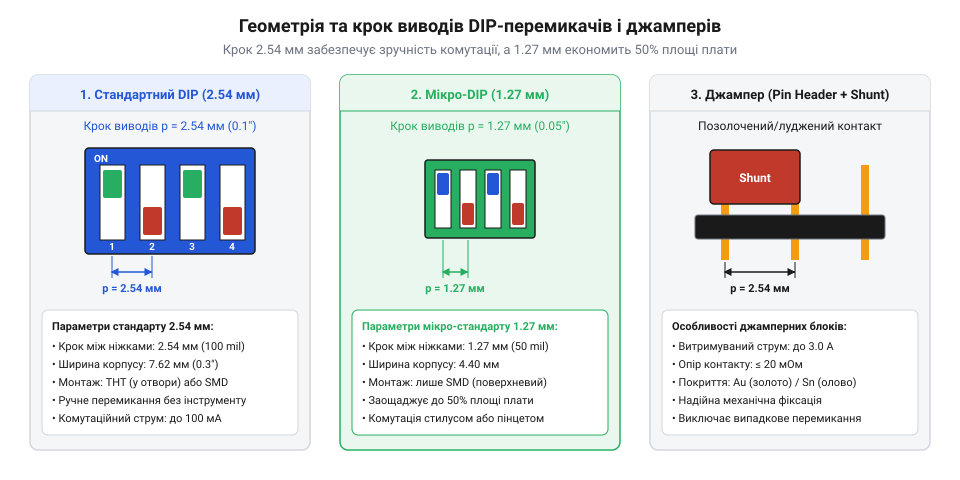
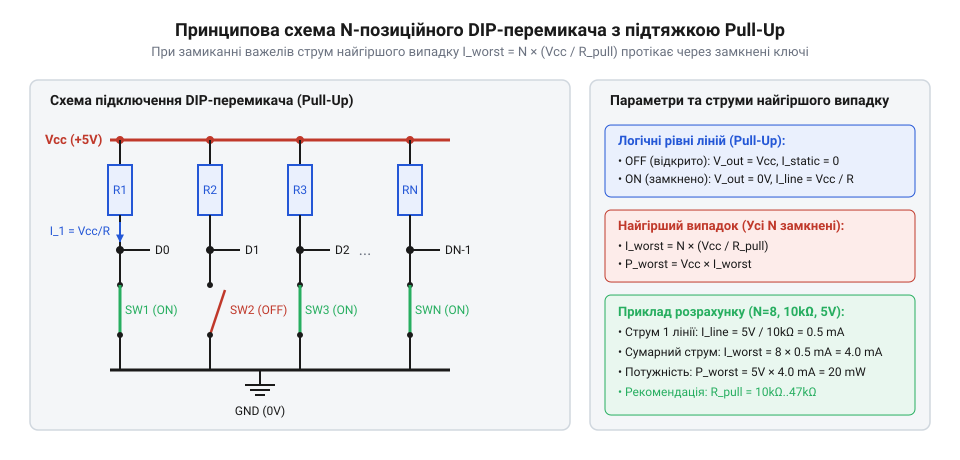

# Апаратний інтерфейс, геометрія корпуса та схемотехніка підключення DIP-блоків і джамперів

<preknowlist>
- [Тумблери, захисні ковпачки Mollie та блокування важелів (Switch Guards)](root:cat-hw-controls/toggle-switches-and-switch-guards) — Принцип роботи контактних груп та загальні механічні обмеження вимикачів.
</preknowlist>

## Проблема непевних станів апаратної конфігурації

Під час проєктування електронних пристроїв часто виникає потреба задати початкові параметри системи до запуску прошивки: статичну мережеву адресу шини, режим завантаження мікроконтролера (від англ. @@en|bootloader mode@@ — режим завантажувача) або апаратну конфігурацію периферії. Якщо намагатися вирішити це завдання тимчасовими дротяними перемичками чи відкоригованими вручну доріжками, пристрій стає вразливим до вібрацій, механічного зносу й завад. Вільні незахищені провідники створюють високий паразитний опір і ловлять електромагнітні наводки, через що цифровий вхід потрапляє у хаотичний проміжний стан.

Для формування стабільних налаштувань використовують закриті перемикачі у форматі мікросхем — DIP-перемикачі (від англ. @@en|DIP switch@@, скор. від @@en|Dual In-line Package switch@@ — перемикач у корпусі з двома паралельними рядами виводів). Вони поєднують кілька незалежних контактних груп в одному герметичному або захищеному корпусі, уможливлюючи компактну комутацію сигнальних ліній безпосередньо на друкованій платі. Поряд із ними застосовують джамперні штирьові з'єднувачі — Pin Headers (від англ. @@en|pin header@@ — штирьовий роз'єм) зі знімними струмопровідними перемичками (від англ. @@en|jumper cap@@). На відміну від силових органів керування, таких як [клавішні перемикачі](root:cat-hw-controls/rocker-switches-and-power-toggle-panels) чи [тумблери з захисними ковпачками](root:cat-hw-controls/toggle-switches-and-switch-guards), конфігураційні DIP-блоки розраховані на малі сигнальні струми й високу щільність монтажу.

На відміну від програмного збереження конфігурації у перезаписуваній енергонезалежній пам'яті — такій як EEPROM (від англ. @@en|EEPROM@@, скор. від @@en|Electrically Erasable Programmable Read-Only Memory@@ — електрично стирана програмована пам'ять; від англ. *electrically* — електрично, *erasable* — стираний, *programmable* — програмований) або Flash-пам'ять (від англ. @@en|Flash memory@@; від англ. *flash* — спалах), — фізичні DIP-блоки надають абсолютну апаратну визначеність. Програмні налаштування у напівпровідниковій пам'яті можуть бути випадково пошкоджені під час аварійного просідання напруги живлення (англ. @@en|brownout@@), програмного зависання ядра чи збою при оновленні прошивки, що призводить до повного «розконфігурування» приладу й вимагає прямого підключення програматора. Натомість апаратне комутування виводів гальванічним контактом або джампером гарантує фіксацію логічних рівнів ще до зчитування першої інструкції завантажувача й абсолютно не залежить від стану прошивки. Головною платою за цю надійність є фізичні габарити перемикачів на платі, трудомідкість ручного перемикання при серійній збірці та ризик окиснення контактів під дією довкілля.

Невірний вибір апаратного інтерфейсу конфігурації призводить до випадання логічних рівнів, швидкого окиснення контактів під дією довкілля або пошкодження контактних груп під час паяння плати. Щоб забезпечити надійну роботу пристрою впродовж років, необхідно правильно добирати геометрію корпусу, матеріал покриття контактів та схемотехніку підтяжки.

## Геометрія корпусів та тип контактів

DIP-перемикачі виготовляють у кількох стандартизованих форм-факторах, які визначають спосіб монтажу та зручність доступу до важелів. Найпоширенішим є стандартний крок виводів `2.54 мм` (0.1 дюйма) для наскрізного монтажу у отвори (від англ. @@en|Through-Hole Technology@@, скор. @@en|THT@@) або поверхневого монтажу (від англ. @@en|Surface Mount Device@@, скор. @@en|SMD@@). Для надкомпактних пристроїв використовують корпуси Half-Pitch із кроком виводів `1.27 мм` (0.05 дюйма), які економлять понад `50%` площі друкованої плати.

За конструкцією рухомого елемента DIP-блоки поділяють на три основні типи:
- Слайдерні (від англ. @@en|slider type@@) — важелі переміщуються горизонтально вздовж корпусу.
- Піанінні (від англ. @@en|piano type@@) — важелі розташовані на бічній грані, що дозволяє перемикати їх із краю плати при щільному міжплатному монтажі.
- Роторні (від англ. @@en|rotary switch@@) — поворотний диск під викрутку або ручку перетворює кут повороту у 4-бітовий двійковий або двійково-десятковий код BCD (від англ. @@en|binary-coded decimal@@, від англ. *binary* — двійковий, *coded* — кодований, та *decimal* — десятковий). Усередині корпусу під ротором розташовано кругову контактну плату із чотирма виходами вагових розрядів `1` (2⁰), `2` (2¹), `4` (2²), `8` (2³) та одним спільним виводом COM. При повороті диска пружний бронзовий повзунок замикає спільний вивід COM із відповідною комбінацією вагових пінів, формуючи на виводах код позиції від `0` до `9` (або `0`–`F` у шістнадцяткових версіях). Для систем із підтяжкою до живлення випускають блоки з інверсним кодом (англ. @@en|complementary BCD@@), де виходи замикаються на землю для логічного нуля. Перезатягування викрутки може зламати механічний фіксатор позицій, а потрапляння флюсу під диск викликає хибне розпізнавання коду через окиснення доріжок.

Джамперні штирьові з'єднувачі Pin Headers також випускають із кроком `2.54 мм` або `2.00 мм`. Знімна перемичка містить усередині пружну бронзову або фосфор-бронзову контактну скобу, що замикає два сусідні штирі.

*Геометричні стандарти корпусів DIP-перемикачів та штирьових джамперів із кроком 2.54 мм та 1.27 мм.*

Надійність контакту в сигнальних колах залежить від металургії покриття. Виробники застосовують два типи покриття контактних майданчиків:
- Луджені контакти (від англ. @@en|tin plating@@) — дешевше рішення для кіл із напругою понад `5 В` і струмом понад `10 мА`, де електрична мікродуга здатна пробивати оксидну плівку олова.
- Позолочені контакти (від англ. @@en|gold plating@@) — обов'язковий вибір для слабострумових сухих кіл (напруга нижче `5 В`, струм менше `1 мА`), оскільки золото не окиснюється і забезпечує стабільний опір контакту нижче `50 мОм`.

В електричних паспортах DIP-блоків завжди розрізняють два параметри струму. Комутаційний струм (від англ. @@en|switching capacity@@, типово `25 мА` при `24 В` постійного струму) визначає граничне навантаження в момент перемикання важеля. Струм витримування у замкненому стані (від англ. @@en|carry current@@, або non-switching rating, типово від `100 мА` до `1 А`) показує максимальний струм, який закрита контактна група може проводити без перегріву.

## Схемотехніка підключення та підтягувальні збірки

DIP-перемикач або джампер є пасивним механічним контактом, який сам по собі не генерує електричної напруги. Якщо під'єднати один вивід перемикача до цифрового входу мікроконтролера, а другий залишити відкритим, у розімкненому стані вхід буде перебувати у плаваючому стані й зчитуватиме випадковий шум. Тому кожну лінію обов'язково оснащують підтягувальним резистором.

У типовій схемі з активним низьким рівнем (від англ. @@en|active-low logic@@) один контакт перемикача підключають до спільної шини землі (GND), а другий — до входу мікроконтролера та через підтягувальний резистор до плюса живлення (VCC). Коли перемикач розімкнений, резистор утримує на піні високий логічний рівень HIGH («1»). При замиканні перемикача пін безпосередньо з'єднується з землею, і рівень падає до LOW («0»). Аналогічно працюють і схеми ручного вводу, такі як [тактильні кнопки](root:cat-hw-controls/tactile-buttons) та [модулі KY-004](root:cat-hw-controls/ky-004-button).

Щоб не розпаювати десятки окремих дискретних резисторів для багатьох позицій DIP-блоків, застосовують компактні резистивні матриці — збірки резисторів. Вони випускаються у двох основних конфігураціях:
- Однорядні збірки SIL (від англ. @@en|Single In-line Package@@) — містять кілька резисторів із одним спільним виводом (від англ. @@en|common pin@@), який підключають до VCC або GND.
- Дворядні збірки DIL (від англ. @@en|Dual In-line Package@@) — містять ізольовані пари резисторів для незалежного монтажу.

*Принципова схема апаратного підключення 4-позиційного DIP-блоку до GPIO за допомогою резистивної матриці SIL зі спільним виводом VCC.*

Номінал підтягувальних резисторів обирають у діапазоні від `4.7 кОм` до `10 кОм`. Менший опір (наприклад `2.2 кОм`–`4.7 кОм`) забезпечує високу завадостійкість у промислових умовах, але збільшує струм споживання у замкненому стані. Більший опір (`10 кОм`–`47 кОм`) мінімізує енергоспоживання пристрою у сплячому режимі.

## Технологія монтажу та герметизація термоплівкою

Особливою пасткою під час серійного виробництва електронних плат є процес паяння та наступної промивки зібраних вузлів. Під час паяння хвилею припаю (від англ. @@en|wave soldering@@) або паяння оплавленням у печі (від англ. @@en|reflow soldering@@) рідкий флюс або його агресивні випари можуть затікати через щілини корпусу в контактну камеру DIP-перемикача. Після охолодження флюс застигає на поверхні контактів, утворюючи діелектричну плівку, яка повністю блокує проходження струму.

Аналогічна небезпека виникає під час ультразвукової або струминної промивки плат мийними розчинами для видалення залишків паяльних паст. Мийний розчин під тиском заносить розчинений бруд усередину корпусу, що призводить до хімічної корозії та різкого зростання перехідного опору контактів.

Для захисту від цих чинників випускають герметизовані серії перемикачів — Washable (від англ. @@en|wash-proof switch@@). Їхню верхню відкриту частину з важелями на заводі заклеюють термостійкою захисною плівкою (від англ. @@en|top tape sealing@@, на основі полііміду Kapton), яка витримує температуру паяння до `260 °C`.

Технологічний процес вимагає дотримання суворої послідовності дій:
1. Захисна плівка залишається на корпусі DIP-перемикача протягом усього циклу монтажу, паяння та промивки плати.
2. Після завершення промивки та повного висушування плат захисну плівку вручну знімають за спеціальний виступаючий язичок.
3. Лише після видалення плівки дозволяється переключати важелі перемикача.

Якщо спробувати змістити важіль через захисну плівку до її видалення, герметичний шар розривається, і залишки розчинника разом із грязевими частками проникають всередину контактного вузла, зводячи нанівець увесь технологічний захист.
