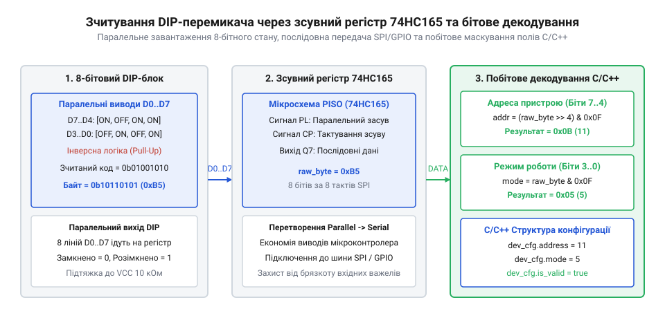
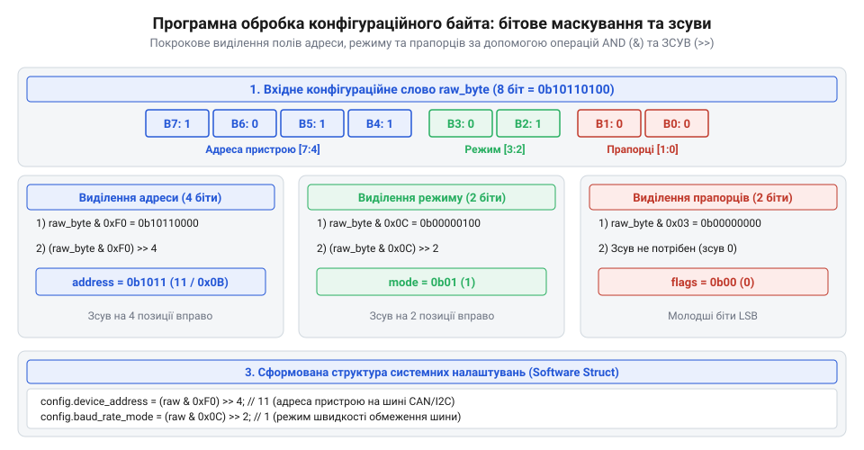

# Програмний інтерфейс зчитування та бітового декодування конфігурації DIP-перемикачів

<preknowlist>
- [DIP-перемикачі та джамперні блоки конфігурації](root:cat-hw-controls/dip-switches-and-configuration-blocks) — Фізична будова, типи контактних груп та апаратна розводка DIP-перемикачів.
</preknowlist>

## Проблема зчитування та інверсна логіка

Підключення конфігураційних DIP-перемикачів до цифрових входів мікроконтролера приховує апаратну пастку, яка спричиняє плутанину при першій спробі обробки даних у програмі. Для зменшення кількості зовнішніх компонентів вхідні лінії мікроконтролера зазвичай підтягують до позитивної шини живлення `V_CC` за допомогою внутрішніх або зовнішніх підтягувальних резисторів (від англ. @@en|pull-up resistor@@, від англ. *pull* — тягнути, та *up* — вгору). Проте у схемах із зовнішніми притискними резисторами — схемотехніці Pull-Down (від англ. @@en|pull-down resistor@@, від англ. *pull* — тягнути, та *down* — вниз) — резистивна збірка стягує розімкнену лінію до землі `GND` (`0`), а замкнений важіль подає `V_CC` (`1`), формуючи пряму логіку сигналів. На відміну від схеми Pull-Up, яка дає інвертований байт і вимагає двох кроків обробки `clean_val = (~raw_port) & M` (або еквівалентного побітового виключного АБО з маскою `(raw_port & M) ^ M`), підключення Pull-Down дозволяє виконувати пряме маскування зчитаного порту однократним виразом `clean_val = raw_port & M` без попереднього побітового інвертування.

Коли важіль перемикача перебуває у вимкненому стані OFF, його контакт розімкнений, і підтягувальний резистор утримує на вході мікроконтролера високий логічний рівень `1`. Під час переведення важеля у стан ON контакт замикає вхідну лінію на спільний провід заземлення GND, що примусово знижує напругу на піні до логічного нуля `0`. В результаті необроблений байт, зчитаний безпосередньо з вхідного порту, містить інвертовані значення: увімкнені важелі подаються нулями, а вимкнені — одиницями.

Для приведення байта до прямої логіки (де увімкнений важіль відповідає логічній одиниці `1`) зчитане значення піддають побітовому інвертуванню за допомогою оператора побітового заперечення `~` (від англ. @@en|bitwise NOT@@, від англ. *bitwise* — побітовий). Щоб очистити старші невикористані біти порту після інверсії, результат розрядного заперечення поєднують маскою за допомогою побітового І `&` (від англ. @@en|bitwise AND@@):

    raw_port  = 0b11100000      [зчитано з порту: 5 важелів увімкнено у позиціях 0..4]
    inv_byte  = ~raw_port       = 0b00011111      [побітове інвертування]
    clean_val = inv_byte & 0x1F = 0b00011111      [маскування 5 молодших бітів]

Отримане значення `clean_val` містить прямі двійкові прапорці, де кожен встановлений біт `1` чітко відповідає увімкненому важелю перемикача.

## Паралельний зсув та зсувний регістр

У разі прямого підключення важелів до окремих ліній GPIO мікроконтролер може зчитати весь конфігураційний байт за один системний такт, звернувшись безпосередньо до регістру вхідних даних порту (наприклад, `PINB` в AVR або `GPIOA->IDR` в ARM). Проте при зчитуванні 8-позиційного або 16-позиційного DIP-блоку виділення відповідної кількості фізичних пінів часто є неприпустимим марнотратством.

Для економії виводів мікроконтролера застосовують зсувні регістри паралельно-послідовного перетворення (англ. @@en|shift register@@, від англ. *shift* — зсув), такі як 74HC165. У цій схематиці всі лінії DIP-перемикача підключаються до паралельних входів регістра, а мікроконтролер використовує лише три цифрові лінії: засув `PL` (від англ. @@en|latch@@ — клямка), такт `CP` (англ. @@en|clock@@ — годинник) та послідовний вхід даних `Q7` (англ. @@en|serial data@@). Для надійного перезахоплення даних на лінію `PL` подають від'ємний імпульс тривалістю не менше `15`–`20 нс` (при напрузі живлення `5 В`), що замикає стан усіх важелів у внутрішніх тригерах. Виштовхування бітів відбувається за зростаючим фронтом на лінії тактування `CP` із мінімальною тривалістю імпульсу `15 нс` та затримкою поширення сигналу до виходу `Q7` порядку `20`–`35 нс`. На високочастотних мікроконтролерах (наприклад, ESP32 на `240 МГц`) надшвидке перемикання пінів підряд може порушити мінімальні таймаути регістра, тому між зміною рівнів `PL` і `CP` вставляють мікросекундні затримки або інструкції NOP для гарантованого зчитування кожного розряду.

*Схема зчитування конфігураційного байта з DIP-перемикача через зсувний регістр 74HC165 та його маскування у C/C++ структурі.*

Алгоритм послідовного зчитування виконується у три кроки. Спочатку мікроконтролер подає короткий низький імпульс на лінію засуву `PL` (Parallel Load), що фіксує поточний стан усіх важелів у внутрішніх тригерах регістра. Після повернення лінії `PL` у високий стан перший біт стає доступним на послідовному виході `Q7`. Потім у циклі подаються стробувальні імпульси на лінію тактування `CP` (Clock Pulse): з кожним спадаючим чи зростаючим фронтом регістр зсуває внутрішній вміст на один розряд, послідовно виштовхуючи біти в мікроконтролер.

Для повного зняття обчислювального навантаження з центрального процесора ручне програмне тактування замінюють апаратним опитуванням через периферійний модуль SPI. Лінію виходу даних `Q7` підключають до входу `MISO` (англ. @@en|MISO@@), а лінію тактування `CP` — до виходу `SCK` апаратного інтерфейсу. При поєднанні з контролером прямого доступу до пам'яті (від англ. *Direct Memory Access* — прямий доступ до пам'яті; англ. @@en|DMA@@) апаратний модуль SPI після імпульсу на лінії `PL` самостійно генерує послідовність тактових імпульсів та вивантажує отриманий конфігураційний байт безпосередньо у буфер оперативної пам'яті в фоновому режимі. Це дозволяє прошивці отримувати актуальний стан DIP-перемикачів без затримок у циклі виконання та без переривання основної програми.

## Бітове маскування та виділення полів

Отримане з порту або зсувного регістра конфігураційне слово зазвичай містить не просто набір незалежних тумблерів, а кілька упакованих функціональних полів. Наприклад, у 8-бітному DIP-перемикачі біти `0..3` можуть задавати мережеву адресу пристрою на шині I2C або CAN (значення від 0 до 15), біти `4..5` — вибирати швидкість обміну даними, а біти `6..7` — вмикати спеціальні режими налагодження.

*Діаграма бітового маскування та зсувів для виділення адреси пристрою та прапорців режимів із конфігураційного слова.*

Для витягування окремого багатобітового поля із загального слова застосовують операцію побітового І з маскою (від англ. @@en|bitmask@@, від англ. *bit* — двійковий розряд, та *mask* — маска) та наступний правий логічний зсув `>>` (від англ. @@en|right shift@@). Застосування саме беззнакових типів даних (наприклад, `uint8_t` замість `int8_t`) є критичним: для знакових від'ємних чисел зі старшим бітом `1` компілятор виконує арифметичний правий зсув (від англ. *arithmetic right shift* — арифметичний зсув праворуч, @@en|arithmetic right shift@@), який дублює знаковий біт у звільнені старші розряди замість заповнення їх нулями, що викривляє розпаковане значення. Зворотний процес — пакування окремих параметрів у єдиний конфігураційний байт — виконують за допомогою зсуву вліво `<<` (від англ. @@en|left shift@@, від англ. *left* — лівий, та *shift* — зсув) та побітового АБО `|` (від англ. @@en|bitwise OR@@, від англ. *bitwise* — побітовий, та *OR* — або), де кожне значення спочатку обрізають маскою для захисту від перевищення ширини поля, зсувають уліво на позицію молодшого біта в байті та об'єднують із рештою полів. При розпакуванні ж маска містить одиниці лише в тих позиціях, які відповідають потрібному полю:

    config_byte = 0b10110100      [прямий зчитаний байт конфігурації]
    device_addr = (config_byte & 0x0F) >> 0  = 0b0100 = 4     [маска 0x0F виділяє біти 0..3]
    baud_rate   = (config_byte & 0x30) >> 4  = 0b11 = 3       [маска 0x30 виділяє біти 4..5]
    debug_mode  = (config_byte & 0xC0) >> 6  = 0b10 = 2       [маска 0xC0 виділяє біти 6..7]

Застосування зсуву вправо на кількість позицій молодшого біта поля перетворює ізольовану бітову групу у звичайне ціле число, готове для використання у програмі як індекс або числове значення адреси.

## Драйвери для ESP-IDF та Arduino

У реальних прошивках мікроконтролерів опитування DIP-перемикачів виконується один раз під час початкового завантаження системи (`setup()` в Arduino або `app_main()` в ESP-IDF) й зберігається у незмінній структурі налаштувань. Оскільки важелі перемикача встановлюються людиною вручну до подачі живлення, тривалий безперервний дебаунсинг під час роботи не потрібен, але при старті додають коротку затримку `1`–`5 мс` для стабілізації напруги на підтяжках та завершення перехідних процесів після спрацювання схеми скидання за просіданням живлення (від англ. @@en|brownout reset@@, скор. @@en|BOR@@). Під час подачі живлення паразитні ємності сигнальних ліній і зовнішні резистивні підтяжки потребують часу для заряджання до стійкого логічного рівня HIGH («1»), тому передчасне зчитування регістрів GPIO до завершення цієї паузи загрожує прочитанням хибних бітів. Отриманий апаратний зріз стану важелів упаковують у константну структуру конфігурації, запобігаючи випадковому перезапису параметрів у процесі виконання основного циклу. Для систем із великою кількістю позицій (8–16 біт) паралельне опитування окремих пінів GPIO стає марнотратним, тому застосовують послідовне зчитування через зсувний регістр 74HC165 (від англ. @@en|shift register@@) з паралельним завантаженням (англ. @@en|parallel load@@) за допомогою короткого імпульсу на лінії PL та послідовним вичитуванням байта через апаратну шину SPI (від англ. @@en|SPI bus@@, скор. від @@en|Serial Peripheral Interface@@).

Нижче наведено ідіоматичні реалізації драйвера опитування 4-бітного DIP-перемикача адреси та режимів для фреймворків ESP-IDF (мова C) та Arduino (мова C++):

:::tabs
:::code api-dip-switch-software/c/esp-idf/dip-switch-read.c
:::code api-dip-switch-software/cpp/arduino/dipconfig.cpp
:::

Представлений обробник гарантує точний розбір налаштувань незалежно від обраної платформи та забезпечує повну ізоляцію прикладної прошивки від апаратних особливостей підключення перемикачів.
