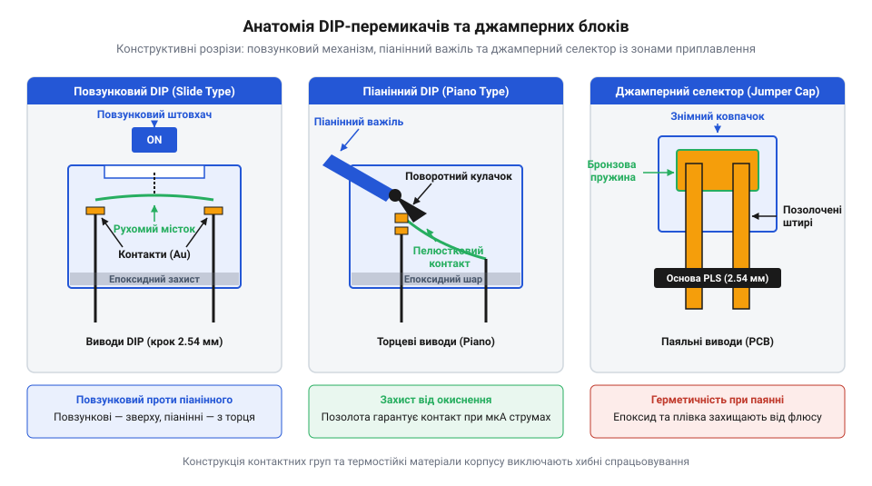
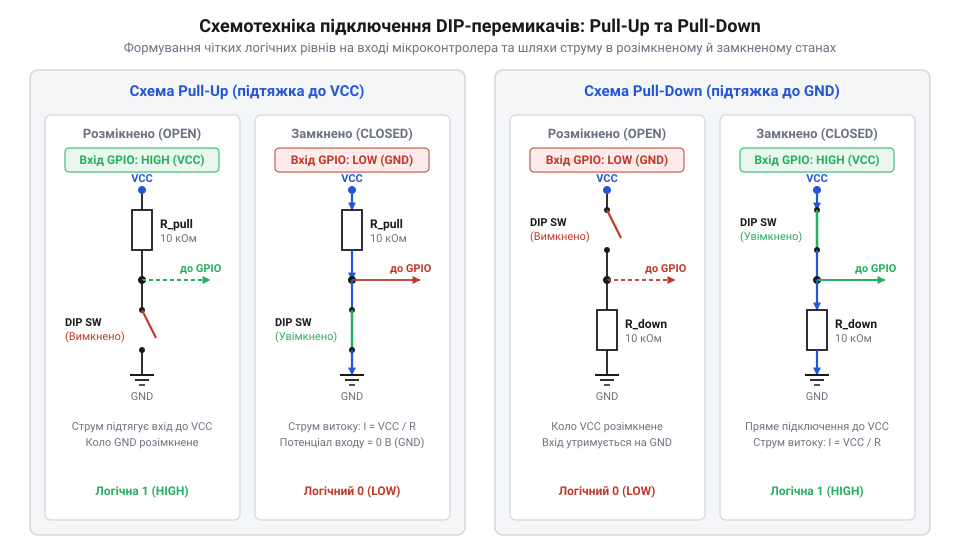
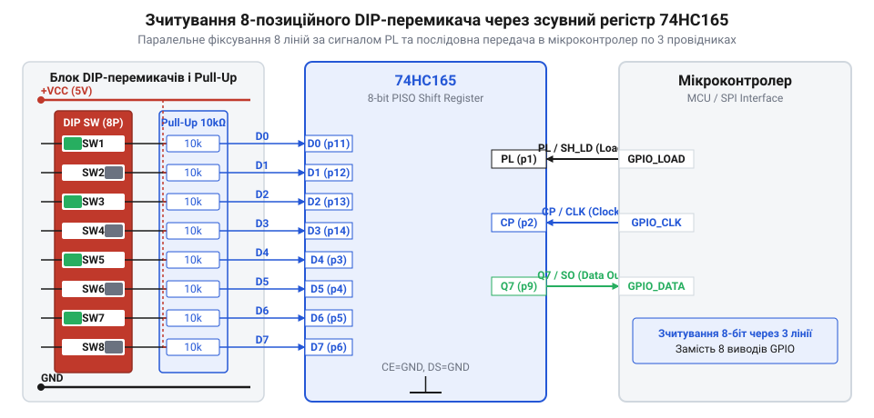

# DIP-перемикачі та джамперні блоки конфігурації

<preknowlist>
- [Тактильні кнопки з ковпачками](root:cat-hw-controls/tactile-buttons) — Базове розуміння роботи дискретних сухих контактів та механічних контактних груп.
- [Тумблери, захисні ковпачки Mollie та блокування важелів (Switch Guards)](root:cat-hw-controls/toggle-switches-and-switch-guards) — Принципи ручної комутації та розрізнення фіксованих станів перемикачів.
</preknowlist>

## Проблема апаратного вибору системних режимів

При створенні серійних електронних пристроїв або автономного обладнання виникає задача задання унікальних налаштувань для кожного окремого екземпляра — мережевої адреси пристрою, швидкості обміну даними чи варіанту завантаження системного ПЗ. Якщо змінювати ці параметри шляхом перекомпіляції та перепрошивки мікроконтролера для кожного виробу, серійне виробництво перетворюється на повільний і вразливий до помилок процес. У польових умовах, де відсутній доступ до програматора чи сервісного інтерфейсу, зміна конфігурації прошивкою стає взагалі неможливою, а випуск приладів із однаковими фабричними адресами призводить до непрацездатності шини зв'язку через конфлікти пристроїв. Фізичний механізм адресної колізії полягає в тому, що при паралельному підключенні кількох модулів з однаковою адресою на спільну лінію обміну даними обидва ведені вузли починають одночасно передавати відповіді у відповідь на запит майстра. У результаті домінуючий низький рівень сигналу одного трансивера шунтує високий рівень іншого, формуючи на шині викривлені значення бітів, що викликає систематичні помилки контрольних сум (CRC) або повне блокування арбітражу шини (від англ. @@en|bus arbitration@@, від латинського @@la|arbitrium@@ — рішення). Програмне збереження налаштувань у внутрішній енергонезалежній пам'яті (від англ. @@en|EEPROM@@, від @@en|Electrically Erasable Programmable Read-Only Memory@@ — електрично стирана програмована пам'ять) також виявляється вразливим: при просіданні живлення під час запису вміст комірок може спотворитися, а для читання програмного реєстру необхідний попередній успішний запуск ядра мікроконтролера та тактового генератора. На відміну від пам'яті, конфігураційні елементи комутації формують жорстко припаяний апаратний потенціал на виводах, який зчитується миттєво при подачі живлення ще до виконання першої інструкції прошивки, а для їх наочної комутації зазвичай використовують [тумблери та захисні перемикачі](root:cat-hw-controls/toggle-switches-and-switch-guards) або компактні внутрішньоплатні розмикачі.

Для розв'язання цієї проблеми в архітектуру пристрою закладають органи апаратного вибору режимів — комбінаційні елементи комутації, стани яких зчитуються мікроконтролером безпосередньо при подачі живлення. На відміну від класичних [тумблерів або кнопкових панелей](root:cat-hw-controls/toggle-switches-and-switch-guards), призначених для оперативного керування користувачем, конфігураційні перемикачі розраховані на статичну фіксацію налаштувань під час збирання чи обслуговування.

Еволюція конфігураційних перемикачів від початків обчислювальної техніки 1970-х років пройшла шлях від розгалужених комутаційних панелей із ручними дротовими перемичками до компактних закритих модулів. Визначною віхою стало патентування компанією AMP перших 4- та 8-позиційних модулів у корпусах Dual In-line Package (DIP), що дозволило запаювати органи апаратної конфігурації безпосередньо на друковану плату поруч із мікросхемами. У материнських платах епохи ISA-шин та ранніх IBM PC джампери й DIP-перемикачі слугували єдиним інструментом для фізичного розподілу ресурсів — вибору системних переривань IRQ, каналів прямого доступу до пам'яті DMA та базових адрес вводу-виводу. Згодом матеріали контактних груп еволюціонували від найпростішого латунного покриття до хімічно стійких срібно-золотих сплавів та герметизованих SMD-корпусів, розрахованих на автоматичний монтаж і промислове миття плати.

Для детального ознайомлення з комбінаторними розрахунками можливих станів та бітовою алгеброю розпаршування конфігурацій скористайтеся [математичною вставкою](root:cat-hw-controls/dip-switches-and-configuration-blocks/math-configuration-byte-bitmasking-and-combinations.md). Також у випадках, коли на платі потрібні компактні дискретні органи кодування з HEX-виходом, застосовують [ротаційні кодові перемикачі](root:cat-hw-controls/rotary-dip-switches).

## Конструкція DIP-перемикачів та джамперних блоків

@@en|DIP-перемикач@@ (англ. @@en|Dual In-line Package@@, від @@en|dual@@ — подвійний, @@en|in-line@@ — у лінію, @@en|package@@ — корпус) є монолітним блоком із кількох незалежних тумблерних чи повзункових контактних груп, розміщених у стандартному корпусі з двома рядами виводів із кроком 2.54 мм (або 1.27 мм у SMD-виконанні). За способом механічного впливу на важіль розрізняють три основні конструктивні варіанти: повзункові (англ. @@en|slide type@@), де важіль переміщується горизонтально уздовж плати; рокерні (англ. @@en|rocker type@@), у яких контакт переключається натисканням на один із країв гойдалки; та піанінні (англ. @@en|piano type@@), де важелі розташовані на бічній грані корпусу для зручного доступу при вертикальному монтажі плат.

Альтернативним або доповнювальним рішенням є @@en|джамперні блоки@@ (англ. @@en|jumper@@, від @@en|to jump@@ — перестрибувати). Вони складаються з відкритої штирової колодки (англ. @@en|pin header@@) та знімної струмопровідної перемички (англ. @@en|jumper cap@@), всередині якої встановлено пружинну бронзову або мідну гніздову контакторну втулку. Перемичка надівається на два суміжні штирі, фізично замикаючи електричне коло.

Оскільки конфігураційні перемикачі можуть залишатися в одному положенні роками, ключовою вимогою до їхньої конструкції є захист від окиснення та атмосферної корозії. При низьких сигнальних струмах і напругах (одиниці мікроампер при 3.3 В чи 5 В) оксидна плівка на латуні чи міді не здатна пробитися електрично, що призводить до обриву кола. Механічний пробій диелектричної плівки оксиду досягається за рахунок контактного тиску в зоні дотику контактних поверхонь. Позначимо механічний тиск як `P_contact`, нормальну силу притискання рухомого контактного містка як `F_contact` та площу зони фактичного дотику мікронерівностей як `A_contact`. Формула механічного напруження в зоні дотику має вигляд:

```
P_contact = F_contact / A_contact
```

Зростання локального тиску вище границі текучості металу викликає пластичну деформацію та механічне зрізання оксидної плівки.

**Умова:** Обчислимо контактний тиск `P_contact` у повзунковому механізмі при силі притискання пружини `F_contact = 0.35 Н` та ефективній площі мікроплям дотику `A_contact = 0.0015 мм²` (`1.5 × 10⁻⁹ м²`).

```
P_contact = F_contact / A_contact
= 0.35 / (1.5 × 10⁻⁹)      [підстановка числових параметрів контактної пари]
= 233.3 × 10⁶              [обчислення механічного напруження в паскалях]
= 233.3 МПа                [підсумковий контактний тиск]
```

Отримане значення `233.3 МПа` перевищує границю текучості латуні (`150–200 МПа`), що гарантує руйнування оксиду при перемиканні, однак при тривалому статичному контакті волога викликає глибинну корозію, подібну до зносу у [клавішних перемикачах комутації](root:cat-hw-controls/rocker-switches-and-power-toggle-panels). Тому контактні поверхні високоякісних @@en|DIP-компонентів@@ (від англ. @@en|Dual In-line Package@@, де dual — подвійний, in-line — у лінію, package — корпус) та штирів джамперів вкривають шаром нікелю з наступним напиленням золота (від англ. @@en|gold plating@@, де gold — золото, plating — гальванічне покриття від старофранцузького @@fro|plate@@ — пластина) або паладієво-золотих сплавів. Під час паяння друкованої плати на автоматизованих лініях хвилею припаю флюс та розплавлений каніфольний шлам можуть проникнути всередину корпусу @@en|DIP-перемикача@@, затекти на контакти й назавжди зіпсувати модуль. Для запобігання цьому корпуси виготовляють термостійкими (із полібутилентерефталату PBT або рідкокристалічних полімерів LCP), а верхню панель на час паяння й миття заклеюють захисною термостійкою силіконовою плівкою (від англ. @@en|top tape seal@@, де top — верхній, tape — стрічка від давньоанглійського @@ang|tæppe@@ — смужка тканини, seal — ущільнення від латинського @@la|sigillum@@ — відбиток, печатка). Ця герметизуюча плівка витримує пікову температуру до 260 °C протягом 30 секунд і тиск промивального струменя до 0.3 МПа при частоті ультразвукової очистки 40 кГц, запобігаючи проникненню розчинників флюсу до внутрішньої порожнини корпусу.


*Конструктивні відмінності контактних груп повзункового та піанінного DIP-перемикачів та будова знімного джампера з золоченими контактами.*

## Схемотехніка формування чітких логічних рівнів

Механічний контакт @@en|DIP-перемикача@@ чи джампера є простим розмикачем: у замкненому стані його опір близький до нуля, а у розімкненому — прямує до нескінченності. Якщо приєднати розімкнений контакт безпосередньо до цифрового входу мікроконтролера без додаткових елементів, вхідний вивід опиниться у так званому плаваючому стані (англ. @@en|floating pin@@). Високий вхідний опір CMOS-каскадів призводить до того, що лінія працює як антена, вловлюючи електромагнітні наведення від довколишніх кіл, що викликає хаотичні перемикання логічних 0 та 1.

Для фіксації визначеного електричного потенціалу застосовують схемотехніку підтяжки (від англ. @@en|pull resistor@@, де pull — тягнути від давньоанглійського @@ang|pullian@@ — шарпати, а resistor — резистор від латинського @@la|resistere@@ — чинити опір). При підключенні за схемою @@en|Pull-Up@@ (від англ. @@en|Pull-Up@@, підтяжка вгору) вхід мікроконтролера з'єднують із шиною живлення через підтягувальний резистор `R_pull`, а сухий контакт перемикача підключають між цим входом і землею (GND). Як і при опитуванні [сухих тактильних кнопок](root:cat-hw-controls/tactile-buttons), коли контакт розімкнений, струм через резистор вирівнює потенціал входу до напруги живлення, формуючи чітку логічну 1. Коли важіль замикає контакт на землю, потенціал падає до 0 В (логічний 0), а через резистор протікає струм витоку `I_leak`. Заряджання паразитної ємності лінії розімкненого контакту визначається постійною часу екпоненційного розряду та наростання напруги. Позначимо постійну часу як `τ`, опір резистора підтяжки як `R_pull` та сумарну паразитною ємність доріжки плати та вхідного каскаду як `C_parasitic`. Математичне рівняння часової постійної RC-кола має вигляд:

```
τ = R_pull · C_parasitic
```

Час наростання напруги `t_rise` від 0 В до `99 %` рівню `V_CC` описується пропорцією `t_rise = 4.6 · τ`, яка задає мінімальну тривалість встановлення логічного рівня після подачі живлення.

**Умова:** Обчислимо постійну часу `τ` та тривалість наростання напруги `t_rise` для кола підтяжки `Pull-Up` з опором `R_pull = 47 кОм` (`47 × 10³ Ом`) та сумарною паразитною ємністю доріжки плати `C_parasitic = 20 пФ` (`20 × 10⁻¹² Ф`).

```
τ = R_pull · C_parasitic
= (47 × 10³) · (20 × 10⁻¹²)      [підстановка числових значень опору та ємності]
= 940 × 10⁻⁹                     [обчислення постійної часу в секундах]
= 0.94 мкс                        [підсумкова постійна часу RC-кола]

t_rise = 4.6 · τ
= 4.6 · 0.94                     [обчислення часу встановлення 99% напруги V_CC]
= 4.32 мкс                       [тривалість встановлення логічної 1]
```

Отриманий час наростання `4.32 мкс` є абсолютно безпечним для затримки первинного зчитування при старті прошивки, проте при завищеному номіналі `R_pull` понад 100 кОм затримка зчитування зростає, піддаючи вхід тривалому впливу високочастотних імпульсних наведень під час включення живлення.

```
I_leak = V_CC / R_pull
```

Типове значення R_pull лежить у межах від 4.7 кОм до 100 кОм. Занадто малий опір (менше 1 кОм) призводить до невиправданих витрат енергії при замкненому контакті, що критично для батарейних пристроїв. Занадто великий опір (понад 100 кОм) робить лінію чутливою до наведень та уповільнює фронти сигналів через наявність паразитної ємності плати C_parasitic. Дзеркальною є схема @@en|Pull-Down@@ (підтяжка вниз), де резистор з'єднує вхід із землею, а контакт комутує напругу живлення V_CC.


*Принципові схеми формування логічних рівнів за допомогою зовнішніх резисторів підтяжки Pull-Up та Pull-Down.*

Коли кількість конфігураційних ліній зростає (наприклад, 8 або 16 позицій), виділення під кожну лінію окремого виводу GPIO мікроконтролера стає занадто марнотратним. У таких випадках застосовують розширення ліній за допомогою паралельно-послідовних зсувних регістрів, зокрема [мікросхем 74HC165](root:cat-hw-parts/74hc165). За цією топологією всі конфігураційні контакти підключаються до паралельних входів регістра, який за одного імпульсу завантаження фіксує байт станів, а потім послідовно передає його в мікроконтролер лише по трьох цифрових лініях (Clock, Data, Latch).


*Схема мультиплексування 8-позиційного DIP-масиву через паралельно-послідовний зсувний регістр 74HC165.*

Детальні схеми підключення, розводку виводів та електричні таймінги ви знайдете у [залізному API](root:cat-hw-controls/dip-switches-and-configuration-blocks/api-dip-and-jumper-mcu-schematic.md), а готові C/C++ алгоритми зчитування — у [програмному API](root:cat-hw-controls/dip-switches-and-configuration-blocks/api-configuration-byte-bitmask-parsing.md). Повний приклад проєктування та розведення плати конфігураційного модуля описано у [практичному проєкті](root:cat-hw-controls/dip-switches-and-configuration-blocks/proj-dip-jumper-mcu-configuration-module.md).

## Розширення вхідних ліній конфігурації

При проєктуванні складних цифрових систем із великим масивом апаратних налаштувань інженер неминуче стикається з обмеженням кількості вхідних виводів (від англійського @@en|GPIO@@) мікроконтролера. Якщо для читання 4-позиційного блоку @@en|DIP switch@@ потрібно чотири окремих виводи, то 16-бітова конфігураційна панель задіює значну частину портів MCU, позбавляючи пристрій можливості підключати периферію.

Для розв'язання цієї проблеми застосовують каскадування [паралельно-послідовних зсувних регістрів 74HC165](root:cat-hw-parts/74hc165) (від англ. @@en|shift register@@, де shift — зсув від давньоанглійського @@ang|sciftan@@ — впорядковувати, а register — регістр від латинського @@la|registrum@@ — списочна книга). Схемотехніка полягає в тому, що всі паралельні входи мікросхеми підключаються до контактів DIP-перемикачів з підтягувальними резисторами, а виходи регістрів об'єднуються в єдину послідовну шину. Мікроконтролер подає короткочасний імпульс на лінію завантаження (від англ. @@en|Parallel Load@@, `PL`), фіксуючи поточний стан усіх важелів у внутрішніх тригерах, після чого за допомогою тактових імпульсів `CLK` послідовно зчитує біти через єдину лінію даних `Q7`. Паспортні таймінги CMOS-логіки вимагають суворого дотримання мінімальної тривалості імпульсів засувки та затримки поширення сигналу (від англ. @@en|propagation delay@@). Позначимо загальний час опитування як `t_readout`, мінімальну тривалість імпульсу `PL` як `t_w(PL)`, кількість конфігураційних бітів у каскаді як `N_bits`, період тактового сигналу як `T_clk` та час затримки поширення даних як `t_pd`. Формула часового балансу опитування каскадованого масиву має вигляд:

```
t_readout = t_w(PL) + N_bits · T_clk + t_pd
```

Коректна фіксація даних гарантується лише тоді, коли тривалість `PL` перевищує паспортне значення `t_w(PL) ≥ 20 нс`, а період тактування `T_clk` перевищує суму часу установки та зсуву.

**Умова:** Обчислимо повний час зчитування `t_readout` для 32-бітового конфігураційного масиву (`4` мікросхеми 74HC165, `N_bits = 32`) при тривалості засувки `t_w(PL) = 20 нс`, частоті тактування `f_clk = 10 МГц` (період `T_clk = 100 нс`) та затримці поширення `t_pd = 26 нс`.

```
t_readout = t_w(PL) + N_bits · T_clk + t_pd
= 20 + 32 · 100 + 26      [підстановка паспортних часових параметрів 74HC165]
= 20 + 3200 + 26          [обчислення суми тривалості тактування та засувки]
= 3246 нс                 [сумарний час зчитування 32-бітного масиву]
= 3.25 мкс                [підсумкова тривалість опитування]
```

Час опитування `3.25 мкс` дозволяє мікроконтролеру опитувати 32 важелі без затримки основного циклу програми, а для невеликих масивів альтернативним рішенням є [ротаційні кодові DIP-перемикачі](root:cat-hw-controls/rotary-dip-switches), які видають 10 або 16 позицій у формі двопровідникового BCD/HEX коду через 4 виводи, а повні схемотехнічні рішення наведено у матеріалі про [апаратний інтерфейс: принципові схеми, цокольовка та підтяжки ліній](root:cat-hw-controls/dip-switches-and-configuration-blocks/api-dip-and-jumper-mcu-schematic.md).

Практичний вигляд друкованої плати та схему збірки шинного розширювача детально розібрано в [проєкті модуля апаратного задання конфігурації для мікроконтролера](root:cat-hw-controls/dip-switches-and-configuration-blocks/proj-dip-jumper-mcu-configuration-module.md).

## Програмна обробка та декодування конфігурації

Отримане з вхідних ліній або зсувного регістра значення являє собою сирий конфігураційний байт (`uint8_t`), біти якого відповідають фізичному положенню кожної клавіші. Оскільки механічні контакти під час перемикання піддаються явищу брязкоту (від англ. @@en|contact bounce@@, де contact — контакт від латинського @@la|contactus@@ — дотик, а bounce — відскок), програмний драйвер має забезпечити надійне зчитування. На відміну від опитування [тактильних кнопок на платах](root:cat-hw-controls/ky-004-button), положення DIP-перемикачів зазвичай змінюється до подачі живлення, тому фільтрація зводиться до одноразової затримки на 5–10 мс після подачі VCC або фіксації стану за алгоритмом мажоритарного вибору з трьох послідовних зчитань. У відповідальних промислових системах для захисту від ненадійного дотику чи механічного пошкодження важеля один з бітів (найчастіше старший біт `b₇`) виділяють як біт контролю парності (від англ. @@en|parity bit@@, де parity — парність від латинського @@la|paritas@@ — рівність, а bit — біт від англ. @@en|binary digit@@). Перевірка цілісності зчитаного конфігураційного слова базується на додаванні за модулем 2 усіх інформаційних бітів. Позначимо обчислений прапорець парності як `P_calc`, а інформаційні біти конфігурації як `b₀, b₁, ..., b₆`. Формула обчислення паритету має вигляд:

```
P_calc = b₀ ⊕ b₁ ⊕ b₂ ⊕ b₃ ⊕ b₄ ⊕ b₅ ⊕ b₆
```

Збіг обчисленого значення `P_calc` із виділеним бітом `P_recv` гарантує відсутність одиночних помилок зчитування.

**Умова:** Перевіримо цілісність конфігураційного байта `0b10110101` (де біти даних `b₀..b₆ = 0b0110101`, а отриманий біт парності `P_recv = 1`).

```
P_calc = b₀ ⊕ b₁ ⊕ b₂ ⊕ b₃ ⊕ b₄ ⊕ b₅ ⊕ b₆
= 1 ⊕ 0 ⊕ 1 ⊕ 0 ⊕ 1 ⊕ 1 ⊕ 0      [підстановка розпаршених значень бітів даних]
= 1 ⊕ 1 ⊕ 1 ⊕ 1                 [послідовний бітовий сумувальний XOR]
= 0                              [обчислена парність інформаційних бітів]

Parity_OK = (P_calc == P_recv)
= (0 == 1)                       [порівняння обчисленого та отриманого біта парності]
= false                          [виявлено помилку цілісності конфігурації]
```

Отриманий результат `false` сигналізує драйверу про невідповідність паритету, що викликано збоєм контакту або неправильно виставленим перемикачем. У цьому випадку програма блокує запуск небезпечних приводів, формує аварійний статус та переводить мікроконтролер у безпечний режим (від англ. @@en|fail-safe@@, де fail — збій від старофранцузького @@fro|faillir@@, safe — безпечний) із сигналізацією про помилку на панелі керування.

Після отримання стабільного байта застосовують бітову алгебру для виділення окремих параметрів (наприклад, системної адреси `0..7` або швидкості шини). Для цього використовують побітові маски (від англійського @@en|bitmask@@) та операції зсуву (`&`, `>>`). Принципи обчислення комбінацій та надійності маскування розкрито у матеріалі про [комбінаторику та бітову алгебру розпаршування конфігураційних слів](root:cat-hw-controls/dip-switches-and-configuration-blocks/math-configuration-byte-bitmasking-and-combinations.md).

Типовий програмний код декодування конфігураційного байта реалізують за допомогою побітових масок у C та C++:

:::tabs
:::code dip-switches-and-configuration-blocks-d/c/esp-idf/parse-dip-configuration.c
:::code dip-switches-and-configuration-blocks-d/cpp/arduino/appconfig.cpp
:::

Готові реалізації модулів зчитування та придушення завад викладено в описі про [програмний драйвер: маскування, зсуви та розпаршування конфігураційного байта](root:cat-hw-controls/dip-switches-and-configuration-blocks/api-configuration-byte-bitmask-parsing.md).
