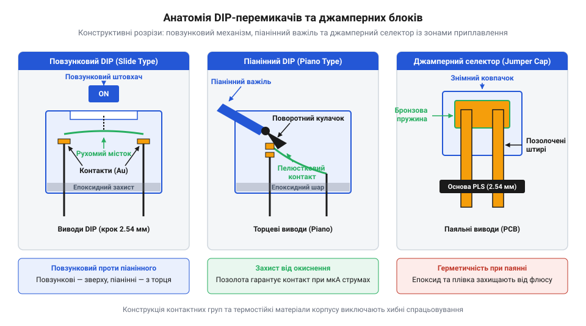
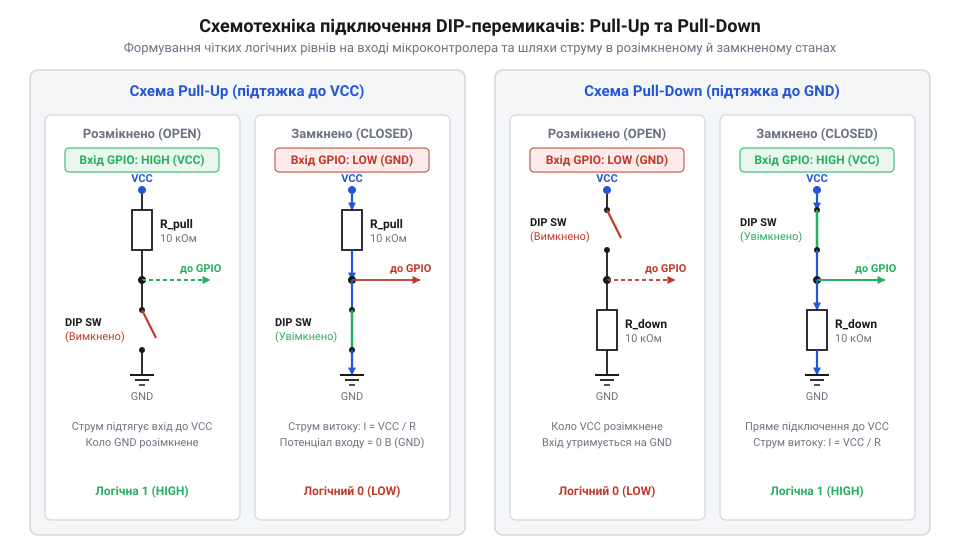
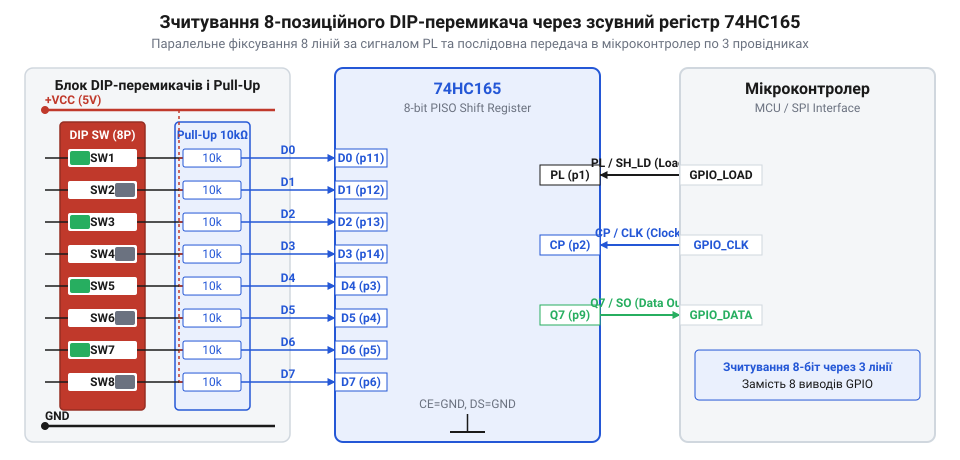

# DIP-перемикачі та джамперні блоки конфігурації

<preknowlist>
- [Тактильні кнопки з ковпачками](root:cat-hw-controls/tactile-buttons) — Базове розуміння роботи дискретних сухих контактів та механічних контактних груп.
- [Тумблери, захисні ковпачки Mollie та блокування важелів (Switch Guards)](root:cat-hw-controls/toggle-switches-and-switch-guards) — Принципи ручної комутації та розрізнення фіксованих станів перемикачів.
</preknowlist>

## Проблема апаратного вибору системних режимів

Конфігурація пристрою через прошивку або @@en|EEPROM@@ (англ. @@en|Electrically Erasable Programmable Read-Only Memory@@) вимагає попереднього програмування кожної плати в серійному виробництві, а збій пам'яті може змінити мережеву адресу. Якщо два вузли на спільній шині отримають однаковий ідентифікатор, виникає адресна колізія (лат. @@en|collisio@@ — зіткнення): обоє одночасно виставляють рівні на лініях даних, викликаючи коротке замикання та спотворення кадрів. Щоб встановити режим до подачі живлення на мікроконтролер, застосовують апаратну фіксацію потенціалів. За аналогією з тим, як [тумблери та блокування важелів](root:cat-hw-controls/toggle-switches-and-switch-guards) утримують силові кола, @@en|DIP-перемикач@@ (англ. @@en|Dual In-line Package switch@@, від лат. @@en|duplex@@ — подвійний та англ. @@en|line@@ — лінія) чи штировий @@en|джампер@@ (англ. @@en|jumper@@, від англ. @@en|jump@@ — стрибати) фізично замикають або розмикають провідники на друкованій платі. Завдяки цьому зчитування стану відбувається миттєво в першому тактовому циклі після скидання пристрою.

## Конструкція DIP-перемикачів та джамперних блоків

За конструкцією виділяють повзункові (англ. @@en|slide@@), рокерні (англ. @@en|rocker@@) та піанінні (англ. @@en|piano@@) @@en|DIP-перемикачі@@, а також штирові колодки з знімними @@en|джамперами@@. Через малі сигнальні струми в мікроконтролерних колах на поверхні контактів утворюється оксидна плівка, яка збільшує опір. Механічний контактний тиск руйнує цей шар під час перемикання, а покриття з золота чи паладію запобігає повторному окисненню. Під час монтування на плату силіконова плівка захищає внутрішній механізм від проникнення рідкого флюсу.


*Будова повзункових, рокерних, піанінних DIP-перемикачів та штирових джамперів.*

## Схемотехніка формування чітких логічних рівнів

Розімкнений механічний контакт залишає вхідний @@en|CMOS@@-затвор мікроконтролера в плаваючому стані (англ. @@en|floating state@@), через що наведення довкілля викликають хаотичне перемикання логічних рівнів. Для фіксації потенціалу використовують підтягувальний резистор (англ. @@en|pull-up resistor@@, від англ. @@en|pull@@ — тягнути) до лінії живлення або стягувальний (англ. @@en|pull-down resistor@@) до землі. Опір резистора R разом із паразитною ємністю доріжок C формує постійну часу RC, яка визначає час наростання напруги: занадто високий опір затримує фронт сигналу, а занадто малий збільшує енергоспоживання.


*Схеми підтяжки вхідних ліній до живлення та землі за допомогою резисторів.*

## Розширення вхідних ліній конфігурації

При підключенні багатопозиційних панелей виникає дефіцит портів @@en|GPIO@@ (англ. @@en|General Purpose Input/Output@@). Для економії ніжок застосовують зсувний регістр (англ. @@en|shift register@@) паралельно-послідовного перетворення @@en|74HC165@@. Стан усіх перемикачів одночасно фіксується у внутрішніх тригерах за коротким імпульсом засувки (англ. @@en|latch@@, від староангл. @@en|læccan@@ — хапати), після чого дані послідовно вичитуються через одну лінію за тактовими імпульсами. Час опитування обмежується лише максимальною частотою тактування регістру. Детальніше часові діаграми та каскадування розглянуто в описі [зсувного регістра 74HC165](root:cat-hw-parts/74hc165).


*Каскадування зсувних регістрів 74HC165 для опитування багатьох DIP-перемикачів.*

## Програмна обробка та декодування конфігурації

Для виключення випадкових збоїв зчитаний байт піддають програмній фільтрації шляхом мажоритарного вибору з трьох послідовних замірів. Захист цілісності забезпечує біт контролю парності (англ. @@en|parity bit@@, від лат. @@en|paritas@@ — рівність): при виявленні помилки система блокує запуск і переходить у безпечний режим. Окремі налаштування виділяють через побітове маскування (англ. @@en|bitwise masking@@) та зсув.

:::tabs
@tab C
`c
uint8_t raw_cfg = read_config_byte();
if (calculate_parity(raw_cfg) != PARITY_OK) {
    enter_safe_mode();
} else {
    uint8_t device_addr = (raw_cfg >> 2) & 0x0F;
}
```
@tab C++
`cpp
uint8_t raw_cfg = read_config_byte();
if (calculate_parity(raw_cfg) != PARITY_OK) {
    enter_safe_mode();
} else {
    uint8_t device_addr = (raw_cfg >> 2) & 0x0F;
}
```
:::
