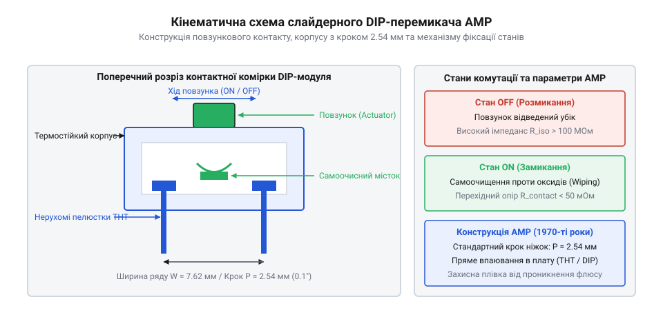
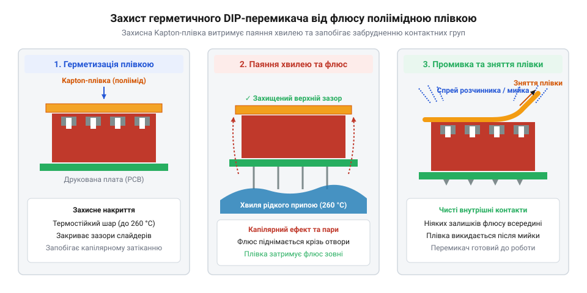

# Історія створення DIP-перемикачів та еволюція конфігурації плат

<preknowlist>
- [Клавішні перемикачі (Rocker Switches) та силові панелі комутації](root:cat-hw-controls/rocker-switches-and-power-toggle-panels) — Принципи роботи рокерних контактних систем та механізми перемикання двопозиційних контактів.
- [Тумблери, захисні ковпачки Mollie та блокування важелів (Switch Guards)](root:cat-hw-controls/toggle-switches-and-switch-guards) — Конструкція ручних перемикачів дискретних станів та особливості ковзних контактних груп.
</preknowlist>

## Проблема конфігурації ранніх друкованих плат

Наприкінці 1960-х років із виникненням масового виробництва друкованих плат (англ. @@en|printed circuit board@@) та перших інтегральних мікросхем розробники електронних обчислювальних машин зіткнулися з потребою апаратного налаштування режимів роботи пристроїв. Системні плати, периферійні контролери та промислова автоматика вимагали вибору адрес пам'яті, частотних дільників та режимів переривань безпосередньо при монтажі або обслуговуванні. Головним способом апаратного конфігурування на той час були паяні дротяні перемички (англ. @@en|wire jumper@@) та відкриті штирьові блоки з пластиковими знімними перемичками (англ. @@en|jumper block@@). Проте ручний демонтаж дротяних перемичок на поширених тоді дешевих гетинаксових платах супроводжувався високим ризиком аварій: тривале локальне нагрівання жалом паяльника викликало термодеструкцію паперово-фенольної основи, що призводило до відшарування мідної фольги від матриці та розтікання розплавленого припаю між сусідніми доріжками з утворенням коротких замикань.

Використання дротяних перемичок вимагало від техніка наявності паяльника безпосередньо на місці встановлення обладнання. Будь-яка зміна конфігурації передбачала випаювання старої перемички та вигинанні нової, що в польових умовах призводило до перегріву мідних доріжок, відшарування фольги від гетинаксової основи плат та ризику випадкового короткого замикання сусідніх провідників розплавленим припаєм. Альтернативні штирьові контактні блоки з шунтами спростили процедуру, проте вони займали значний об'єм над поверхнею плати та мали суттєвий недолік: дрібні знімні шунти часто випадали від вібрації під час транспортування або губилися інженерами, залишаючи лінію у невизначеному стані.

Традиційні панельні важільні комутаційні елементи з закритим корпусом — такі як [тумблерами та захисними ковпачками](root:cat-hw-controls/toggle-switches-and-switch-guards) — забезпечували надійність перемикання, але їхні габарити та гвинтове кріплення унеможливлювали щільне розміщення на друкованих платах поруч із мікросхемами. Промисловості було необхідне нове компактне рішення, яке б поєднало надійність закритої контактної групи зі стандартизованим кроком виводів для прямого монтажу на плату.

## Патент AMP та створення перших DIP-перемикачів

Розв'язанням проблеми стало винайдення уніфікованого багатопозиційного блоку перемикачів у стандартизованому корпусі для мікросхем. У 1972–1974 роках інженери американської компанії @@en|AMP Incorporated@@ розробили та запатентували (патент США US 3,852,559) конструкцію перемикача в корпусі типу Dual In-line Package (від англ. *dual* — подвійний, *line* — лінія, *package* — корпус, @@en|DIP switch@@).

Головною інженерною ідеєю винаходу стала адаптація декількох мініатюрних слайдерних контактних груп у єдиний пластиковий корпус, геометрія виводів якого повністю відповідала міжнародному стандарту корпусування інтегральних мікросхем @@en|DIP@@. Виводи вимикача мали стандартний мікросхемний крок `2.54 мм` (`0.1` дюйма) між сусідніми контактами в ряду та відстань `7.62 мм` (`0.3` дюйма) між паралельними рядами виводів. Кінематика кожного елемента спиралася на рухомий пластиковий ползун, усередині якого розміщувався пружинний містковий контакт із позолоченої бронзи. Під час зсуву важеля стиснута пружина з силою притискала місток до фіксованих терміналів, забезпечуючи ножове самоочищення контактних поверхонь від оксидних плівок та надійну фіксацію в крайніх положеннях навіть за умов вібрацій.

*Конструктивна еволюція конфігураційних блоків: перехід від відкритих паяних перемичок до уніфікованого багатопозиційного DIP-перемикача AMP у корпусі з кроком 2.54 мм.*

Усередині корпусу кожен перемикач мав власний пружинний ползун із золоченим або срібним містковим контактом, який переміщувався між фіксованими терміналами. Об'єднання від 2 до 12 перемикачів у суцільний блок дозволило монтувати DIP-перемикачі в ті ж стандартні панельки або отвори друкованої плати, що й звичайні мікросхеми. Це дало змогу задіяти автоматичні складальні машини та паяння хвилею при масовому виготовленні материнських плат (зокрема у ранніх комп'ютерах IBM PC та Apple II), скоротивши час апаратного налаштування обладнання на конвеєрі в десятки разів.

## Конструктивна еволюція форм-факторів і монтажу

Упродовж 1980-х та 1990-х років, у міру ущільнення компонування системних плат і розширення сфер застосування мікропроцесорної техніки, класичний слайдерний DIP-перемикач (@@en|slide DIP switch@@) зазнав значних конструктивних модифікацій. Для зручності доступу в умовах щільно розташованих дочірніх плат розробники створили рокерні перемикачі (@@en|rocker DIP switch@@), кінематика яких спиралася на двоплечі клавіші, подібні до силових [клавішних перемикачів](root:cat-hw-controls/rocker-switches-and-power-toggle-panels), а також «піанінні» перемикачі (англ. @@en|piano DIP switch@@; від італ. *piano* — тихий/фортепіано), важелі яких виведені на бічну грань корпусу для перемикання з торця плати.

Дворазове скорочення площі плати забезпечила поява роторних кодових перемикачів (від лат. *rotare* — обертати, @@en|rotary DIP switch@@). Замість кількох лінійних слайдерів роторний перемикач має один обертовий диск зі шліцом під викрутку, на зворотній стороні якого сформовано кулачковий профіль із виступами та заглибинами. При поверненні диска кулачковий механізм почергово натискає на чотири пружні контактні пелюстки, що відповідають двійковим ваговим розрядам `1`, `2`, `4` та `8`. Залежно від кута повороту диска виступи кулачка замикають відповідну комбінацію контактних ліній на спільну шину, формуючи на чотирьох виходах двійково-кодований десятковий код (англ. @@en|BCD switch@@, Binary-Coded Decimal) або шістнадцятковий код. Вбудований пружинний фіксатор положення чітко утримує диск під фіксованим кутом (з кроком `36°` для BCD або `22.5°` для Hex), запобігаючи зависанню контактів у проміжному стані та генерації хибних комбінацій. Це дозволило вибирати один із 10 або 16 режимів роботи пристрою на мінімальній площі корпуса `10 × 10 мм` із п'ятьма виводами замість встановлення чотирьох окремих слайдерів. Наприкінці 1980-х років розвиток технології поверхневого монтажу зумовив появу SMT-моделей DIP-перемикачів (@@en|SMD DIP switch@@) з формованими виводами G- та J-типу для автозабірників pick-and-place.

*Захист внутрішньої контактної групи DIP-перемикача термостійкою плівкою від проникнення рідкого флюсу й промивальних розчинів при паянні хвилею.*

Критичним бар'єром під час впровадження DIP-перемикачів у масове паяння хвилею припаю стало проникнення рідкого флюсу й промивальних розчинів у щілини навколо рухомих слайдерів. Капілярний ефект затягував розплавлений каніфольний флюс усередину корпуса, де він застигав на золочених контактах у вигляді діелектричної плівки й викликав відмову. Проблему було розв'язано завдяки застосуванню термостійких пластмас (поліамідів та поліфеніленсульфіду) для корпусів, здатних витримувати короткочасне нагрівання до `260 °C`, а також наклеюванню на верхню грань корпусу захисної поліімідної плівки (англ. @@en|polyimide tape@@). Плівка герметизувала корпус на час паяння та рідинного ультразвукового промивання плат і видалялася оператором перед фінальним налаштуванням приладу.

## Матеріалознавчий прорив та герметизація корпусу

Масове впровадження конвеєрного складання друкованих плат у 1970-х роках виявило гостру технологічну суперечність. Автоматична пайка хвилею припою (англ. @@en|wave soldering@@) та подальше ультразвукове промивання плат у хімічних розчинниках спричиняли масовий вихід з ладу перших механічних перемикачів. Рідкий розплавлений флюс під дією капілярного ефекту (англ. @@en|capillary action@@, від лат. *capillaris* — волосяний) проникав крізь мікроскопічні зазори довкола виводів та рухомих слайдерів усередину корпусу. Після охолодження флюс застигав діелектричною плівкою на контактних ламелях, повністю ізолюючи кола.

Перші корпуси виготовляли зі стандартних поліамідів, які деформувалися при температурі паяння та вбирали вологу. Технологічний прорив відбувся завдяки переходу на високотемпературні інженерні термопласти: полібутилентерефталат (англ. @@en|polybutylene terephthalate@@, PBT) та рідкокристалічні полімери (англ. @@en|liquid crystal polymer@@, LCP, від лат. *liquidus* — рідкий). Матеріал LCP витримує короткочасний нагрів до 300 °C без втрати геометрії, що дозволило застосовувати перемикачі у процесах поверхневого монтажу та паяння оплавленням (англ. @@en|reflow soldering@@).

Оточуючу герметичність забезпечили двома рубежами. Нижній шар корпусу з боку виводів почали компаундувати епоксидною смолою (від грец. *epoxy* — над та *oxy* — кислий), що герметично закрило капілярні шляхи уздовж контактних штирів. Рідкий епоксидний компаунд володіє низькою в'язкістю при дозуванні й глибоко заповнює мікроскопічні зазори між металом виводів та пластмасою. Під час полімеризації він утворює міцні сітчасті полімерні зв'язки з високою адгезією (від лат. *adhaesio* — прилипання) до поверхонь пластиків PBT і LCP. Завдяки близькому коефіцієнту теплового розширення епоксидна герметизація зберігає цілісність і не тріскається під дією термічного шоку від розплавленого припою (`260 °C`), повністю блокуючи підсос флюсу й хімічних розчинників. Верхній бік слайдерів під час паяння та миття заклеювали знімною термостійкою поліімідною плівкою Kapton. Вона надійно захищала внутрішню камеру від випарів і рідин, а після завершення монтажу технологічну плівку просто знімали оператори.

## Розвінчання міфів та сучасне значення

Навколо походження конфігураційних блоків виникло чимало історичних міфів. Найпоширенішим є твердження, ніби крок виводів 2.54 мм (англ. @@en|mil@@ — тисячна частка дюйма, 100 mil) розробили спеціально для DIP-перемикачів. У дійсності компанія AMP Incorporated лише запозичила геометричний стандарт корпусу Dual In-line Package (англ. @@en|Dual In-line Package@@, від англ. *dual* — подвійний, *in-line* — в один ряд, та *package* — корпус), створений у середині 1960-х років для мікросхем. Завдяки цьому нові перемикачі ідеально ставали у стандартні отвори плат і монтажні панелі. Також помилково приписувати винахід одній людині: хоча інженер Норберт Енгерт отримав ключовий патент, конкуренти з Grayhill та CTS паралельно створювали власні рокерні й роторні модифікації.

З появою енергонезалежної пам'яті та мікроконтролерів програмне налаштування усунуло потребу в масових блоках перемикачів. Проте DIP-структури зберегли унікальні ніші, де вимагається абсолютна апаратна надійність. На відміну від програмних регістрів Flash-пам'яті чи EEPROM, які можуть бути модифіковані через експлойти завантажувача, збої живлення чи дистанційні мережеві атаки, розімкнений механічний контакт створює фізичний повітряний зазор (англ. @@en|air gap@@, від англ. *air* — повітря, та *gap* — зазор). Цей зазор гальванічно розриває електричне коло, що унеможливлює зміну апаратної конфігурації (наприклад, вибору шифрувальних ключів чи блокування завантаження) за допомогою шкідливого коду, перехоплення сигналів шини або побічних каналів витоку інформації без безпосереднього фізичного розкриття корпусу. На відміну від [клавішних перемикачів](root:cat-hw-controls/rocker-switches-and-power-toggle-panels) чи [тумблерів із блокуванням](root:cat-hw-controls/toggle-switches-and-switch-guards), базова блок-секція дає миттєву візуальну перевірку стану без подачі живлення на систему. Поєднання абсолютної апаратної захищеності від кібератак та нульового енергоспоживання в режимі очікування залишає DIP-перемикачі незамінним інструментом критичної апаратної конфігурації.
