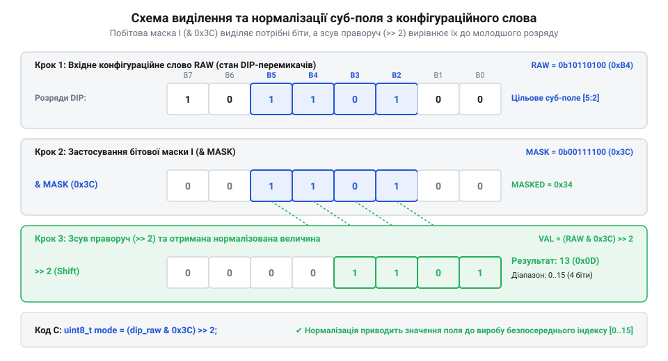

# Комбінаторика та бітова алгебра розпаршування конфігураційних слів

<preknowlist>
- [Тактильні кнопки з ковпачками](root:cat-hw-controls/tactile-buttons) — принципи зчитування дискретних станів вводу та схемотехніка підтягувальних резисторів
</preknowlist>

## Проблема зчитування багаторозрядних апаратних налаштувань

Під час проектирування мікроконтролерних систем виникає задача апаратного задання початкових конфігурацій — мережевих адрес, швидкостей обміну чи системних режимів. Найпростіший спосіб реалізації полягає у підключенні блоку перемикачів, як-от @@en|DIP switch@@ (від англійського *Dual In-line Package* — дворядний корпус), де кожен важіль механічно замикає або розмикає окрему лінію дискретного вводу. Якщо зчитувати стан кожного перемикача окремою логічною змінною через окремий опитаний вивід, програмний код швидко переповнюється розгалуженими ланцюжками перевірок `if-else`. Наприклад, для перевірки комбінації з 8 перемикачів доводиться створювати громіздкі логічні вирази або складні таблиці переходів, що призводить до перевитрати пам'яті програм і підвищує ризик помилок при опитуванні ліній.

Для вирішення цієї проблеми окремі логічні рівні дискретних ліній об'єднують у єдине конфігураційне бітове слово (англ. @@en|configuration word@@). Замість перевірки кожної лінії окремо, вхідний порт мікроконтролера зчитує паралельний стан усіх перемикачів за одну машино-командну операцію читання регістру. У типовій схемотехніці з підтягувальними резисторами замкнений важіль перемикача з'єднує вхідний вивід із землею, формуючи логічний нуль `0`, а розімкнений важіль підтягується до напруги живлення, створюючи логічну одиницю `1`. Така схема формує активний низький рівень (англ. @@en|active-low logic@@), через що фізично ввімкнений стан важеля передається як двійковий `0`. Для приведення конфігураційного слова до інтуїтивно зрозумілої форми, де замкненому перемикачеві відповідає одиничний біт `1`, зчитаний байт піддають програмному побітовому інвертуванню оператором `~` (англ. @@en|bitwise NOT@@). Отримана сукупність `N` незалежних інвертованих розрядів утворює вектор двозначних величин, кожен елемент якого набуває значення `0` або `1`. Оскільки виходи [тактильних кнопок](root:cat-hw-controls/tactile-buttons) та блоків перемикачів є бінарними, аналіз отриманого бітового слова потребує застосування апарату булевої алгебри та комбінаторики для обчислення загальної кількості доступних системних станів.

## Потужність простору станів та бітові суб-поля

Масив із `N` двопозиційних перемикачів представляє впорядкований послідовний набір дискретних елементів, де кожен важіль має рівно 2 можливі стійкі стани. Згідно з основними правилами комбінаторики, загальна потужність простору станів `S` для `N` незалежних розрядів обчислюється як добуток кількостей станів кожного важеля:

```
S = 2 · 2 · ... · 2      [добуток N множників для кожного біта]
= 2ⁿ                     [піднесення до степеня]
```

Для 8-позиційного блоку перемикачів це дає `2⁸ = 256` унікальних конфігураційних комбінацій (від `00000000₂ = 0` до `11111111₂ = 255`). У реальних пристроях ці `N` бітів рідко використовуються як одне ціле число. Натомість конфігураційне слово розбивають на суміжні групи бітів — суб-поля (англ. @@en|bit field@@). Наприклад, у 8-бітовому слові розряди `b₀...b₃` можуть виділятися під системну адресу, розряди `b₄...b₆` — під вибір режиму роботи, а розряд `b₇` — під прапорець увімкнення розширеного функціоналу.

Математичний розрахунок необхідної ширини суб-поля `k` (у бітах) для кодування `M` різних системних режимів виконується через логарифм за основою 2 з округленням до найближчого більшого цілого числа:

```
k = ⌈log₂ M⌉              [операція округлення до більшого цілого]
```

Якщо система має `M = 5` режимів роботи, то необхідна кількість бітів обчислюється як:

```
k = ⌈log₂ 5⌉
= ⌈2.3219⌉                 [значення логарифма]
= 3                        [округлення до верхньої межі]
```

Таким чином, 3 біти дають `2³ = 8` можливих комбінацій, що з запасом покриває 5 необхідних режимів, тоді як 2 біти замощують лише `2² = 4` стани, чого недостатньо. Проте створення надлишкового простору станів утворює `2ᵏ - M = 8 - 5 = 3` зарезервовані, але фізично доступні комбінаційні значення (значення `5` (`101₂`), `6` (`110₂`) та `7` (`111₂`)). Якщо оператор випадково встановить важелі апаратного [DIP-перемикача](root:cat-hw-controls/dip-switches-and-configuration-blocks) у будь-який із цих зарезервованих станів, а програмний парсер не матиме явного відсікання нереалізованих значень, мікроконтролер може виконати перехід за некоректним вказівником або увійти у незаплановану гілку розгалуження. Для запобігання такій непередбачуваній поведінці в коді розпаршування обов'язково застосовують жорстку перевірку меж `val < M` або обробку резервного стану (від англійського @@en|fallback state@@), яка при виявленні невалідного коду примусово виставляє безпечний режим роботи системи та генерує прапорець помилки конфігурації. При проектуванні ж усього конфігураційного слова сума ширин усіх суб-полів `k₁ + k₂ + ... + kₘ` не повинна перевищувати загальну розрядність `N` наявного масиву перемикачів.

```
k = ⌈log₂ 5⌉
= ⌈2.3219⌉                 [значення логарифма]
= 3                        [округлення до верхньої межі]
```

Таким чином, 3 біти дають `2³ = 8` можливих комбінацій, що з запасом покриває 5 необхідних режимів, тоді як 2 біти замощують лише `2² = 4` стани, чого недостатньо. При проектуванні конфігураційного слова сума ширин усіх суб-полів `k₁ + k₂ + ... + kₘ` не повинна перевищувати загальну розрядність `N` наявного DIP-перемикача.

## Маскування та нормалізація бітових суб-полів

Після зчитування повного конфігураційного слова з порту вводу-виводу постає задача ізоляції конкретного суб-поля з загального масиву бітів. Застосування звичайного арифметичного ділення чи порівняння є неефективним, оскільки побічні розряди спотворюють результат. Для виділення потрібного суб-поля застосовують побітову операцію І (англ. @@en|bitwise AND@@) із спеціально розрахованою бітовою маскою (англ. @@en|bitmask@@).


*Схема застосування бітової маски І та зсуву праворуч для виділення та нормалізації суб-поля з конфігураційного слова.*

Бітова маска — це число, у якому розряди цільового суб-поля заповнені одиницями (`1`), а всі інші розряди — нулями (`0`). Якщо цільове суб-поле має ширину `k` бітів і починається з позиції `p` (де `p` — номер найменшого молодшого розряду суб-поля, починаючи від 0), значення бітової маски `MASK` обчислюється за формулою:

```
MASK = ((1 << k) - 1) << p    [зсув одиниці на k позицій та зміщення на позицію p]
```

Для виділення суб-поля шириною `k = 3` біти, яке починається з позиції `p = 4` у 8-бітовому слові, розрахунок маски дає:

```
1 << 3 = 8                    [1000₂ в двійковій системі]
(1 << 3) - 1 = 7              [00000111₂ — k одиниць у молодших розрядах]
MASK = 7 << 4 = 112           [01110000₂ або 0x70 в шістнадцятковій системі]
```

Застосування операції `WORD & MASK` обнуляє всі біти поза межами суб-поля. Проте отримане значення залишається зсунутим на `p` позицій ліворуч (значення знаходиться в діапазоні від `0` до `(2ᵏ - 1) · 2ᵖ`). Для нормалізації числового значення до стандартного діапазону `[0 ... 2ᵏ - 1]` виконують логічний зсув праворуч (англ. @@en|bitwise shift right@@) на `p` розрядів:

Зворотна задача — пакування нового значення `VAL` у призначене суб-поле шириною `k` на позиції `p` без спотворення сусідніх розрядів — вимагає двох послідовних булевих операцій. Спочатку цільові біти у початковому слові `WORD` обнуляють за допомогою операції побітового І з інвертованою бітовою маскою `~MASK` (інверсія бітів, англ. @@en|bitwise NOT@@), що утворює маску з нулями на позиціях суб-поля та одиницями у всіх інших розрядах. Після цього нове значення `VAL` зсувають ліворуч на `p` позицій та об'єднують із підготовленим словом через побітове АБО (англ. @@en|bitwise OR@@):

```
UPDATED_WORD = (WORD & ~MASK) | ((VAL << p) & MASK)    [очищення суб-поля та запис нових бітів]
```

Якщо знехтувати попереднім очищенням розрядів через `~MASK`, старі одиниці в суб-полі змішаються з новими бітами через операцію `OR`, викликаючи непередбачуване викривлення записаної конфігурації.

```
VALUE = (WORD & MASK) >> p    [побітове І з маскою та нормалізуючий зсув праворуч]
```

Цей двокроковий механізм дозволяє миттєво добувати та інтерпретувати будь-яке суб-поле конфігураційного слова за допомогою двох базових процесорних інструкцій.

## Часові параметри та електричні межі підтяжки

Для коректного зчитування станів перемикачів кожна дискретна лінія підключається до підтягувального резистора (англ. @@en|pull-up resistor@@) `R_pull`. Коли важіль перемикача розімкнений, резистор підтягує лінію до напруги живлення `V_DD` (логічна 1). Проте будь-яка друкована плата та вхідний вивід мікроконтролера володіють паразитною ємністю `C_p` (зазвичай від `5 pF` до `30 pF`). Утворення паразитного `RC`-ланцюга визначає часові затримки встановлення логічних рівнів під час перемикання важелів або подачі живлення.

Час заряджання паразитної ємності `t_charge` від 0 В до порогу спрацьовування вхідного тригера логічної одиниці `V_IH` через опір `R_pull` описується експоненційним законом переходного процесу:

```
V(t) = V_DD · (1 - e^(-t / (R_pull · C_p)))   [напруга на конденсаторі в часі]
```

Виразивши час `t_charge` для досягнення рівня `V_IH`, отримуємо формулу:

```
t_charge = - R_pull · C_p · ln(1 - V_IH / V_DD)  [роззрахунок часу заряджання]
```

Принциповим обмеженням є вибір верхньої межі опору підтяжки `R_pull,max`. Якщо обрати занадто великий опір (наприклад, `1 MΩ`), то вихідний струм витоку вхідного виводу `I_leak` (англ. @@en|leakage current@@) утворює дільник напруги з `R_pull`. Щоб напруга на розімкненій лінії не опустилася нижче мінімального порогу логічної одиниці `V_IH,min`, має виконуватися умова:

```
V_DD - I_leak · R_pull ≥ V_IH,min             [падіння напруги на підтяжці]
R_pull ≤ (V_DD - V_IH,min) / I_leak            [верхня межа опору підтяжки]
```

Для мікроконтролера з `V_DD = 3.3 V`, `V_IH,min = 2.0 V` та струмом витоку `I_leak = 1 μA` верхня межа опору підтяжки становить:

```
R_pull,max = (3.3 - 2.0) / (1 · 10⁻⁶)
= 1.3 / 10⁻⁶                                  [ділення різниці напруг на струм витоку]
= 1.3 · 10⁶ Ω                                 [1.3 MΩ]
```

Проте задля забезпечення завадостійкості та швидкого розряджання паразитної ємності (часовий інтервал `t_charge` нижчий за `1 μs`) у реальних схемах з звичайною підтяжкою обирають опір `R_pull` у діапазоні від `4.7 kΩ` до `10 kΩ`. Це гарантує швидке перезаряджання ємності `C_p` та усуває хибні спрацьовування вхідних регістрів від зовнішніх електромагнітних навадок.
