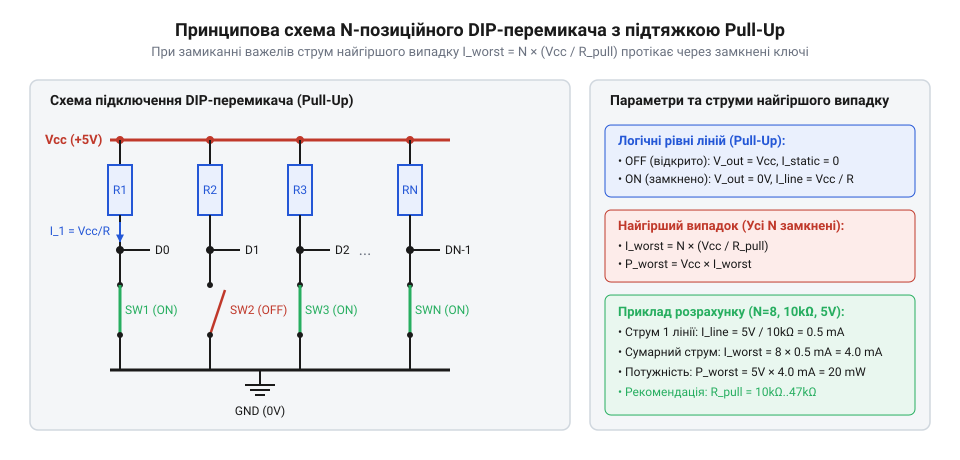
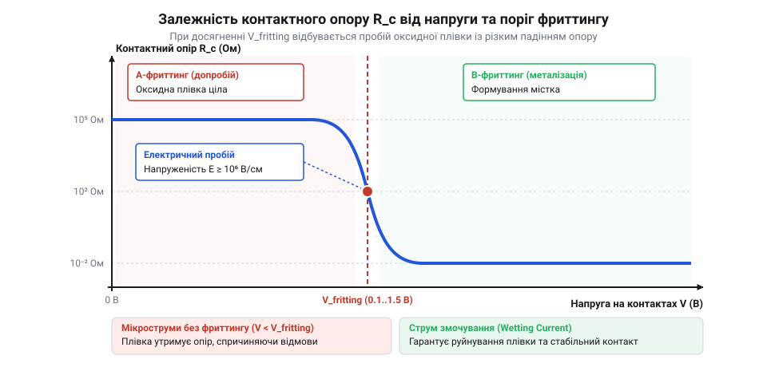

# Двійкове комбінаторне кодування та розрахунок резистивних збірок

<preknowlist>
- [Клавішні перемикачі (Rocker Switches) та силові панелі комутації](root:cat-hw-controls/rocker-switches-and-power-toggle-panels) — Принципи створення контактних перемикачів та комутації електричних кіл.
- [Тумблери, захисні ковпачки Mollie та блокування важелів (Switch Guards)](root:cat-hw-controls/toggle-switches-and-switch-guards) — Закони Ом та Кірхгофа для ковзних контактних груп.
</preknowlist>

## Потреба дискретної адресації та комбінаторна ємність

У цифрових системах керування та мікроконтролерних модулях часто виникає проблема апаратного задання унікальної адреси пристрою на системній шині або вибору режиму завантаження без використання енергонезалежної пам'яті. Використання DIP-перемикачів дозволяє фізично зафіксувати бінарний код адреси за допомогою `N` незалежних двопозиційних клавіш. Кожна позиція перемикача може перебувати в одному з двох дискретних станів: розімкненому (логічна одиниця або нуль залежно від схемотехніки) чи замкненому.

Загальна комбінаторна ємність `K` (кількість доступних унікальних адресних станів), яку забезпечує `N`-позиційний DIP-перемикач, обчислюється за правилом добутку для незалежних бінарних розрядів:

K
= 2ⁿ                                     [комбінаторне правило добутку для N бінарних позицій]

Кожному важільцю з порядковим номером `i ∈ {0, 1, ..., N - 1}` відповідає ваговий коефіцієнт двійкового розряду `2ⁱ`. Сумарне десяткове значення зчитуваного адресного коду `A_dec` формується як сума добутків значення розряду `d_i ∈ {0, 1}` на його ваговий коефіцієнт:

A_dec
= ∑ (d_i · 2ⁱ)                           [сума вагових коефіцієнтів розрядів]

**Обчислення адреси 4-позиційного перемикача:** для 4-позиційного DIP-перемикача (`N = 4`) розрахуємо десятковий та шістнадцятковий код при положенні важелів `d_0 = 1`, `d_1 = 0`, `d_2 = 1`, `d_3 = 1`:

A_dec
= 1 · 2⁰ + 0 · 2¹ + 1 · 2² + 1 · 2³      [підстановка розрядів 1, 0, 1, 1]
= 1 · 1 + 0 · 2 + 1 · 4 + 1 · 8          [обчислення степенів двійки]
= 1 + 0 + 4 + 8                          [додавання вагових значень]
= 13                                     [десятковий результат, що відповідає 0x0D]

Для пристроїв із двійково-кодованим десятковим форматом (англ. @@en|BCD switch@@, Binary-Coded Decimal) 4 розряди обмежуються діапазоном комбінацій від `0000₂` (`0`) до `1001₂` (`9`), а комбінації від `1010₂` до `1111₂` вважаються недопустимими й відсікаються програмно або апаратно. Проте під час механічної комутації DIP-перемикачів чи обертання роторних перемикачів виникає проблема асинхронності спрацьовування контактних груп: при переході між позиціями, де змінюються кілька бітів одночасно (наприклад, від `0011₂` до `0100₂`), контакти переключаються не миттєво. Через механічний розкид виникають транзитні гонки розрядів (англ. @@en|transient race conditions@@), під час яких контролер короткочасно зчитує фальшиві проміжні коди на кшталт `0010₂` або `0111₂`. Щоб усунути ці спотворення, комбінації розрядів формують так, аби сусідні стани мали кодову відстань Хеммінга (англ. @@en|Hamming distance@@) рівно в один біт. Для кожного розряду з індексом `i` значення розряду коду `G_i` обчислюють через операцію «виключне АБО» (англ. @@en|XOR@@, exclusive OR, від лат. *exclusivus* — виключний) між поточним двійковим розрядом `B_i` та сусіднім старшим розрядом `B_(i+1)` (припускаючи для межі `B_N = 0`):

G_i
= B_i ⊕ B_(i+1)                          [побітове додавання за модулем 2 зі старшим розрядом]

У цілочисельному векторному вигляді для всього двійкового значення `B` обчислення підсумкового коду `G` виконується шляхом побітового поєднання числа з його зсувом праворуч на один розряд:

G
= B ⊕ (B >> 1)                           [операція XOR двійкового коду з його зсувом праворуч]

Отримана кодова послідовність утворює код Грея (англ. @@en|Gray code@@), у якому під час повороту важеля перемикача на будь-який сусідній крок змінює стан лише один фізичний контакт, що повністю усуває появу фальшивих транзитних адрес.

## Математика підтягувальних резисторів та споживання

Оскільки сухий контакт DIP-перемикача в розімкненому стані має нескінченно великий опір, лінія цифрового входу мікроконтролера опиняється у високоімпедансному стані (Z-стані) й піддається впливу електромагнітних завад. Для однозначного зафіксування логічного рівня застосовують резистивні підтягувальні збірки Pull-Up (до шини живлення `V_CC`) або Pull-Down (до спільної шини GND).

*Електрична принципова схема підтяжки ліній N-позиційного DIP-перемикача резистивною збіркою Pull-Up з позначенням струму струмопроходження при замиканні клем на землю.*

У схемі з підтяжкою Pull-Up резистором `R_pu` до напруги `V_CC`, коли контакт розімкнено, струм через резистор дорівнює струму витоку входу, і на вхід подається високий рівень `V_CC`. Коли контакт замкнено на землю GND, струм протікає через резистор `R_pu` безпосередньо на землю. Струм однієї замкненої лінії `I_line` обчислюється за законом Ома. Проте під час аналізу найгіршого випадку (англ. @@en|worst-case analysis@@; від англ. *worst-case* — найгірший випадок, та *analysis* — аналіз) оцінювання лише за номінальним опором є недостатнім: реальні підтягувальні резистивні збірки мають технологічний розкид номіналу (англ. @@en|resistor tolerance@@; від англ. *tolerance* — допуск, відхилення). Для масових резисторів ряду E24 технологічна похибка опору `δ_R` становить `±5%` (для бюджетних збірок до `±10%`), а нестабільність шини живлення додає відхилення напруги `δ_V = ±5%`. Мінімальний можливий опір резистора `R_pu_min` відповідає нижній межі технологічного допуску `R_pu_min = R_pu · (1 - δ_R)`. У результаті граничний струм замкненої лінії `I_line_max` та максимальний піковий струм споживання `I_worst_max` `N`-позиційного блоку обчислюються з максимізацією напруги й мінімізацією опору:

    R_pu_min
    = R_pu · (1 - δ_R)                       [мінімальний опір за від'ємного допуску]

    I_line_max
    = V_CC_max / R_pu_min                    [найбільший струм однієї замкненої лінії]
    = (V_CC · (1 + δ_V)) / (R_pu · (1 - δ_R)) [підстановка граничних відхилень напруги й опору]

    I_worst_max
    = N · I_line_max                         [сумарний струм N замкнених ліній при R_pu_min]
    = N · ((V_CC · (1 + δ_V)) / (R_pu · (1 - δ_R))) [граничне споживання для найгіршого випадку]

**Приклад обчислення граничного споживання:** для 8-позиційного DIP-перемикача (`N = 8`) з номіналом підтяжки `R_pu = 10` кОм (`δ_R = ±5%` або `0.05`), напругою `V_CC = 5` В (`δ_V = ±5%` або `0.05`):

    R_pu_min
    = 10000 · (1 - 0.05)                     [мінімальний опір резистора]
    = 10000 · 0.95                           [нижня межа допуску 5%]
    = 9500 Ом = 9.5 кОм                      [найменше значення опору]

    V_CC_max
    = 5 · (1 + 0.05)                         [максимальна напруга живлення]
    = 5 · 1.05                               [верхня межа допуску напруги]
    = 5.25 В                                 [найбільша напруга шини]

    I_worst_max
    = 8 · (5.25 / 9500)                      [підстановка N=8, V_max=5.25 В, R_min=9.5 кОм]
    = 8 · 0.0005526                          [максимальний струм однієї лінії 0.553 мА]
    = 0.004421 А ≈ 4.42 мА                   [граничний статичний струм збірки]

За рахунок технологічного розкиду номіналів та напруги живлення реальний струм споживання 8-канальної збірки зростає з номінальних `4.00` мА до граничних `4.42` мА (приріст на `10.5%`), що критично враховувати при розрахунку бюджету живлення плати.

I_line
= (V_CC - V_OL) / R_pu                  [закон Ома для замкненої лінії]
≈ V_CC / R_pu                            [знехтування малими залишковими падіннями]

Найгірший випадок за споживанням струму й тепловим розсіюванням виникає тоді, коли всі `N` важелів DIP-перемикача одночасно переведені у замкнений стан (`k = N`). Сумарний статичний струм споживання збірки `I_worst` та загальна потужність теплового розсіювання `P_worst` визначаються за формулами:

I_worst
= N · (V_CC / R_pu)                      [сума струмів N замкнених ліній]

P_worst
= I_worst · V_CC                         [формула електричної потужності]
= N · (V_CC² / R_pu)                     [підстановка струму найгіршого випадку]

**Розрахунок споживання 8-позиційної збірки:** для `N = 8` ліній із резисторами `R_pu = 10 кОм` за напруги живлення `V_CC = 5 В`:

I_worst
= 8 · (5 / 10000)                        [підстановка N=8, V_CC=5 В, R=10 кОм]
= 8 · 0.0005                             [струм однієї лінії 0.5 мА]
= 0.004 А = 4 мА                         [сумарний статичний струм]

P_worst
= 8 · (5² / 10000)                       [обчислення потужності розсіювання]
= 8 · (25 / 10000)                       [квадрат напруги живлення]
= 0.02 Вт = 20 мВт                       [сумарне тепловиділення на збірці]

## Оптимальний вибір номіналів та енергозбереження

Вибір номіналу підтягувального резистора `R_pu` є компромісом між завадостійкістю, швидкістю наростання сигналу та енергоспоживанням. Для забезпечення надійного логічного рівня опір `R_pu` повинен перебувати в жорстко обмеженому діапазоні `R_min ≤ R_pu ≤ R_max`.

Верхня межа опору `R_max` визначається як статичним збереженням логічного рівня, так і динамікою перезаряду паразитної ємності лінії. З одного боку, опір мусить утримувати напругу вище порогового рівня логічної одиниці `V_IH_min` з урахуванням вхідного струму витоку мікроконтролера `I_leak`:

R_max_leak
= (V_CC - V_IH_min) / I_leak             [граничний опір за струмом витоку]

З іншого боку, при розмиканні контакту підтягувальний резистор утворює разом із сумарною паразитною ємністю друкованої траси та виводу `C_line` підтягувальний еквівалентний RC-ланцюг з постійною часу `τ = R_pu · C_line` (від англійського @@en|time constant@@). Для забезпечення потрібної швидкості наростання фронту сигналу за заданий час `t_rise` напруга на лінії повинна зрости від `0` до `V_IH_min`, що описується експоненційним законом заряджання ємності:

V_IH_min
= V_CC · (1 - e⁻ᵗ_rise / (R_pu · C_line))   [закон заряджання ємності через резистор]
= V_CC - V_CC · e⁻ᵗ_rise / (R_pu · C_line)   [розкриття дужок]

Звідси шляхом логарифмування обчислюється максимальний допустимий опір `R_max_dynamic` для забезпечення фронту `t_rise`:

R_max_dynamic
= t_rise / (C_line · ln(V_CC / (V_CC - V_IH_min)))   [виведення опору через час наростання]

Для типового цифрового входу CMOS з порогом `V_IH_min = 0.7 · V_CC` коефіцієнт логарифма дорівнює `ln(1 / 0.3) ≈ 1.204`, що спрощує формулу до виразу `R_max_dynamic = t_rise / (1.204 · C_line)`. Остаточна верхня межа опору `R_max` обирається як найсуворіше з двох обмежень: `R_max = min(R_max_leak, R_max_dynamic)`. Перевищення `R_max_dynamic` спричиняє затягування фронту імпульсу та хибні спрацьовування систем шин через завади.

R_max
= (V_CC - V_IH_min) / I_leak             [граничний опір за струмом витоку]

Нижня межа опору `R_min` визначається максимально допустимим струмом через контакт або вихідний каскад `I_max`, а також обмеженнями автономного джерела живлення:

R_min
= V_CC / I_max                           [граничний опір за максимально допустимим струмом]

*Залежність перехідного опору контактних точок від прикладеної напруги з виділенням зони фриттингу для пробою діелектричної оксидної плівки.*

Окрім суто електричних розрахунків кола, вибір `R_pu` обмежений фізикою мікроконтактів. При комутації мікрострумів (струми менше `1 мА` за напруги нижче `5 В`) на поверхні золочених чи срібних контактних майданчиків з часом утворюється тонка діелектрична оксидна або сульфідна плівка. Для її пробою та забезпечення низького перехідного опору контакту потрібне явище фриттингу (англ. @@en|fritting@@; від нім. *Fritten* — спікання) — електричного руйнування оксидної плівки під дією локальної напруженості поля. Для виникнення фриттингу струм у момент замикання має перевищувати пороговий струм змочування (англ. @@en|wetting current@@; від англ. *wetting* — змочування), який для рокерних та слайдерних DIP-контактів становить `I_wet ≥ 10`–`100 мкА` при напрузі `V_fritting ≥ 0.5`–`1.5 В`. Якщо обрати надміру великий опір підтяжки (наприклад, `R_pu > 1 МОм`), струм замикання впаде нижче `1 мкА`, що унеможливить фриттинг і призведе до нестабільного перехідного опору та хибних зчитувань адреси.

## Фізичні межі надійності та явище фриттингу

При комутації слаботочних сигналів у цифрових колах з напругою від `1.8 В` до `3.3 В` та струмами менше `1 мА` на поверхні металевих контактів DIP-перемикачів з часом утворюється тонка діелектрична або напівпровідникова оксидна плівка завтовшки `d` від `1` до `10 нм`. Коли контакт механічно замикається, ця плівка створює високий початковий опір, який заважає проходженню струму підтяжки.

Для пробою цієї ізоляційної плівки застосовують явище фриттингу (англ. @@en|fritting@@, від англ. *fritting* — електричний пробій і спікання тонких плівок). Напруженість електричного поля `E` в об'ємі тонкої плівки при прикладанні напруги `V` досягає критичного значення `E_crit ≈ 10⁸ В/м`:

        V_fritting
        = E_crit · d              [закон пробою діелектричного шару]
        = 10⁸ · (5 · 10⁻⁹)        [підстановка товщини плівки d = 5 нм]
        = 0.5 В                   [порогова напруга пробою оксиду]

При досягненні напруги `V_fritting` діелектричний шар руйнується, виникає м'який фриттинг (англ. @@en|soft fritting@@), а при досягненні напруги розплавлення металу `V_melt ≈ 0.37 В` (для срібла) виникає твердий фриттинг (англ. @@en|hard fritting@@) з утворенням стійкого металевого містка. Для підтримання стабільного контакту струм кола має перевищувати струм змочування (англ. @@en|wetting current@@), який для срібних контактів становить від `1` до `10 мА`. При комутації мікрострумів застосовують золочені контакти, де інертне покриття запобігає окисненню.

## Розрахунок адресного простору та еквівалентного опору

У системних шинах керування кожен периферійний пристрій дістає унікальну апаратну адресу, яка задається блоком DIP-перемикачів. Загальний комбінаторний адресний простір `A_total` для `N`-позиційного перемикача обчислюють за формулою двополюсного стану:

        A_total
        = 2ⁿ                      [кількість унікальних двійкових комбінацій]

Якщо системна шина об'єднує `k` однакових конфігураційних блоків по `N` перемикачів, сумарна кількість адресованих станів становить `2^(k · N)`. Проте пряме паралельне зчитування загальної кількості `S = k · N` секцій вимагає `k · N` фізичних виводів мікроконтролера, що призводить до дефіциту ліній введення-виведення. Для оптимізації застосовують комбінаторний розрахунок матричного опитування, організуючи секції у сітку з `R` рядків та `C` стовпчиків за умови `R · C ≥ k · N`. Замість `P_direct = k · N` ліній кількість задіяних виводів скорочується до `P_matrix = R + C`, вимагаючи для квазіквадратної матриці мінімальне число портів:

        P_matrix
        = 2 · ⌈√(k · N)⌉          [мінімальна кількість виводів при квадратній матриці]

Зокрема, для `k = 4` блоків по `N = 4` перемикачі (`16` секцій) пряме підключення вимагає `16` виводів, а матрична сітка `4 × 4` потребує лише `4 + 4 = 8` портів, заощаджуючи `50 %` ліній мікроконтролера.

        A_system
        = 2ⁿ¹ · 2ⁿ² · ... · 2ⁿₖ   [правило добутку комбінаторних просторів]
        = 2^(k · N)               [для однаковій кількості розрядів]

При комутації `k` замкнених ліній з однаковими підтягувальними резисторами номіналом `R_pull` еквівалентний опір паралельного ланцюга `R_eq` та сумарний струм споживання `I_total` обчислюють як:

        1 / R_eq
        = k / R_pull              [сумування провідностей k замкнених ліній]
        = 5 / 10000               [підстановка k = 5 та R_pull = 10 кОм]
        R_eq = 2000 Ом = 2 кОм    [обчислення еквівалентного опору]

Звідси статичне споживання струму при напрузі живлення `V_CC = 3.3 В` становить `I_total = 3.3 / 2000 = 1.65 мА`. Обчислення еквівалентного опору дозволяє узгодити завадостійкість адресної лінії з обмеженнями енергоспоживання пристрою.
