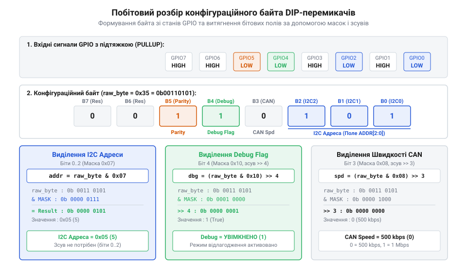
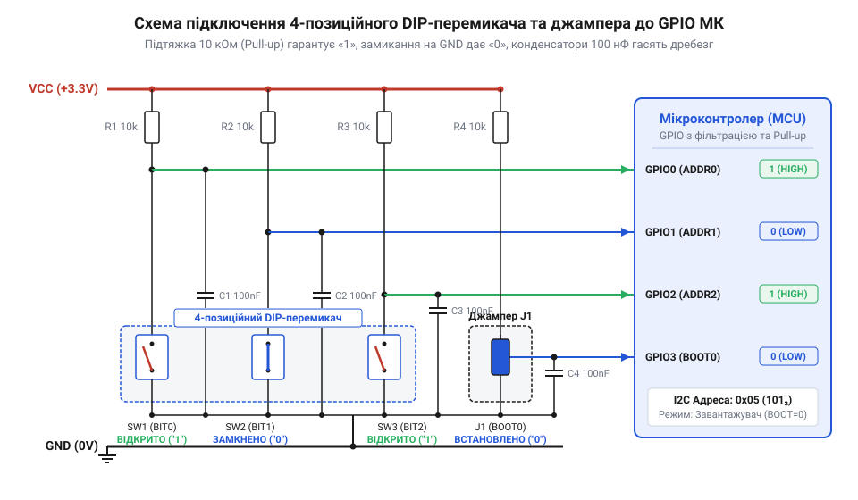

# Проєктування та розпайка конфігураційного модуля на DIP-блоках і джамперах

<preknowlist>
- [DIP-перемикачі та джамперні блоки конфігурації](root:cat-hw-controls/dip-switches-and-configuration-blocks) — Принцип дії, типи та механічна будова DIP-перемикачів і джамперів.
- [KY-004 — тактильна кнопка на платі](root:cat-hw-controls/ky-004-button) — Базові принципи роботи цифрових входів мікроконтролера та підтягувальних резисторів.
</preknowlist>

## Завдання апаратного вибору адреси й режимів

Під час розгортання серійного обладнання у промислових мережах десятки однотипних контролерів підключаються до спільної шини @@en|I2C@@ (англ. *Inter-Integrated Circuit*) або @@en|CAN@@ (англ. *Controller Area Network*). Якщо мережева адреса пристрою жорстко зашита у вихідний код прошивки, кожен вузол вимагає індивідуального компілювання й збірки бінарного файла. Це створює критичні проблеми під час планового обслуговування чи аварійної заміни плати: сервісний інженер на об'єкті змушений мати програматор, вихідні сирці та налаштоване середовище розробки лише для того, щоб змінити адресний ідентифікатор вузла з 3 на 4. На шині @@en|I2C@@ збіг 7-бітних адрес двох ведених пристроїв призводить до прямого конфлікту: під час адресного розклику ведучим обидва модулі одночасно притискають відкритий колектор шини даних `SDA` до землі (стан ACK), спотворюючи відповіді, викликаючи блокування шини та повну втрату зв'язку з периферією. На шині @@en|CAN@@ дублювання ідентифікатора викликає ще катастрофічніші наслідки: під час одночасного відправлення повідомлень обома вузлами початкові біти арбітражу збігаються, тому жоден із них не поступається шиною. Проте на першому ж біті даних, де значення розходяться, вузол, який передає рецесивний рівень `1`, фіксує на диференційній лінії домінантний рівень `0`, накинутий другим передавачем. Спрацьовує виявлення помилки біта @@en|Bit Error@@ (англ. *bit error* — помилка розряду), що змушує обидва контролери згенерувати кадр помилки @@en|Error Frame@@ (англ. *error frame* — кадр помилки) з шести домінантних бітів поспіль. Це створює постійну домінантну заваду на лінії, провокує нескінченний цикл повторного передавання @@en|retransmission@@ (англ. *retransmission* — повторне передавання), швидко переповнює лічильники помилок контролера та паралізує мережу системними тайм-аутами.

Схожа проблема виникає при виборі конфігурації старт-апу мікроконтролера. При подачі живлення базова система повинна визначити режим роботи: запуск основного робочого алгоритму, перехід у режим оновлення прошивки через @@en|UART-завантажувач@@ чи запуск заводського самотестування периферії.

*Формування 8-бітного слова з фізичних станів перемикачів і застосування бітових масок для розпакування параметрів.*

Вирішенням цих завдань є апаратний конфігураційний вузол на основі @@en|DIP-перемикача@@ (англ. *Dual In-line Package* — дворядне розташування виводів) або @@en|джампера@@ (англ. *jumper*, від *to jump* — перестрибувати контактні піни). Механічні перемикачі фіксують дискретний стан логічних рівнів прямо на друкованій платі. Під час подачі живлення мікроконтролер одноразово опитує вхідні лінії @@en|GPIO@@ (англ. *General-Purpose Input/Output* — входи загального призначення), збирає значення важелів у єдиний конфігураційний байт та за допомогою побітових масок і зсувів розпаковує мережеву адресу й прапорці режимів.

## Схемотехніка підключення DIP-блока та джамперів

Будь-яка механічна контактна група — чи то важіль DIP-блока, чи перемичка джампера — у розімкненому стані розриває електричне коло. Якщо вивід @@en|GPIO@@ підключити до перемикача без додаткових елементів, у розімкненому стані вхід залишається у підвішеному стані. Такий плаваючий вхід має нескінченно високий імпеданс, внаслідок чого вловлює довколишні електромагнітні наводки, викликаючи хаотичні перемикання логічного рівня між 0 та 1.

*Схемотехнічне об'єднання механічних перемикачів із зовнішніми підтягувальними резисторами 10 кОм та керамічними RC-фільтрами.*

Для формування стабільного потенціалу застосовують підтягувальні резистори. У стандартній схемі з активним низьким рівнем (Active Low) ліній входу вивід підтягується резистором 10 кОм до лінії живлення `VCC` (режим @@en|Pull-Up@@), а контакт перемикача замикає пін на `GND`. Коли важіль увімкнений (стан ON), струм тече на землю, і пін фіксує напругу 0 В (логічний 0). Коли важіль вимкнений (OFF), перемикач розімкнений, і резистор 10 кОм надійно підтягує напругу до `VCC` (логічна 1).

Внутрішні підтягувальні резистори мікроконтролера мають занадто високий опір (від 30 до 50 кОм), тому в умовах промислових завад на лінії можуть виникати хибні спрацьовавання. Зовнішня резистивна збірка номіналом 10 кОм гарантує достатній струм підтяжки: у розімкненому стані важеля (OFF) струм через підтяжку практично нульовий (`0 мА`), а при замкненому важелі (ON) струм витоку на землю становить `I = VCC / R = 3.3 В / 10 кОм = 0.33 мА` (або `0.5 мА` при напрузі `5 В`) на одну лінію, що є оптимальним компромісом між завадостійкістю та енергоефективністю. Однак підтяжка 10 кОм накладає жорсткі обмеження на довжину виносного шлейфу через паразитну ємність провідників (від `50` до `100 пФ/м` для плаского стрічкового кабелю @@en|flat ribbon cable@@). При сумарній ємності лінії та входу GPIO близько `200 пФ` (що відповідає довжині шлейфу до `2 м`) постійна часу заряду `τ = R · C = 10 кОм · 200 пФ = 2 мкс` ще забезпечує чіткий фронт сигналу, але подальше подовження кабелю понад `2 м` створює високий апаратний імпеданс, схильний до ємнісних перехресних наводок (англ. @@en|capacitive crosstalk@@) від сусідніх імпульсних ліній. Для вибору десяткових режимів або адрес зручно застосовувати роторний @@en|BCD-перемикач@@ (англ. *Binary-Coded Decimal* — двійково-десятковий), який за допомогою внутрішнього кулачкового диска розкодовує положення ручки у 4-бітну двійкову комбінацію. Паралельно контактам перемикачів встановлюють керамічні конденсатори ємністю 0.1 мкФ. Разом із резистором 10 кОм вони створюють RC-фільтр низьких частот із постійною часу 1 мс, що повністю пригнічує брязкіт контактів та високочастотні наводки. Схемотехнічні підходи збігаються з підключенням інших елементів вводу, таких як [тактильні кнопки](root:cat-hw-controls/ky-004-button) або захищені [тумблери](root:cat-hw-controls/toggle-switches-and-switch-guards).

## Розводка плати та апаратний захист

DIP-блокові перемикачі та джампери розраховані на ручне налаштування оператором, тому вони часто розташовані на краю друкованої плати або виведені крізь вирізи корпусу пристрою. Це робить їх первинним джерелом проникнення електростатичного розряду від рук людини. Безпосередній розряд статичної електрики амплітудою у кілька кіловольт через металевий важіль перемикача здатний миттєво пробити підзатворний діелектрик вхідного транзистора @@en|GPIO@@.

Для апаратного захисту безпосередньо біля контактних площадок DIP-блока встановлюють @@en|ESD-супресори@@ (англ. *Electrostatic Discharge*, лат. *supprimere* — придушувати електростатичний розряд) або TVS-діоди (англ. *Transient Voltage Suppressors*). При перевищенні порогової напруги пробою (Breakdown Voltage, `V_BR`) TVS-діод лавинно відкривається за рекордні частки наносекунди (час спрацьовування від 1 до 100 пікосекунд для кремнієвих структур) та скидає високочастотний імпульсний струм на шину заземлення. Сучасні супресори сигнальних ліній розраховані на максимальну пікову потужність розряду (Peak Pulse Power, `P_pp`) від 100 до 400 Вт при стандартній формі імпульсу 8/20 мкс, що дозволяє їм безперешкодно поглинати та розсіювати енергію електростатичного розряду амплітудою до 15–30 кВ відповідно до стандарту IEC 61000-4-2, обмежуючи пікову напругу фіксації (Clamping Voltage, `V_clamp`) на безпечному для входів мікроконтролера рівні (до 5.5–6 В). При цьому критичним параметром захисного діода є його бар'єрна ємність p-n переходу `C_j`, яка підключається паралельно до лінії: щоб додаткова ємність TVS-діода не затягувала фронти сигналів при підтяжці `R_pull = 10 кОм` за сумарної ємності доріжки й входу `C_line = 20 пФ` і вимозі до часу наростання `t_rise_max = 1 мкс`, гранична ємність супресора розраховується так: Принципи дії ТВС-супресорів для відведення розрядів розкрито у матеріалі про [ESD-захист цифрових входів](root:hw-components/tvs-diode).

        C_j_max = t_rise_max / (2.2 · R_pull) - C_line
                = 1 µs / (2.2 · 10 kOhm) - 20 pF   [розрахунок граничної ємності TVS]
                = 45.4 pF - 20 pF                  [віднімання ємності монтажу]
                ≈ 25.4 pF                          [максимально припустима ємність діода]

Для високошвидкісних або суміщених шин обирають малоємнісні TVS-збірки з `C_j < 1–3 пФ`, що повністю усуває викривлення фронтів напруги.

Під час трасування друкованої плати доріжки від перемикачів прокладають мінімальною довжиною над суцільним заземленим полігоном (Ground Plane). Заземлена площина створює екранувальний бар'єр та мінімізує петлю зворотного струму, запобігаючи випромінюванню й наведенню електромагнітних завад. Блокувальні керамічні конденсатори 0.1 мкФ монтують якомога ближче до виводів резистивної збірки та DIP-блока, уникаючи довгих провідників, що можуть працювати як приймальні антени.

## Програмне зчитування та бітова маска

Опитування конфігураційного модуля виконується під час ініціалізації мікроконтролера до запуску основних мережевих стеків. Оскільки кожен важіль @@en|DIP-перемикача@@ (англ. *Dual In-line Package* — дворядне розташування виводів) підключений до окремого піна @@en|GPIO@@ (англ. *General-Purpose Input/Output* — входи загального призначення), прошивка зчитує фізичні рівні ліній і об'єднує їх у паралельний байт.

Оскільки при схемній підтяжці до `VCC` замкнений важіль дає логічний 0 (Active Low), для отримання прямої логіки застосовують побітову інверсію НЕ (`~`). Після інвертування увімкненому положенню важеля відповідає логічна 1. Якщо всі лінії перемикача розведені послідовно на один паралельний порт, для виділення окремих полів адреси й режимів використовують логічне AND (`&`) з відповідною бітовою маскою та правий зсув (`>>`). Проте на реальних друкованих платах через трасування провідників важелі DIP-блока часто розкидані по довільних виводах різних портів @@en|GPIO@@ (наприклад, `PA2`, `PB5`, `PC0`). У такому разі неможливо застосувати єдиний масковий зсув до одного регістру порту. Програма змушена збирати послідовний конфігураційний байт програмно: драйвер у циклі опитує кожен фізичний пін за масивом картографії пінів, інвертує Active Low стан і за допомогою лівого зсуву `(is_closed << i)` та побітового OR (`|=`) пакує стан розряду `i` у відповідну позицію віртуального байта. Лише після такого програмного формування монолітного байта виділяють бітові поля масками. Наприклад, під час опитування 4-бітного роторного @@en|BCD-перемикача@@ (англ. *Binary-Coded Decimal* — двійково-кодований десятковий), чотири виводи вагових розрядів 2⁰, 2¹, 2², 2³ підключають до ліній `GPIO4`–`GPIO7`. Якщо зчитаний сирий стан вхідного регістру порту становить `raw_port = 0b11010011` (де замкнені лінії ротора дають 0 через Pull-Up), покрокове виділення позиції перемикача виконується за схемою:

    inv_port = ~raw_port                 [0b00101100 — інверсія Active Low у пряму логіку]
    masked   = inv_port & 0xF0           [0b00100000 — накладання бітової маски 0xF0 на біти 4..7]
    bcd_val  = masked >> 4               [0b00000010 — правий зсув на 4 біти, значення = 2]

Отримане десяткове значення `bcd_val = 2` відповідає поточній фіксованій позиції роторного селектора. Для запобігання хибному опитуванню під час перехідних процесів та механічного прокручування вала застосовують програмний @@en|дебаунсинг@@ (англ. *debounce*, від *bounce* — відскок контактів) шляхом порівняння кількох послідовних зчитувань.

:::tabs
@tab C
:::code proj-dip-configured-mcu-board/c/dip_switch.h 10-28
:::code proj-dip-configured-mcu-board/c/dip_switch.c 27-56
@tab C++
:::code proj-dip-configured-mcu-board/cpp/include/dip_configurator.hpp 20-30
:::code proj-dip-configured-mcu-board/cpp/src/dip_configurator.cpp 25-36
:::

## Валідація режимів та налагодження модуля

У реальних експлуатаційних умовах оператор може випадково або навмисно встановити заборонену комбінацію важелів — наприклад, комбінацію `0b1111` (зарезервовану для технічного самотестування) або адресний код `0b1010`, що викликає конфлікт на шині. Принцип @@en|дефенсивного кодування@@ (англ. *defensive programming* — захисне програмування) вимагає перевірки зчитаної маски перед її застосуванням у системі.

Якщо функція валідації виявляє заборонений стан, драйвер активує @@en|фолбек@@ (англ. *fallback* — відступ на безпечний варіант) — автоматичне повернення до заздалегідь визначеного безпечного профілю (наприклад, стандартна адреса 1 та швидкість 115200 біт/с).

Перевірка зібраного модуля на друкованій платі починається з вимірювання статичних напруг @@en|мультиметром@@ (англ. *multimeter*, від лат. *multus* — багато та грецького *metron* — міра): на замкнених виводах напруга має становити 0 В, на розімкнених — рівень `VCC`. Для аналізу динаміки перехідних процесів та механічного брязкоту контактів використовують цифровий осцилограф із пасивним щупом 10X. Методологія вимірювання тривалості фронту вимагає налаштування однократного запуску розгортки (Single Trigger) за спадним або наростаючим перепадом напруги під час фізичного перемикання важеля. За осцилографічними курсорами на рівнях 10% та 90% від повного розмаху `VCC` оцінюють час наростання або спаду сигналу, що визначається постійною часу RC-ланцюга: наприклад, для резистора підтяжки 10 кОм та фільтруючого конденсатора 0.1 мкФ тривалість перезаряджання становить від 1 до 2.2 мілісекунди. Занадто затягнутий фронт свідчить про надмірну ємність або зношеність контактів, а занадто крутий — про відсутність фільтрації брязкоту. Для одночасного аналізу кількох паралельних ліній під час старт-апу застосовують @@en|логічний аналізатор@@ (англ. *logic analyzer*). Верифікацію роботи підтяжок та завадозахисту проводять так само, як і для [тактильних кнопок](root:cat-hw-controls/ky-004-button) чи силових [тумблерів](root:cat-hw-controls/toggle-switches-and-switch-guards). Прийоми підключення щупів та захоплення сигналів розкрито у статті про [логічні аналізатори у налагодженні](root:cat-hw-instruments/logic-analyzers-in-embedded-debugging).

:::tabs
@tab C
:::code proj-dip-configured-mcu-board/c/main.c 7-54
@tab C++
:::code proj-dip-configured-mcu-board/cpp/src/dip_configurator.cpp 38-79
:::code proj-dip-configured-mcu-board/cpp/src/main.cpp 4-30
:::
