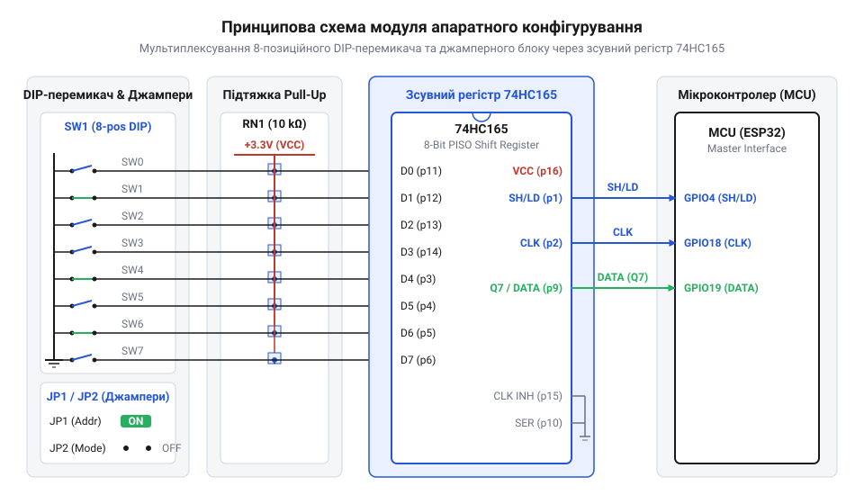
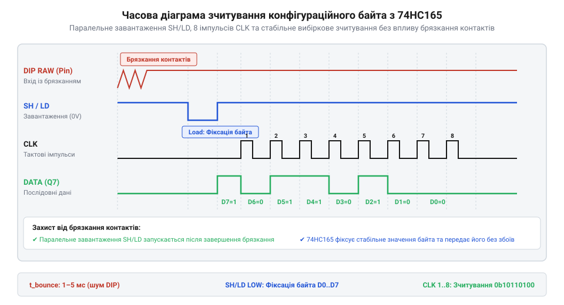

# Проєкт модуля апаратного задання конфігурації для мікроконтролера

<preknowlist>
- [DIP-перемикачі та джамперні блоки конфігурації](root:cat-hw-controls/dip-switches-and-configuration-blocks) — принципи роботи важелів, кроки виводів та базові схеми підтяжки
- [Тактильні кнопки з ковпачками](root:cat-hw-controls/tactile-buttons) — принципи роботи нормально розімкнених контактних груп і поняття брязкання контактів
</preknowlist>

## Необхідність апаратного задання параметрів

Під час розробки промислових мікроконтролерних систем виникає задача фіксованого завдання системних конфігурацій до моменту старту основними алгоритмами. Вузол повинен мати визначену мережеву адресу I2C, індекс швидкості послідовного порту та режим завантаження ще до зчитування конфігурацій із енергонезалежної пам'яті. Збереження цих параметрів у флеш-пам'яті створює ризик блокування пристрою при помилковому записі або виникненні конфлікту адрес на спільній шині.

Пряме підключення десятка механічних вимикачів безпосередньо до портів мікроконтролера призводить до виснаження ресурсів. Кожен важіль вимагає окремої лінії, що створює гострий дефіцит виводів GPIO (від англ. @@en|GPIO deficit@@) у компактних корпусах. Окрім втрати ніжок, незахищені довгі провідники від механічних контактів виконують роль антен. Вони збирають імпульсні завади від силового обладнання та створюють ризик хибного зчитування станів у момент подачі живлення.

Використання [DIP-перемикачів](root:cat-hw-controls/dip-switches-and-configuration-blocks) або джамперних блоків дозволяє зберегти апаратне налаштування при вимкненому живленні. Важелі фізично фіксують положення контактів без витрат електроенергії. Для усунення невизначеного третього стану (Z-стану; від англ. @@en|Z-state@@) розімкнені виводи потребують прив'язки потенціалу через резистивні збірки. Оптимальним рішенням стає винесення кіл комутації в окремий завадостійкий модуль, де дані паралельно фіксуються та передаються в контролер лише трьома цифровими лініями.

Вибір номіналу підтягувальних резисторів `R_pull` прямо визначає статичне струмоспоживання модуля (від англ. @@en|static current@@). У розімкненому стані важеля струм через підтяжку не протікає, і споживання визначається лише мікроамперними струмами витоку входів. При замиканні важеля на землю через резистор постійно протікає струм `I_closed = V_CC / R_pull`. Розрахуємо сумарний струм `I_total` для 8-позиційного DIP-перемикача при напрузі живлення `V_CC = 3.3 В` для номіналів 1 кОм, 10 кОм та 100 кОм:

        I_closed(1k) = 3.3 / 1000 = 3.3 мА           [струм одного замкненого важеля при 1 кОм]
        I_total(1k) = 8 · 3.3 мА = 26.4 мА           [сумарний струм 8 замкнених важелів при 1 кОм]

        I_closed(10k) = 3.3 / 10000 = 0.33 мА        [струм одного замкненого важеля при 10 кОм]
        I_total(10k) = 8 · 0.33 мА = 2.64 мА         [сумарний струм 8 замкнених важелів при 10 кОм]

        I_closed(100k) = 3.3 / 100000 = 0.033 мА     [струм одного замкненого важеля при 100 кОм]
        I_total(100k) = 8 · 0.033 мА = 0.264 мА      [сумарний струм 8 замкнених важелів при 100 кОм]

Застосування занадто низького опору 1 кОм призводить до невиправданого перевитрачання струму до 26.4 мА, що є критичним для пристроїв з батарейним живленням. Вибір надто високого опору 100 кОм знижує споживання до 0.264 мА, але робить лінії чутливими до електромагнітних наводок та збільшує час наростання сигналу. Номінал підтягувальної резистивної збірки 10 кОм забезпечує компромісний струм 2.64 мА, гарантуючи завадостійкість та економне використання енергії.

## Принципова схема та вибір компонентів

Схемотехніка модуля конфігурування будується навколо 8-бітного зсувного регістра паралельно-послідовного перетворення (від англ. @@en|parallel-in serial-out@@) 74HC165. Опитування контактних груп виконується за допомогою 3-провідного інтерфейсу, що складається з ліній паралельного завантаження SH/LD, тактування CLK та послідовного виходу даних DATA. Внутрішню структуру та тактування мікросхеми детально висвітлює окремий матеріал про [зсувний регістр 74HC165](root:sf-devices/74hc165-shift-register).

*Принципова схема підключення 8-позиційного DIP-перемикача та підтягувальних резисторних збірок до вхідних портів зсувного регістра 74HC165.*

Кожен важіль 8-позиційного DIP-перемикача та джамперного селектора підключений до відповідного паралельного входу D0–D7 регістра 74HC165. Для стабілізації логічних рівнів застосовують резистивні матричні збірки (від англ. @@en|resistor network@@) опором 10 кОм у конфігурації Pull-Up. Коли важіль розімкнений, підтягувальний резистор забезпечує високий логічний рівень 1 на вході регістра. При замиканні важеля на землю GND вхідний потенціал знижується до логічного 0. Усередині регістра 74HC165 входи D0–D7 з'єднані безпосередньо з асинхронними входами встановлення внутрішніх тригерів. Вхід асинхронного паралельного завантаження PL (від англ. *parallel load*; далі — @@en|parallel load@@) має абсолютний пріоритет над тактовим входом CLK. Низький логічний рівень на вході PL миттєво фіксує стани входів D0–D7 у тригерах незалежно від фронтів тактування. При поверненні входу PL у високий рівень асинхронна фіксація вимикається. Після цього регістр перемикається у режим синхронного зсуву, де кожен фронт на вході CLK просуває біти до послідовного виходу Q7. Така логічна архітектура унеможливлює втрату бітів під час паралельного зчитування конфігурації.

Процес зчитування даних мікроконтролером розділений на дві послідовні фази. Спершу мікроконтролер подає короткий низький імпульс на лінію SH/LD. Цей сигнал засуває поточний стан усіх вісімки вхідних важелів у внутрішні тригери регістра. Після повернення лінії SH/LD у високий стан контролер генерує серію з 8 тактових імпульсів на лінії CLK, зчитуючи біти від D7 до D0 через лінію DATA.

*Осцилограма часових діаграм сигналів фіксації SH/LD, тактування CLK та послідовного зчитування даних DATA.*

Програмна реалізація драйвера здійснює зчитування та верифікацію цілісності отриманого конфігураційного байта.

:::tabs
=== C
:::code proj-dip-jumper-mcu-configuration-module/c/include/dip_74hc165.h
:::code proj-dip-jumper-mcu-configuration-module/c/src/dip_74hc165.c
:::code proj-dip-jumper-mcu-configuration-module/c/src/main.c
=== C++
:::code proj-dip-jumper-mcu-configuration-module/cpp/include/dip_config.hpp
:::code proj-dip-jumper-mcu-configuration-module/cpp/src/dip_config.cpp
:::code proj-dip-jumper-mcu-configuration-module/cpp/main.cpp
:::

Драйвер обчислює контрольну парність зчитаного байта. При виявленні спотворення даних через обвуглення чи окислення контактів система відхиляє зчитаний байт та активує безпечний режим за замовчуванням.

## Розведення друкованої плати та термостійкість

Розводка друкованої плати модуля конфігурування вимагає дотримання правил завадозахисту цифрових кіл. Суцільний шар заземлення GND розміщують на нижньому шарі плати безпосередньо під мікросхемою 74HC165 та DIP-перемикачами. Для нейтралізації високочастотних імпульсних провалів напруги живлення поруч із виводом VCC регістра встановлюють керамічний блокираторний конденсатор (від англ. @@en|decoupling capacitor@@) ємністю 100 нФ з найкоротшим шляхом до землі.

Сигнальні провідники клем SH/LD, CLK та DATA трасують паралельно з мінімальною довжиною до роз'єму підключення мікроконтролера. Їх віддаляють від силових трас перемикання навантажень та імпульсних перетворювачів на відстань не менше трьох ширин провідника. Протилежні виводи DIP-перемикачів з'єднують із загальним земляним полігоном широкими провідниками для зменшення омічного опору повернення струму.

Термічна стійкість (від англ. @@en|thermal endurance@@) корпусів DIP-перемикачів є критичним фактором надійності при монтуванні плати. Вибір матеріалу корпусу безпосередньо залежить від технології монтажу: вивідні THT-компоненти зазвичай виготовляють із полібутилентерефталату (від англ. @@en|polybutylene terephthalate@@; далі — @@en|PBT@@), який володіє високою механічною міцністю, проте деформується вже при температурах понад 220–230 °C. Для поверхневого монтажу (від англ. @@en|surface-mount technology@@; далі — @@en|SMD@@) в печі оплавлення при 245–260 °C корпуси виготовляють виключно з термостійкого поліфеніленсульфіду (від англ. @@en|polyphenylene sulfide@@; далі — @@en|PPS@@) або рідкокристалічного полімеру (від англ. @@en|liquid crystal polymer@@; далі — @@en|LCP@@), які витримують короткочасний нагрів до 280 °C без зміни геометрії. Використання дешевих PBT-перемикачів у процесі SMD-паяння оплавленням або перевищення температури паяльника понад 260 °C тривалістю понад 3–5 секунд спричиняє деформацію пластикових повзунків, послаблення притискного зусилля внутрішніх пружин і викривлення ламелей, що викликає ненадійний контакт та обрив кола в процесі експлуатації.

## Програмний драйвер зчитування стану

Спроба зчитати конфігураційні параметри без фіксованого таймінгу або без верифікації цілісності ризикує передати мікроконтролеру спотворену системну адресу чи помилкову швидкість шини. Через механічне зношування або окиснення контактів DIP-перемикача логічний рівень на лінії може бути нестабільним. Програмний драйвер зсувного регістра (англ. @@en|shift register@@, від to shift — зсувати) має чітко дотримуватися часової послідовності керування сигналом @@en|parallel load@@ (лат. parallelus — паралельний, англ. load — завантаження) та перевіряти цілісність отриманого байта за допомогою @@en|parity check@@ (англ. parity check, від лат. paritas — рівність).

Алгоритм опитування починається з формування низького імпульсу на лінії `PL` (Parallel Load / SH_LD). Переведення `PL` у логічний нуль на час `t_w ≥ 20 нс` засуває поточний стан усіх восьми важелів у внутрішні тригери IC. Після повернення `PL` у високий рівень байт стає доступним для послідовного вичитування. Мікроконтролер зчитує старший біт `D7` напряму з лінії `DATA`, після чого генерує тактовий перепад на лінії `CLK`. Кожен фронт `CLK` зсуває наступний біт на вихід `Q7`.

Отриманий 8-бітний конфігураційний байт підлягає бітовому маскуванню та зсуву. Молодші біти визначають системну адресу, середній діапазон відповідає за індекс швидкості послідовного порту, а старший розряд виділяється під біт парності. Якщо сума одиничних бітів не відповідає очікуваному паритету, драйвер відхиляє зчитаний байт та активує безпечні налаштування за замовчуванням. Такий підхід аналогічний захисту від механічних завад під час опитування контактів у [тактильних кнопках](root:cat-hw-controls/tactile-buttons).

Обчислювально найефективнішим способом перевірки парності на мікроконтролерах є послідовне складання бітів за модулем 2 за допомогою побітової операції «Виключне АБО» (від англ. *exclusive OR*; далі — @@en|XOR@@). Контрольний біт парності `P_calc` для семи інформаційних бітів `b_6`–`b_0` обчислюють за формулою:

P_calc = b_6 ⊕ b_5 ⊕ b_4 ⊕ b_3 ⊕ b_2 ⊕ b_1 ⊕ b_0      [побітове додавання за модулем 2]

Операція ⊕ повертає логічний нуль для парної кількості одиничних бітів та одиницю для непарної.

**Приклад обчислення парності для байта конфігурації 0x1D (0b00011101):**

P_calc = 0 ⊕ 0 ⊕ 1 ⊕ 1 ⊕ 1 ⊕ 0 ⊕ 1      [підстановка бітів b_6..b_0 з байта 0b0011101]
= 0 ⊕ 1 ⊕ 1 ⊕ 1 ⊕ 0 ⊕ 1                 [обчислення 0 ⊕ 0 = 0]
= 1 ⊕ 1 ⊕ 1 ⊕ 0 ⊕ 1                     [обчислення 0 ⊕ 1 = 1]
= 0 ⊕ 1 ⊕ 0 ⊕ 1                         [обчислення 1 ⊕ 1 = 0]
= 1 ⊕ 0 ⊕ 1                             [обчислення 0 ⊕ 1 = 1]
= 1 ⊕ 1                                 [обчислення 1 ⊕ 0 = 1]
= 0                                     [підсумкове значення біта парності]

Отриманий результат `P_calc = 0` підтверджує парну кількість одиниць у зчитаному байті та виконується за кілька тактів процесора. Використання побітового `XOR` прискорює валідацію конфігураційного байта порівняно з циклами арифметичного додавання, мінімізуючи затримки обробки аналогічно апаратним опитуванням [тактильних кнопок](root:cat-hw-controls/tactile-buttons).

Нижче наведено ідіоматичні драйвери зчитування та розбору конфігураційного байта мовами C та C++:

:::tabs
@tab C
:::code proj-dip-jumper-mcu-configuration-module/c/include/dip_74hc165.h
:::code proj-dip-jumper-mcu-configuration-module/c/src/dip_74hc165.c
:::code proj-dip-jumper-mcu-configuration-module/c/src/main.c
@tab C++
:::code proj-dip-jumper-mcu-configuration-module/cpp/include/dip_config.hpp
:::code proj-dip-jumper-mcu-configuration-module/cpp/src/dip_config.cpp
:::code proj-dip-jumper-mcu-configuration-module/cpp/main.cpp
:::

## Лабораторне випробування та аналіз сигналів

Навіть бездоганно написаний драйвер безсилий, якщо у фізичному каналі виникають перехідні завади або провали живильної напруги. На етапі пусконалагодження апаратного модуля конфігурації критично важливо контролювати часові діаграми сигналів за допомогою двоканального осцилографа або логічного аналізатора.

*Часова діаграма тактування зсувного регістра 74HC165 із виміряними інтервалами затримки та встановлення даних.*

Під час вимірювання першим кроком перевіряють ширину імпульсу засувки `PL` (сигнал @@en|parallel load@@). Тривалість низького рівня повинна перевищувати 20 нс, інакше внутрішній @@en|shift register@@ не встигне зафіксувати стани важелів. Другий критичний параметр — час встановлення @@en|setup time@@ (англ. setup time — час підготовки) та час утримання @@en|hold time@@ (англ. hold time — час утримання) даних відносно зростаючого фронту `CLK`. Якщо фронт `CLK` набігає занадто швидко після зміни `PL`, вихід `Q7` може зчитати невизначений стан.

Найпоширенішою апаратною несправністю є брязкання контактів (англ. @@en|contact bounce@@, від contact — контакт, bounce — відскок) при перемиканні важелів увімкненого модуля. На осцилограмі це проявляється як серія хаотичних спадів та сплесків напруги амплітудою до 1.5 В на лінії `DATA`. Наявність підтягувальних резисторів й блокираторних конденсаторів згладжує ці сплески. Обрив лінії або відсутність контакту джампера формує підвішений вхід (англ. @@en|floating input@@, від float — плавати, input — вхід), що призводить до систематичних помилок @@en|parity check@@ при опитуванні.
