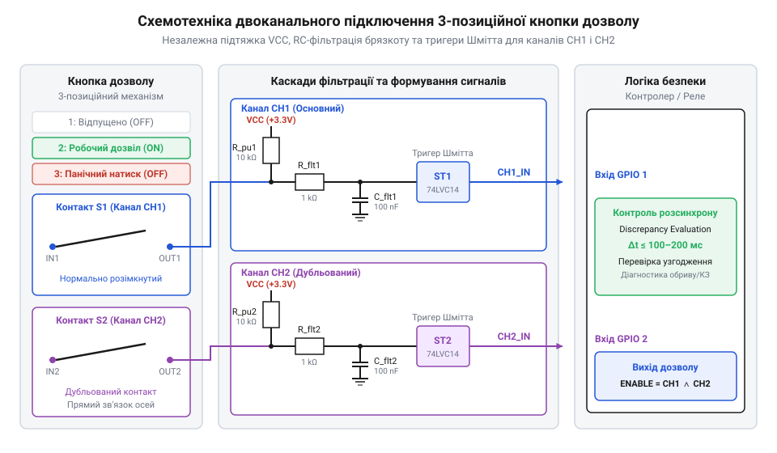
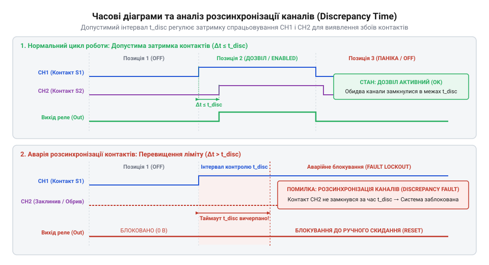

# Апаратний інтерфейс, схемотехніка підключення та часові допуски пристроїв дозволу

<preknowlist>
- [Кнопка аварійного стопу грибок та органи безпечного відключення (IEC 60947-5-5)](root:cat-hw-controls/estop-mushroom-button) — принципи дублювання контактних груп та побудови дубльованих кіл безпеки.
- [Тактильні кнопки з ковпачками](root:cat-hw-controls/tactile-buttons) — механізм виникнення контактного брязкоту та способи його апаратної фільтрації.
</preknowlist>

## Ризики налагодження та концепція дозволу

Під час програмування, навчання та сервісного обслуговування промислових робототехнічних комплексів оператор змушений перебувати у потенційно небезпечній зоні руху маніпулятора. У випадку раптового збою системи або виникнення непередбачуваної траєкторії інстинктивна фізіологічна реакція людини проявляється у двох крайніх формах: або в миттєвому відпусканні пульта з розтисканням долоні, або у панічному судомному стисканні рукоятки. Ззвичайні двопозиційні органи керування, аналогічно до того як влаштовані [тактильні кнопки з ковпачками](root:cat-hw-controls/tactile-buttons), непридатні для безпечного налагодження, оскільки судомне стискання залишає контакт замкненим, блокуючи відключення приводу.

Для усунення цього ризику застосовують трипозиційні пристрої дозволу (від англ. *enable* — надавати можливість, дозволяти; англ. @@en|enabling switch@@), кінематика яких реалізує три послідовних стани:
1. Позиція 1 (відпущено): механічний важіль перебуває у вільному стані під дією пружини повернення, електричні контакти розімкнені, рух робота повністю заборонено.
2. Позиція 2 (робочий дозвіл): оператор свідомо утримує важіль у середньому проміжному положенні, розмикаючи захисне блокування та дозволяючи рух маніпулятора на зниженій швидкості.
3. Позиція 3 (панічне натискання): при переляку або судомі оператор з силою дотискає важіль до упору, що призводить до негайного примусового розмикання силового ланцюга.

Особливістю кінематики є те, що при поверненні важеля з Позиції 3 у Позицію 1 пристрій проходить Позицію 2 без замикання робочих контактів, запобігаючи повторному випадковому запуску обладнання. Це реалізовано за допомогою апаратного анкерного блокування (від англ. *anchor* — якір, зачіп; англ. @@en|anchor latch mechanism@@): під час глибокого панічного продавлювання в Позицію 3 кулачковий штовхач зриває механічний фіксатор і перемикає повзунок на обхідну направляючу колію. Під дією пружини повернення контактний блок рухається назад уздовж холостого каналу без торкання ламелей Позиції 2, а повне взведення анкера в робочий стан відбувається лише після доходження важеля до Позиції 1. Оскільки надійність блокування тримається на точній геометрії пластикових та металевих направляючих, при накопиченні бруду чи абразивному зносі анкерний зуб ризикує заклинити або проскочити, що вимагає контролю механічного ресурсу кнопкового вузла (зазвичай `10⁵`..`10⁶` спрацьовувань).

## Схемотехніка дубльованого підключення ліній

Відповідно до вимог стандарту безпеки ISO 13849-1 (Категорія 3/4), кінематичний ланцюг пристрою дозволу повинен містити дві незалежні контактні групи (канали CH1 та CH2) для усунення поодиноких точок відмови. У кожному каналі застосовують конфігурацію з нормально розімкненими (NO) та нормально замкненими (NC) контактами, організованими за схемою мостового перемикання.

*Принципова схема розводки контактних груп двох незалежних каналів CH1 та CH2 із пасивними RC-ланцюгами та тригерами Шмітта.*

Для формування цифрових сигналів входи підтягують до шини живлення `VCC = 24 В` через резистори `R_pullup = 4.7 кОм`. З огляду на те, що механічне замикання супроводжується мікроскопічними стрибками ламелей, для придушення брязкоту застосовують пасивний низькочастотний RC-фільтр другого порядку. Постійна часу фільтра розраховується за формулою:

`τ = R_filter · C_filter`

де `R_filter = 10 кОм` — опір обмежувального резистора, а `C_filter = 100 нФ` — ємність фільтруючого керамічного конденсатора.

Отже, стала часу становить:

`τ = 10⁴ · 10⁻⁷ = 10⁻³ c = 1 мс`

Цього значення достатньо для повного поглинання контактного брязкоту тривалістю `0.2..0.5 мс`. Відфільтрований сигнал подається на тригер Шмітта (англ. @@en|Schmitt trigger@@) із гістерезисом напруги `ΔV_hyst = 1.2 В`, який формує прямокутні фронти без проміжних невизначених станів.

Сформовані логічні рівні з обох тригерів подаються на логіку реле безпеки, яка очікує суворо синфазної зміни станів. Для аналізу відповідності вихідних рівнів нормативним режимам роботи та виявлення несправностей застосовують таблицю істинності (від англ. @@en|truth table@@, від англ. *truth* — істина, та *table* — таблиця):

| Позиція / Стан | Канал CH1 | Канал CH2 | Статус реле | Пояснення / Режим |
|---|---|---|---|---|
| Позиція 1 (Відпущено) | `0` (розімкнено) | `0` (розімкнено) | Вимкнено | Базовий стан спокою, рух заборонено |
| Позиція 2 (Робочий дозвіл) | `1` (замкнено) | `1` (замкнено) | Дозволено | Нормальний робочий режим утримування |
| Позиція 3 (Панічний натиск) | `0` (розімкнено) | `0` (розімкнено) | Вимкнено | Захисне відключення при перетисканні |
| Розсинхронізація / Обрив | `0` (або `1`) | `1` (або `0`) | Відмова | Апаратне розходження станів каналів |
| Коротке замикання ліній | `1` (статичне) | `1` (статичне) | Відмова | Виявляється тестовим імпульсним опитуванням |

Будь-яка комбінація, де стани `CH1` та `CH2` не збігаються (`CH1 ≠ CH2`), розцінюється як апаратне пошкодження кабелю чи контактної групи. У такому разі система захисту негайно блокує роботу обладнання та переходить у режим виявлення відмов (від англ. @@en|fault detection@@, від англ. *fault* — відмова, та *detection* — виявлення), що запобігає повторному пуску до усунення обриву чи замикання в колах [дубльованого контролю ліній](root:cat-hw-controls/estop-mushroom-button).

## Часові нормативи розсуву контактів

Під час переходу кнопки дозволу між позиціями механічні допуски виготовлення важелів та нерівномірність зносу контактних груп спричиняють часовий розкид між моментом замикання першого та другого каналів. Цю різницю в часі називають часом неузгодженості (від англ. *discrepancy* — розходження; англ. @@en|discrepancy time@@).

*Часові діаграми перемикання каналів із позначенням допустимого часового вікна неузгодженості.*

Пристрій керування безпекою вимірює інтервал розсинхронізації між фронтами сигналів `t_CH1` та `t_CH2`. Умова справності обох каналів описується нерівністю:

    Δt_discrepancy = |t_CH1 - t_CH2| ≤ t_max      [допустимий розсуд контактних груп]

де `t_max` — максимально допустимий нормативний час неузгодженості. Якщо через механічне заклинювання або зварювання контактів часовий інтервал перевищує `t_max`, контролер не просто відключає вихідний сигнал, а активує апаратний алгоритм засувки помилки (від англ. @@en|latch fault@@, від англ. *latch* — засувка, та *fault* — відмова). У цьому стані тригер безпеки фіксується у заблокованому положенні й ігнорує будь-які подальші перемикання важеля. Повернення в нормальний робочий режим вимагає повного скидання живлення (від англ. @@en|power cycle@@, від англ. *power* — живлення, та *cycle* — цикл) або спеціальної процедури апаратного скидання після виправлення фізичної несправності ліній.

`Δt_discrepancy = |t_CH1 - t_CH2| ≤ t_max`

де `t_max` — максимально допустимий нормативний час неузгодженості (зазвичай становить від `50 мс` до `200 мс`). Якщо через механічне заклинювання або зварювання контактів одного з каналів інтервал `Δt_discrepancy` перевищує `t_max`, контролер фіксує апаратну відмову, блокує перезапуск робота та переводить систему в стан аварійної зупинки. Подібний підхід дублювання та діагностики ліній також застосовують у [кнопках аварійного стопу](root:cat-hw-controls/estop-mushroom-button) для забезпечення найвищого рівня повноти безпеки (SIL 3).

## Діагностика коротких замикань і обривів

Проста фіксація статичних напруг не дозволяє відрізнити нормальний робочий стан лінії від перехресного короткого замикання між каналами або примусового подання напруги внаслідок пошкодження кабелю. Для активного виявлення небезпечних відмов контролери безпеки застосовують метод імпульсного тестового опитування (англ. @@en|pulse testing@@ або @@en|cross-fault detection@@).

Суть методу полягає в тому, що на вихід каналу `CH1` подаються короткочасні тестові стробувальні імпульси низького рівня тривалістю `t_pulse = 1..2 мс`. Схемотехнічно таке формування реалізують на ключі верхнього плеча (від англ. @@en|high-side switch@@) на P-канальному польовому транзисторі (від англ. @@en|P-Channel MOSFET@@, від англ. *P-channel* — p-канальний, та *MOSFET* — метало-оксид-напівпровідниковий транзистор), витік якого підключено до шини живлення `VCC = 24 В`. У штатному режимі затвор транзистора утримується під низьким потенціалом, забезпечуючи його відкритий стан та подачу напруги в лінію `CH1`. Під час тестового стробування мікроконтролер короткочасно піднімає напругу на затворі, закриваючи ключовий транзистор на час `t_pulse`, що створює короткочасний провал напруги до `0 В`. Якщо між провідниками каналів `CH1` і `CH2` виникає перехресне коротке замикання чи пробій на стороннє джерело, напруга в лінії `CH1` під час імпульсу не падає або тестовий провал дзеркально з'являється у каналі `CH2`. Логічний блок порівнює часові відбитки сигналів і при розходженні відгуку миттєво відключає живлення приводів.

Для діагностики обриву провідників використовують принципи, подібні до тих, що застосовуються у [тросових вимикачах](root:cat-hw-controls/cable-pull-switches-and-safety-rope-switches), де контролюється вихід сигнального струму за межі нормованого вікна `I_loop = 4..20 мА`. Якщо виміряний струм падає до нуля, це однозначно сигналізує про фізичний розрив кабелю живлення.

## Панельний монтаж та клас захисту IP

Промислові пульти керування (підвісні тейч-педалі) піддаються постійним механічним ударам, падінням та впливу мастильно-охолоджувальних рідин. Для забезпечення надійної експлуатації кнопки дозволу та педалі підключають із дотриманням суворих вимог герметизації корпусу відповідно до стандарту IEC 60529.

Для досягнення класу захисту IP65 або IP67 (від англ. *Ingress Protection* — захист від проникнення; англ. @@en|IP rating@@) застосовують наступні рішення:
- Еластичні силіконові або ґумові гофровані манжети (англ. @@en|protective bellows@@), які повністю закривають рухомий шток кнопкового механізму від потрапляння стружки та пилу.
- Кабельні вводи із затискними цангами та герметизуючими кільцями (англ. @@en|cable gland@@), які запобігають затіканню вологи вздовж зовнішньої оболонки кабелю та компенсують висмикуючі зусилля.
- Внутрішній монтаж контактних груп у герметичних каморах із позолоченими ламелями, що аналогічно заходам у [DIP-перемикачах](root:cat-hw-controls/dip-switches-and-configuration-blocks) захищає слабострумові контакти від пасивації та окислення.
- Гідрофобні дихальні мембрани (англ. @@en|venting membrane@@, від англ. *venting* — вентиляційний, та *membrane* — мембрана) із мікропористого фторопласту, які вбудовують у стінку корпусу для вирівнювання внутрішнього й зовнішнього тиску повітря. Вони вільно пропускають гази при температурних коливаннях, але затримують краплі води та олії, запобігаючи виникненню вакуумного підсосу та випаданню внутрішнього конденсату на контактах.

Правильне поєднання герметичного панельного монтажу з дубльованим електричним каскадом гарантує довговічну та безпечну роботу пристроїв дозволу у найважчих умовах промислового виробництва.
