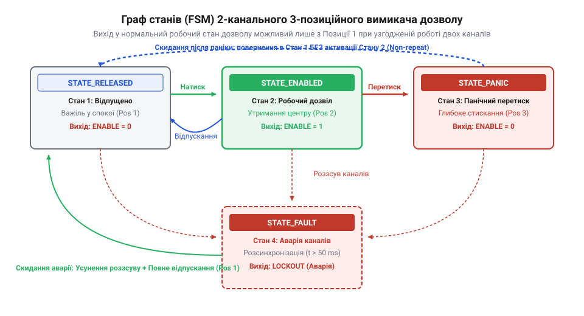

# Програмний інтерфейс та FSM-драйвер опитування пристроїв дозволу

<preknowlist>
- [Тумблери, захисні ковпачки Mollie та блокування важелів (Switch Guards)](root:cat-hw-controls/toggle-switches-and-switch-guards) — Принцип дії ковзних контактних груп та особливості виникнення брязкоту
- [Кнопка аварійного стопу грибок та органи безпечного відключення (IEC 60947-5-5)](root:cat-hw-controls/estop-mushroom-button) — Концепція двоканального дублювання ліній безпеки та обробки аварійних відключень
</preknowlist>

## Архітектура опитування двоканальних пристроїв дозволу

Пряме зчитування одного цифрового входу мікроконтролера для перемикача дозволу є небезпечним розв'язком. У разі обриву дроту, короткого замикання або залипання контакту система втратить здатність розпізнати аварійну ситуацію. Промислові стандарти безпеки вимагають дублювання сигнальних ліній — використання двох незалежних контактів (Канал A та Канал B), стан яких постійно порівнюється.

Окрім брязкоту контактів, у двоканальних механічних перемикачах існує неминучий часовий розсув перемикання (від англійського *discrepancy timeout* — тайм-аут неузгодженості сигналів, @@en|discrepancy timeout@@). Через механічні допуски один контакт замикається чи розмикається на кілька мілісекунд раніше за інший. Програми з блокуючими затримками унеможливлюють реалізацію точного діагностичного контролю, оскільки зупиняють виконання основного циклу.

Для забезпечення апаратної виявлюваності обриву провідників схемотехніка опитування вимагає чіткого розрізнення відсутності струму через розрив кабелю та нормального розімкненого стану. Якщо обидва канали побудовані на однотипних нормально розімкнених сухих контактах (англ. @@en|NO contact@@, normally open; від англ. *dry contact* — сухий контакт), то при розриві сигнального дроту підтягувальні резистори утримують постійний пасивний рівень, через що мікроконтролер сприймає аварійний обрив як звичайне положення «Відпущено». Використання комбінації з нормально розімкненого та інвертованого нормально замкненого контактів (англ. @@en|NC contact@@, normally closed) створює антивалентну пару сигналів, у якій в будь-якому справному стані лінії мають протилежні логічні рівні `01₂` або `10₂`. При пасивному обриві кабелю або короткому замиканні обидва входи одночасно переходять у синфазний стан `00₂` або `11₂`, що дозволяє драйверу миттєво зафіксувати апаратну несправність ліній зв'язку за аналогією з колами захисту в [органах аварійного відключення](root:cat-hw-controls/estop-mushroom-button).

Для порівняльного оцінювання рівня діагностичного охоплення (англ. @@en|diagnostic coverage@@, DC) розглянемо поведінку каскадів при перехресному короткому замиканні між провідниками або замиканні лінії на шину живлення `VCC`. У дубльованій системі з двома однакових нормально розімкнених контактів (пара NO+NO) в усіх робочих положеннях обидва канали мають однакові логічні рівні `00₂` або `11₂`. Якщо між лініями каналів виникає перехресне коротке замикання (англ. @@en|short circuit@@) або примусовий потенціал живлення, обидва входи отримують одиничний рівень `11₂`, що мікроконтролер сприймає як легітимний робочий дозвіл, залишаючи апаратну відмову невидимою. Математично відсоток діагностичного покриття `DC` розраховують як відношення сумарної інтенсивності виявлених небезпечних відмов `Σ λ_dd` до загальної інтенсивності всіх небезпечних відмов контуру `Σ λ_d`:

        DC = (Σ λ_dd ÷ Σ λ_d) · 100%

У симетричній конфігурації NO+NO перехресне замикання не виявляється (`Σ λ_dd = 0`), що дає `DC = 0%`. Натомість у конфігурації з антивалентною парою NO+NC будь-яке замикання між провідниками чи пробій на шину живлення миттєво примушує обидва входи прийняти однаковий синфазний потенціал `00₂` або `11₂`. Оскільки антивалентна схема принципово забороняє однакові рівні, програмний драйвер розпізнає колізію як перехресну відмову (англ. @@en|cross-fault detection@@), зараховує це небезпечне замикання до виявлених відмов `Σ λ_dd` та забезпечує максимальний розрахований рівень діагностичного покриття `DC ≥ 99%`, аналогічно до вимог контролю у [тросових вимикачах аварійного зупинення](root:cat-hw-controls/cable-pull-switches-and-safety-rope-switches).

Архітектура безпечного драйвера базується на неблокуючому циклічному опитуванні за системним таймером або перериваннями. Драйвер періодично зчитує сирі рівні @@en|GPIO@@, застосовує часовий фільтр брязкоту, контролює максимальний допустимий час неузгодженості каналів та передає очищений вектор станів у кінцевий автомат, аналогічно до принципів захисту в [органах аварійного відключення](root:cat-hw-controls/estop-mushroom-button).

## Структури даних та неблокуюче опитування

Для збереження фізичного стану двох ліній та параметрів фільтрації створюють структури даних, які містять номери вхідних виводів, поточні й попередні рівні сигналів, а також часові мітки для фільтрації брязкоту (від англійського *debouncing* — усунення брязкоту контактів, @@en|debouncing@@).

Алгоритм неблокуючого опитування виконується з фіксованим періодом (наприклад, кожні 1–5 мілісекунд). Якщо значення на вхідній лінії змінюється, драйвер фіксує поточний час і чекає стабілізації рівня протягом заданого інтервалу (наприклад, 10 мс), не блокуючи виконання інших завдань контролера.

:::tabs
:::code api-enabling-switch-software/c/esp-idf/enabling-switch-update-hw.c
:::code api-enabling-switch-software/cpp/arduino/dualchannelinput.cpp
:::

Застосована техніка неблокуючої обробки дозволяє регулярно оновлювати відфільтровані вектори контактних груп без створення затримок у реальному часі.

Для критичних за часом систем реального часу альтернативою циклічному опитуванню є апаратна конфігурація переривань GPIO (від англ. @@en|GPIO interrupt@@; від англ. *General-Purpose Input/Output* — входи-виходи загального призначення, та *interrupt* — переривання). Налаштування обробки фронтів на обох лініях дозволяє процесору перебувати у режимі очікування і миттєво реагувати на зміну стану пристрою дозволу — як при переході зі спадного фронту (англ. @@en|falling edge@@), так і при наростаючому (англ. @@en|rising edge@@). Уніфікована служба обслуговування переривань (від англ. @@en|interrupt service routine@@, скор. @@en|ISR@@; від англ. *service* — обслуговування, та *routine* — процедура) зчитує системний таймер високої точності безпосередньо у момент події та надсилає повідомлення у чергу завдань. Такий підхід повністю звільняє процесор від марного циклічного опитування у стані спокою, забезпечуючи мікросекундну затримку реакції системи безпеки при панічному натисканні чи відпусканні педалі [аварійного зупинення](root:cat-hw-controls/estop-mushroom-button).

Для безпечного переносу зібраних даних з ізольованого контексту обробника переривань у фонову задачу обробки застосовують спеціалізовані функції операційної системи реального часу, такі як `xQueueSendFromISR` у середовищі FreeRTOS (від англ. @@en|FreeRTOS queue@@). Обробник ISR зчитує поточний рівень сигналу та часову мітку з апаратного лічильника, пакує їх у компактну структуру події й записує в міжзадачну чергу без використання задіювань блокування, які заборонені в контексті переривань. Якщо записана подія має високий пріоритет (наприклад, виявлення розсинхронізації чи панічного спрацювання), функція повертає прапор `high_priority_task_woken`. Виклик макросу перемикання контексту (від англ. @@en|context switch@@, від англ. *context* — контекст, та *switch* — перемикання) `portYIELD_FROM_ISR` при виході з переривання змушує планувальник негайно передати управління задачі аналізу кінцевого автомата, минаючи квантування часу процесора. Це гарантує детерміноване передавання даних без ризику взаємного блокування потоків виконання.

## Кінцевий автомат станів та обробка розсинхронізації

Після фільтрації вхідних сигналів вектор станів двох каналів обробляється кінцевим автоматом (від англійського *finite state machine* — кінцевий автомат, @@en|finite state machine@@, `FSM`). Логіка автомата передбачає чотири ключові стани: «Відпущено» (`STATE_RELEASED`), «Робочий дозвіл» (`STATE_ENABLED`), «Панічний натиск» (`STATE_PANIC`) та «Аварія каналів» (`STATE_FAULT`).

*Граф FSM відображає переходи між робочими станами та вимушений вихід у стан аварії при перевищенні тайм-ауту розсинхронізації.*

Особливе місце в логіці посідає обробка неузгодженості каналів: якщо один із контактів змінив стан, другий мусить повторити його протягом вікна `discrepancy_timeout` (наприклад, 200 мс). Якщо за цей час другий канал не змінився, автомат фіксує коротке замикання чи механічне блокування і переходить у стан `STATE_FAULT`. Перехід у стан `STATE_ENABLED` можливий лише тоді, коли обидва канали одночасно є активними.

Важливою вимогою безпеки є протокол розблокування: після виходу зі стану `STATE_PANIC` або `STATE_FAULT` повторний дозвіл не надається доти, доки перемикач повністю не повернеться у стан `STATE_RELEASED` (коли обидва канали вимкнені).

:::tabs
:::code api-enabling-switch-software/c/esp-idf/enabling-fsm-process.c
:::code api-enabling-switch-software/cpp/arduino/fsmstate.cpp
:::

Реалізована схема гарантує захист від повторного включення без повернення кнопки у вихідне положення, унеможливлюючи несанкціоноване відновлення роботи обладнання.

У розширених конфігураціях безпеки для відновлення роботи після зафіксованої аварії каналів `STATE_FAULT` застосовують додатковий алгоритм скидання за допомогою зовнішньої кнопки квитування (від англ. @@en|manual reset@@; від англ. *manual* — ручний, та *reset* — скидання). Програмний модуль зчитує сигнал від окремої [тактильної кнопки](root:cat-hw-controls/tactile-buttons) та проводить обов'язкову неблокуючу фільтрацію брязкоту контактів, перевіряючи стабільність утримання логічного рівня протягом заданого завадостійкого інтервалу (наприклад, 20 мс). Скидання стану `STATE_FAULT` і перехід до `STATE_RELEASED` дозволяється виключно за умови одночасного виконання двох інваріантів: підтвердженого завадостійкого імпульсу кнопки квитування та повного фізичного відпущення обох основних контактних груп пристрою дозволу. Якщо ж під час натискання кнопки квитування один із каналів залишається заблокованим або замкненим, алгоритм відхиляє запит на скидання, запобігаючи обходу захисту при апаратних несправностях.

Для глибокого аналізу причин відмов у момент переходу автомату в стан `STATE_FAULT` драйвер фіксує бітову маску первинного джерела збою (тайм-аут розсинхронізації `discrepancy_timeout`, коротке замикання на лінію живлення чи обрив) та записує відповідний код помилки (від англійського *fault code* — код помилки, @@en|fault code@@) у структуру діагностичних лічильників (@@en|diagnostic counter@@). Отриманий запис атомарно зберігається в енергонезалежній пам'яті мікроконтролера (від англійського *non-volatile storage* — енергонезалежне сховище, @@en|Non-Volatile Storage@@, `NVS` чи `EEPROM`). Збереження історії відмов у `NVS` гарантує, що після випадкового або навмисного знеструмлення обладнання інформація про критичний апаратний знос чи пробій кабелю не втрачається. Під час наступного ввімкнення живлення стартова самодіагностика зчитує записані прапорці аварії та блокує виконання робочих циклів до проведення сервісного обслуговування, унеможливлюючи небезпечну експлуатацію дегенеративно пошкодженого органа керування.
