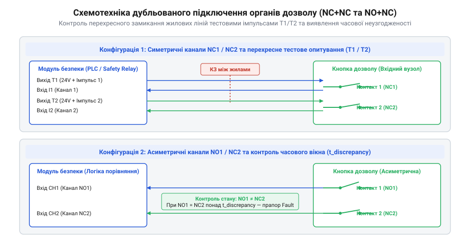
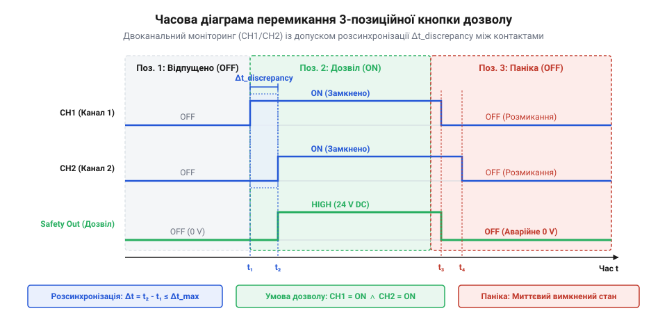

# Залізний інтерфейс підключення двоканальних кнопок дозволу та педалей

<preknowlist>
- [Кнопка аварійного стопу грибок та органи безпечного відключення (IEC 60947-5-5)](root:cat-hw-controls/estop-mushroom-button) — Загальні принципи примусового розмикання NC-контактів та категорій безпеки.
- [Тумблери, захисні ковпачки Mollie та блокування важелів (Switch Guards)](root:cat-hw-controls/toggle-switches-and-switch-guards) — Принципи механічного фіксування та електричного змикання сухих контактних груп.
</preknowlist>

## Схемотехнічні ризики та апаратні вимоги

Приєднати трипозиційну кнопку дозволу чи підлогову педаль до звичайного цифрового входу мікроконтролера за допомогою одного двожильного проводу — фатальна помилка проєктування. Ручні пульти роботів-маніпуляторів піддаються постійним вигинам, падінням та роздавлюванню, що створює ризик непоміченого пошкодження шлейфу. Якщо дві жили кабелю замикаються між собою через перетирання ізоляції, то звичайний сухий контакт передаватиме на контролер постійний сигнал «Дозволено» незалежно від того, відпустив оператор кнопку чи судомно продавлює її в аварійний стан.

Другою критичною загрозою є дугове зварювання контактних груп при комутації реактивних навантажень або при індуктивних наведеннях. Якщо контактні поверхні спеклися під дією струму, звичайна зворотна пружина не має достатнього зусилля для розриву розплавленого металу й не зможе розімкнути коло при вивільненні кнопки. На відміну від потужних силових контакторів із домішками оксиду кадмію @@en|AgCdO@@, які схильні до утворення сухих оксидних плівок при малих струмах, у низьковольтних колах безпеки на `24 В` застосовують срібно-нікелеві сплави @@en|AgNi10@@ (англ. @@en|silver-nickel alloy@@, де silver — срібло, а nickel — нікель). Дрібнодисперсна структура AgNi володіє високою ерозійною стійкістю до мікродуг, запобігає переносу металу між контактами й підтримує низький перехідний опір без зварювання. Для додаткового усунення цього ризику органи дозволу оснащують механізмом вимушеного прямого розмикання (англ. @@en|positive opening mechanism@@, де positive — примусовий від латинського @@la|positivus@@, а mechanism — механізм від грецького @@el|mechane@@), як і [промислові грибкові кнопки](root:cat-hw-controls/estop-mushroom-button). Всередині такого вимикача встановлено жорсткий кулачковий механізм прямої дії: при відпусканні важеля або його продавлюванні в третю позицію привід натискає на негнучкий кулачок, який механічно передає зусилля руки безпосередньо на рухомий контакт. Цей прямохідний кулачок зрізає та примусово руйнує мостки приварювання металу навіть при зварюванні контактних точок, а подальшу схемотехнічну розводку будують за вимогами функціональної безпеки ISO 13849-1 та IEC 62061.

Апаратна безпека базується на трьох непорушних правилах: обов'язковому дублюванні контактних груп, електричному розділенні каналів та апаратному контролі цілісності шлейфу. Поодинокий контакт чи одноканальна лінія зв'язку не здатні забезпечити діагностику короткого замикання, тому всі сучасні кнопки дозволу мають щонайменше дві незалежні контактні групи, розведені окремими жилками кабелю.

Прямий зв'язок між досягненням найвищих категорій функціональної безпеки @@en|PL d@@ та @@en|PL e@@ (англ. @@en|Performance Level@@) відповідно до стандарту ISO 13849-1 та конструкцією механізму примусового розмикання визначається критерієм поодинокої відмови. У сертифікованій системі Категорії 4 зварювання контактних точок під дією дуги вважається типовою небезпечною відмовою, яка у разі відсутності кулачкового розриву унеможливила б зупинення обладнання. Механічний штовхач примусової дії розриває спечені поверхні з зусиллям до 50 Н безпосередньо за рахунок мускульної сили оператора, гарантуючи безумовне розмикання кола безпеки навіть при руйнуванні повертальної пружини. Це дозволяє досягти рівня діагностичного охоплення @@en|DC@@ (англ. @@en|Diagnostic Coverage@@) понад 99 % та фундаментально виконує вимоги до створення стійких до відмов дубльованих структур.

## Електричні схеми підключення дубльованих контактів

У промислових системах безпеки застосовують дві основні конфігурації дубльованого підключення органів дозволу: `NC+NC` (два нормально замкнені контакти) та `NO+NC` (один нормально розімкнений та один нормально замкнений контакт). Найпоширенішою є топологія `NC+NC`, де обидва контакти замкнені лише у Положенні 2 (утримання) і розмикаються у Положенні 1 (відпущено) та Положенні 3 (перетиснуто). Конфігурація `NO+NC` використовується у спеціалізованих контролерах безпеки для протифазного динамічного моніторингу.

Щоб виявити перехресні короткі замикання (від англ. @@en|cross-circuit fault@@) між жилами гнучкого кабелю, модуль реле безпеки застосовує механізм імпульсного опитування (від латинського *pulsus* — поштовх, удар; від англ. @@en|pulse testing@@). Замість постійної напруги живлення `24 В` виходи реле `S11` та `S21` генерують короткі прямокутні такт-імпульси з амплітудою `24 В`, зсунуті в часі один відносно одного. Тривалість вимірювального імпульсу становить від `0.1 мс` до `2.0 мс` (типово `0.5 мс`) з періодом повторення від `10 мс` до `50 мс`, що робить їх непомітними для механічних контактів, але достатніми для логіки реле. Коли на виході `S11` сформовано технологічну паузу з просіданням до `0 В`, канал `S21` залишається під напругою `24 В`. Якщо жили двох каналів перетираються й замикаються між собою, імпульс з виходу `S21` потрапляє на вхід `S12` під час паузи, що відразу фіксується внутрішнім мікроконтролером як небезпечне коротке замикання й негайно розмикає силові виходи за час, що не перевищує `20 мс`.

*Принципова схема дубльованого підключення кнопок дозволу NC+NC та NO+NC із контролем перехресного замикання та імпульсним опитуванням.*

Для досягнення високих категорій безпеки (Category 3/4 за ISO 13849-1, рівень PL d чи PL e) лінія опитування повинна живитися виключно від такт-імпульсних виходів реле безпеки. Підключення дубльованих контактів до спільного джерела постійного струму знижує рівень безпеки до Category 2, оскільки унеможливлює виявлення перехресних замикань між каналами до моменту спрацьовування. Детальний принцип дії, схемотехніку входів S11-S22 та внутрішню логіку обробки розглядають [реле безпеки та контролери захисного відключення](root:cat-hw-drivers/safety-relay).

## Часові діаграми та параметри контактів

Фізичне перемикання станів трипозиційного вимикача характеризується чітко нормованими часовими інтервалами. При переході з Положення 1 у Положення 2 контакти повинні замкнутися протягом короткого вікна утримання. Проте через механічні допуски й знос рухомих елементів дві контактні групи не можуть розімкнутися чи замкнутися абсолютно одночасно. Різниця в часі між спрацьовуванням двох каналів називається часом розсинхронізації (англ. *discrepancy time*, від *discrepancy* — розбіжність) @@en|discrepancy time@@.

Модуль реле безпеки відстежує часовий інтервал розсинхронізації `t_disc`. Якщо один контакт уже розімкнувся (наприклад, при натисканні до Положення 3), а другий через механічне заклинювання запізнився більше ніж на допустиму межу (зазвичай `100–500 мс`), реле сприймає це як апаратну відмову органу дозволу й блокує повторний запуск системи до усунення несправності. Головною фізичною причиною поступового зростання часового розсинхронізму є накопичений механічний знос поверхонь, послаблення зворотно-стискальних пружин та нерівномірний кутовий зсув штовхачів контактних груп. Внаслідок постійного циклічного навантаження геометрія кулачкового штовхача змінюється на мікрони, через що одна контактна пара розмикається раніше за іншу. Коли цей зсув перевищує допустимий поріг `t_disc`, реле діагностує небезпечну деградацію механічного вузла ще до того, як виникне повне заклинювання контакту у замкненому стані.

*Часова діаграма перемикання станів трипозиційного вимикача дозволу з візуалізацією інтервалів розсинхронізації каналів.*

Електричні межі комутації сухих контактів визначаються вимогами стандарту IEC 60947-5-1. Для надійної роботи в слабострумових колах опитування реле безпеки (напруга `24 В` постійного струму, струм `5–100 мА`) перехідний опір замкнених контактів не повинен перевищувати `0.1 Ом`. Зростання опору понад `5 Ом` через окиснення чи забруднення золочених контактів призводить до падіння напруги й хибного фіксування обриву лінії. Максимальна комутована напруга для сухих контактів органів дозволу зазвичай становить `30 В` DC чи `125 В` AC при граничному струмі не більше `1 А`.

## Екранування, кабелі та роз'єми підключення

Особливості експлуатації ручних пульт-пейджерів та підлогових педалей вимагають застосування високогнучких багатожильних кабелів, стійких до багаторазових згинів, стирання та агресивних мастил. Для переносних органів дозволу використовують спецкабелі з жилами з тонкого лудженого мідного дроту та оболонкою з поліуретану (PUR). Для підлогових педалей у цехових умовах застосовують броньовані провідники з зовнішньою спіральною металевою або силіконовою захисною оболонкою, що запобігає пошкодженню гарячою стружкою чи наступанням важкої техніки.

Для захисту слабострумових такт-імпульсних сигналів від потужних електромагнітних завад (від частотних перетворювачів двигунів чи зварювальних апаратів) кабель повинен мати спільне плетене мідне екранування. Заземлення екрана виконують за допомогою гнучкого дренажного провідника (від англійського @@en|drain wire@@, де drain — стікати, а wire — провід) або EMC-гільзи, підключеної безпосередньо до загальної шини `PE` (англ. @@en|protective earth@@) суворо в одній точці — на боці шафи керування або контролера безпеки. Двостороннє заземлення екрана ручного пульта або підлогової педалі суворо заборонено через фізику виникаючих контурних струмів (англ. @@en|ground loop current@@). При різниці потенціалів між заземлювачами шафи та віддаленого обладнання крізь подвійно заземлений екран починає протікати вирівнювальний струм промислової частоти. Цей струм створює спад напруги на опорі екрана й за рахунок взаємної індуктивності наводить диференційні завади на сигнальні жили, спричиняючи хибні спрацьовування імпульсного опитування або хибне блокування лінії безпеки. З міркувань збереження ємнісного балансу лінії та збереження крутизни крутих фронтів такт-імпульсів тривалістю `200–500 мкс`, максимальна довжина гнучкого кабелю обмежується значенням `50 м`. Перевищення межі `50 м` збільшує паразитно розсіяну ємність понад `10 нФ`, завалаючи фронти тестових сигналів та викликаючи неправдиві спрацьовування компараторів реле.

Для підключення переносних пультів та педалей застосовують промислові герметичні роз'єми з нарізним або байонетним фіксатором (найчастіше стандарти M12 8-pin, M23 або важкі багатоконтактні роз'єми Harting ступеня захисту IP65/IP67). Контакти роз'ємів повинні мати позолочене покриття товщиною не менше `0.8 мкм` для забезпечення стабільного низького перехідного опору під дією вібрацій.
