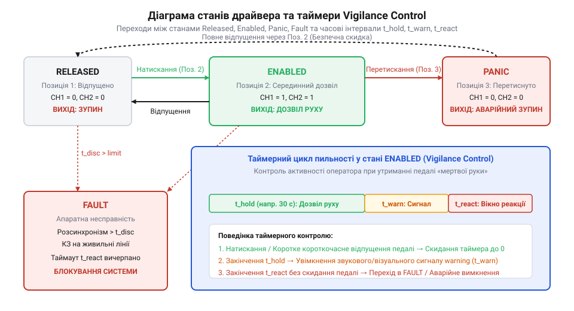

# Програмний інтерфейс зчитування станів трипозиційного давача та vigilance control

<preknowlist>
- [Трипозиційні кнопки дозволу та педалі «мертвої руки»](root:cat-hw-controls/enabling-switches-and-dead-man-pedals) — Фізична будова трипозиційних контактів та принципи роботи педалей контролю пильності.
- [Кнопка аварійного стопу грибок та органи безпечного відключення (IEC 60947-5-5)](root:cat-hw-controls/estop-mushroom-button) — Концепція двоконтурного розмикання та категоризація захисного відключення.
</preknowlist>

## Призначення та архітектура драйвера дозволу

Під час обслуговування автоматизованого обладнання ручний очікувальний режим вимагає постійного підтвердження безпечної присутності оператора. Якщо під час паніки чи знепритомнення людина нездатна зреагувати, звичайні двопозиційні органи вводу не захищають від судомного стискання. Для усунення цього ризику використовують програмний інтерфейс драйвера дозволу та контроль пильності (від англ. *vigilance* — пильність, *control* — контроль; далі — @@en|vigilance control@@). За аналогією з тим, як резервоване живлення відключають [кнопками аварійного зупинення](root:cat-hw-controls/estop-mushroom-button), цей драйвер керує доступом до руху виконавчих механізмів. Внутрішній кінцевий автомат драйвера фіксує чотири базові стани: `Released` (важіль відпущено), `Enabled` (важіль у робочому проміжному стані), `Panic` (важіль судомно проштовхнуто до упору) та `Fault` (виявлено апаратну несправність ліній). Програмно у мові C ці стани реалізують через перелічення `typedef enum { ENABLING_STATE_RELEASED = 0, ENABLING_STATE_ENABLED, ENABLING_STATE_PANIC, ENABLING_STATE_FAULT } enabling_state_t;` (у C++ — строго типізований `enum class EnablingState : uint8_t { Released, Enabled, Panic, Fault };`), а повний контекст зберігають у структурі `enabling_driver_t` (або C++ класі `EnablingDriver`), яка оперує посиланнями на дискретні лінії та внутрішні таймери. Первинне налаштування виконують функцією ініціалізації, яка зв'язує фізичні канали дискретного вводу з внутрішньою структурою даних драйвера. Сигнатура виклику в C має вигляд `enabling_err_t enabling_driver_init(enabling_driver_t *driver, const enabling_config_t *config);` (у C++ — `bool EnablingDriver::init(const DriverConfig &config);`), де конфігураційна структура `enabling_config_t` описує номери апаратних портів, виводи контактних груп та базові часові інтервали. Таке розділення ізолює апаратний рівень від алгоритмічного та гарантує детерміноване скидання системи в безпечний стан `Released` під час первинного запуску.

## Конфігурування дебаунсу та крос-канального контролю

Механічний брязкіт контактних поверхонь та технологічні допуски пружинних елементів викликають асинхронне спрацьовування паралельних ліній. Для усунення хибних перемикань, подібних до тієї завади, що виникає при комутації [тактильних кнопок](root:cat-hw-controls/tactile-buttons), драйвер виконує цифровий антибрязкіт (англ. @@en|debounce@@, де de — скасування, а bounce — відскок), затримуючи фіксацію рівня на заданий інтервал `t_debounce` (типово у діапазоні від 5 до 20 мс). Для двох дубльованих каналів додатково налаштовують допустиме часове вікно розсинхронізму `t_discrepancy` (у межах від 10 до 50 мс). Якщо один із контактів змінив стан, а другий не повторив його протягом `t_discrepancy`, програма ідентифікує обрив лінії або приварювання контактної групи та миттєво встановлює внутрішній бітовий прапорець апаратної помилки `Fault`. Логіка встановлення прапорця `Fault` працює за принципом тригерного засуву: драйвер негайно блокує будь-які командні виходи, скидає дозволи на рух та забороняє вихід із блокування до повного фізичного перевідпускання важеля або виконання скидання живлення системи.

## Таймери vigilance control та обробка подій

Для запобігання навмисному заклинюванню підлогових педалей чи важелів сторонніми предметами програмний драйвер реалізує циклічний контроль пильності (англ. @@en|vigilance control@@, де vigilance — пильність від латинського @@la|vigilare@@ — не спати). Алгоритм використовує три послідовні часові інтервали: утримування `t_hold`, попередження `t_warn` та реакції `t_react`. Механізм реєстрації функцій зворотного виклику (англ. @@en|callback@@, де call — викликати, а back — назад) здійснюється передачею вказувача на обробник подій під час ініціалізації: при переході таймера у фазу `t_warn` драйвер автоматично викликає зареєстрований @@en|callback@@, який вмикає світлодіодну індикацію чи звуковий сигнал сповіщення на пульті. Щоб скинути таймер `t_hold` і підтвердити присутність без зупинки роботи, оператор повинен виконати короткочасний імпульс перевідпускання важеля — коротке вивільнення кнопки в стан `Released` і повторний перехід у `Enabled` протягом встановленого вікна пульсу (наприклад, 200–800 мс). При виявленні такого дійсного фронту драйвер миттєво обнуляє лічильник `t_hold`, деактивує попереджувальний сигнал і перезапускає цикл контролю, а якщо оператор не підтверджує присутність протягом часу `t_react`, система негайно скидає дозволи на рух.

*Діаграма станів кінцевого автомата драйвера з часовими інтервалами контролю пильності.*

## Реалізація аварійного відключення та обробка помилок

Перехід драйвера у стани `Panic` або `Fault` вимагає миттєвого знеструмлення силових ланцюгів приводу у першому ж такті обробки. Для забезпечення повноти безпеки за нормами IEC 61508 / ISO 13849-1 регулярне опитування вхідних ліній виконують із детермінованим періодом (наприклад, кожні 1–5 мс) у високопріоритетному циклі апаратного переривання таймера (англ. @@en|interrupt service routine@@, де interrupt — переривання від латинського @@la|interruptus@@, а routine — процедура). Для унеможливлення повторного самовільного пуску при виникненні аварії драйвер переходить у фіксований стан засуву (англ. @@en|latch state@@, де latch — засувка від староанглійського @@ang|læccan@@ — хапати): відновлення стану `Enabled` суворо заборонене до тих пір, поки не буде виконано двоетапну процедуру ручного скидання `Latch`. Спочатку оператор повинен повністю відпустити орган керування у вихідний стан `Released`, після чого програма має викликати явну функцію скидання засуву `driver_reset_latch()`, аналогічно до правил розблокування, за якими діють [промислові кнопки аварійного стопу](root:cat-hw-controls/estop-mushroom-button); при цьому будь-які спроби скинути прапорець до повернення кнопки в стан `Released` ігноруються кінцевим автоматом.
