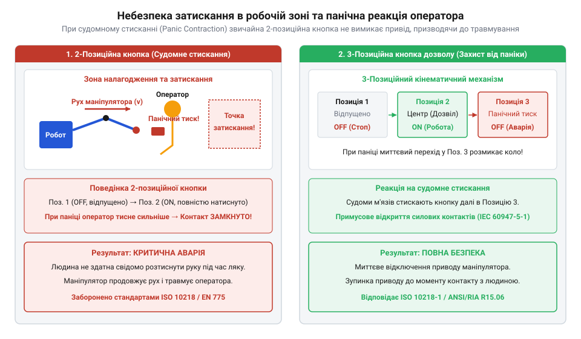
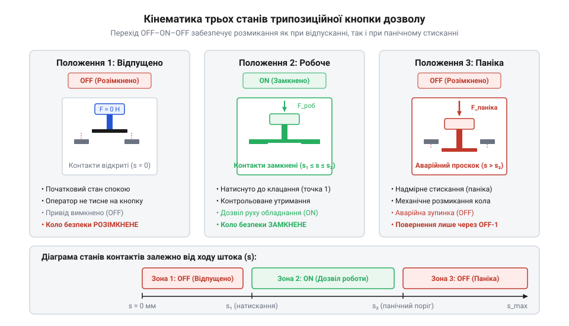
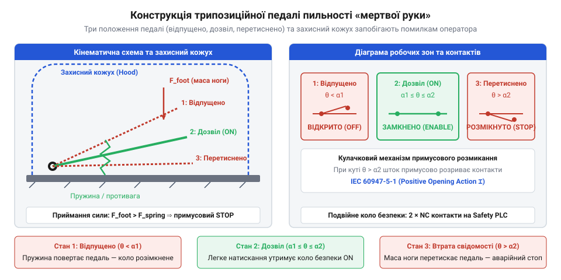
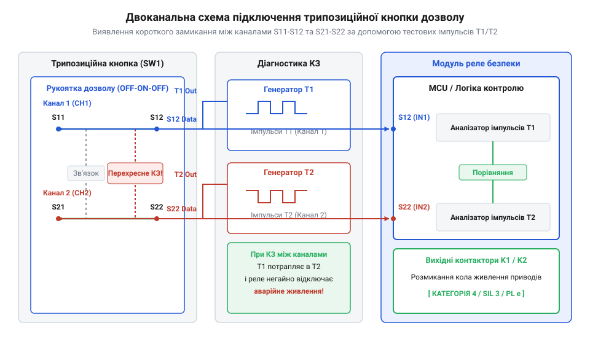

# Трипозиційні кнопки дозволу та педалі «мертвої руки»

<preknowlist>
- [Кнопка аварійного стопу грибок та органи безпечного відключення (IEC 60947-5-5)](root:cat-hw-controls/estop-mushroom-button) — принципи прямого розмикання контактів та концепція категорій зупинення в колах безпеки
- [Тактильні кнопки з ковпачками](root:cat-hw-controls/tactile-buttons) — базова будова та відмінності між нормально розімкненими (NO) і нормально замкненими (NC) контактними групами
- [Тумблери, захисні ковпачки Mollie та блокування важелів (Switch Guards)](root:cat-hw-controls/toggle-switches-and-switch-guards) — механічні способи запобігання помилковому чи умисному перемиканню важелів
</preknowlist>

## Небезпека ручного налагодження та людський фактор

Налагодження, технічне обслуговування й програмування робототехнічних осередків та важких автоматизованих верстатів вимагають присутності оператора безпосередньо у потенційно небезпечній робочій зоні. У стандартному автоматичному режимі людина захищена зовнішньою огорожею із прохідними блокуваннями. Проте під час юстування чи покрокового навчання маніпулятора захисні бар'єри відключаються, а керування здійснюється з портативного пульту налагодження (@@en|teach pendant@@, від англійського *pendant* — підвіс, кулон). Для запобігання травмам у такому режимі швидкість виконання команд обмежена, проте сам по собі маніпулятор зберігає високий крутний момент і здатен нанести важкі затискання чи травми при раптовому помилковому русі. Детальніший опис апаратної будови та функціоналу ручних органів керування викладено в огляді [пультів налагодження промислових роботів](root:cat-hw-controls/teach-pendant-interface).

Класична концепція захисту спирається на використання стандартних двопозиційних кнопок (@@en|tactile button@@) або ручних клавішних перемикачів зі станами «відпущено» (OFF, розімкнено) та «натиснуто» (ON, замкнено). Передбачається, що для виконання тестового переміщення оператор натискає кнопку, а в разі позаштатної ситуації — просто розтискає пальці, зупиняючи обладнання. Однак подібний розрахунок ігнорує психофізіологічні особливості реакції людини під час стресу. При виникненні раптової небезпеки — наприклад, коли важка консоль робота починає рухатися прямо на оператора — спрацьовує безумовний рефлекс панічного стискання (@@en|panic reaction@@, від англійського *panic* — паніка, переляк). Замість розтискання кисті людина інстинктивно стискає кулак із максимально можливим м'язовим зусиллям. При використанні двопозиційної кнопки таке судомне стискання утримує комутаційні контакти в замкненому стані, підтримуючи небезпечний рух саме в той момент, коли виникає загроза життю.


*Схема зони налагодження робототехнічного осередку та напрямки неконтрольованого руху маніпулятора під час панічної реакції оператора.*

Історичний досвід застосування захисних органів керування бере початок від залізничних педалей пильності, які розмикали коло при розслабленні ноги машиніста в разі втрати свідомості. Докладний огляд того, як захисні пристрої еволюціонували від перших пневматичних педалей локомотивів до сучасних промислових органів дозволу, висвітлено в [історичному розвитку пристроїв пильності](root:cat-hw-controls/enabling-switches-and-dead-man-pedals/hist-enabling-switches-evolution.md). Проте в сучасних робототехнічних комплексах захист лише від одного крайнього стану (відпускання) виявився недостатнім через небезпеку судомного затискання.

Для усунення цієї вразливості розроблено трипозиційні пристрої дозволу (@@en|enabling device@@, від англійського *enable* — надавати змогу, дозволяти). Вони формують безпечний дозвіл на рух лише у разі, якщо шток органу керування утримується в проміжному, середньому стані. Якщо оператор втрачає свідомість і розтискає руку або, навпаки, панікує й стискає рукоятку з усвідомленим чи судомним зусиллям, механізм переходить у розімкнений стан. На відміну від кнопки з фіксацією положення, яка залишалася б увімкненою при випусканні з рук, пристрій дозволу принципово позбавлений механічного засува у робочій позиції: при випадковому падінні пульта з рук або вислизанні з долоні зворотна пружина забезпечує безпідставне миттєве скидання штока у вихідне розімкнене положення. На відміну від [органів аварійного виключення](root:cat-hw-controls/estop-mushroom-button) чи [захисних ковпачків і тумблерів](root:cat-hw-controls/toggle-switches-and-switch-guards), трипозиційна кнопка є органом безперервного утримання, який вимагає постійної підтвердженої присутності оператора у свідомому та контрольованому стані.

Ергономічні та біомеханічні виміри показують, що в нормальному стані людина здійснює свідоме ізометричне утримання рукоятки з помірним зусиллям хвату (@@en|grip force@@, від англійського *grip* — хват, стискання та *force* — сила) в межах 20–50 Н. Для запобігання м'язовій втомі (від лат. *fatigatio* — втома; англ. @@en|muscle fatigue@@) під час тривалого утримання пристрою ізометричне навантаження (від грец. *isos* — рівний та *metron* — міра; англ. @@en|isometric load@@) не повинно перевищувати `15%` від максимального довільного скорочення м'язів-згиначів кисті, інакше порушується капілярний кровотік і виникає тремор. З огляду на це нижній поріг переходу `F_1` у Положення 2 обирають у вузькому діапазоні `15–30` Н, що дозволяє тривалий дозвіл на рух без локальної ішемії тканин. Проте при раптовій загрозі фізіологічна реакція розгортається поза свідомим контролем: безумовний рефлекс викликає тетанічне скорочення (@@en|tetanic contraction@@, від англійського *tetanic* — тетанічний, судомний та *contraction* — скорочення) м'язів-згиначів пальців, через що м'язовий тонус кисті стрибкоподібно зростає в 5–10 разів, досягаючи 200–400 Н. Верхній поріг примусового продавлювання `F_2` у Положення 3 розраховують за критерієм гарантованого переходу: значення `100–150` Н задовольняє умову, коли поріг у 3–5 разів перевищує зусилля звичайної втоми (що унеможливлює хибні розмикання при треморі), але лежить суттєво нижче за мінімальну судомну силу `200` Н навіть у виснаженого оператора, гарантуючи надійне розмикання кола безпеки ще до досягнення піку панічного затискання.

Такий двосторонній запобіжний розрахунок перетворює трипозиційну кнопку на єдиний інструмент захисту, здатний повністю нейтралізувати людський фактор у критичний момент. Незалежно від того, як саме розгортається позаштатна подія — через втрату свідомості із супутньою втратою м'язового тонусу (@@en|muscle tone@@, від англійського *muscle* — м'яз та *tone* — тонус) чи через психоемоційний шок із судомним тетанусом, — кінцевий механічний результат залишається ідентичним: розмикання кола живлення. Орган керування не вимагає від оператора вольових рішень чи раціональних дій під час аварії, а спирається на фізичну неможливість тривалого утримання проміжної позиції без свідомого й контрольованого зусилля.

Саме ця біомеханічна гарантія зумовила закріплення трипозиційних органів у міжнародних нормативних стандартах функціональної безпеки. Згідно зі стандартом ISO 10218-1 (безпека промислових робототехнічних комплексів), виконання будь-яких ручних переміщень маніпулятора у режимі зниженої швидкості (@@en|manual reduced speed mode@@, від англійського *manual* — ручний, *reduced* — знижений, *speed* — швидкість та *mode* — режим) суворо заборонено без утримання пристрою дозволу в Другому стані. Водночас стандарт IEC 60204-1 визначає, що виходи трипозиційної кнопки мають пріоритетно блокувати силові кола привода в разі виходу за межі робочого інтервалу, підключаючись безпосередньо до [модулів та реле безпеки](root:cat-hw-controls/safety-relays-and-controllers) для миттєвого зняття напруги з двигунів незалежно від команд керувальної програми.

## Кінематика трьох станів та механічний перехід

В основу роботи трипозиційного вимикача дозволу (@@en|enabling switch@@, від англійського *switch* — вимикач, перемикач) покладено кінематичний механізм із послідовною зміною трьох фізичних станів штока: OFF-ON-OFF. Перехід між цими станами забезпечується профільним кулачком із двома механічними порогами опору пружин.

У першому стані (Стан 1, OFF) шток повністю відпущений і перебуває у верхній точці ходу під дією основної поворотної пружини. Електричні контакти групи дозволу розімкнені. Цей стан відповідає відсутності оператора або випадковому випусканню пульту з рук. Для переходу в другий стан (Стан 2, ON) оператор долає перше помірне механічне зусилля `F_1` (порядок `3–6` Н або `300–600` г), стискаючи основну пружину. Кінематично це реалізовано через профільний кулачок (@@en|profile cam@@, від англійського *profile* — профіль та *cam* — кулачок) і пружинний селектор ходу (@@en|spring selector@@, від англійського *spring* — пружина та *selector* — селектор, перемикач): при русі штока ролик-штовхач (@@en|cam follower@@, від англійського *follower* — штовхач) ковзає по похилій вхідній рампі з кутом нахилу `α_1 = 15°–25°` й западає у тактильну виїмку (від англ. *detent* — фіксатор; англ. @@en|detent groove@@) Другого стану. Пологий кут `α_1` забезпечує плавний вхід без різких поштовхів. У цій проміжній позиції кулачок утримує містковий штовхач, який замикає контакти дозволу, надаючи сигнал [модулям та реле безпеки](root:cat-hw-controls/safety-relays-and-controllers) про готовність до виконання ручних операцій. На межі Другого стану плече кулачка переходить у круту бар'єрну рампу з кутом нахилу (від фр. *rampe* — підйом; англ. @@en|ramp angle@@) `α_2 = 60°–75°`, яка впирається в упорну шайбу селектора, підключену до другої, значно жорсткішої пружини. Оскільки осьове зусилля опору пропорційне тангенсу кута нахилу рампи, стрибок кута від `α_1` до `α_2` створює різку зміну механічного опору. Для подальшого просування штока у третій стан (Стан 3) необхідно подолати цей геометричний та пружинний селектор, який створює різкий стрибок сили до другого порога `F_2` (порядок `15–25` Н або `1.5–2.5` кг). Цей геометрично сформований тактильний бар'єр (від фр. *barrière* — перепона; англ. @@en|tactile barrier@@) `F_2` критично важливий: він утворює чітко відчутний пальцями механічний упор, що запобігає передчасному випадковому проскоку у Стан 3 через тремор рук чи втому кисті, але легко долається під час панічного стискання кулака.

Якщо виникає небезпечна ситуація і людина панічно стискає рукоятку, зусилля натискання зростає й долає другий, підвищений механічний поріг. Шток здійснює додатковий робочий хід (@@en|overtravel@@, від англійського *overtravel* — перевищення ходу) і переходить у третій стан (Стан 3, OFF). При цьому скошений край кулачка працює як жорсткий клин, який фізично зрізає та віджимає рухомий контактний місток (@@en|contact bridge@@, від англійського *contact* — контакт та *bridge* — місток) через [механізм вимушеного розмикання](root:cat-hw-controls/estop-mushroom-button) (@@en|positive opening mechanism@@, від англійського *positive* — безумовний, примусовий). Захисне коло розривається безпосередньо прямолінійним штовханням, що гарантує розмикання навіть у разі локального мікрозварювання точок контакту. Одночасно з примусовим зсувом штока підпружинена блокувальна засувка (@@en|latching pawl@@, від англійського *latch* — фіксатор, засувка та *pawl* — заскочка, собачка) западає у паз ползуна й механічно замикає контактну групу в розімкненому стані. Це унеможливлює повторну короткочасну комутацію під час зворотного ходу штока, доки вимикач повністю не повернеться у вихідну позицію.


*Кінематична діаграма ходу штока трипозиційної кнопки з тривожним переходом OFF-ON-OFF.*

Критично важливою особливістю кінематики є траєкторія зворотного ходу штока. Якщо шток опинився у Третьому стані (паніка), при подальшому розтисканні кисті він повертається з 3-го стану в 1-й через позицію 2. Проте спеціальний механічний блокувальний важелик запобігає повторному замкненню контактів Другого стану при зворотному русі:

```
s_0 = 0.0 мм          [Стан 1: OFF, шток відпущено, контакти розімкнені]
s_1 = 1.5 мм          [Перехідна точка замикання контакту дозволу]
s_2 = 3.0 мм          [Стан 2: ON, робоче проміжне положення дозволу]
s_3 = 4.5 мм          [Спрацьовування механізму вимушеного розмикання]
s_4 = 6.0 мм          [Стан 3: OFF, примусове аварійне розмикання при паніці]
```

Таким чином, проскок із Третього стану назад у Перший відбувається без короткочасного ввімкнення кола живлення. Щоб повторно подати дозвіл на рух, оператор мусить повністю відпустити шток до точки `s_0` для скидання механічної засувки, і лише після цього знову плавно натиснути кнопку до точки `s_2`.

Оцінку ймовірності відмов та часових затримок подібних кінематичних ланцюгів описано у [математичних моделях надійності](root:cat-hw-controls/enabling-switches-and-dead-man-pedals/math-enabling-switch-reliability-and-timing.md). Практичну схему збирання давача та його підключення подано у проєкті [двоканального контролера кнопки дозволу](root:cat-hw-controls/enabling-switches-and-dead-man-pedals/proj-enabling-switch-controller.md), а специфіку цокольовки контактів розкрито у [схемах розводки залізного інтерфейсу](root:cat-hw-controls/enabling-switches-and-dead-man-pedals/api-hw-enabling-switch-wiring.md). Алгоритм програмного фільтрування проскоків станів висвітлено у довіднику з [програмним драйвером зчитування станів](root:cat-hw-controls/enabling-switches-and-dead-man-pedals/api-sw-enabling-switch-driver.md).

## Конструкція педалей пильності та «мертвої руки»

Якщо під час робототехнічного налагодження оператор переміщується вздовж маніпулятора з ручним пультом, то для стаціонарних верстатів, штампувальних пресів та залізничного транспорту ручні кнопки дозволу не підходять. У таких умовах працівник повинен тримати обидві руки вільними для позиціонування заготовки чи керування інструментом. Для цього застосовують підлогові органи керування — педалі «мертвої руки» (від лат. *pedalis* — підніжний; англ. @@en|dead-man pedal@@) або педалі пильності (англ. @@en|vigilance pedal@@).

Кінематика педалі пильності реалізує той самий трипозиційний принцип, що й ручний вимикач, але враховує специфіку м'язових зусиль ноги та біомеханіку руху ступні. У Положенні 1 (педаль повністю відпущена у вихідному стані `0°`) коло дозволу розімкнене. Коли оператор наступає на педаль і притискає її в комфортне середнє Положення 2 на кут відхилення `10°–15°`, контакти дозволу замикаються для роботи обладнання. Якщо людина знепритомніє, зсунеться з робочого місця або під час судом чи паніки продавлює площадку далі через робочу точку в Положення 3 на повний кут `25°–35°` до апаратного упору, пружинний механізм надлишкового ходу переводить контакти у вимушене розмикання. Чіткий кутовий зазор у `10°–15°` між Положенням 2 і Положенням 3 запобігає випадковому продавлюванню в аварійний стан при звичайних коливаннях зусилля ноги. Оскільки вага ноги значно більша за зусилля кисті, уперше виникає проблема компенсації маси робочого спецвзуття оператора (маса черевика з металевим підноском становить `1.5–2.5 кг`). Конструктивний розрахунок спирається на баланс моментів сил (@@en|torque@@, від англійського *torque* — крутний момент, момент сили) відносно осі обертання (від фр. *pivot* — вісь; англ. @@en|pivot axis@@) педалі. Противага (@@en|counterweight@@, від англійського *counter* — проти та *weight* — вантаж, вага) із плечем важеля `L_cw` та пружинний блок створюють компенсувальний момент `M_counter`, який урівноважує пасивну вагу черевика `m_boot` на плечі ступні `L_foot`:

M_counter = M_boot + M_holding       [рівняння балансу моментів відносно осі обертання]
= m_boot · g · L_foot + F_leg · L_foot [підстановка складових маси спецвзуття та активного зусилля]

Компенсувальний момент повністю перекриває пасивну вагу взуття, вимагаючи додаткового активного зусилля м'язів гомілки `F_leg` у межах `20–40 Н` (що дає утримувальний момент `M_holding = 4–10 Н·м`) для впевненого фіксування Положення 2. Таке налаштування противаги та зворотної пружини дозволяє утримувати площадки без втоми оператора під час тривалої зміни, але водночас гарантує миттєве повернення в Положення 1 (`0°`), якщо нога зісковзне з педалі.

На відміну від ручних органів, підлогова педаль вразлива до падіння важких предметів чи заготовок, що може імітувати натискання. Тому її завжди оснащують масивним металевим захисним кожухом, який закриває педаль зверху та з боків, залишаючи відкритим лише передній проріз для ноги. Для залізничних локомотивів та важких транспортерів простий механічний 3-позиційний утримач доповнюють системою підтвердження пильності (від лат. *vigilantia* — пильність; англ. @@en|vigilance control@@). Вона вимагає від оператора періодично (наприклад, кожні 30–60 секунд після світлового чи звукового сигналу) короткочасно послабити й знову відновити натиск на педаль, що виключає можливість блокування педалі стороннім важким предметом.

Просте статичне утримання педалі в Положенні 2 не захищає від випадків, коли оператор заклинив її стороннім предметом або знепритомнів у позі, яка продовжує тиснути на площадку. Електронна система @@en|vigilance control@@ усуває цю вразливість шляхом контролю динаміки натискання через зациклений сторожовий таймер (від англ. *watchdog* — вартовий собака; англ. @@en|watchdog timer@@). Робочий цикл ділиться на два часових інтервали: основний інтервал очікування тривалістю `30–60` секунд та вузьке вікно скидання (англ. @@en|reset window@@) тривалістю `3–5` секунд, що відкривається після спрацьовування попереджувальної світлової чи звукової сигналізації. Протягом цього вікна оператор мусить короткочасно змінити зусилля ноги — злегка ослабити або дотиснути педаль, створивши перепад електричного сигналу на контактах. Якщо зафіксовано такий фронт імпульсу, таймер скидається у вихідний стан і відлік основного інтервалу починається знову. Якщо ж оператор не реагує на сигнал або педаль заблокована наглухо у статичному стані без зміщення контактів, [реле безпеки](root:cat-hw-controls/safety-relays-and-controllers) сприймає відсутність перепадів як втрату пильності оператора та зупиняє привід обладнання.


*Конструктивна схема трипозиційної педалі пильності з противагою та захисним кожухом; показано геометричні кути спрацьовування та механізм вимушеного розмикання при втраті свідомості оператора.*

Еволюційний шлях від перших пневматичних педалей паровозів початку XX століття до сучасних електронних вузлів висвітлено в [історії засобів захисту](root:cat-hw-controls/enabling-switches-and-dead-man-pedals/hist-enabling-switches-evolution.md).

## Двоканальне підключення та діагностика перехресних замикань

Застосування трипозиційних органів дозволу у високоризикових промислових середовищах вимагає від електричної схеми відповідності найвищим стандартам функціональної безпеки — категоріям SIL 3 (згідно з IEC 62061) та PL e (згідно з ISO 13849-1). Одноканальне підключення кнопки чи педалі є неприпустимим: замикання сигнального провідника на лінію живлення або приварювання єдиного контакту робить пристрій повністю безпорадним перед аварією. Тому всі промислові органи дозволу будують за дубльованою двоканальною схемою, де кожна контактна група має незалежні розмикальні контакти примусового розмикання.

Обидва канали підключають до спеціалізованих пристроїв — [реле безпеки](root:cat-hw-controls/safety-relays-and-controllers) або безпекових контролерів (Safety PLC). На відміну від класичної [кнопки аварійного стопу](root:cat-hw-controls/estop-mushroom-button), яка лише розриває коло живлення, пристрої дозволу вимагають динамічної діагностики цілісності кабельних ліній. Головною загрозою в гнучких кабелях ручних пультів є перехресне замикання (англ. @@en|cross-circuit fault@@) — коротке замикання між ізольованими жилами двох різних каналів унаслідок перетискання чи стирання ізоляції. Якщо обидва канали живляться постійною напругою 24 В, то при перехресному замиканні розмикання одного контакту не зупинить обладнання, оскільки струм потече через сусідній замкнений провід.

Для виявлення цієї прихованої відмови реле безпеки використовує метод імпульсного тестування каналів. Виходи живлення кнопок (клеми `S11` та `S21`) містять апаратний генератор імпульсів, вихідний каскад якого побудовано на силових польових транзисторах у конфігурації верхнього ключа (від англ. *side* — сторона; англ. @@en|high-side switch@@) із додатковим підтягувальним ключем для розряду паразитної ємності довгого кабелю. Ці виходи генерують несинхронні високочастотні короткі тестові імпульси відключення амплітудою `24 В` і тривалістю `200–500 мкс` із періодом повторення `10–50 мс`. Спеціальні вхідні індуктивні та низькочастотні `RC`-фільтри (@@en|low-pass filter@@, від англійського *low* — низький, *pass* — пропуск та *filter* — фільтр) реле безпеки розраховують на стала часу (@@en|time constant@@, від англійського *time* — час та *constant* — стала, константа) `τ = 2–5 мс`, що відповідає частоті зрізу `30–80 Гц`. Завдяки цьому провал напруги на конденсаторі під час короткого імпульсу `200–500 мкс` не перевищує `2–4 В`, утримуючи відфільтровану напругу вище `20 В`, тому тестові провали не спричиняють хибного спрацьовування силових контакторів чи проміжних реле. Схемотехнічно кожен вхідний канал реле розгалужується на силове та діагностичне кола. Силове коло містить низькочастотний `RC`-фільтр для згладжування імпульсів перед вихідними реле. Діагностичне коло знімає сигнал безпосередньо з вхідних клем і подає його на вхідний резистивний дільник напруги, з'єднаний із прецизійним аналоговим компаратором (від лат. *comparare* — порівнювати; англ. @@en|analog comparator@@) та фазочутливим детектором (від англ. *phase-sensitive detector*; далі — @@en|phase-sensitive detector@@). Компаратор охоплено позитивним зворотним зв'язком за схемою тригера Шмітта (від прізвища винахідника Отто Шмітта; англ. @@en|Schmitt trigger@@) із гістерезисом `1.5–2.0 В`, який порівнює миттєву напругу з пороговим значенням `15 В`, відсікає імпульсні завади на лініях і формує круті прямокутні фронти. Фазочутливий детектор будується на логічній схемі синхронного помножувача чи елемента «Виключне АБО» з опорним тактовим сигналом генератора `S11`/`S21`: він синхронно зіставляє імпульси з клем `S11` і `S21` із фазою сигналів на вхідних клемах `S12` і `S22`. Така фазова синхронізація придушує синфазні промислові електромагнітні завади, які не збігаються по фазі з опорним генератором. Проте при виникненні перехресного замикання імпульс з каналу `S11` потрапляє на вхід `S22` другого каналу в точній фазовій синхронії. Фазочутливий детектор негайно фіксує порушення часового інтервалу й скидає апаратний тригер за декілька мікросекунд, блокуючи повторний запуск обладнання до усунення пошкодження лінії.


*Принципова схема двоканального підключення трипозиційної кнопки до реле безпеки з тестовими імпульсами; показано ланцюги розмикання та виявлення перехресного замикання між каналами S11-S12 і S21-S22.*

Схемотехнічні специфікації розводки контактів, параметри імпульсного тестування та топологію підключення роз'ємів детально викладено в [залізному інтерфейсі підключення](root:cat-hw-controls/enabling-switches-and-dead-man-pedals/api-hw-enabling-switch-wiring.md).

## Захист від обходу та умови експлуатації

Під час тривалого налагодження робототехнічного осередку утримувати ручну кнопку дозволу в Положенні 2 протягом годин вимагає постійного м'язового напруження. Прагнучи полегшити роботу, оператори нерідко намагаються вдатися до умисного обходу системи безпеки — фіксують клавішу в замкненому стані за допомогою скотчу, кабельних затяжок чи механічних струбцин. Таке блокування повністю знецінює захисні функції пристрою: у разі аварії чи втрати свідомості обладнання продовжить небезпечний рух.

Для нейтралізації таких дій стандарти безпеки ISO 13849-1 та IEC 60204-1 вимагають впровадження конструктивних та алгоритмічних заходів захисту від обходу (від лат. *protectio* — прикриття; англ. @@en|anti-defeat protection@@). Першим рубежем захисту є обов'язковий контроль послідовності переходу станів. Контролер безпеки дозволяє запуск системи лише після проходження сигнальним ланцюгом послідовності від Положення 1 (розімкнено) до Положення 2 (замкнено). Якщо кнопку затиснуто скотчем до подачі живлення, система виявить початковий стан Положення 2 без переходу з Положення 1 і згенерує помилку блокування. Другим апаратним рубежем є застосування різноіменних контактних груп із нормально розімкненим (NO) та нормально замкненим (NC) контактами. У робочому Положенні 2 контакт NO замикається, а контакт NC примусово розмикається. Контролер здійснює протифазне опитування ліній і вимагає постійної наявності протилежних логічних сигналів. Спроба подати напругу 24 В від зовнішнього джерела електричною перемичкою на обидва канали створює симетричний високий рівень на входах. Протифазна логіка миттєво фіксує конфлікт сигналів і блокує роботу пристрою. Третім алгоритмічним рубежем є перевірка часового вікна неузгодженості каналів (англ. @@en|discrepancy time@@). Розрахунок цього вікна спирається на суму максимального механічного зазору кінематичного штовхача, часу прольоту контактної групи `5–15` мс та часу дребезгу контактів (англ. @@en|contact bounce@@). Верхня межа вікна в `50` мс обирається так, щоб бути меншою за час реакції людини, але достатньою для завершення фізичного перемикання обох груп, а нижній поріг у `10` мс відсікає спроби штучного синхронного впорскування електричних сигналів. [Реле безпеки](root:cat-hw-controls/safety-relays-and-controllers) обробляє цей інтервал за допомогою внутрішнього скінченного автомата (від лат. *automatus* — саморушний; англ. @@en|finite-state machine@@): при зміні стану першого каналу запускається таймер розсинхронізації `t_disc` і система переходить у проміжний стан перевірки. Якщо другий канал синфазно змінює стан до вичерпання допустимого вікна, запуск підтверджується; якщо ж таймер перевищує `50` мс через приварювання контакту або обрив провідника, автомат переходить у стан заблокованої аварії (англ. @@en|latching fault@@), що вимагає обов'язкового повернення обох каналів у Положення 1. Четвертим рубежем є тайм-аут перебування у робочому стані: пристрій вимагає періодичного повернення в Положення 1 протягом заданого часового інтервалу від 5 до 15 хвилин.

Окрім людського фактора, органи дозволу стикаються із жорсткими умовами довкілля. Для підвісних пультів налагодження роботів та підлогових педалей вирішальними є класи захисту від зовнішніх чинників (англ. @@en|Ingress Protection@@, скор. @@en|IP@@). IP; англ. @@en|Impact Protection@@, скор. IK). Корпуси виготовляють із хімічно стійкого ударостійкого пластику або алюмінієвих сплавів із герметичністю на рівні IP65 або IP67 для захисту від змащувально-охолоджувальних рідин, пилу та металевої стружки. Захист рухомого штока реалізують через герметичне сильфонне ущільнення (від фр. *soufflet* — міх, гармошка; англ. @@en|bellows seal@@), складена гофрована структура якого з нітрильного каучуку стискається й розправляється на повний робочий хід `6.0 мм` без виникнення напружень в матеріалі. Периметр корпусу та кабельний ввід герметизують маслостійкі еластомерні манжети (від грец. *elastos* — гнучкий та *meros* — частина; англ. @@en|elastomer boot@@) із фторопластовими добавками, що запобігають розбуханню матеріалу при тривалій дії синтетичних олив. Механічна міцність за класом IK08 або IK10 досягається завдяки тому, що корпус обтягують зовнішнім амортизувальним захисним бампером (від англ. *bump* — удар, зіткнення; англ. @@en|protective bumper@@), який розсіює кінетичну енергію удару до `20 Дж` і гарантує збереження функціональності пристрою при падінні пульта на бетонну підлогу з висоти до двох метрів.

Алгоритми програмної перевірки послідовності станів описано в [програмному інтерфейсі драйвера](root:cat-hw-controls/enabling-switches-and-dead-man-pedals/api-sw-enabling-switch-driver.md), а розрахунок часових параметрів надійності подано у [математичних моделях надійності](root:cat-hw-controls/enabling-switches-and-dead-man-pedals/math-enabling-switch-reliability-and-timing.md). Практичну схему обробника з функціями антиобходу можна зібрати за допомогою матеріалів з [проєкту контролера дозволу](root:cat-hw-controls/enabling-switches-and-dead-man-pedals/proj-enabling-switch-controller.md).
