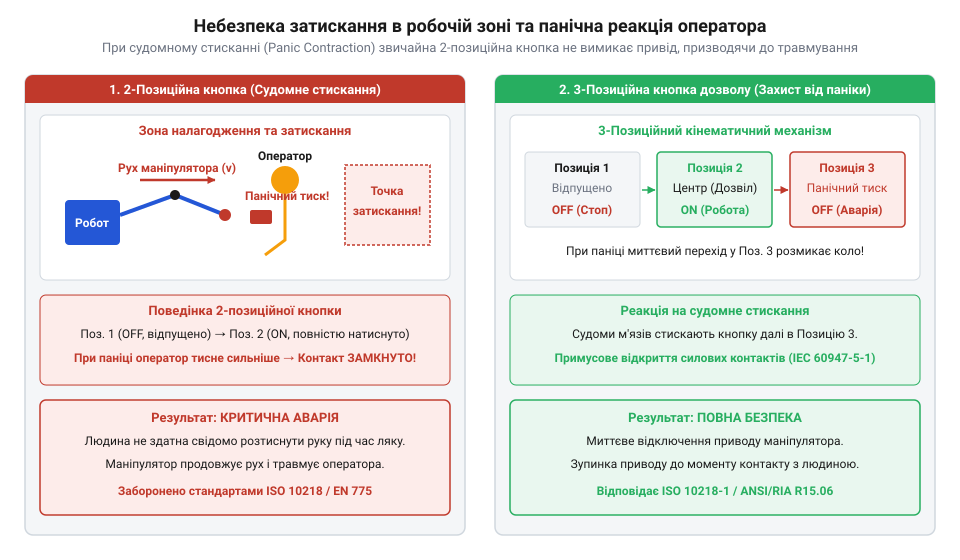
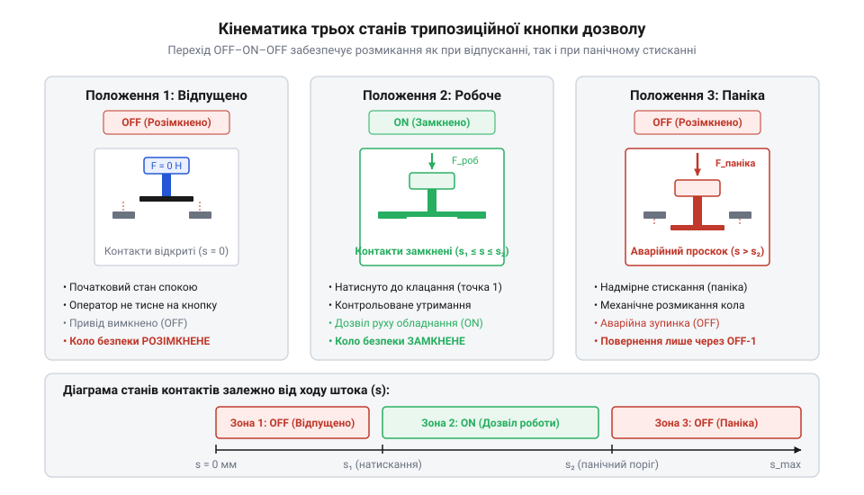
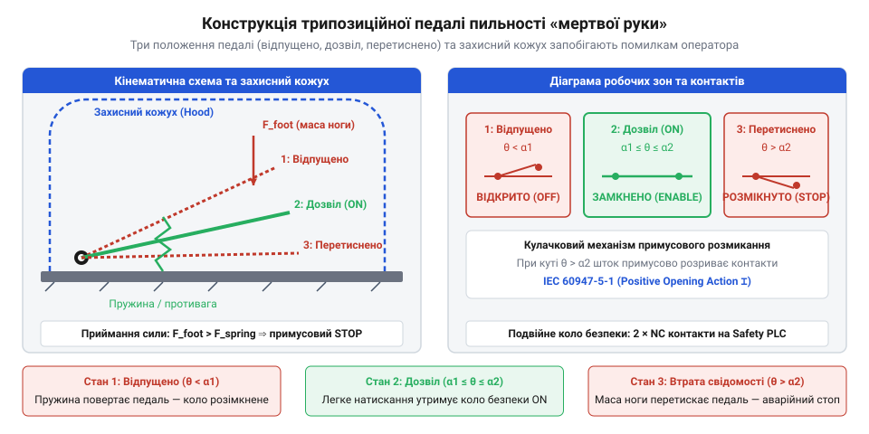
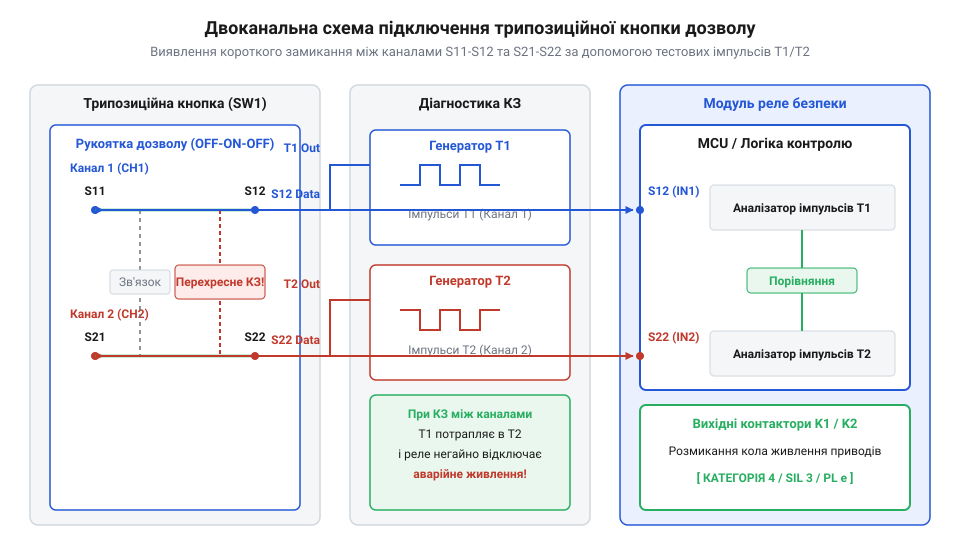

# Трипозиційні кнопки дозволу та педалі «мертвої руки»

<preknowlist>
- [Кнопка аварійного стопу грибок та органи безпечного відключення (IEC 60947-5-5)](root:cat-hw-controls/estop-mushroom-button) — Принципи прямого примусового розмикання контактів та концепція категорій аварійного зупинення в колах функціональної безпеки.
- [Тактильні кнопки з ковпачками](root:cat-hw-controls/tactile-buttons) — Базова будова контактних груп та відмінності між нормально розімкненими (NO) і нормально замкненими (NC) електричними колами.
- [Тумблери, захисні ковпачки Mollie та блокування важелів (Switch Guards)](root:cat-hw-controls/toggle-switches-and-switch-guards) — Механічні способи запобігання помилковому або умисному перемиканню органів керування.
</preknowlist>

## Небезпека ручного налагодження та людський фактор

Під час обслуговування роботизованих осередків у небезпечній зоні оператор перебуває в безпосередньому контакті з рухомими механізмами. Застосування звичайних двопозиційних [тактильних кнопок](root:cat-hw-controls/tactile-buttons) створює смертельну загрозу: при раптовому переляку чи ураженні струмом спрацьовує рефлекторне судомне стискання кисті (від латинського @@la|contractio@@ — стягування; @@en|panic contraction@@). У такому стані оператор несвідомо утримує двопозиційну кнопку замкненою, блокуючи аварійну зупинку обладнання. Трипозиційний вимикач дозволу (від англ. @@en|enabling switch@@) нейтралізує цей людський фактор, розмикаючи коло як при розтисканні, так і при панічному продавлюванні рукоятки.

*Судомне панічне стискання кнопкового елемента оператором вимагає апаратного переривання кола у третьому крайньому положенні.*

## Кінематика трьох станів трипозиційного вимикача

Механіка кнопкового важеля реалізує послідовну кінематику трьох фізичних положень: OFF-ON-OFF. У першому вихідному стані шток відпущений, і контакти розімкнені. При м'якому стисканні шток долає перший тактильний поріг і переходить у другий серединний стан, замикаючи коло дозволу руху. При небезпеці та панічному продавлюванні важеля шток долає другий поріг і переходить у третій стан, де кулачок примусово розмикає контакти (від латинського @@la|positivus@@ — безумовний; @@en|positive opening action@@), аналогічно до того, як працюють контакти у [кнопках аварійного стопу](root:cat-hw-controls/estop-mushroom-button). Зворотний хід важеля з третього стану в перший проходить через спеціальний блокувальний паз, що унеможливлює повторне замикання кола дозволу.

*Примусовий розрив контактів у третьому положенні та блокування зворотного ходу запобігають випадковому ввімкненню пристрою.*

## Конструкція педалей пильності та противаги

Для захисту операторів важкого обладнання та залізничного транспорту застосовують підлогові педалі «мертвої руки» (від англ. @@en|dead-man pedal@@) та контролю пильності (від латинського @@la|vigilans@@ — пильний; @@en|vigilance control@@). Оскільки вага важкого робочого спецвзуття може довільно продавлювати педаль, її механізм оснащують регульованими пружинними противагами та розрахованим балансом моментів сил відносно осі обертання. Для запобігання заклинюванню педалі у серединному стані сторонніми предметами електронний блок МК реалізує циклічний сторожовий таймер. Якщо оператор утримує педаль у стані дозволу без періодичного короткочасного розтискання понад нормований час, система подає звуковий сигнал і вимикає привід.

*Механічна противага компенсує вагу спецвзуття, а сторожовий таймер вимагає періодичного підтвердження пильності.*

## Двоканальне підключення та імпульсна діагностика

Відповідно до високих категорій функціональної безпеки SIL 3 та PL e, трипозиційні вимикачі підключають за дубльованою двоканальною схемою. Кожен канал використовує окрему групу контактів, що гарантує зупинку обладнання навіть при зварюванні ламелей в одному з кіл. Гнучкий кабель виносного пульта піддається згинам і стиранню, що створює ризик перехресних коротких замикань між провідниками (від англ. @@en|cross-circuit fault@@). Для виявлення замикань реле безпеки подає на канали протифазні тестові імпульси (від латинського @@la|pulsus@@ — поштовх; @@en|test pulses@@), фіксуючи відхилення форми сигналу та розсинхронізм спрацьовування каналів. Детальний опис апаратної структури та алгоритмів обробки сигналів викладено в огляді [реле та контролерів безпеки](root:cat-hw-controls/safety-relays-and-controllers).

*Імпульсна діагностика та дубльоване розведення виявляють короткі замикання між провідниками виносного кабелю.*

## Захист від обходу та умови експлуатації

Для відволікання від монотонної роботи оператори іноді намагаються заблокувати педалі чи кнопки струбцинами або клейкою стрічкою, аналогічно до порушень при використанні [тумблерів без захисних ковпачків](root:cat-hw-controls/toggle-switches-and-switch-guards). Для блокування такого обходу модуль безпеки контролює сувору послідовність станів: дозвіл руху активується лише тоді, коли перехід у серединний стан відбувся з вихідного відпущеного стану впродовж нормованого часового вікна. Окрім того, пристрої виконання для жорстких промислових умов виготовляють у герметичних корпусах із захистом IP67 та маслостійкими силіконовими манжетами.
