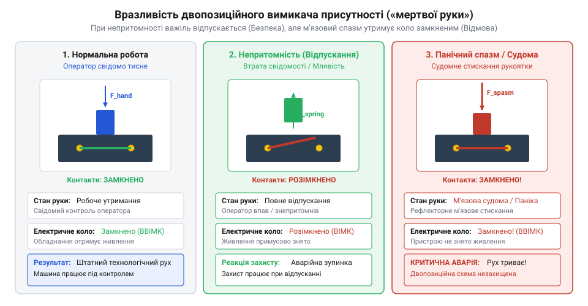
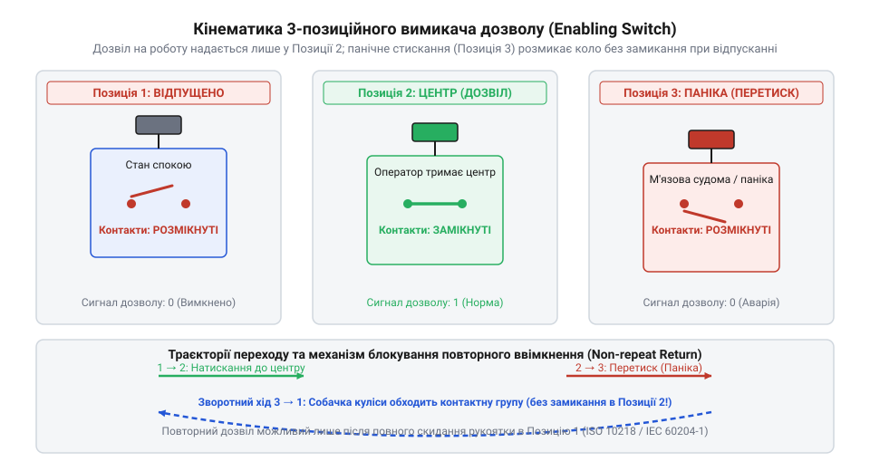

# Історія розвитку пристроїв дозволу та механізмів «мертвої руки»

<preknowlist>
- [Кнопка аварійного стопу грибок та органи безпечного відключення (IEC 60947-5-5)](root:cat-hw-controls/estop-mushroom-button) — концептуальна відмінність між примусовим аварійним зупиненням оператором і пасивним захистом змушеної присутності.
</preknowlist>

## Катастрофи раннього транспорту й перші важелі

Упровадження високих швидкостей на залізничному транспорті наприкінці XIX століття викрило критичну вразливість систем керування: безпека потяга повністю залежала від безперервної свідомості однієї людини. Коли машиніст паровоза втрачав свідомість через раптовий серцевий напад чи непритомнів від чадного газу, регулятор подачі пари залишався у відкритому положенні, а склад продовжував рух на повній швидкості до неминучого зіткнення. На відміну від ситуацій, коли свідомий оператор може задіяти [організовані органи аварійного стопу](root:cat-hw-controls/estop-mushroom-button), непритомність позбавляє людину можливості виконати будь-яку цілеспрямовану дію. Інженерний прорив стався завдяки кінематичному поєднанню підпружиненої рукоятки @@en|Frank J. Sprague@@ (Френка Спрага) із пневматичною гальмівною системою @@en|George Westinghouse@@ (Джорджа Вестінгауза). У разі ослаблення хвату машиніста стиснута поворотна пружина миттєво повертала важіль у вихідний стан, що механічно відкривало випускний клапан і скидало тиск стисненого повітря з магістрального гальмівного трубопроводу (англ. @@en|main brake pipe@@). Падіння тиску в магістралі автоматично приводило у дію повітророзподільники на кожному вагоні склада, спричиняючи негайне екстрене гальмування та одночасне знеструмлення тягових двигунів.

Перші інженерні рішення для забезпечення автоматичного зупинення з'явилися на початку XX століття з розвитком міського електричного транспорту. У 1903 році американський винахідник @@en|Frank J. Sprague@@ (Френк Спраг) оснастив контролери електропоїздів підпружиненою рукояткою керування тягою. Машиніст мусив постійно долати опір пружини й утримувати важіль рукою; якщо змикальний тиск зникав, пружина розмикала електричне коло тяги та одночасно відкривала клапан випускного магістрального повітропроводу пневматичного гальма @@en|Westinghouse@@. Завдяки цьому потяг зупинявся самостійно без участі оператора.

Паралельно на магістральних залізницях почали застосовувати підпружинені педалі під ногами машиніста. Перевагою педалі вважалося зменшення втоми кисті руки при багатогодинних поїздках, оскільки оператор утримував її вагою власної ноги. Сукупність цих механічних та пневматичних пристроїв дістала назву @@en|dead-man's switch@@ (пристрій «мертвої руки», від англійського @@en|dead@@ — мертвий, @@en|man@@ — людина). Зазначені важелі створили нову концепцію безпеки: відсутність фізичної активності оператора трактується системою як катастрофічна відмова й викликає негайне переведення обладнання в безпечний стан.

## Судома й пастка двопозиційних вимикачів

Тривала експлуатація двопозиційних органів змушеної присутності викрила фундаментальну фізіологічну проблему. Двопозиційна кінематика має лише два стани: відпущений (початкова позиція, коло розімкнене) і натиснутий (робоча позиція, коло замкнене). Інженерний розрахунок передбачав, що непритомна людина розслабить м'язи, і пружина поверне важіль у відпущений стан. Проте реальна фізіологія людини під час серцевого нападу, інсульту чи ураження електричним струмом проявляється тонічною судомою (від грецького @@gr|τόνος@@ — напруга, м'язовий спазм), при якій кисть мимовільно й міцно стискається в кулак. З біомеханічного погляду, поверхневий і глибокий м'язи-згиначі пальців передпліччя мають значно більший силовий потенціал і при судомі розвивають пікове ізометричне зусилля понад 300–400 ньютонів. На відміну від патологічного ізометричного спазму непритомного оператора, при свідомому панічному переляку чи раптовій втраті рівноваги спрацьовує безумовний захисний хапальний рефлекс, коли людина підсвідомо намагається міцно вхопитися за рукоятку як за опорну точку. Хоча природа цих станів різна — неконтрольована нейром'язова деполяризація в першому випадку та вестибуло-моторна панічна реакція у другому, — вони призводять до однакового фатального результату: механічне стискання в десятки разів перевищує протидію повертальної пружини (розрахованої лише на 10–30 ньютонів), унаслідок чого двопозиційна система залишається заблокованою в замкненому стані.

*Фізична схема переходу двопозиційної рукоятки з робочого стану в замкнений стан через м'язовий спазм.*

При спазмі м'язи-згиначі пальців притискають важіль до корпусу з силою, яка багаторазово перевищує зусилля повертальної пружини. У результаті непритомний машиніст чи оператор продовжує утримувати двопозиційний перемикач у замкненому стані, а катастрофічна ситуація розвивається без жодного протидійного заходу. Аналогічний фізіологічний ефект виникає при гострому панічному переляку: замість відпускання важеля людина рефлекторно стискає його з максимальним зусиллям.

Додатковою вразливістю двопозиційної системи виявилася легкість її навмисного обходу. Оператори залізничного транспорту та силових верстатів, втомлюючись від постійного м'язового напруження кисті, заклинювали двопозиційні рукоятки важелями, зв'язували їх мотузками або фіксували стрічкою. Через це пристрій @@en|dead-man's control@@ втрачав захисні властивості. Нездатність двопозиційної кінематики розрізнити свідому роботу від м'язового спазму чи навмисного заклинювання спонукала інженерів до створення трьохстадійного кінематичного контролю.

## Трипозиційна кінематика та панічний захист

Вирішенням проблеми спазматичного стискання став винахід трипозиційного вимикача дозволу (від англійського @@en|enabling switch@@, де @@en|enable@@ — надавати змогу, дозволяти). Конструкція базується на нелінійному кулачковому механізмі, що має три чітко розрізнені фізичні положення важеля. У першому положенні (важіль повністю відпущено) електричні контакти розімкнені під дією основної пружини. У другому положенні (важіль злегка натиснуто й утримується в середній позиції) кулачковий профіль піднімає контактний місток, замикаючи коло для виконання небезпечних маневрів. Проте при продовженні ручного натискання та переході у третє положення (панічний стан) кулачок звертає зі ступеня виступів і жорстким механічним штовхачем примусово розсуває контактні пластини. Це розмикання за принципом @@en|positive break@@ гарантує механічний розрив кола навіть за умови зварювання контактних точок під дією електричної дуги або поломки пружини.

*Траєкторія руху важеля дозволу між трьома позиціями з вимушеним розмиканням клем у крайній панічній позиції.*

Третє положення (важіль силоміць продавлено вкрай) задіюється при судомі чи панічному стисканні кисті. Кулачок перемикача долає поріг додаткової жорсткої пружини, і механізм примусово розмикає електричне коло. При цьому застосовується принцип прямого примусового розмикання (від англійського @@en|positive break@@), де механічний штовхач фізично розриває зварні чи злиплі контакти без залежності від пружності пружин.

Важливою особливістю трипозиційної кінематики є асиметрія зворотного ходу. Коли людина відпускає важіль із третього (панічного) положення, механізм повертається в перше положення крізь середню позицію без замикання контактів. Внутрішній зачіп пропускає робочий контакт у розімкненому стані аж до повного виходу важеля в початкову позицію. Тільки після повного відпускання рукоятки й повторного помірного натискання можна знову замкнути коло дозволу, що унеможливлює випадкове відновлення небезпечного руху при релаксації м'язів.

## Стандартизація ISO 10218 і неможливість обходу

Поява маніпуляторів у важкій промисловості змінила вимоги до безпеки: якщо на залізниці оператор перебував у кабіні, то налагоджувальник робота працює безпосередньо в потенційно смертельній зоні руху важелів. Спроби операторів заблокувати підпружинену рукоятку клейкою стрічкою, клинками чи стяжками для зменшення втоми рук призводили до фатальних аварій. Це спонукало розробників міжнародних стандартів @@en|ISO 10218@@ та @@en|IEC 60204-1@@ формалізувати жорсткі вимоги до конструкції органів змушеної присутності. Зокрема, стандарт @@en|IEC 60204-1@@ закріпив обов'язковий перехресний контроль (від англійського *cross-monitoring* — перехресний моніторинг каналів, @@en|cross-monitoring@@) двох незалежних ліній комутації: якщо один контакт перемикається, другий зобов'язаний змінити стан протягом суворо обмеженого часового вікна розсинхронізації (зазвичай 100–200 мілісекунд), інакше реле безпеки фіксує апаратне коротке замикання чи залипання клем і блокує роботу обладнання.

Стандарти зафіксували принципи захисту від навмисного обходу (від латинського *temperare* — змішувати, врівноважувати, @@en|anti-tamper design@@). Форма корпусу сучасного пристрою дозволу робить фізично неможливим його заклинювання у проміжному робочому стані за допомогою підручних предметів. Ергономічна поверхня позбавлена виступів для зачеплення стяжок, а внутрішній кінематичний механізм вимагає безперервного активного утримання.

Окрім механічного захисту, стандартизація впровадила обов'язкову двоканальну архітектуру (від грецького *arche* — початок і *tekton* — будівельник, @@en|dual-channel architecture@@). Перемикач містить два незалежні дубльовані контакти, що опитуються безпековим контролером. Якщо один контакт зварюється через електричну дугу, другий розмикає ланцюг, а реле безпеки блокує повторний пуск. Це перетворило рукоятку дозволу з простого електричного вимикача на повноцінний елемент систем високих категорій надійності, які працюють паралельно з [органами аварійного відключення](root:cat-hw-controls/estop-mushroom-button).

## Розвінчання міфів про походження «мертвої руки»

Популярна література та технологічні блоги часто описують пристрій «мертвої руки» як винахід реактивної авіації середини XX століття або ранньої робототехніки. Утім, аналіз архівних патентів і залізничних регламентів доводить, що це уявлення є міфом. Концепція змушеної присутності народилася наприкінці XIX століття на рейковому транспорті під час масового впровадження електричної тяги та міських трамваїв. Порівняльний аналіз хронології показує, що залізничні патенти на підпружинені рукоятки тяги та педалі (зокрема патент US747808A Френка Спрага 1903 року та європейські регламенти електрифікованих ліній 1905–1908 років) зафіксували юридичний та технічний пріоритет майнових прав (від англійського *patent priority* — патентний пріоритет, @@en|patent priority@@) щонайменше на три десятиліття раніше за авіацію. Перші авіаційні патенти на ручки керування польотом із контролем непритомності пілота з'явилися лише наприкінці 1920-х та у 1930-х роках для тривалих перельотів поштової авіації. Авіаційні інженери не створювали концепцію @@en|dead-man control@@ заново, а перенесли перевірені залізничні принципи розриву кіл на штурвали й сектори газу, змінивши лише зусилля повертальних пружин під фізіологію пілота.

Перші дієві пристрої безпеки розробили інженери Френк Спраг (@@en|Frank J. Sprague@@) та Джордж Вестінгауз (@@en|George Westinghouse@@) для запобігання катастрофам у разі втрати свідомості машиністом. Саме на залізниці вперше сформулювали принцип пасивного розмикання тягового кола та автоматичного гальмування при відпусканні рукоятки чи педалі.

Авіація та промислова робототехніка не вигадували концепцію «мертвої руки» (від англійського *dead-man* — мертва людина, @@en|dead-man control@@), а лише запозичили вже зрілі залізничні рішення. Їхнім внеском стала адаптація механіки під специфічні умови: трипозиційна кінематика в робототехніці з'явилася для захисту від панічного стискання, що було неактуальним для важких підпружинених залізничних педалей.
