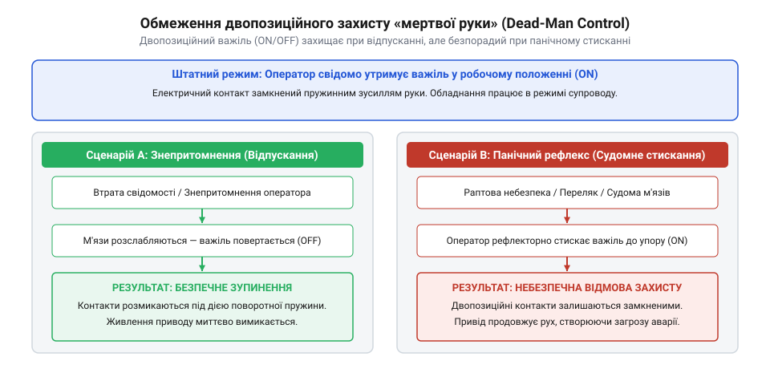
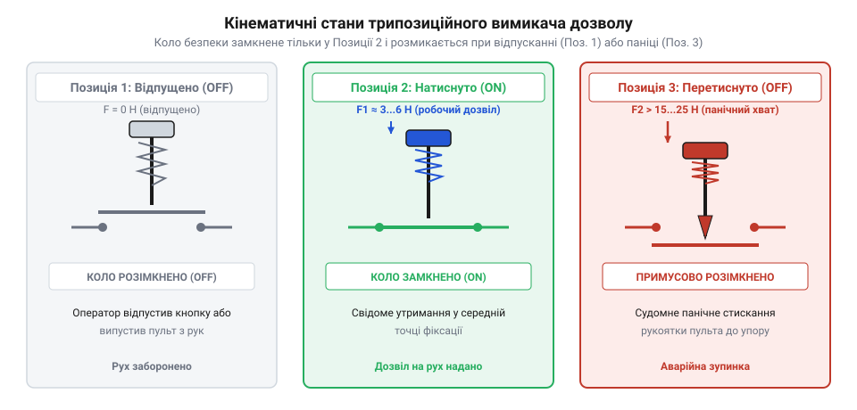

# Еволюція засобів захисту оператора: від педалей локомотивів до трипозиційних селекторів

<preknowlist>
- [Кнопка аварійного стопу грибок та органи безпечного відключення (IEC 60947-5-5)](root:cat-hw-controls/estop-mushroom-button) — принципи апаратного розмикання кіл живлення при виникненні аварійних ситуацій
- [Тумблери, захисні ковпачки Mollie та блокування важелів (Switch Guards)](root:cat-hw-controls/toggle-switches-and-switch-guards) — пасивні та активні механічні засоби запобігання випадковому перемиканню
</preknowlist>

## Проблема непритомності та педалі залізниць

На початку XX століття з появою швидкохідних електричних і дизельних локомотивів виникла гостра інженерна проблема. На відміну від паровозів, де у кабіні завжди працювали дві особи — машиніст та кочегар, нові типи тяги дозволяли переходити на обслуговування одним оператором. Проте якщо машиніст під час руху раптово втрачав свідомість через серцевий напад, засинав або непритомнів, некерований потяг продовжував рухатися на повній швидкості, що призводило до катастрофічних залізничних аварій.

Для запобігання таким техногенним катастрофам залізничні інженери винайшли перші механічні та пневматичні @@en|педалі «мертвої людини»@@ (від англ. @@en|dead-man's control@@, де dead — мертвий, man — людина, та pedal — педаль від латинського @@la|pedalis@@ — підніжний). Конструктивно вони суттєво відрізнялися: найпростіші вагові важелі спиралися на противагу та важільні механізми, які вимагали постійного фізичного утримання рукою чи ногою, тоді як пневматичні педалі системи @@en|Westinghouse@@ (від власної назви @@en|Westinghouse Air Brake Company@@) інтегрувалися безпосередньо у гальмівну магістраль. Принцип дії цих органів захисту базувався на двопозиційній логіці: поки машиніст живий і при свідомості, він протидіє зусиллю пружини й утримує педаль у притиснутому стані, закриваючи випускний клапан. Якщо машиніст непритомніє, м'язовий тонус ноги зникає, і пружина миттєво повертає важіль у вихідне положення. У пневматичних системах це викликає відкриття механічного клапана автогальма, розрядку гальмівної магістралі в атмосферу та екстрене спрацьовування пневмогальм, а в електричних кола живлення тягових двигунів розмикаються аналогічно до того, як розмикають ланцюги [тумблери та захисні вимикачі](root:cat-hw-controls/toggle-switches-and-switch-guards).

Однак двопозиційні органи захисту першого покоління виявилися вразливими до людського фактора. Постійне статичне напруження ноги протягом багатьох годин викликало сильну втому операторів. Бажаючи полегшити роботу, машиністи почали обходити апаратний захист: клали на педаль важкі гайкові ключі, заклинювали важіль дерев'яними клинами чи фіксували його ременями. У результаті при справжній непритомності машиніста заклинений механізм не спрацьовував, і катастрофи продовжувалися. Одноступенева логіка розмикання кола виявилася недостатньою для надійного блокування.

## Панічний рефлекс та небезпека двопозиційників

З розвитком автоматизації в середині XX століття та появою промислових роботів органи безпечного відключення перекочували із залізниць до цехів. На відміну від аварійних ситуацій із [кнопками аварійного стопу](root:cat-hw-controls/estop-mushroom-button), де вимагається швидке зупинення всього осередку, у режимі налагодження робота інженер перебуває безпосередньо в небезпечній зоні поруч з маніпулятором і тримає у руках пульт керування.

Перші налагоджувальні пульти оснащували простими двопозиційними кнопками дозволу: натиснуто — робот рухається, відпущено — зупиняється. Згодом з'ясувалося, що під час раптової загрози або непередбаченого маневру роботизованого маніпулятора фізіологічна реакція людини кардинально відрізняється від непритомності. Замість розслаблення рук людина під дією переляку або при ураженні струмом виказує панічний судомний рефлекс (від англ. @@en|panic grip@@, де panic — паніка від грецького @@el|πανικός@@, та grip — хват): м'язи передпліччя рефлекторно й з силою стискають рукоятку.

*Порівняння реакції людини при втраті свідомості та панічному судомному стисканні двопозиційного важеля.*

Використання звичайних двопозиційних ручних [тактильних кнопок](root:cat-hw-controls/tactile-buttons) чи кнопкових вимикачів у пультах дозволу стало причиною важких травм та серії смертельних інцидентів на автомобільних заводах у 1970-х роках. Під час перших спроб впровадження промислових маніпуляторів інженери-налагоджувальники програмували траєкторії руху безпосередньо у робочій зоні, утримуючи двопозиційний вимикач. Коли маніпулятор через помилку в програмі або гідравлічний збій раптово зміщувався в бік людини, реакція на сполох супроводжувалася панічним ефектом @@en|panic grip@@ (від англ. @@en|panic grip@@, де panic — паніка від грецького @@el|πανικός@@, та grip — хват): замість розтискання долоні оператор рефлекторно стискав пультову рукоятку з силою понад 100 Н. Двопозиційний контакт замикався ще сильніше, робот не зупинявся і притискав людину до захисного огородження. Саме аналіз цих виробничих аварій 1970-х років довів інженерам, що людська фізіологія робить двопозиційні вимикачі непридатними для захисту в аварійних ситуаціях.

Усунення цієї небезпеки вимагало кардинальної зміни кінематики органів керування — переходу до трипозиційної парадигми «Вимкнено — Увімкнено — Вимкнено» (від англ. @@en|OFF-ON-OFF logic@@). У цій концепції коло дозволу замкнене лише у середньому фіксованому положенні важеля. При відпусканні кнопки (втрата свідомості) контакти розмикаються пружиною, а при надмірному судомному стисканні (панічний рефлекс) важіль продавлюється в третє положення, де контакти примусово розмикаються другим механічним каскадом.

*Кінематичні стани трипозиційного селектора дозволу з контактами примусового розмикання.*

Цей трипозиційний принцип згодом ляг у основу міжнародного стандарту безпеки промислової робототехніки ISO 10218 та вимог до електрообладнання машин IEC 60204-1, гарантуючи захист оператора як при знепритомненні, так і при судомному стисканні рукоятки.

## Винахід трипозиційного вимикача та стандартизація

Зі стрімким впровадженням промислових роботів-маніпуляторів у 1970–1980-х роках виникла потреба в безпечному ручному налагодженні обладнання зсередини робочої зони. Оператор, перебуваючи поряд із маніпулятором, утримував навчальний пульт і мусив мати швидкий спосіб зупинки механізму. Звичайні двопозиційні органи керування чи [промислові грибкові кнопки](root:cat-hw-controls/estop-mushroom-button) не рятували під час судомного стискання пульта в момент паніки. Інженерним проривом став винахід трипозиційного вимикача дозволу (англ. *enabling switch*, від *enable* — надавати дозвіл) @@en|enabling switch@@, який реалізував кінематику трьох послідовних станів: «відпущено (OFF) — утримано (ON) — перетиснуто (OFF)».

Ключовим елементом нової кінематики став механізм вимушеного прямого розмикання контактів (англ. @@en|positive opening mechanism@@). Якщо у першому стані (позиція 1) кнопка повністю відпущена й коло дозволу розімкнене, то при легкому натисканні (позиція 2) пружинний фіксатор замикає контакти, дозволяючи рух маніпулятора на зниженій швидкості. При настанні небезпеки та панічному стисканні ручки оператором механічний штовхач долає опір другої пружини й примусово розмикає місток у позиції 3 (надлишковий хід), навіть якщо контакти зазнали мікрозварювання. Щоб запобігти повторному небезпечному замиканню кіл під час повернення кнопки з позиції 3 у позицію 1, у конструкцію введено кулісний блокувальник із підпружиненим напрямним пальцем. При продавлюванні у позицію 3 палець перескакує через пружну собачку куліси й спрямовується у зворотний обхідний паз. Механіка зворотного ходу влаштована так, що під час руху важеля назад через Положення 2 обхідний паз утримує контактну траверсу відтиснутою, оскільки блокувальна засувка перекриває прямохідний канал і не дає штовхачу увійти в зачеплення з містком. Лише при повному поверненні важеля у вихідну позицію 1 (нульова точка ходу) скидний штифт вдаряється про механічний упор корпуса й скидає засувку у зведене положення, відновлюючи можливість замикання контактів при наступному натисканні.

Цей технічний принцип виявився настільки надійним, що став основою міжнародної стандартизації безпеки машин. Стандарт ISO 10218 (захист промислових робототехнічних систем) та міжнародна норма IEC 60204-1 (електрообладнання машин) зробили наявність трипозиційного органу дозволу обов’язковою вимогою для будь-яких процедур навчання й налагодження в небезпечній зоні. Американський інститут стандартизації у нормі ANSI/RIA R15.06 закріпив правило: рух робота у ручному режимі можливий лише за умов одночасного утримання кнопки дозволу в середньому Положенні 2 та обмеження швидкості переміщення робочого органу.

## Міфи першості та еволюція до дубльованої безпеки

В історії промислової безпеки вкорінилося чимало міфів щодо першості винаходу органів захисту оператора. Поширене уявлення, ніби підлогова педаль «мертвої людини» (англ. @@en|dead-man pedal@@) з’явилася як суто залізничний винахід компанії Westinghouse на початку XX століття, є спрощенням. Насправді перші пневматичні та важелясті розмикачі застосовувалися на парових шахтних підйомниках ще в XIX столітті, а залізниця лише адаптувала їх під вагові характеристики локомотивів. Інший міф стверджує, ніби трипозиційна кнопка дозволу була винайдена одним робототехнічним концерном; насправді це був колективний еволюційний результат взаємодії інженерних груп та органів інспекції праці США, Німеччини та Японії у відповідь на серію важких травм при налагодженні автозбиральних ліній.

Паралельно з оновленням норм змінювалася й електрична архітектура комутації. Перші органи дозволу були одноканальними й розривали безпосередньо коло живлення реле чи контактора. Однак одиничний пробій ізоляції або коротке замикання в кабелі ручного пульта робили таку систему беззахисною. У сучасних робототехнічних комплексах застосовують двоканальні дубльовані контактні групи (два незалежні NC-контакти на кожен канал дозволу), що працюють у зв'язці з електронними модулями моніторингу. Для виявлення найпідступнішої відмови — короткого замикання між жилами гнучкого кабелю — модуль безпеки подає на канали не постійну напругу, а прямокутні випробувальні строб-імпульси (від англ. @@en|test pulses@@), зміщені в часі один відносно одного. Перший тестовий вихід `T1` формує короткі імпульсні просідання напруги в каналі A, тоді як вихід `T2` генерує фазово зсунуту серію імпульсів у каналі B. Зчитувальні входи `I1` та `I2` очікують суворо свій часовий паттерн: якщо при пошкодженні кабелю між жилами виникає перехресне замикання, імпульси з каналу A потрапляють на вхід B (або навпаки), що електронний блок негайно фіксує як апаратний дефект (від англ. @@en|cross-fault detection@@) і миттєво відключає силові приводи ще до того, як оператор спробує розмикати контакти. Детальніше про принципи побудови електронних модулів моніторингу та виявлення перехресних замикань читайте у матеріалі про [реле безпеки та контролери захисного відключення](root:cat-hw-drivers/safety-relay).

Схеми контролю подають на кожен канал дискретні імпульсні сигнали та фіксують найменшу неузгодженість між каналами, а також перехресні замикання між жилами гнучкого кабелю. Для захисту цих слабострумових сигналів від потужних електромагнітних завад (від англ. @@en|electromagnetic interference@@) під час багаторазових скручувань і деформацій переносного пульта використовують високогнучкі багатожильні кабелі з поліуретановою оболонкою (від німецького *Polyurethan*; від англ. @@en|polyurethane@@) та подвійним екрануванням (від англ. @@en|double shielding@@). Комбінація суцільної алюмінієвої фольги та щільного плетеного мідного екрана запобігає наведенню хибних сплесків напруги на вхідні лінії при згинанні шлейфу біля частотних приводів робота. Поєднуючи механічну кінематику трьох станів із двоканальним електричним резервуванням, сучасні вимикачі дозволу досягають найвищих рівнів повноти безпеки SIL 3 та Performance Level PL e. На відміну від статичних вимикачів, як-от [трипозиційні тумблери](root:cat-hw-controls/toggle-switches-and-switch-guards) чи [силові рокерні панелі](root:cat-hw-controls/rocker-switches-and-power-toggle-panels), які слугують для вибору режимів роботи, органам дозволу довірено безпосереднє оперативне збереження життя оператора.
