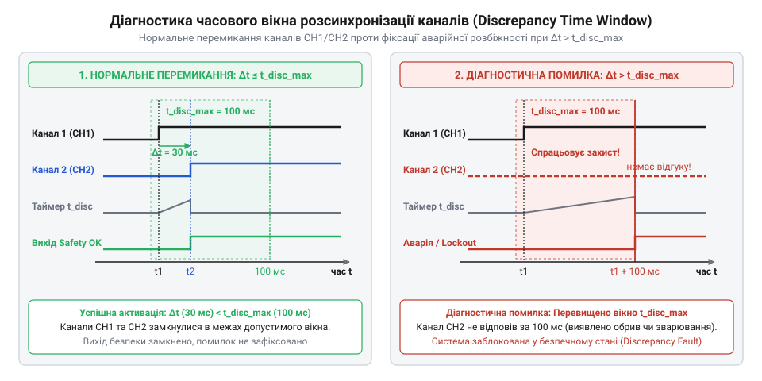
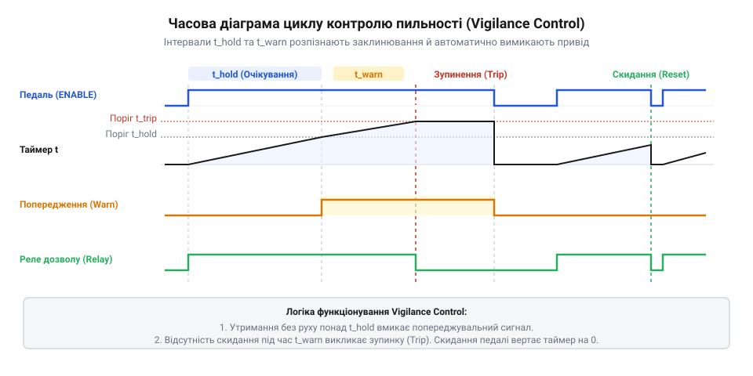

# Математичні моделі надійності та часові параметри vigilance control

<preknowlist>
- [Кнопка аварійного стопу грибок та органи безпечного відключення (IEC 60947-5-5)](root:cat-hw-controls/estop-mushroom-button) — принципи апаратного розмикання кіл та дубльовані канали безпеки
- [Тумблери, захисні ковпачки Mollie та блокування важелів (Switch Guards)](root:cat-hw-controls/toggle-switches-and-switch-guards) — принципи механічного зношування сухих контактів
</preknowlist>

## Проблема механічного зносу та показник B10d

У системах функціональної безпеки промислового обладнання кнопки дозволу та педалі присутності піддаються безперервним циклічним навантаженням. Кожне натискання супроводжується пружною деформацією контактних пружин, механічним тертям солідних груп та мікродуговим ерозійним зносом при розмиканні електричних кіл. Унаслідок деградації матеріалів виникає два типи несправностей: безпечні відмови, коли контакт не замикається і система зупиняється, та небезпечні відмови, коли контакти зварюються чи заклинюють у замкненому стані, залишаючи небезпечний привід увімкненим після відпускання важеля. На відміну від статичної комутації, яку описують [тумблери та захисні перемикачі](root:cat-hw-controls/toggle-switches-and-switch-guards), розрахунок інтенсивності відмов органів дозволу базується на кількості робочих циклів.

Для кількісної оцінки надійності контактних груп використовують показник `B10d` (від англ. @@en|B10d value@@, де B10 — десять відсотків відмов, а d — @@en|dangerous@@ від латинського @@la|damnum@@ — шкода, збиток). Показник `B10d` визначає число комбінованих циклів комутації, за якого 10 % випробовуваних зразків зазнають небезпечної відмови за стандартних умов експлуатації відповідно до норм ISO 13849-1. На початковому етапі експлуатації інтенсивність небезпечних відмов на один цикл `λ_d_cycle` вважається сталою величиною. Головними фізичними чинниками небезпечних відмов є механічна деградація повертальних пружин та термічне зварювання контактних поверхонь. Втома матеріалу пружини (від англ. @@en|metal fatigue@@, від лат. *fatigatio* — увтома) викликає зменшення її жорсткості `k_spring(N)` залежно від кількості циклів `N` за законами деградації `k_spring(N) = k_0 · (1 - α_fatigue · N)`, де `k_0` — початкова жорсткість, а `α_fatigue` — коефіцієнт втоми. Водночас під час перехідних процесів індуктивного навантаження піковий струм `I_peak` виділяє джоулеве тепло `Q = I_peak² · R_contact · t_arc` у контактній плямі опором `R_contact` за час існування електричної дуги `t_arc`. Для опису накопичення мікрозварювань застосовують матричний розрахунок переходів станів `M_weld`, де вектор ймовірностей перевизначення стану `P(N+1) = M_weld · P(N)` задається через точкову ймовірність зварювання `p_weld = C_weld · (I_peak² · R_contact) / k_spring(N)`, де `C_weld` — термофізична константа матеріалу. Зі зменшенням `k_spring(N)` відновлювальне зусилля стає недостатнім для розриву мікрозварювань, що різко підвищує інтенсивність відмов. Ймовірність небезпечної відмови `F_d(N)` залежно від напрацьованого числа циклів `N` задається експоненційним розподілом:

```
F_d(N) = 1 - e^(-λ_d_cycle · N)
```

За визначенням параметра `B10d`, при `N = B10d` частка відмов `F_d(B10d) = 0.10`. Точний і спрощений зв'язок між цими величинами виводиться логарифмуванням:

```
1 - e^(-λ_d_cycle · B10d) = 0.10
e^(-λ_d_cycle · B10d) = 0.90                      [віднімання від одиниці]
-λ_d_cycle · B10d = ln(0.90)                    [логарифмування обох частин]
-λ_d_cycle · B10d = -0.10536                    [значення натурального логарифма 0.90]
λ_d_cycle = 0.10536 / B10d                      [точна інтенсивність небезпечних відмов на цикл]
```

У нормах ISO 13849-1 використовують лінійну апроксимацію `λ_d_cycle ≈ 0.1 / B10d`, яка дає необхідний інженерний запас міцності при розрахунках надійності.

**Умова:** Обчислимо інтенсивність небезпечних відмов на один цикл `λ_d_cycle` для трипозиційного вимикача дозволу із паспортним значенням `B10d = 100 000` циклів.

```
λ_d_cycle = 0.1 / B10d
= 0.1 / 100000                                  [підстановка паспортного показника B10d]
= 1 × 10⁻⁶                                      [інтенсивність небезпечних відмов на цикл]
```

Отримана величина `1 × 10⁻⁶` показує ймовірність зварювання чи заклинювання контактної групи при кожному окремому натисканні оператора.

Значення інтенсивності небезпечних відмов на один цикл є базовою величиною для переходу від дискретних механічних випробувань до неперервної часової оцінки надійності системи. На відміну від напівпровідникових елементів, де деградація орієнтована на астрономічний час роботи, електромеханічна контактна група зношується саме в момент комутації. Отримана величина `λ_d_cycle` показує ймовірність виходу з ладу за один робочий цикл, але під час оцінювання систем функціональної безпеки рівень ризику вимірюють через небезпечні відмови за годину або рік. Тому безпосереднє застосування показника `B10d` вимагає врахування інтенсивності експлуатації обладнання: чим частіше оператор задіює орган дозволу протягом робочої зміни, тим швидше вичерпується ресурсоємність контактного вузла й зростає річна ймовірність виникнення прихованого небезпечного стану.

## Обчислення показника MTTFd та частота спрацьовувань

Щоб перейти від циклічної інтенсивності відмов `λ_d_cycle` до часового показника `MTTFd` (від англ. @@en|mean time to dangerous failure@@ — середній час до небезпечної відмови), необхідно врахувати інтенсивність використання пристрою протягом року. Річна кількість циклів спрацьовування `n_op` залежить від графіка роботи обладнання, кількості робочих днів на рік `d_op`, годин на день `h_op` та середньої частоти натискань за годину `N_op_hour`.

Формула річного напрацювання `n_op` має вигляд:

```
n_op = d_op · h_op · N_op_hour
```

Річна інтенсивність небезпечних відмов `λ_d` розраховується як добуток кількості операцій за рік `n_op` та інтенсивності відмов на один цикл `λ_d_cycle`. Середній час до небезпечної відмови `MTTFd` для одного каналу обчислюється як обернена величина до `λ_d`:

```
λ_d = n_op · λ_d_cycle
= n_op · (0.1 / B10d)                           [підстановка циклічної інтенсивності]
= (0.1 · n_op) / B10d                           [річна інтенсивність небезпечних відмов]

MTTFd = 1 / λ_d
= B10d / (0.1 · n_op)                           [показник MTTFd одного каналу в роках]
```

**Умова:** Обчислимо значення `MTTFd` для педалі присутності в робототехнічній осередці при `d_op = 220` днів/рік, `h_op = 8` годин/день, частоті натискань `N_op_hour = 30` циклів/годину та `B10d = 100 000` циклів.

```
n_op = d_op · h_op · N_op_hour
= 220 · 8 · 30                                  [підстановка експлуатаційних параметрів]
= 52800                                         [річна кількість робочих циклів]

MTTFd = B10d / (0.1 · n_op)
= 100000 / (0.1 · 52800)                        [підстановка B10d та n_op]
= 100000 / 5280                                 [розрахунок знаменника]
= 18.94 років                                   [підсумковий показник MTTFd одного каналу]
```

У двоканальних системах безпеки, які застосовують [кнопки аварійного стопу](root:cat-hw-controls/estop-mushroom-button) та резервовані органи дозволу, канальні елементи нерідко мають різну фізичну конструкцію (наприклад, електромеханічний контакт із показником `B10d_1` та оптичний датчик або мікроперемикач із `B10d_2`). Оскільки інтенсивність небезпечних відмов кожного каналу за однакового річного напрацювання `n_op` визначається його власною витривалістю `λ_d1 = (0.1 · n_op) / B10d_1` та `λ_d2 = (0.1 · n_op) / B10d_2`, показники середнього часу до відмови окремих гілок виявляються несиметричними: `MTTFd_1 = B10d_1 / (0.1 · n_op)` та `MTTFd_2 = B10d_2 / (0.1 · n_op)`. Для урахування взаємного резервування та імовірності прихованого накопичення дефектів у несиметричній дубльованій архітектурі підсумковий еквівалентний показник системи `MTTFd_sys` розраховується за формулою комбінування @@en|ISO 13849-1@@:

```
MTTFd_sys = (2 / 3) · ( MTTFd_1 + MTTFd_2 - (MTTFd_1 · MTTFd_2) / (MTTFd_1 + MTTFd_2) )
```

У цьому виразі перший доданок `(MTTFd_1 · MTTFd_2) / (MTTFd_1 + MTTFd_2)` відображає еквівалентний середній час паралельної роботи обох каналів (що відповідає оберненій сумі інтенсивностей `1 / (λ_d1 + λ_d2)`), а другий доданок `(MTTFd_1 + MTTFd_2) / 6` враховує середню тривалість збереження захисної функції при прихованій відмові однієї з гілок. Якщо ресурсна відмінність між компонентами значна (наприклад, `B10d_1 ≪ B10d_2`), слабший канал із високою частотою відмов підпорядковує собі надійність всієї структури, оскільки формула ISO 13849-1 запобігає заповненню прогалин безпеки одного елемента за рахунок більш надійного сусіднього каналу.

```
MTTFd_sys = (2 / 3) · ( MTTFd_1 + MTTFd_2 - (MTTFd_1 · MTTFd_2) / (MTTFd_1 + MTTFd_2) )
```

Для симетричних каналів (`MTTFd_1 = MTTFd_2 = MTTFd_channel`) вираз спрощується до співвідношення `MTTFd_sys = (2 / 3) · MTTFd_channel`. Стандарт обмеженого нормування встановлює верхню межу `MTTFd` для кожного каналу на рівні 100 років.

## Діагностичне охоплення та часова неузгодженість каналів

У двоканальних вимикачах дозволу контактні групи розмикаються механічно незалежно, проте внаслідок механічних допусків, люфтів та зносу механізму перемикання між розмиканням першого й другого каналів виникає часова затримка. Цей інтервал називається часом неузгодженості `t_discrepancy` (від англ. @@en|discrepancy time@@ — час неузгодженості, від латинського @@la|crepare@@ — тріщати, гриміти). Якщо один із контактів зварюється чи заклинює, під час натискання або відпускання змінює стан лише один канал, а інший залишається в початковому положенні.

Діагностика прихованих відмов базується на мікроконтролерному перехресному опитуванні каналів. Коли перший контакт змінює стан, мікроконтролер запускає таймер зворотного відліку з допуском `t_discrepancy_max` (типово 10–50 мс). Якщо протягом цього вікна другий канал не змінює свій стан, алгоритм фіксує апаратну помилку розсогласування (від англ. @@en|cross-fault detection@@) та блокує повторний запуск системи.


*Часова діаграма спрацьовування двох контактних груп із виявленням перевищення припустимого вікна неузгодженості t_discrepancy.*

Ефективність самодіагностики описує показник діагностичного охоплення `DC` (від англ. @@en|diagnostic coverage@@, від грецького @@el|diagnostikos@@ — здатний розпізнавати, та @@en|coverage@@ — покриття від старофранцузького @@fro|couvrir@@ — покривати). Показник `DC` задається відношенням інтенсивності виявлених небезпечних відмов `λ_dd` до загальної інтенсивності небезпечних відмов `λ_d_total`:

```
DC = Σ λ_dd / Σ λ_d_total
   = (Σ λ_d_total - Σ λ_du) / Σ λ_d_total               [розділення на виявлені λ_dd та невиявлені λ_du відмови]
   = 1 - (Σ λ_du / Σ λ_d_total)                         [запис через частку прихованих відмов]
```

У колах із примусовим розмиканням контактів (від англ. @@en|positive opening action@@) прихована відмова виникає в разі зварювання чи механічного заклинювання контактної групи. Якщо перевірка виконується лише пасивно під час робочого перемикання з частотою `f_op`, зварений контакт залишається невиявленим увесь інтервал між натисканнями. Для динамічного виявлення дефектів у коло подають короткі тестові імпульси з частотою `f_test = 1 / T_test`. Прихована частка відмов `λ_du` зменшується пропорційно відношенню періоду діагностичного тестування `T_test` до періоду робочих комутацій `T_demand = 1 / f_op`:

```
DC = 1 - (T_test / (2 · T_demand))                      [усереднена імовірність невиявленого стану за період]
   = 1 - (f_op / (2 · f_test))                          [перехід до частоти тестових імпульсів f_test]
```

**Приклад розрахунку:** За робочої частоти комутації педалі `f_op = 0.5` Гц (одне натискання на 2 секунди) та частоти тестових строб-імпульсів мікроконтролера `f_test = 50` Гц (період тестування `T_test = 20` мс):

```
DC = 1 - (0.5 / (2 · 50))                               [підстановка частот f_op та f_test]
   = 1 - (0.5 / 100)                                    [обчислення знаменника]
   = 1 - 0.005                                          [частка прихованих відмов дорівнює 0.5 %]
   = 0.995                                              [коефіцієнт DC = 99.5 %]
```

Завдяки високій частоті тестових імпульсів (`f_test ≥ 100 · f_op`) будь-яке зварювання контактів з розмиканням примусової дії фіксується за час, значно менший за час реакції оператора, що забезпечує досягнення високого рівня діагностичного охоплення (`DC ≥ 99 %`).

```
DC = Σ λ_dd / Σ λ_d_total
```

Залежно від схемотехніки та частоти опитування розрізняють чотири рівні `DC`:
- Відсутній (`DC < 60 %`): стани контактів зчитуються без перевірки часової узгодженості та без захисту від зварювання.
- Низький (`60 % ≤ DC < 90 %`): застосовується статичний контроль стану контактів при включенні живлення.
- Середній (`90 % ≤ DC < 99 %`): реалізовано динамічне перехресне опитування з контролем вікна `t_discrepancy` при кожному перемиканні.
- Високий (`DC ≥ 99 %`): застосовано контакти з примусовим розмиканням (від англ. @@en|positive opening action@@) у поєднанні з імпульсним динамічним тестуванням доріжок.

Для пристроїв тривалого утримання, таких як педалі присутності та системи @@en|vigilance control@@ (від англ. @@en|vigilance@@ — пильність від латинського @@la|vigilare@@ — не спати), додатково впроваджують часові інтервали активного підтвердження. Пристрій вимагає періодичного послаблення чи короткочасного повторного натискання педалі, запобігаючи навмисному заклинюванню педалі сторонніми предметами.


*Діаграма станів та часових інтервалів циклу vigilance control з автоматичним відключенням при відсутності реакції оператора.*

Алгоритм @@en|vigilance control@@ оперує трьома послідовними інтервалами: часом утримання `t_hold`, часом попередження `t_warn` та повним часом до спрацьовування захисту `t_total_trip`:

```
t_total_trip = t_hold + t_warn
```

Якщо протягом інтервалу `t_hold` оператор не підтвердив пильність, вмикається звукова чи світлова сигналізація на час `t_warn`. Відсутність реакції оператора після закінчення `t_total_trip` переводить систему в аварійний стан (від англ. @@en|fail-safe@@), відключаючи силові приводи. Такі самі принципи аналізу часових таймінгів та підтяжки ліній застосовують у [тросових вимикачах безпеки](root:cat-hw-controls/cable-pull-switches-and-safety-rope-switches) та статичних [DIP-перемикачах конфігурації](root:cat-hw-controls/dip-switches-and-configuration-blocks).

## Часові вікна системи vigilance control

Статичне затискання педалі присутності або органу дозволу важким предметом створює ризик обходу захисного блокування, коли пристрій залишається в активному стані без реальної присутності оператора. Для запобігання такій фальсифікації застосовують алгоритми контролю пильності (англ. @@en|vigilance control@@, від лат. @@la|vigilantia@@ — пильність), які вимагають циклічного підтвердження дій людини. Алгоритм розбиває робочий інтервал на три послідовні часові фази: максимальний час утримання `t_hold_max`, час попередження `t_warn` та допустиме вікно реакції `t_react`.

Упродовж фази `t_hold_max` оператор утримує контакт у робочому положенні. Якщо за цей час не відбулося корисного маневру, система вмикає звуковий або світловий сигнал тривалістю `t_warn`. З цього моменту починається відлік допустимого часу реакції `t_react`, протягом якого оператор зобов'язаний короткочасно змінити стан контакту (зняти та знову прикласти зусилля). Для уникнення хибних вимкнень через втому й одночасно забезпечення швидкого захисного зупинення, значення `t_react` математично моделюють на основі логнормального розподілу часу моторної реакції людини-оператора `T_react ~ LogNormal(μ_r, σ_r²)`. Оптимальна тривалість вікна реакції розраховується з умови забезпечення 99.9% імовірності успішного відгуку оператора за формулою:

t_react = exp(μ_r + 3.09 · σ_r) + t_mech

де `μ_r` — математичне сподівання логарифма психомоторного відгуку на стимул (`μ_r ≈ ln 0.25 с`), `σ_r` — середньоквадратичне відхилення латентного періоду в умовах монотонного навантаження (`σ_r ≈ 0.35`), а `t_mech` — механічний час перекидання контактної групи. Загальний часовий цикл контролю `t_cycle` обчислюється як сума всіх трьох фаз:

    t_cycle = t_hold_max + t_warn + t_react

Якщо оператор не підтвердив пильність до моменту закінчення сумарного інтервалу `t_warn + t_react`, логіка безпеки знімає дозвіл та ініціює захисне зупинення. На відміну від прямого лінійного розмикання кіл, яке використовують [тросові вимикачі аварійного зупинення](root:cat-hw-controls/cable-pull-switches-and-safety-rope-switches), системи трипозиційного дозволу з часовими вікнами запобігають як хибному вимкненню через випадкове тремтіння рук, так і небезпечному заклинюванню механізму.

## Розрахунок показників повноти безпеки PL та SIL

Підсумкова верифікація функціональної безпеки органу дозволу полягає у визначенні досягнутого рівня продуктивності @@en|PL@@ (англ. @@en|Performance Level@@) за стандартом ISO 13849-1 або рівня повноти безпеки @@en|SIL@@ (англ. @@en|Safety Integrity Level@@) за стандартом IEC 62061. Для цього об'єднують обчислені значення середнього часу до небезпечної відмови `MTTFd`, середнього діагностичного охоплення `DC_avg` та оцінку стійкості до відмов із спільної причини @@en|CCF@@ (англ. @@en|Common Cause Failure@@).

Імовірність небезпечної відмови за годину `PFHd` (англ. @@en|Probability of Dangerous Failure per Hour@@) для двоканальної структури з діагностичним моніторингом описується залежністю від `MTTFd`, середнього діагностичного охоплення `DC_avg` та відмов зі спільної причини (від англ. @@en|Common Cause Failure@@, де common — спільна, cause — причина, failure — відмова). Відповідно до стандарту IEC 62061, вплив відмов із спільної причини квантифікують через коефіцієнт бета (від англ. @@en|beta factor@@, від назви грецької літери `β`), який визначає частку від загальної інтенсивності небезпечних відмов каналу `λ_D = 1 / (8760 · MTTFd_channel)`, що одночасно уражає обидва дубльовані канали через спільні зовнішні чинники (перенапругу, вібрацію чи локальний перегрів). Частка небезпечних невиявлених відмов розділяється на незалежну складову `(1 - β) · λ_D · (1 - DC_avg)` та спільну складову `β · λ_D`. Для двоканальної системи типу 1oo2 підсумкове математичне виведення імовірності `PFHd` задається виразом:

    PFHd = (1 / (8760 × MTTFd_C1)) × (1 - DC_avg) + CCF_part
    = (1 / (8760 × MTTFd_C1)) × (1 - DC_avg) + (1 / (8760 × MTTFd_CCF))   [врахування дубльованого каналу C1 та спільної причини CCF]

Значення `PFHd` визначає підсумковий клас безпеки. Зменшення `PFHd` нижче межі `10⁻⁶` на годину дозволяє досягти рівня `PL d` (або `SIL 2`), а зниження до діапазону від `10⁻⁸` до `10⁻⁷` забезпечує найвищий рівень `PL e` (`SIL 3`). На відміну від статичних компонентів, де конфігурація виставляється апаратно, як у випадку, коли застосовують [DIP-перемикачі та джамперні блоки](root:cat-hw-controls/dip-switches-and-configuration-blocks), органи дозволу вимагають безперервного динамічного опитування для збереження розрахованого рівня `SIL`.
