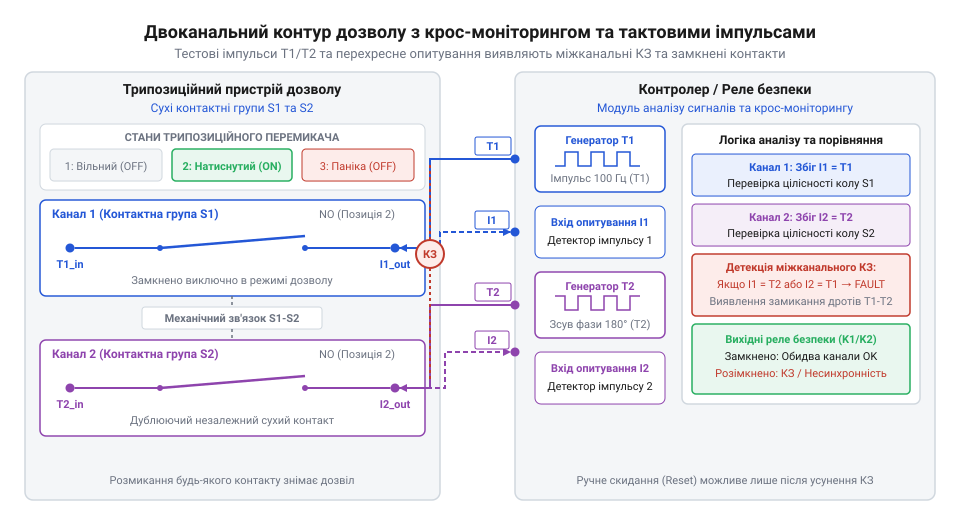
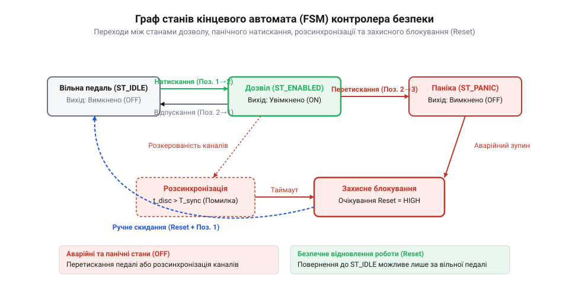

# Побудова двоканального контуру дозволу з педаллю «мертвої руки» та контролером безпеки

<preknowlist>
- [Кнопка аварійного стопу грибок та органи безпечного відключення (IEC 60947-5-5)](root:cat-hw-controls/estop-mushroom-button) — механіка примусового розмикання контактних груп NC, принципи побудови аварійних кіл вимкнення та вимоги до органів функціональної безпеки
</preknowlist>

## Небезпека одноканального керування та інциденти

Традиційна педаль із єдиною контактною групою видається найпростішим рішенням для звільнення рук оператора під час роботи з пресами, зварювальними роботами чи деревообробними верстатами. Проте в промисловому середовищі така схема стає джерелом смертельної небезпеки.

Основний ризик одноканального контуру полягає у відсутності дублювання та діагностики відмов. Під дією індуктивного навантаження або через електричну дугу при розмиканні контакти реле чи мікровимикача всередині педалі можуть зваритися (зварювання контактів). Коли оператор знімає ногу з педалі, зварений контакт залишається замкненим: коло живлення не розмикається, і небезпечний механізм продовжує рух, незважаючи на команду зупинки.

Другий критичний фактор — це психофізіологічна реакція людини на небезпеку. При раптовій загрозі або у разі затягування одягу в механізм оператор випробовує рефлекторний спазм або судому. Замість відпущення педалі людина інстинктивно стискає ногу із зусиллям, утримуючи звичайну двопозиційну педаль у замкненому стані.

Крім того, одноканальна схема принципово не здатна розрізнити свідоме натискання оператором від навмисного заклинювання педалі стороннім предметом (цеглою, дерев'яним клином) або її механічного залипання через бруд та стружку.

Для усунення цих ризиків стандарт ISO 12100 вимагає застосування трипозиційної механіки дозволу («мертвої руки») у поєднанні з двоканальною електричною схемою. Трипозиційний вимикач має три чіткі стани:
1. **Положення 1 (Відпущено)**: коло відкрите, дозвіл відсутній.
2. **Положення 2 (Робоче натискання наполовину)**: коло замкнене, дозвіл надано.
3. **Положення 3 (Панічний натиск до упору)**: коло примусово відкривається, викликаючи негайну аварійну зупинку.

Така трипозиційна конструкція разом із дубльованою контактною групою дозволяє реалізувати Категорію 4 (@@en|Category 4@@) та найвищий рівень повноти безпеки @@en|Performance Level@@ PL e за стандартом ISO 13849-1. На відміну від одноканальної схеми Категорії 1, де імовірність небезпечної відмови на годину `PFH_d` (від англійського @@en|Probability of Dangerous Failure per Hour@@, де @@en|probability@@ походить від латинського *probabilis* — правдоподібний) обмежується надійністю єдиного контакту і становить `PFH_d ≈ 1.14 × 10⁻⁵` 1/год (що відповідає лише PL c), двоканальна система з крос-моніторингом знижує `PFH_d` за рахунок діагностичного охоплення `DC_avg` (від англійського @@en|Diagnostic Coverage@@ — рівень діагностичного охоплення) до рівня нижче `10⁻⁷` 1/год. Оцінка показника `PFH_d` для двоканального контуру з діагностичним охопленням `DC_avg = 99%` та середнім часом до небезпечної відмови каналу `MTTF_d = 100` років (`876 000` годин) розраховується за формулою:

```
PFH_d = (1 - DC_avg) ÷ (2 × MTTF_d)
      = (1 - 0.99) ÷ (2 × 876000)      [підстановка DC_avg=0.99 та MTTF_d=876000 год]
      = 5.7 × 10⁻⁹                     [значення імовірності відмови на годину, 1/год]
```

Завдяки цьому небезпечна відмова одного контакту або коротке замикання в кабелі виявляється самою системою безпеки до того, як призведе до втрати захисної функції, що робить контур стійким до подиночних відмов відповідно до вимог [органів безпечного відключення](root:cat-hw-controls/estop-mushroom-button).

## Схемотехніка двоканального контуру та перехресне опитування

Щоб виявити відмову одного з контактів або пошкодження лінії зв'язку, пристрій дозволу підключають за двоканальною схемою із резервуванням контактних груп. Замість однієї лінії сигнал керування дублюється двома незалежними електричними колами (Channel 1 та Channel 2), які використовують сухі контакти педалі.


*Двоканальне підключення педалі дозволу з використанням тактових імпульсів T1 та T2 виявляє короткі замикання між дротами та на шини живлення ще до замкнення робочих контактів.*

Просте паралельне чи послідовне дублювання дротів не захищає від короткого замикання між самими провідниками кабелю. Якщо внаслідок механічного перетискання кабелю дріт першого каналу замкнеться на дріт другого каналу або на шину живлення 24 В, контролер сприйме хибний рівень і втратить здатність зчитувати розмикання.

Для вирішення цієї проблеми контролери безпеки (або спеціалізовані модулі безпеки) застосовують механізм крос-моніторингу за допомогою тактових імпульсів (test pulses). Контролер не просто подає постійну напругу на контакти педалі, а генерує на виходах T1 та T2 короткі періодичні тестові сигнатури зі зсувом у часі (наприклад, мікросекундні провали напруги). 

Сигнал з виходу T1 проходить через контактну групу першого каналу на вхід I1, а сигнал з T2 — через другу контактну групу на вхід I2. Контролер періодично формує короткі тестові прямокутні імпульси тривалістю від 100 мкс до 2 мс із періодом повторення 10–50 мс, причому стробувальні імпульси каналу T1 зсунуті у часі відносно T2. Якщо між кабелями виникає замикання, тестовий імпульс із виходу T1 потрапляє на вхід I2 (або навпаки), через що контролер миттєво фіксує чужу сигнатуру і переходить у стан апаратної помилки (Cross-fault / Fault), блокуючи виходи дозволу ще до того, як оператор спробує активувати обладнання. При розрахунку часових параметрів тестових імпульсів важливо враховувати довжину траси: паразитна ємність довгого кабелю (понад 50–100 метрів) завалює фронти коротких тестових провалів напруги, перетворюючи їх на загладжені спади, що може спричинити хибні спрацьовування захисту від перехресного замикання через недосягнення логічного нуля під час тестового стробу.

## Алгоритм усунення брязкіту та розсинхронізації

Під час механічного натискання педалі людина не може замкнути дві незалежні контактні групи абсолютно одночасно. Через механічні допуски, знос або різну швидкість руху важеля один контакт завжди замикається дещо раніше за інший. Крім того, на самих сухих контактах виникає механічний брязкіт (debounce) тривалістю 5–20 мс.

Якщо контролер реагуватиме на першу ж мікросекундну неузгодженість сигналів, система постійно генеруватиме хибні аварійні зупинки. Для коректної обробки вводиться алгоритм часового вікна очікуваної розсинхронізації (discrepancy time).


*Кінцевий автомат контролера безпеки переходить у стан аварійного блокування при перевищенні таймауту розсинхронізації та вимагає повного скидання.*

Алгоритм обробки працює в два етапи:
1. **Фільтрація брязкіту (Debounce)**: кожні `debounce_ms` (зазвичай 15–20 мс) сирі значення каналів перевіряються на стабільність. Новий стан каналу приймається лише тоді, коли сигнал не змінюється протягом указаного інтервалу.
2. **Контроль часового розсуву (Discrepancy Timeout)**: коли один з відфільтрованих каналів змінює стан, а інший ще ні, запускається таймер неузгодженості `discrepancy_start_ms`. Якщо другий канал замикається протягом дозволеного вікна `discrepancy_timeout_ms` (зазвичай 100 мс), перехід вважається успішним і система входить у стан `ENABLING_STATE_ACTIVE`. Якщо ж таймаут перевищено (наприклад, один дріт обірвано або контакт залип), розбіжність вважається відмовою, і FSM переходить у стан `ENABLING_STATE_FAULT`.

При фіксації помилки розсинхронізації або панічного натиску система активує засувку блокування `requires_reset`, через що повторне включення дозволу стає неможливим навіть при повторному затисканні педалі, поки оператор повністю не відпустить її у Положення 1 та не буде виконано умову скидання (Reset). Аналогічний захисний механізм діє й під час зворотного ходу: при нормальному поверненні педалі в початковий стан контакти двох каналів також розмикаються асиметрично через механічні допуски пружин. У цей момент FSM ініціалізує таймер розсинхронізації, і якщо другий канал розмикається протягом дозволеного вікна `discrepancy_timeout_ms` (100 мс), FSM безперешкодно переходить у стан `ENABLING_STATE_RELEASED` без активації засувки. Проте якщо один з контактів залипає чи приварюється і другий канал не розмикається до вичерпання таймауту, FSM миттєво фіксує незворотну апаратну відмову, переходить у стан `ENABLING_STATE_FAULT` та активує засувку `requires_reset`, що унеможливлює подальшу роботу обладнання до усунення несправності.

Програмна реалізація опитування каналів, перевірки брязкіту та автомата станів FSM наведено нижче:

:::tabs
```c|generic
:::code proj-enabling-pedal-safety-interface/c/enabling_switch.c 43-110
```
```cpp|generic
:::code proj-enabling-pedal-safety-interface/cpp/EnablingPedal.cpp 49-97
```
:::

## Захист від заклинювання та безпечний Reset

У реальних умовах виробництва оператори іноді намагаються обійти захисні функції педалі дозволу, затискаючи її в робочому Положенні 2 за допомогою клейкої стрічки, кабельних стяжок або важких деталей. Якщо пристрій дозволу залишається постійно замкненим, система втрачає функцію захисту від втрати свідомості оператором, що зводить нанівець усю концепцію функціональної безпеки.

Для захисту від навмисного блокування реалізують два обов'язкові алгоритмічні бар'єри:
1. **Перевірка початкового стану (Startup Test)**: при подачі живлення на контролер або під час запуску технологічного циклу обидва канали педалі мають перебувати у стані Положення 1 (Відпущено). Якщо педаль була затиснута заздалегідь до включення пристрою, контролер відмовляється видавати дозвіл, виставляє прапорець `requires_reset` та переходить у стан блокування `ENABLING_STATE_FAULT`.
2. **Контроль максимального часу неперервної роботи (Max Stuck Time)**: якщо педаль утримується у центральному положенні понад заданий граничний час (наприклад, `maxStuckTimeMs = 30000 мс`), таймер контролера реєструє потенційне заклинювання або втрату свідомості й автоматично переводить систему в аварійний стан.

Після будь-якого аварійного розмикання, панічного натиску або виявлення помилки розсинхронізації активується режим безпечного ручного скидання (Manual Reset). Пристрій дозволу принципово не повинен автоматично відновлювати вихідний дозвіл при повторному затисканні. Для зняття блокування оператор зобов'язаний повністю відпустити педаль у Положення 1, після чого система скидає внутрішні прапорці `requires_reset` і дає змогу розпочати новий цикл. При цьому схемотехніка самої кнопки Reset вимагає захисту від заклинювання або навмисного замикання контакту накоротко: реле або контролер безпеки відстежує не статичний рівень напруги, а виключно фронт переходу з розімкненого стану в замкнений після усунення аварії (Monitored Manual Reset), тому постійно замкнена або закорочена кнопка сприймається як несправність і блокує відновлення роботи.

## Архітектура прошивки контролера та індикація

Програмна архітектура прошивки будується на основі неблокувального скінченного автомата (FSM), який регулярно оновлюється в головному циклі або через переривання системного таймера (наприклад, з періодом 10 мс). Модульна структура відокремлює логіку фільтрації сигналів від обробки станів та керування світлосигнальною арматурою.

Драйвер контролює чотири основні стани системи: `ENABLING_STATE_RELEASED` (Відпущено), `ENABLING_STATE_ACTIVE` (Робочий дозвіл), `ENABLING_STATE_PANIC` (Панічний натиск) та `ENABLING_STATE_FAULT` (Аварія або розсинхронізація). Для візуальної діагностики стану використовують триколірну світлодіодну індикацію:
- **Вимкнено (Off)**: педаль у стані спокою (Положення 1).
- **Зелений (Green)**: робочий дозвіл активний, канали узгоджені (Положення 2).
- **Жовтий (Yellow)**: очікування скидання Reset після усунення аварійного стану або перевірка заклинювання.
- **Червоний миготливий (Red Blinking)**: панічна зупинка (Положення 3), розсинхронізація каналів, коротке замикання або критичний апаратний збій.

Для забезпечення функціональної безпеки високого рівня логіка кінцевого автомата доповнюється апаратним захистом від критичних помилок пам'яті @@en|RAM@@ (англ. *Random-Access Memory*) та зависання обчислювального ядра. У разі спотворення змінних станів у пам'яті через електромагнітні завади перевірка значення енумератора на кожному кроці оновлення виявляє невизначений стан і миттєво переводить FSM у безпечний стан `ENABLING_STATE_FAULT` з викликом зворотного виклику помилки. Крім того, робота головного циклу обробки FSM безперервно контролюється сторожовим таймером — @@en|Watchdog@@ (від англ. @@en|watchdog timer@@ — таймер-наглядач). Кожен успішний та своєчасний прохід циклу опитування каналів скидає таймер @@en|Watchdog@@. Якщо через збій стека чи зациклення переривань FSM перестає оновлюватися на час понад заданий інтервал (наприклад, 15–20 мс), сторожовий таймер примусово перезавантажує мікроконтролер, знімає напругу з вихідних реле дозволу та переводить індикацію в аварійний режим до проведення ручного скидання.

Нижче наведено програмні інтерфейси та реалізацію FSM на мовах C та C++:

:::tabs
```c|generic
:::code proj-enabling-pedal-safety-interface/c/enabling_switch.h 15-86
:::code proj-enabling-pedal-safety-interface/c/enabling_switch.c 43-120
```
```cpp|generic
:::code proj-enabling-pedal-safety-interface/cpp/EnablingPedal.hpp 13-77
:::code proj-enabling-pedal-safety-interface/cpp/EnablingPedal.cpp 49-115
```
:::

## Фізична збірка макета та тестування

Для практичної верифікації розробленого контуру збирається тестовий макет, що включає трипозиційну педаль дозволу із сухими контактами NC/NO, мікроконтролерний модуль (або реле безпеки), світлосигнальні індикатори та кнопковий елемент ручного скидання Reset.

Випробування захисних функцій проводиться відповідно до тестового регламенту перевірки відмов:
1. **Тест нормального циклу**: оператор натискає педаль наполовину в Положення 2. Світлодіод змінює колір на зелений, FSM переходить у стан `ENABLING_STATE_ACTIVE`. При відпущенні педалі дозвіл миттєво знімається.
2. **Імітація обриву лінії**: під час робочого стану відключається один із каналів. Контролер фіксує розсинхронізацію, після досягнення таймауту `discrepancy_timeout_ms` вмикає миготливий червоний індикатор та блокує роботу.
3. **Імітація короткого замикання каналів**: між провідниками T1/I1 та T2/I2 створюється штучний міст. Генератор тактових тестових імпульсів виявляє перехресну сигнатуру, FSM виставляє прапорець `cross_fault_detected` та миттєво вимикає виходи.
4. **Тест заклинювання на старті**: педаль затискається в Положення 2 перед подачею живлення. При включенні контролер блокує запуск і вимагає повного відпускання педалі.

Приклади програмного моделювання сценаріїв тестування:

:::tabs
```c|generic
:::code proj-enabling-pedal-safety-interface/c/main.c 18-72
```
```cpp|generic
:::code proj-enabling-pedal-safety-interface/cpp/main.cpp 10-63
```
:::
