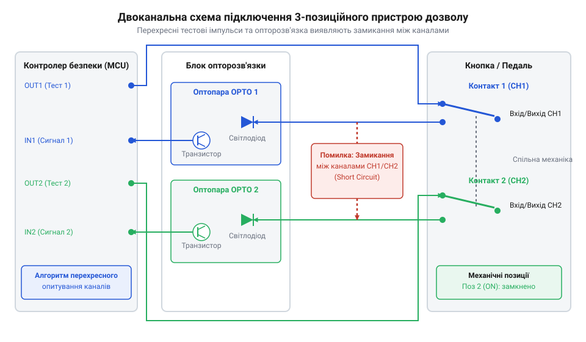
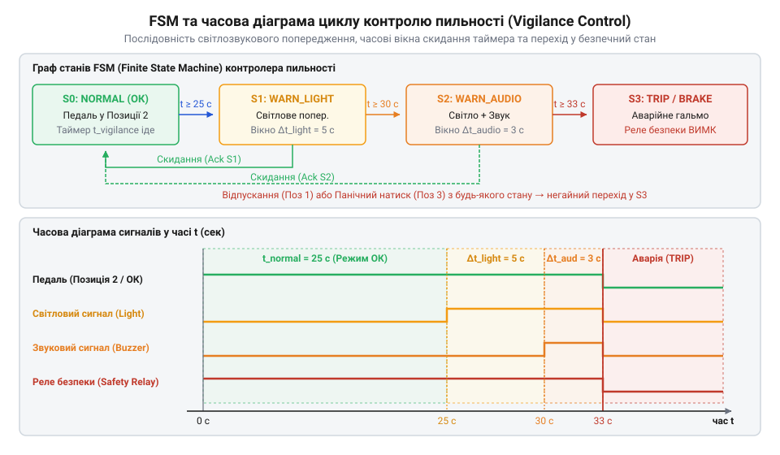

# Проєкт двоканального контролера кнопки дозволу та педалі пильності

<preknowlist>
- [Кнопка аварійного стопу грибок та органи безпечного відключення (IEC 60947-5-5)](root:cat-hw-controls/estop-mushroom-button) — концепція прямого розмикання контакту (positive opening operation) та категорії зупинення
- [Тумблери, захисні ковпачки Mollie та блокування важелів (Switch Guards)](root:cat-hw-controls/toggle-switches-and-switch-guards) — принцип механічного блокування та сухі контакти перемикання
- [DIP-перемикачі та джамперні блоки конфігурації](root:cat-hw-controls/dip-switches-and-configuration-blocks) — підключення Pull-Up/Pull-Down підтяжок та обробка сухого контакту
</preknowlist>

## Небезпечні відмови та втрата контролю

Під час налагодження, програмування маніпуляторів чи сервісного обслуговування технологічного обладнання оператор перебуває в безпосередній близькості до рухомих механізмів. Використання стандартних одноканальних кнопок керування у таких зонах становить високу загрозу. У разі приварювання металевих контактів (від нім. *Schweissen* — зварювання) через електродугову ерозію чи фізичного замикання кабельної жили на лінію живлення, пристрій втрачає здатність розмикати коло. Подібно до того, як відмова [кнопки аварійного стопу](root:cat-hw-controls/estop-mushroom-button) паралізує захисне відключення, залипання одноканального вимикача призводить до того, що машина продовжує рух навіть після того, як оператор припиняє натискання. Окрім електричних та механічних відмов, суттєву загрозу становить фізіологічний фактор. При безперервному утриманні важеля в середній Позиції 2 м'язи передпліччя й кисті зазнають тривалого ізометричного навантаження. Згідно з біомеханічними розрахунками втоми, при утриманні зусилля на рівні 15–20% від максимальної довільної сили стиску кисті (англ. @@en|maximum voluntary contraction@@, MVC) часовий поріг м'язової втоми t_fatigue становить лише 15–30 секунд. Після вичерпання цього інтервалу накопичена ішемія м'язових тканин викликає фізіологічний тремор, що неминуче призводить до мимовільного розтискання пальців або судомного продавлювання важеля.

Додатковим фактором ризику є фізіологічна реакція людини на раптову небезпеку. При несподіваному зіткненні чи наляку оператор часто не відпускає орган керування, а навпаки — з високою силою стискає його в кулаці. Звичайний двопозиційний перемикач (увімкнено/вимкнено) сприймає судомне продавлювання як команду продовження руху. Для усунення цього людського фактора застосовують 3-позиційну кнопку дозволу (від англ. @@en|enabling switch@@), кінематика якої базується на двоступеневому підпружиненні важеля. Перехід із вільного Положення 1 у середнє Положення 2 вимагає подолання м'якої першої пружини, що замикає контакти дозволу й дає оператору чіткий тактильний упор. Щоб перевести важіль далі у Положення 3 під час паніки, судомний стиск мусить подолати значно більший опір жорсткої другої пружини, змушуючи внутрішній штовхач примусово розмикати містки в безпечний стан. Завдяки такому механічному розділенню зусиль кнопка має три чітко розрізнювані механічні стани:

1. Позиція 1 (відпущено) — важіль або педаль перебуває у вільному стані, контакти розімкнені, силове коло вимкнено (Safe Stop).
2. Позиція 2 (натиснуто наполовину) — оператор утримує важіль у середній робочій зоні з відчутним опором, контакти замкнені, рух дозволено (Enable).
3. Позиція 3 (перетиснуто до упору) — судомне продавлювання в стані паніки долає зусилля фіксатора, змушуючи контакти примусово розмикатися й повертати систему у стан безпечної зупинки (Safe Stop).

Проте реалізація 3-позиційної механіки вирішує лише частину задачі. Для захисту від поодиноких електричних відмов кабельної лінії та вхідних кіл комутацію виконують за двоканальною схемою (від англ. @@en|dual-channel wiring@@), що вимагає паралельної обробки двох незалежних ліній.

## Двоканальна схемотехніка та перехресний контроль

Побудова апаратного вхідного інтерфейсу для 3-позиційних кнопок дозволу та педалей пильності (від англ. @@en|dead-man's pedal@@) базується на принципі гальванічного ізолювання й активного тестового зондування сигнальних жил. Просте паралельне підключення двох нормально замкнених контактів до спільної шини живлення не здатне виявити перехресне замикання (від англ. @@en|cross-circuit fault@@) між провідниками кабелю: якщо жила Каналу 1 коротить на жилу Каналу 2, розмикання одного з містків залишається непоміченим контролером. Окрім виявлення коротких замикань, вхідні кола захищають від високовольтних імпульсних завад. Довгі сигнальні кабелі в промислових умовах сприймають короткі комутаційні сплески напруги. Для придушення завад паралельно випромінювачу оптопари встановлюють протизавадний `RC`-фільтр (від англ. @@en|RC filter@@). Часову сталу `τ` (від англ. @@en|time constant@@) цього фільтра розраховують через добуток обмежувального опору `R_lim` та фільтрувальної ємності `C_filt`. Для обчислення часової сталої `τ` підставляємо значення обмежувального опору `R_lim = 2200` Ом та фільтрувальної ємності `C_filt = 100` нФ:

        τ = R_lim · C_filt
        = 2200 × 100 × 10⁻⁹      [підстановка номіналів опору й ємності]
        = 0.00022                [обчислення значення у секундах]
        = 0.22 ms                [переведення значення у мілісекунди]

Отримане значення `τ = 0.22` мс повністю пригнічує мікросекундні високовольтні імпульси без затримки спрацьовування кола безпеки. Ця часова стала є набагато меншою за час механічного брязкоту контактів і не погіршує швидкість реакції системи.

Щоб гарантувати виявлення коротких замикань на VCC, GND та між жилами кабелю, контакти живлють протифазними або тестовими імпульсними сигналами T1 та T2 від мікроконтролера чи реле безпеки. Струм кожного каналу проходить через контактну групу органу дозволу й надходить на гальванічну опторозв'язку (від грец. *optikos* — зоровий; англ. @@en|optocoupler@@), яка захищає вхідні ніжки мікроконтролера від промислових завад і високої напруги. Для забезпечення стабільної роботи інфрачервоного світлодіода оптопари та захисту каналу від перевантаження номінальний опір обмежувального резистора R_lim розраховують за формулою R_lim = (V_test - V_f) / I_f. Наприклад, для промислового тестового сигналу амплітудою V_test = 24 В, прямого спаду напруги на випромінювачі V_f = 1.2 В та прямого робочого струму I_f = 10 мА розрахункове значення становить (24 - 1.2) / 0.010 = 2280 Ом, що відповідає стандартному номіналу 2.2 кОм або 2.4 кОм з ряду E24. Зважаючи на те, що розсіювана потужність складає P = (V_test - V_f) * I_f = 22.8 * 0.010 = 0.228 Вт, у схемі необхідно використовувати резистор із номінальною потужністю розсіювання не менше 0.25 Вт (типово 0.5 Вт для підвищення надійності):

*Принципова схема двоканального підключення 3-позиційної кнопки дозволу та педалі пильності з перехресним живленням каналів і опторозв'язкою.*

На відміну від статичних підтяжок [DIP-перемикачів](root:cat-hw-controls/dip-switches-and-configuration-blocks), використання двох незалежних оптопар у поєднанні з імпульсним подаванням напруги дозволяє контролеру перевіряти відповідність зчитаних рівнів тестовим сигналам. Якщо Канал 1 отримує активний рівень під час павзи на Каналі 2, схема миттєво фіксує електричне пробиття кабелю. Аналогічну схемотехніку застосовують для педалей пильності, де механічний важіль під стопою оператора комутує дубльовані контактні групи під час виконання технологічних операцій.

## Алгоритм фільтрації та контроль розсинхронізму

Програмна обробка дискретних сигналів двоканального пристрою дозволу передбачає трипослідовну фільтрацію: усунення механічного брязкоту, часову діагностику неузгодженості ліній та керування циклом контролю пильності (від лат. *vigil* — пильний; англ. @@en|vigilance control@@).

Оскільки сухі контакти піддаються вібраціям, сирі дані GPIO першочергово проходять через симетричний цифровий антидребезг (від англ. @@en|debounce@@) із часовим вікном `t_debounce` (10–20 мс). Для підвищення завадостійкості вхідного фільтра застосовують математичний алгоритм кільцевого буфера фіксованої глибини N відліків (типово N = 8 або N = 16) із мажоритарним вибором стану. На кожному такті квантування T_s новий сирий біт записується в кільцевий масив за циклічним вказівником `pos = (pos + 1) % N`, а обробник обчислює рухому суму активних відліків S_k = S_(k-1) + b_new - b_old. Якщо рухома сума перевищує поріг більшості S_k > N / 2, мажоритарний фільтр приймає рішення про стійкий замкнений стан контакту, що запобігає хибним спрацьовуванням від імпульсних завад. Лише після стабілізації логічних рівнів обробник переходить до моніторингу часу розсинхронізації (англ. @@en|discrepancy time@@, `t_discrepancy`). Згідно з вимогами стандарту ISO 13849, через допустимий механічний люфт або знос контактів один місток може замкнутися дещо раніше за інший. Якщо різниця в часі спрацьовування каналів перевищує поріг `t_discrepancy` (наприклад, 50 мс), система переходить у стан апаратної відмови `ENABLING_STATE_FAULT`, що вимагає повного розмикання обох ліній для скидання:

*Часова діаграма та граф станів FSM циклу контролю пильності vigilance control.*

Для запобігання ситуаціям, коли оператор навмисно блокує педаль пильності важким предметом, реалізують алгоритм vigilance control. Якщо пристрій перебуває в робочому стані Позиції 2 безперервно протягом часу `t_hold_max`, контролер активує попереджувальну звукову та світлову індикацію. Якщо оператор не здійснює перевідпускання важеля або натискання кнопки підтвердження протягом часу `t_warn` + `t_react`, FSM блокує дозвіл і переводить обладнання в безпечний стан.

Обробка станів та розсинхронізації каналів на мові C виконується функцією оновлення автомата:

:::code proj-enabling-switch-controller/c/enabling_switch.c 18-83

Для об'єктно-орієнтованих архітектур на C++ фільтрація каналів та таймер контролю пильності інкапсулюються в окремі класи з можливістю гнучкого налаштування часових параметрів:

:::code proj-enabling-switch-controller/cpp/enabling_switch.hpp 7-28
:::code proj-enabling-switch-controller/cpp/enabling_switch.cpp 4-32
:::code proj-enabling-switch-controller/cpp/enabling_switch.cpp 71-117

Подібно до того, як механічне [блокування важелів](root:cat-hw-controls/toggle-switches-and-switch-guards) захищає від випадкового перемикання, поєднання програмного моніторингу розсинхронізму та алгоритму vigilance control повністю виключає як електричні відмови кабелю, так і обхід захисту персоналом.

## FSM прошивки та таймер пильності

Архітектура програмного забезпечення контролера будується на сполученні двох скінченних автоматів: головного автомата стану органів дозволу (Enabling State FSM) та підпорядкованого таймера неперервного контролю пильності (Vigilance Timer FSM). Для забезпечення відмовостійкості вихідний сигнал керування силовими реле активується виключно за одночасної виконання двох умов: дискретний стан кнопки перебуває в позиції дозволу `ENABLING_STATE_ENABLED`, а стан таймера пильності відповідає нормі `VIGILANCE_OK`.

Світлозвукова індикація попередження працює за двоступеневим часовим регламентом. Якщо важіль утримується у Позиції 2 понад ліміт `warning_timeout_ms` (наприклад, 3000 мс), програма вмикає світловий сигналізатор і звуковий зумер, переводячи таймер у стан `VIGILANCE_WARNING`. Це сигналізує оператору про необхідність підтвердити присутність шляхом короткого перевідпускання важеля чи натискання кнопки скидання. Для забезпечення суворої відповідності регламенту часових вікон та виключення накопичення часової похибки (накопичувального дрейфу відліку) лічильник нерухомості прив'язують до апаратного переривання таймера мікроконтролера (наприклад, переривання системного таймера `SysTick_Handler` або апаратного таймера ISR). Використання детермінованого інтервалу переривань із тактуванням від кварцового резонатора гарантує фіксований крок приросту `delta_ms` і повністю усуває джиттер та часовий дрейф, який виникає під час програмного опитування в головному циклі через змінну тривалість виконання інших функцій. Якщо підтвердження не надходить протягом додаткового вікна `trip_timeout_ms` (1000 мс), система переходить у стан `VIGILANCE_TRIPPED`, знімає живлення з котушки силового реле безпеки та вимагає повного розмикання контактів для відновлення роботи.

Реалізація логіки таймера пильності мовою C організована у вигляді модуля з чітким розділенням ініціалізації, періодичного оновлення та скидання:

:::code proj-enabling-switch-controller/c/vigilance_control.h 8-26
:::code proj-enabling-switch-controller/c/vigilance_control.c 21-49

У головному циклі програми `main.c` зчитані значення дискретних входів транслюються в керування силовими акторами з послідовною перевіркою всіх умов безпеки:

:::code proj-enabling-switch-controller/c/main.c 28-90

## Тестування несправностей та валідація

Фінальним етапом розробки двоканального контролера є проведення випробувань на стійкість до апаратних та людських відмов. Комплексна валідація охоплює симуляцію трьох типів критичних подій: механічного панічного продавлювання, електричного обриву сигнальної жили та часового розсинхронізму контактних містків.

Під час перевірки панічного спрацьовування важіль примусово продавлюють у Позицію 3. Програма мусить миттєво зняти сигнал дозволу, а для повторного запуску вимагати відпускання у Позицію 1. Для перевірки електричних відмов штучно розмикають один із каналів (симуляція обриву) або замикають його на лінію протилежного каналу. Якщо неузгодженість рівнів триває довше за встановлений поріг `discrepancy_ms` (30–50 мс), контролер мусить перейти в заблокований стан `EnablingState::Fault` і вимкнути силове реле. Для систематизації та протоколювання результатів автоматизованого тестування будують діагностичну матрицю відмов. Вона систематизує тестові вектори несправностей (обрив жил, замикання VCC/GND, перехресні замикання каналів, панічний перетиск і таймаути пильності), зіставляючи їх із матрицею очікуваних відповідей: вихідним станом FSM (`EnablingState::Fault`, `EnablingState::Panic`), відключенням силового реле безпеки та умовою обов'язкового повернення в Позицію 1. Автоматизоване виконання такої матриці під час тестових прогонів дає змогу верифікувати статус PASS/FAIL та контролювати гарантований час переходу системи у безпечний стан за будь-яких комбінацій вхідних відмов.

Для перевірки реальної поведінки прошивки розробляють автоматизовані тестові сценарії, що симулюють часову динаміку входів у C++:

:::code proj-enabling-switch-controller/cpp/main.cpp 39-84

Аналогічно до регламентів випробувань [тросових вимикачів](root:cat-hw-controls/cable-pull-switches-and-safety-rope-switches) та [кнопок аварійного стопу](root:cat-hw-controls/estop-mushroom-button), успішне проходження всіх тестових сценаріїв гарантує, що пристрій не відмовить при реальній експлуатації й збереже безпечний стан обладнання за будь-яких поодиноких несправностей.
