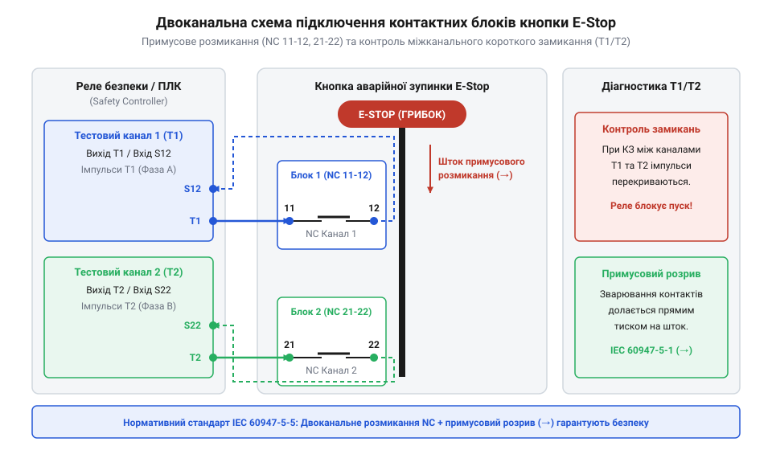

# Схема підключення, маркування контактів та електричні параметри кнопок E-Stop

## Небезпека звичайних кнопок у ланцюгах стопу

У схемах автоматики сигнал аварійної зупинки (@@de|E-Stop@@, від нім. @@de|Not-Halt@@ — аварійна зупинка) є останньою лінією захисту обладнання та оператора. Звичайні [тактильні кнопки з ковпачками](root:cat-hw-controls/tactile-buttons) або [прості кнопки на платі](root:cat-hw-controls/ky-004-button) розмикають контакти виключно за рахунок сили пружини повернення. Якщо в колі виникає коротке замикання чи індуктивний кидок струму при вимкненні котушки контактора, між контактами спалахує електрична дуга (лат. *arcus* — дуга). Вона локально розплавляє срібне покриття й зварює контакти між собою.

У такій ситуації натискання звичайної кнопки або розмикання її пружини є марним: зварений місток залишається замкненим, струм продовжує текти, і аварійний верстат не зупиняється.

Грибоподібна кнопка аварійного стопу запобігає цій катастрофі завдяки механізму примусового розмикання (@@en|Positive Opening Operation@@, від лат. *positivus* — стверджений, за стандартом IEC 60947-5-1). Натискання на червону грибоподібну головку передає зусилля безпосередньо через жорсткий внутрішній шток. Цей шток фізично зрізає й розриває зварені контактні містки незалежно від стану пружин, гарантуючи апаратне розмикання розмикальних (@@en|NC@@, англ. @@en|Normally Closed@@ — нормально замкнений) контактів.

> 🔧 **Навіщо це.**
> Застосування механізму примусового розмикання унеможливлює відмову кнопки стопу через зварювання контактів дугою чи поломку пружини, гарантуючи безумовне знеструмлення виконавчих кіл.

## Маркування клем та двоканальна схемотехніка

Для уникнення помилок монтажу маркування клем кнопкових блоків E-Stop суворо стандартизоване нормами IEC 60947-5-1. Перша цифра вказує номер контактного блоку, а друга — тип контакту:
- **`11-12`** — розмикальний контакт (NC) першого каналу (цифри `1` та `2` позначають NC);
- **`21-22`** — другий незалежний розмикальний контакт (NC) другого каналу;
- **`33-34`** — допоміжний замикальний контакт (NO, англ. @@en|Normally Open@@ — нормально розімкнений), що використовується для світлової сигналізації чи індикації на панелі.

У промислових системах безпеки один розмикальний канал є недостатнім: зламаний дріт чи замикання на корпус може замаскувати аварію. Тому кнопка E-Stop підключається за дубльованою двоканальною схемотехнікою, де обидва NC-канали `11-12` та `21-22` заводяться окремими провідниками у два незалежні входи [безпечного реле](root:cat-hw-drivers/safety-relay) або контролера [безпечного PLC](root:cat-hw-boards/safety-plc).

*Схема двоканального контактного блоку E-Stop: NC-канали 11-12 та 21-22 підключені до незалежних петель моніторингу реле безпеки.*

Двоканальне підключення гарантує, що навіть при обриві чи короткому замиканні одного з дротів другий канал надійно передасть сигнал аварійної зупинки.

## Електричні характеристики та категорії AC-15/DC-13

Контактні блоки кнопок E-Stop є електромеханічними комутаційними апаратами, чия довговічність залежить від характеру навантаження. Їхні параметри визначаються номінальною напругою ізоляції `Ui = 600 В` та умовним термічним струмом `Ith = 10 А` (струм, який сухі контакти витримують тривалий час без перегріву).

Проте реальний струм комутації значно нижчий через комутаційні категорії (стандарт IEC 60947-5-1):
- **Категорія AC-15** (комутація зміннострумових індуктивних навантажень, таких як котушки контакторів): робочий струм становить до `6 А` при напрузі `230 В` чи `3 А` при `400 В`.
- **Категорія DC-13** (комутація постійнострумових електромагнітів і гальм): дозволений струм падає до `0.55 А` при `110 В` та `0.27 А` при `220 В` через сильну дугу при розриві постійного струму.

Для захисту контактів від зварювання при міжканальному короткому замиканні в коло послідовно встановлюють швидкі запобіжники (тип `gG`) номіналом до `10 А`. Якщо кнопка має світлодіодне підсвічування стану, його живлення (зазвичай 24 В постійного струму) підключається до окремих ізольованих клем `X1-X2` і не пов'язане з силовими NC-контактами.

## Діагностика імпульсами T1/T2 та підключення

Навіть двоканальна схема виявляється безсилою, якщо між кабелями першого (`11-12`) та другого (`21-22`) каналів стається протирання ізоляції й виникає міжканальне коротке замикання (англ. @@en|cross-circuit fault@@). У такому разі струм обходить розмикальний контакт, і натискання кнопки не приводить до зупинки.

Для виявлення цієї прихованої відмови [контролер безпечного PLC](root:cat-hw-boards/safety-plc) або реле використовує активну імпульсну діагностику. Модуль безпеки подає на перший канал `11-12` тестові короткі прямокутні імпульси `T1` (тривалістю до 1 мс), а на другий канал `21-22` — зсунуті у часі імпульси `T2`.

Оскільки імпульси `T1` та `T2` не збігаються у часі, при появі міжканального замикання тестовий сигнал `T1` проникає у приймальну лінію `T2`. Приймач негайно фіксує чужий часовий шаблон, інтерпретує це як фатальне пошкодження кабелю й миттєво переводить обладнання в безпечний вимкнений стан, блокуючи повторне увімкнення до усунення короткого замикання.

Така активна діагностика разом із механізмом примусового розмикання дозволяє будувати системи аварійної зупинки вищої категорії безпеки за ISO 13849-1 (до рівня PL e / SIL 3).
