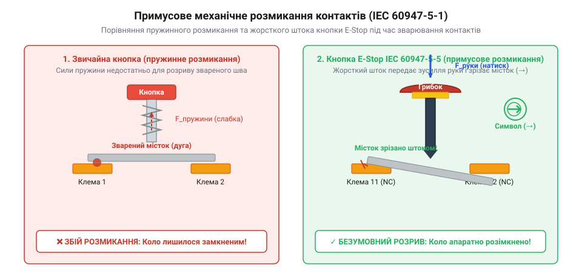
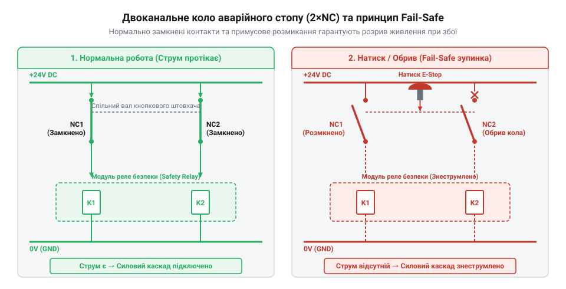
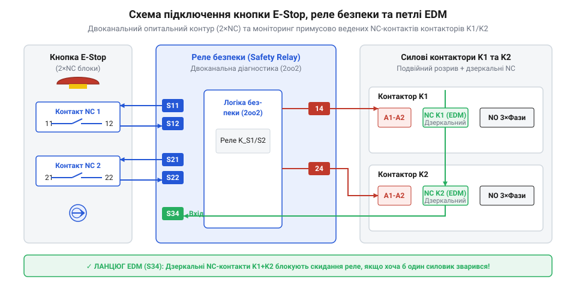

# Кнопка аварійного стопу грибок та органи безпечного відключення (IEC 60947-5-5)

<preknowlist>
- [Тактильні кнопки з ковпачками](root:cat-hw-controls/tactile-buttons) — Принципи механічного розмикання та замикання пружинних контактів у звичайних кнопках для контрасту з примусовим розмиканням.
- [Тумблери, захисні ковпачки Mollie та блокування важелів (Switch Guards)](root:cat-hw-controls/toggle-switches-and-switch-guards) — Механічне фіксування органів керування та різниця між захистом від випадкового натискання й примусовим розмиканням кола.
</preknowlist>

## Чому звичайна кнопка нездатна зупинити аварію

Уявімо працюючий промисловий фрезерний верстат або високошвидкісний транспортер: оператор бачить, що намотувальний вал захопив край одягу робітника. Рука автоматично тисне на найближчу червону кнопку на пульті. Але замість миттєвої зупинки двигун продовжує обертатися з тією ж потужністю. Коли кнопка є звичайною [тактильною кнопкою](root:cat-hw-controls/tactile-buttons) з пружинним розмиканням, під час короткого замикання або комутації індуктивного навантаження між її срібними контактами виникає електрична дуга. Температура дуги миттєво плавить контактний шар, і після охолодження утворюється мікроскопічний зварений шов. Сили внутрішньої зворотної пружини кнопки виявляється категорично недостатньо, щоб розірвати цей зварений місток: кнопка повертається у вихідний стан лише зовні чи застрягає, залишаючи електричне коло замкненим.

Друга смертельна пастка звичайних органів керування полягає у відсутності механічного фіксування стану та небезпеці повторного самозапуску. Якщо для розриву кола використовується стандартна кнопка без клямки чи звичайний [тумблер із захисним ковпачком](root:cat-hw-controls/toggle-switches-and-switch-guards), оператор мусить безперервно утримувати її пальцем під час катастрофи. Щойно зляканий або травмований робітник відпустить ручку, випрямлення внутрішньої пружини миттєво поверне контакти у початковий замкнений стан. У момент розмикання кола з індуктивним навантаженням (котушками контакторів чи обмотками двигунів) накопичена енергія магнітного поля змушує струм продовжувати текти, що висікає потужний сплеск ЕРС самоіндукції в сотні вольт. Ця висока напруга іонізує вузький повітряний проміжок між пластинами і запалює високотемпературну плазмову дугу, яка розплавляє контактні плями й зварює пластини при охолодженні. Повернення рухомого контакту подає живлення на мотори, викликаючи раптовий повторний самозапуск обладнання прямо в момент порятунку постраждалого. Спроба ж розв'язати цю проблему через софтверну обробку в @@en|microcontroller@@ — коли кнопка лише посилає сигнал переривання на @@en|GPIO@@, а програма зупиняє мотор, — створює ще вищий ризик. Завіса прошивки, зависання шини або пробій вихідного силового транзистора перетворюють будь-який програмний команда-стоп на недетерміновану рулетку.

Головною причинно-наслідковою ланкою виникнення руйнівної дуги є фізичний закон самоіндукції при швидкотечному розриві струму через індуктивне навантаження. Енергія магнітного поля котушки E = L · I² / 2 не може зникнути миттєво, тому при розмиканні контактів швидка зміна струму di / dt породжує зворотну ЕРС V = -L · (di / dt), яка сягає багатьох сотень вольт. Оскільки на початковій стадії розмикання відстань між контактами становить лише частки міліметра, напруженість електричного поля перевищує поріг пробою повітря в 3 кВ/мм, спричиняючи ударну іонізацію газу. Утворений плазмовий шнур з температурою понад 3000–5000 °C плавить срібний шар контактів. На відміну від силових комутаційних апаратів, звичайні малогабаритні кнопки позбавлені дугогасних камер із решітками деіонізації та магнітним видуванням, тому повітряний проміжок між їхніми пластинами не здатен згасити дугу до моменту розплавлення металу, що неминуче завершується зварюванням контактної групи.

Для забезпечення реальної безпеки виникла потреба в спеціалізованому апаратному органі. Історичний розвиток і суворі вимоги до [органів аварійного вимкнення](root:cat-hw-controls/estop-mushroom-button/hist-estop-evolution.md) сформували міжнародний стандарт @@en|IEC 60947-5-5@@. Цей стандарт регламентує створення органів @@en|E-Stop@@, які забезпечують безумовне апаратне розмикання кіл живлення за допомогою чистої механічної сили руки оператора без участі будь-яких програмних чи пружинних проміжних ланок.

## Анатомія грибка та примусове розмикання

Головною відмінною рисою кнопки аварійного стопу є грибоподібна штовхальна шапка великого діаметра червоного кольору на жовтому тлі. Така форма обрана не випадково: у момент небезпеки оператору не потрібно шукати дрібну клавішу — по грибку можна вдарити кулаком, долонею або ліктям з будь-якого боку. Проте ключовий секрет надійності прихований усередині корпусу і зветься примусовим механічним розмиканням контактів (від @@en|positive opening operation@@ згідно з @@en|IEC 60947-5-1@@, що маркується на корпусі символом стрілки в колі (→)).

*Примусове розмикання контактів: жорсткий шток передає зусилля руки безпосередньо на місток, руйнуючи дугові зварні токи.*

На відміну від звичайних кнопок, де рухомий контакт розмикається лише силою випрямлення внутрішньої пружини, в кнопці @@en|IEC 60947-5-5@@ шток штовхача зв'язаний із контактним містком жорсткою механічною передачею. Кінематика штока розрахована так, що лінійне переміщення штовхача під дією руки оператора передає прямолінійне зусилля безпосередньо на рухомий кулачок контактної групи. Жорсткий виступ штока має похилу клиновидну поверхню (з кутом нахилу близько 15°–30°), яка трансформує вертикальний тиск руки у помножене поперечне зусилля зсуву. Зсувний кулачок спирається на скошений профіль містка, де за законами тригонометрії коефіцієнт підсилення сили описується виразом `K = F_зрізу / F_руки = 1 / (tan α + μ)`, де `α` — кут нахилу клина, а `μ ≈ 0.1` — коефіцієнт тертя ковзання. При куті нахилу `α = 15°` (`tan 15° ≈ 0.268`) підсилення сягає `K ≈ 3.0–3.5`. Завдяки такому геометричному підсиленню звичайне зусилля тиску оператора в 30–50 Н перетворюється на зсувну силу понад 120–150 Н прямо на контактній площині, що істотно перевищує межу міцності срібно-нікелевої звареної перемички (80–100 Н). Якщо внаслідок дугового пробою виникло @@en|contact welding@@, ця мультиплікована сила натискання легко долає геометричний опір розплавленого срібного містка: клин штока працює як механічний скальпель-добоїк, що зрізає та фізично розриває зварені поверхні, примусово відкриваючи контакти кола 1×NC чи 2×NC незалежно від стану внутрішніх пружин.

Другим обов'язковим елементом є механізм механічної фіксації (від @@en|latching@@). Натиснутий грибок замикається у внутрішній клямці та залишається в утопленому стані навіть після зняття зусилля руки. Повторне замкнення аварійного кола можливе лише після свідомого акту розблокування — повертанням грибка за стрілкою (від @@en|twist-to-release@@) або повертанням спеціального ключа (від @@en|key-release@@). Повна електрична цокольовка клем, діаграми ходу штока та допустимі струми комутації наведені в [паспорті апаратного інтерфейсу](root:cat-hw-controls/estop-mushroom-button/api-estop-hardware-interface.md). Для лінійних конвеєрів та довгомірних агрегатів аналогічний захисний механізм реалізують [тросові вимикачі аварійного зупинення](root:cat-hw-controls/cable-pull-switches-and-safety-rope-switches), а для зон ручного обслуговування застосовують [трипозиційні кнопки дозволу](root:cat-hw-controls/enabling-switches-and-dead-man-pedals).

## Двоканальний схемний розрив і принцип fail-safe

У схемотехніці безпеки фундаментальним правилом є принцип роботи на знеструмлення (від @@en|de-energize to trip@@ або @@en|fail-safe@@). Електричний струм має безперервно протікати через нормально замкнені контакти (від @@en|normally closed@@) кнопки аварійного стопу, утримуючи силові контактори або реле у замкненому стані. У разі будь-якої відмови — натискання кнопки оператором, випадкового перебиття кабелю, падіння напруги живлення чи обриву клеми — струм миттєво зникає, і зворотні пружини силовиків апаратно розмикають лінію живлення електродвигунів.

*Двоканальний контур знеструмлення: розрив будь-якого з двох NC-каналів знімає живлення з котушок силових контакторів.*

Для відповідності високим категоріям безпеки (від @@en|Cat 4@@ за @@en|ISO 13849-1@@ або @@en|SIL 3@@ за @@en|IEC 62061@@) система зобов'язана мати апаратну відмовостійкість (від @@en|Hardware Fault Tolerance@@, @@en|HFT@@ = 1). Це означає, що жодна поодинока несправність у колі — наприклад, замикання одного з проводів на землю чи зварювання одного з контактних містків — не повинна призводити до втрати захисної функції. Для цього кнопку @@en|Emergency Stop@@ оснащують двома незалежними нормально замкненими контактними групами (2×NC), які опитуються двома окремими електричними каналами. Особливу небезпеку у довгих кабельних трасах становить фізичне перехресне замикання між провідниками цих двох NC-каналів при сплющенні чи перебитті багатожильного кабелю. Якщо обидва канали живляться від одного джерела постійної напруги, така перемичка пускає струм в обхід розімкненого контакту кнопки, тому реле безпеки живлять канали тестовими сигналами з різною полярністю чи зсунутими за часом імпульсами. Генератор першого каналу `S11` формує короткі тестові провали напруги 24 В тривалістю 0.5–2 мс із періодом 10–50 мс, тоді як генератор другого каналу `S21` видає аналогічні провали, зсунуті за фазою у часовому вікні. Алгоритм порівняння реле безпеки синхронно опитує приймальні клеми `S12` та `S22`: якщо між провідниками виникає перехресне коротке замикання, напруга з другого каналу підтримує високий потенціал на клемі `S12` під час тестового провалу `S11`. Опитувач виявляє цю неузгодженість імпульсів менше ніж за 1 мс і блокує роботу контуру ще до натискання кнопки. Для запобігання хибним спрацьовуванням тривалість тестових провалів розраховують з урахуванням того, що інерційність масивних котушок контакторів вибачає такі мікропаузи без знеструмлення. Точні методи фундаментального математичного [обрахунку надійності ланцюгів](root:cat-hw-controls/estop-mushroom-button/math-estop-reliability.md) дозволяють обчислити показники @@en|B10d@@ та @@en|MTTFd@@ для таких схем.

Ключова вимога схемотехніки полягає в тому, що сигнали аварійного стопу повинні здійснювати безпосередній апаратний розрив живлення котушок контакторів або активувати входи безпечного відключення моменту (від @@en|Safe Torque Off@@). Програмна обробка стану кнопок у центральному процесорі чи [матричних клавіатурах](root:cat-hw-controls/keypad-4x4-tactile) припустима виключно як додатковий інформаційний індикатор для оператора, але ніколи не як єдиний ланцюг зупинки.

## Інтеграція з реле безпеки й EDM

Просте послідовне підключення контактів кнопки до котушки звичайного промислового реле не забезпечує повноцінного захисту, оскільки контакти самого реле також можуть зваритися від дуги. Тому в ланцюгах @@en|E-Stop@@ застосовують спеціалізовані модулі — реле безпеки (від @@en|Safety Relay@@). Реле безпеки безперервно подає на два канали кнопки тестові імпульси різної полярності або часової зсунутості, що дозволяє миттєво виявити перехресне коротке замикання між проводами шлейфу.

*Петля моніторингу EDM: послідовне підключення примусово ведених NC-контактів контакторів блокує пуск при зварюванні силовиків.*

Для контролю стану самих силових контакторів використовується механізм моніторингу зовнішніх пристроїв (від @@en|External Device Monitoring@@, @@en|EDM@@). Силові контактори оснащуються додатковими діагностичними контактами з примусовим веденням (від @@en|forcibly guided contacts@@ або @@en|mirror contacts@@). Ці допоміжні NC-контакти з'єднуються послідовно і підключаються до контуру скидання реле безпеки. На часовій діаграмі спрацьовування в момент знеструмлення котушки `t_0` головні силові NO-контакти розмикаються за `10–30 мс` (`t_1`), а зв'язані з ними через жорстке коромисло дзеркальні NC-контакти замикаються із затримкою у `5–15 мс` (`t_2`) лише після того, як між силовими пластинами гарантовано утвориться повітряний проміжок понад 0.5 мм. Реле безпеки відводить суворе часове вікно опитування (зазвичай `T_EDM` від 100 до 500 мс) для завершення всіх перехідних процесів: механічний розкид часу відпускання різних контакторів через втомленість пружин чи знос механіки не повинен перевищувати цей інтервал, щоб не провокувати ложних блокувань. Якщо ж при аварійному зупиненні силові контакти хоча б одного контактора зварилися, жорсткий механічний зв'язок утримує дзеркальний NC-контакт розімкненим понад відведене часове вікно `T_EDM`. Коли оператор відіжме кнопку E-Stop і натисне клавішу скидання, реле безпеки виявить порушення таймінгу або розімкнений ланцюг @@en|EDM@@ і заблокує повторний запуск обладнання. Повний приклад збірки та [практичного монтажу контуру](root:cat-hw-controls/estop-mushroom-button/proj-dual-channel-estop-circuit.md) демонструє покрокову інтеграцію таких кіл з промисловими ПЛК (від @@en|PLC@@).

## Помилки монтажу та граничні випадки експлуатації

Найбільш поширеною помилкою при встановленні кнопок аварійного зупинення є їх розміщення в важкодоступних місцях, за захисними екранами або занадто близько до рухомих частин механізмів, де оператор ризикує дістати травму під час спроби натискання. Стандарт @@en|ISO 13850@@ вимагає розміщувати грибки на кожному робочому місці та вздовж проходів обслуговування. Крім того, категорично забороняється порушувати колірне маркування: штовхач повинен бути виключно червоним, а фонова табличка чи корпус — жовтою. Використання червоних кнопок на чорному або сірому корпусі позбавляє пристрій статусу аварійного органу.

Другою серйозною небезпекою є неналежний стан контактних поверхонь та механічне зношення. У середовищах із підвищеною вібрацією, запиленістю чи агресивними випарами срібні контакти піддаються хімічному окисненню з утворенням діелектричної плівки оксиду або сульфіду срібла. Оскільки тестові канали реле безпеки використовують дуже низькі струми опитування (порядку 10–20 мА для мінімізації зносу), напруга в колі виявляється недостатньою для пробою цієї окисної плівки. Через це перехідний опір контактів стрибкоподібно зростає, а струм у контурі падає нижче порогу утримання реле. Додатково ситуацію погіршує вібраційний дребезг контактів: під дією зовнішньої гармонічної вібрації обладнання прискорення коливань перевищує зусилля попереднього підтискання контактної пружини, викликаючи періодичні мікророзмикання контактних поверхонь тривалістю від 0.5 до 5 мс. Оскільки внутрішній цифровий фільтр реле безпеки відстежує цілісність кола з дискретністю 1–3 мс, будь-яка пауза у проходженні струму опитування тривалістю понад 2 мс фіксується як апаратний розрив ланцюга, що призводить до хибних спрацьовувань та спонтанних зупинок технологічної лінії. Для відвернення таких збоїв контактні блоки @@en|E-Stop@@ піддають періодичному тестуванню. Помилки вибору кабельних вводів та нехтування герметичністю корпусу (IP65/IP69K) призводять до потрапляння вологи та коротких замикань між каналами. При проєктуванні ліній великої протяжності поряд із грибками застосовують [тросові вимикачі аварійного зупинення](root:cat-hw-controls/cable-pull-switches-and-safety-rope-switches), а для локальних зон налаштування — [трипозиційні кнопки дозволу](root:cat-hw-controls/enabling-switches-and-dead-man-pedals).
