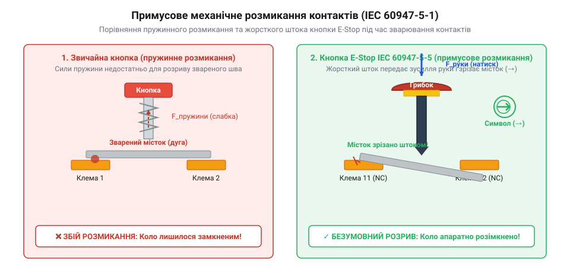
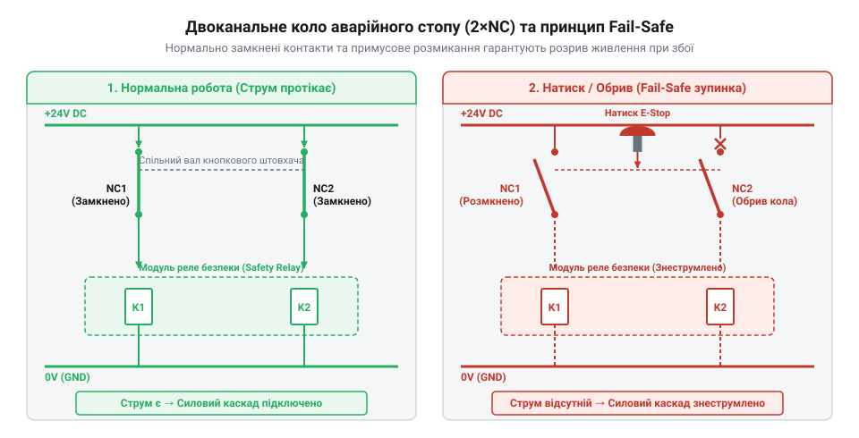

# Кнопка аварійного стопу грибок та органи безпечного відключення (IEC 60947-5-5)

<preknowlist>
- [Тактильні кнопки з ковпачками](root:cat-hw-controls/tactile-buttons) — Принципи механічного розмикання й замикання пружинних контактів та явище брязкоту.
- [Тумблери, захисні ковпачки Mollie та блокування важелів (Switch Guards)](root:cat-hw-controls/toggle-switches-and-switch-guards) — Механічні способи фіксації стану органів керування та захисту від випадкового спрацьовування.
</preknowlist>

## Ризики використання звичайних кнопок для аварій

Використання звичайних [тактильних кнопок з ковпачками](root:cat-hw-controls/tactile-buttons) у контурах аварійного зупинення промислового обладнання створює смертельний ризик для оператора. Коли виникає небезпечна ситуація, комутація потужного струму через індуктивне навантаження викликає електричну дугу між контактами. Температура плазмової дуги сягає кількох тисяч градусів і плавить контактний шар. Після охолодження утворюється зварений мікромісток, розірвати який зусилля звичайної повертальної пружини не здатно: кнопка застрягає, залишаючи лінію живлення замкненою. На відміну від вакуумних розрядників (@@en|vacuum interrupter@@), де висока диелектрична міцність вакууму викликає миттєву деіонизацію та розсіяння плазми при переході струму через нуль, звичайна кнопка у повітряному середовищі позбавлена дугогасних засобів. Малий контактний зазор та низька швидкість розмикання призводять до тривалого горіння плазмового шнура, роблячи термічне зварювання контактів у звичайній кнопці неминучим.

Іншою небезпекою звичайних перемикачів або [тумблерів із захисними ковпачками](root:cat-hw-controls/toggle-switches-and-switch-guards) є відсутність механічного блокування стану. Якщо кнопка розмикається лише під час утримування пальцем, травмований або сполоханий оператор може випадково відпустити клавішу. Пружина миттєво поверне контакти у початковий стан, що спровокує раптовий самозапуск двигунів безпосередньо в момент порятунку людей. Спроба ж обробити сигнал стопу програмно через мікроконтролер наражається на ризик зависання прошивки чи пробою силового транзистора, що робить програмну зупинку недетермінованою.

## Примусове розмикання та фіксація грибка

Вимоги міжнародного стандарту IEC 60947-5-5 регламентують створення спеціальних органів аварійного вимкнення — грибкових кнопок (від англ. *Emergency Stop*, @@en|E-Stop@@). Грибоподібна шапка великого діаметра дозволяє швидко вдарити по ній долонею або кулаком з будь-якого боку.

*Примусове механічне розмикання контактів: жорсткий шток зрізає зварені токи під дією руки.*

Головний секрет надійності грибка полягає в механізмі примусового розмикання контактів (від англ. *positive opening operation*, @@en|positive opening operation@@). Шток кнопки з'єднаний із контактним містком жорсткою механічною передачею без проміжних пружин. Натискання руки оператора передає зусилля безпосередньо на зсувний клин, який діє як механічний скальпель і фізично зрізає зварені мікроконтакти. Вбудована клямка (від англ. *latching*, @@en|latching@@) надійно блокує грибок в утопленому стані до свідомого повертання за стрілкою або розблокування ключем.

## Двоканальна схемотехніка та реле безпеки

У схемотехніці захисту фундаментальним є принцип роботи на знеструмлення (від англ. *fail-safe*, @@en|fail-safe@@). Струм постійно протікає через нормально замкнені контакти (від англ. *normally closed*, @@en|normally closed@@) кнопки. Будь-який розрив провідників або натискання грибка знеструмлює котушки силових контакторів і зупиняє агрегат.

*Двоканальний контур безпеки 2×NC з контролем замикань та петлею моніторингу EDM.*

Для забезпечення відмовостійкості кнопку оснащують двома незалежними NC-контактами (2×NC), які опитуються реле безпеки (від англ. *Safety Relay*, @@en|Safety Relay@@). Реле подає на канали імпульси різної полярності для виявлення перехресних коротких замикань у кабелі. Контроль залипання силовиків виконує петля моніторингу зовнішніх пристроїв (від англ. *External Device Monitoring*, @@en|EDM@@): якщо силові контакти зварилися, дзеркальні контакти контактора заблокують повторний запуск системи після відпускання грибка. Припускати опитування кнопок аварії через [матричні клавіатури](root:cat-hw-controls/keypad-4x4-tactile) можна лише для дублюючої індикації, але не для основного ланцюга безпеки.
