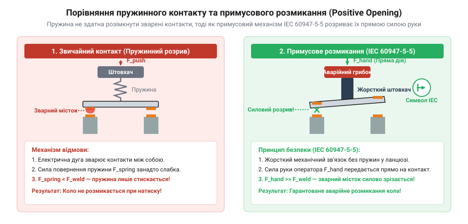
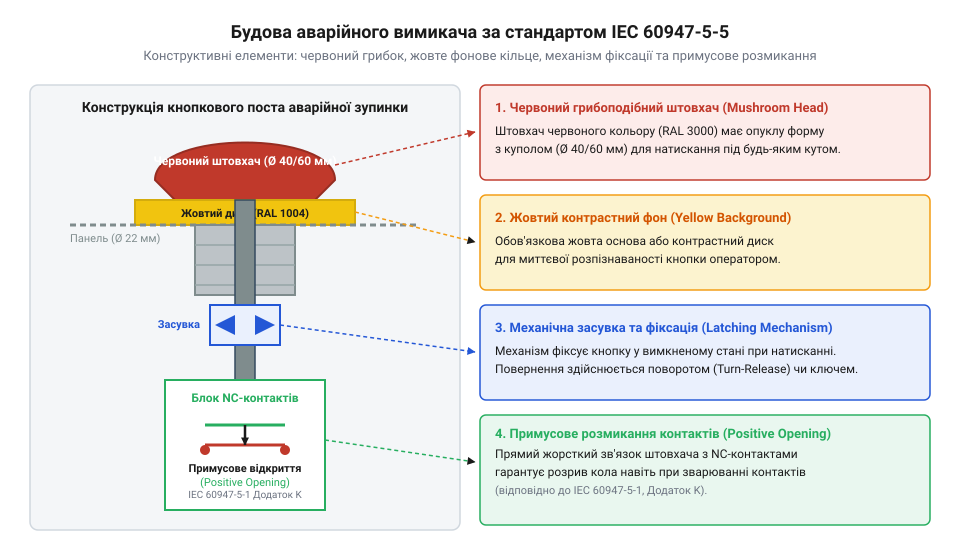

# Історія виникнення кнопок аварійного стопу та стандарту IEC 60947-5-5

<preknowlist>
- [Тактильні кнопки з ковпачками](root:cat-hw-controls/tactile-buttons) — будова та принцип дії звичайного моментного контакту для порівняння з аварійними вимикачами
</preknowlist>

## Небезпечна ера відкритих рубильників

У першій половині XX століття стрімка електрифікація промислових підприємств випередила розвиток норм безпеки праці. На верстатах і конвеєрах для знеструмлення двигунів застосовували звичайні відкриті рубильники (англ. *@@en|knife switch@@*) або найпростіші пружинні вимикачі. У разі аварії — захоплення одягу валами, заклинювання преса чи пожежі — робітник мусив точно поцілити в невеликий важіль або натиснути кнопку, схожу за механікою на [тактильну кнопку з ковпачком](root:cat-hw-controls/tactile-buttons).

Така схема мала два катастрофічні недоліки. По-перше, звичайний пружинний контакт після відпускання руки миттєво повертався у початкове положення, відновлюючи живлення небезпечного механізму. По-друге, при розмиканні навантажених контактів виникав фізичний ефект звуження струмового каналу: у міру розходження металевих пластин площа контактних плям зменшувалася до мікроскопічних розмірів, що викликало екстремальне зростання густини струму та локальне джоулеве нагрівання. Метал миттєво закипав і випаровувався, а висока напруженість електричного поля та термоелектронна емісія спричиняли іонізацію повітряного проміжку й утворення високовольтної електричної дуги. Цей плазмовий канал із температурою понад 5000–10000 K інтенсивно розплавляв поверхневі шари обох контактів, утворюючи об'ємні ванни рідкого металу. При найменшій затримці або зсуві пластин рідкі містки охолоджувалися, кристалізуючись у суцільне зварене з'єднання. У критичний момент людина тиснула на вимикач, але зварені контакти залишалися замкненими. Масовий виробничий травматизм і смертельні випадки на заводах змусили інженерів розробити специфічний пристрій аварійної зупинки (англ. *@@en|emergency stop@@*).

Ситуацію суттєво погіршувала індуктивна природа обмоток електродвигунів, які становили основу промислового приводу. У момент розмикання кола струм прагнув миттєво впасти до нуля, що за законом електромагнітної індукції викликало потужний сплеск електрорушійної сили самоіндукції. Оскільки швидкість зміни струму в часі була екстремально високою, напруга на розімкнених контактах стрибала до кількох тисяч вольт, що багаторазово перевищувало номінальне живлення мережі. Цей високовольтний пробій гарантовано підтримував та живив плазмовий дуговий розряд у повітряному проміжку навіть при збільшенні відстані між пластинами, посилюючи термічне руйнування та прискорюючи дугове зварювання вимикача.

## Винайдення примусового розмикання та фіксації

У середині XX століття інженери електротехнічних компаній запропонували два фундаментальні конструктивні рішення, що лягли в основу сучасних вимикачів безпеки. Першим стало запровадження механічної фіксації (англ. *@@en|latching@@*): при натисканні штовхач зачіплявся внутрішньою засувкою і залишався в розімкненому стані доти, доки його свідомо не повертали повертанням або ключем.

Другим і найважливішим проривом став механізм примусового розмикання контактів (англ. *@@en|positive opening operation@@*). У звичайній кнопці кінематичний ланцюг розірваний: підпружинений штовхач лише тисне на пружину, яка за рахунок пружності повертає контактний місток, тому при дуговому зварюванні пластин пружина просто стискається, а коло залишається замкненим. Натомість у безпековому вимикачі штовхач з'єднали з рухомим контактом жорстким механічним зачепом без проміжних пружних ланок. Важливу роль відіграє матеріалознавчий вибір контактних сплавів срібло-нікель (англ. Важливу роль відіграє матеріалознавчий вибір контактних сплавів срібло-нікель (англ. @@en|AgNi@@) та срібло-оксид олова (англ. @@en|AgSnO2@@): тугоплавкі вкраплення оксиду олова не плавляться в плазмі дуги, перешкоджаючи зливанню рідкого срібла у суцільну ванну та знижуючи межу міцності зварного містка `τ_weld`. Кінематичний розрахунок показує, як зусилля руки оператора `F_hand` долає опір точкового зварювання. Для розмикання контактів сумарна сила `F_opening` мусить перевищити силу зсуву зварного містка `F_weld` та опір повертальної пружини `F_spring`:

F_opening
= F_weld + F_spring          [сума сили зсуву та опору пружини]
= τ_weld · A_weld + F_spring [вираження сили зсуву через площу зварювання]

З урахуванням передавального відношення кінематичного важеля `k` між грибком і контактним містком, необхідне зусилля тиску руки становить:

F_hand
= F_opening ÷ k              [перерахунок через плече важеля]
= (τ_weld · A_weld + F_spring) ÷ k [підстановка сили розмикання]

При межі міцності матеріалу `τ_weld ≈ 120 МПа` та площі мікрозварювання `A_weld = 0.1 мм²` сила руйнування містка `F_weld` досягає 12 Н, що за важеля `k = 1.5` вимагає від оператора тиску `F_hand` лише близько 15–20 Н. Коли оператор тисне на кнопку, кінематика прямого зв'язку передає силу його руки безпосередньо на контактну групу й силоміць відриває зварені пластини.

F_opening
= F_weld + F_spring          [сума сили зсуву та опору пружини]
= τ_weld · A_weld + F_spring [вираження сили зсуву через площу зварювання]

З урахуванням передавального відношення кінематичного важеля `k` між грибком і контактним містком, необхідне зусилля тиску руки становить:

F_hand
= F_opening ÷ k              [перерахунок через плече важеля]
= (τ_weld · A_weld + F_spring) ÷ k [підстановка сили розмикання]

При межі міцності срібла `τ_weld ≈ 120 МПа` та площі мікрозварювання `A_weld = 0.1 мм²` сила руйнування містка `F_weld` досягає 12 Н, що за важеля `k = 1.5` вимагає від оператора тиску `F_hand` лише близько 15–20 Н. Коли оператор тисне на кнопку, кінематика прямого зв'язку передає силу його руки безпосередньо на контактну групу й силоміць відриває зварені пластини.

*Ззвичайний контакт покладається на пружину і при зварюванні дугою залишається замкненим. Механізм примусового розмикання передає зусилля руки оператора безпосередньо на розрив контактних пластин.*

## Стандартизація грибоподібної форми та кольорів

У 1970–1980-х роках із появою європейських та міжнародних норм охорони праці виникла потреба уніфікувати зовнішній вигляд аварійних вимикачів. В екстремальній ситуації людина перебуває в стані паніки чи стресу, тому вона не повинна витрачати секунди на пошук дрібної клавіші або правильне позиціонування пальців.

Результатом розробок з технічної естетики та ергономіки стала **грибоподібна кнопка** (англ. *@@en|mushroom head@@*). Велика вигнута шапка дозволяє активувати стоп будь-якою частиною тіла — ударом долоні, кулаком чи ліктем під довільним кутом. Дослідження з візуального сприйняття закріпили за пристроями безпеки стандартизовану колірну гаму: яскраво-червоний штовхач на жовтому колірному тлі основи. Таке поєднання забезпечує максимальний колірний та світловий контраст у периферійному зорі людини, що гарантує миттєве розпізнавання аварійного органу керування в умовах запиленості, диму чи розфокусування зору під час паніки.

Психофізіологічні дослідження сприйняття в екстремальних умовах довели, що під час гострого стресу та паніки в людини звужується поле зору (виникає ефект тунельного зору) і сповільнюється когнітивна обробка зорових образів. Поєднання насиченого червоного колірного тону з високою яскравістю жовтого фону створює максимальний хроматичний контраст, який обробляється підкірковими зоровими центрами головного мозку рефлекторно, вмикаючи мимовільну увагу без участі повільних аналітичних зон кори. Експериментальні вимірювання моторної реакції показали, що таке забарвлення скорочує час розпізнавання та реакції оператора на 150–200 мс порівняно з нейтральними схемами. У ситуації аварії ця частка секунди є вирішальною для миттєвого зупинення небезпечного обладнання до моменту отримання важкої травми.

## Поява міжнародного стандарту IEC 60947-5-5

У 1990-х роках зростання глобалізації та складності автоматизованого виробництва вимагало об'єднання національних норм у єдиний міжнародний регламент. Результатом роботи Міжнародної електротехнічної комісії став стандарт IEC 60947-5-5 (заснований на європейській нормі EN 418), який суворо визначив вимоги до конструкції та функціонування вимикачів аварійної зупинки.

*Конструкція стандартизованого аварійного грибка IEC 60947-5-5 поєднує червоний штовхач, жовту основу, механічний засув та гарантований розрив електричного кола.*

Стандарт зафіксував неприпустимість ситуацій, коли кнопка залишається в проміжному стані або відпускається самовільно під дією вібрацій обладнання. Для цього впровадили механізм проти фальстарту (англ. *@@en|anti-tease mechanism@@*): на відміну від звичайних кулькових засувок, де підпружинена кулька може зависнути на гребені канавки у нестійкій рівновазі при неповному тиску, безпековий фіксатор побудований на зламній бістабільній кінематиці з точкою перелому. При повільному натисканні штовхача пружина проти фальстарту стискається, накопичуючи потенціальну енергію, а при переході через мертву точку миттєво вистрілює засувку, здійснюючи розмикання контактів та зачеплення блокіратора в єдиному атомарному стрибку. Це повністю усуває вади кулькових фіксаторів і унеможливлює зависання штовхача в непевній позиції, коли контакти вже розімкнулися, але механічне блокування ще не зачепилося. Повернення в початковий робочий стан можливе лише навмисною дією оператора — поворотом шапки (англ. Повернення в початковий робочий стан можливе лише навмисною дією оператора — поворотом шапки (англ. *@@en|turn to release@@*) або розблокуванням за допомогою спеціального ключа (англ. *@@en|key release@@*). Крім того, конструкція унеможливлює випадкове блокування механізму сторонніми предметами.

## Розвінчання міфу про звичайну кнопку

Серед початківців у промисловій автоматизації поширене небезпечне помилкове уявлення, ніби аварійний грибок — це звичайна [тактильна кнопка з ковпачком](root:cat-hw-controls/tactile-buttons) більшого розміру. Насправді застосування стандартних пружинних вимикачів у кола аварійного вимкнення категорично заборонене міжнародними нормативами з безпеки.

Звичайна кнопка керування покладається виключно на повертальну пружину і не має механічної фіксації станів. Якщо її контактні пластини зваряться через електричну дугу чи заклинять від бруду, розмикання кола не відбудеться. Ця конструктивна відмінність безпосередньо позначається на математичних показниках надійності: звичайний кнопковий вимикач взагалі не має нормованого показника напрацювання до небезпечної відмови `B10d` (англ. @@en|B10d@@). @@en|B10d@@), оскільки ймовірність невиконання розмикання при зварюванні контактів може сягати `10⁻²` на одну спробу, що унеможливлює захист вище рівня `PL a`. Показник `B10d` визначає кількість циклів, за яких 10% випробовуваних пристроїв зазнають небезпечної відмови. З нього визначається середній час до небезпечної відмови `MTTFd` залежно від річної кількості операцій `n_op`:

MTTFd
= B10d ÷ (0.1 · n_op)     [розрахунок середнього часу відмови від інтенсивності спрацьовувань]

За стандартом ISO 13849-1 сертифікований E-Stop з примусовим розмиканням має задокументований ресурс `B10d = 100 000` циклів. У двоканальній структурі з діагностичним покриттям це гарантує високий показник `MTTFd > 30` років і знижує ймовірність небезпечної відмови за годину до `PFHd < 10⁻⁷`, що відповідає найвищим рівням повноти безпеки `SIL 3` (за стандартом IEC 62061) та `PL e` (за ISO 13849-1). Механічне блокування у розімкненому стані робить її не елементом вибору режиму, а виділеним пристроєм захисту життя з мінімальним ризиком відмови.
