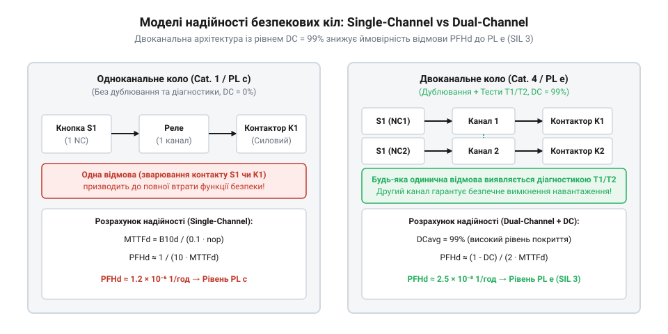

# Розрахунок надійності та показників напрацювання на відмову (B10d, MTTFd, PFHd)

## Проблема відмови механічних контактів у безпеці

Коли на промисловому обладнанні виникає небезпечна ситуація, оператор натискає кнопковий вимикач аварійного зупинення. Проте будь-який механічний контакт з часом зношується під дією дугового розряду, механічного тертя й корозії. Якщо контакт привариться або заклинить у розімкненому стані, натискання кнопки не приведе до знеструмлення кола, що спричинить катастрофічні наслідки.

Довіряти надійності аварійного вимикача лише на основі інтуїції чи паспорта окремої кнопки не можна. Промислові стандарти безпеки ISO 13849-1 та IEC 62061 вимагають кількісного розрахунку ймовірності відмови всього ланцюга, чітко розділяючи безпечні та небезпечні відмови. Безпечна відмова (англ. @@en|safe failure@@) призводить лише до хибного зупинення обладнання через випадкове розмикання кола, тоді як небезпечна відмова (англ. @@en|dangerous failure@@) унеможливлює вимкнення пристрою під час аварії, наприклад через приварювання контактних груп під дією електричної дуги. Для захисту від катастрофічних наслідків у кнопках аварійного зупинення застосовують механізм примусового розмикання контактів (англ. @@en|direct opening action@@), який згідно зі стандартом EN 60947-5-1 (Додаток K) жорстко пов'язує штовхач кнопки з рухомим контактним містком суцільною механічною ланкою без використання пружин у ланцюзі передачі зусилля. Нормативна вимога Додатка K гарантує, що мускульна сила руки оператора прикладається безпосередньо до контактного містка і створює механічне зусилля, достатнє для гарантованого зрізання мікрозварних містків на поверхні контактів та їх розведення на нормовану відстань безпечного зазору. Завдяки цій конструктивній особливості небезпечна відмова приварювання перетворюється на керований розрив, а кожен компонент безпеки оцінюють математичними показниками напрацювання, які пов'язують частоту перемикань із ризиком виникнення відмови.

## Показник B10d та розрахунок MTTFd

Основою для оцінки надійності механічних елементів слугує показник `B₁₀d` (англ. @@en|B10d@@). Ця величина означає кількість циклів спрацювання, за досягнення якої 10% випробовуваних зразків зазнають небезпечної відмови (буква «d» означає англ. @@en|dangerous@@ — небезпечний). Показник `B₁₀d` визначається виробником кнопкового вимикача шляхом прискорених лабораторних випробувань на знос. Він безпосередньо пов'язаний із загальним механічним ресурсом `B₁₀` (англ. @@en|B10@@) — кількістю циклів до виникнення 10% будь-яких відмов (як безпечних, так і небезпечних) — через частку небезпечних відмов `RDF` (англ. @@en|Ratio of Dangerous Failures@@). Оскільки не кожна відмова призводить до втрати функції безпеки (наприклад, передчасне розмикання контакту є безпечним збоєм, а зварювання контактів — небезпечним), показник розраховують за формулою `B₁₀d = B₁₀ / RDF`. Якщо виробник зазначає лише загальний ресурс `B₁₀` і не наводить точного значення `RDF`, стандарт ISO 13849-1 дозволяє за замовчуванням приймати частку небезпечних відмов рівною 50% (`RDF = 0.5`), що дає співвідношення `B₁₀d = 2 × B₁₀`.

Для переведення кількості циклів у часовий показник спочатку обчислюють інтенсивність річної експлуатації `n₀ₚ` (кількість циклів на рік). Кількість циклів на рік обчислюють через середнє число робочих днів на рік `d₀ₚ`, робочих годин на день `h₀ₚ` та середню тривалість одного циклу в секундах `t꜀ᵧ꜀ₗₑ`:

```
n₀ₚ = (d₀ₚ × h₀ₚ × 3600) / t꜀ᵧ꜀ₗₑ    [обчислення річної кількості спрацювань]
```

Знайшовши `n₀ₚ`, розраховують середній час до небезпечної відмови `MTTFd` (англ. @@en|mean time to dangerous failure@@) у роках. Значення `MTTFd` дорівнює відношенню показника `B₁₀d` до 10% від інтенсивності річної експлуатації:

```
MTTFd = B₁₀d / (0.1 × n₀ₚ)          [розрахунок середнього часу до небезпечної відмови]
```

Чим частіше оператор натискає кнопку або проводить планові перевірки, тим більшим є значення `n₀ₚ`, і відповідно тим швидше вичерпується ресурс `MTTFd`.

Проте навіть за дуже рідкісних перемикань обчислена величина `MTTFd` не може зростати безкінечно. Стандарт ISO 13849-1 встановлює суворе нормативне обмеження: максимальне розрахункове значення `MTTFd` для одного каналу обмежене величиною 100 років. Це зумовлено тим, що тривала фізична деградація матеріалів, старіння пружин та оксидування контактів роблять будь-які математичні прогнози на термін понад століття недостовірними.

## Розрахунок ймовірності відмови PFHd та архітектура

Значення `MTTFd` описує надійність одиночного елемента, проте підсумковий рівень безпеки визначається ймовірністю небезпечної відмови за годину `PFHd` (англ. @@en|probability of dangerous failure per hour@@). Обчислення `PFHd` залежить від апаратної структури кола: одноканальної чи двоканальної із дублюванням.

У разі одноканальної схеми без діагностики ймовірність відмови за годину прямо пропорційна оберненому значенню `MTTFd`. Для двоканальної системи, де контакти дублюються і контролюються реле безпеки, враховують коефіцієнт діагностичного покриття `DC` (англ. @@en|Diagnostic Coverage@@, від грец. *diagnōstikos* — здатний розрізняти), що визначає частку виявлених дефектів. Математичний вплив `DC` полягає в розщепленні загальної інтенсивності небезпечних відмов `λd = 1 / MTTFd` на виявлену частку `λdd = λd × DC` та приховану `λdu = λd × (1 - DC)`. Оскільки реле безпеки реагує на виявлені пошкодження миттєвим переведенням системи в безпечний стан, у підсумковий розрахунок `PFHd` потрапляють лише невиявлені відмови `λdu`. Множник `(1 - DC)` математично масштабує результуючу ймовірність: за високого рівня діагностики `DC = 99%` величина `1 - DC = 0.01` зменшує інтенсивність прихованих небезпечних відмов у 100 разів, що у поєднанні з дублюванням каналів знижує підсумкове значення `PFHd` на кілька порядків.


*Структурна різниця між одноканальним та дубльованим ланцюгом аварійного зупинення з діагностичним покриттям.*

Для спрощеної оцінки двоканальної системи з високим рівнем діагностики (`DC ≥ 99%`) застосовують наближену математичну модель обчислення `PFHd`:

```
PFHd ≈ 1 / (10 × MTTFd²)            [спрощений розрахунок для дубльованої схеми]
```

З виразу видно, що дублювання каналів у поєднанні з діагностикою зменшує ймовірність відмови на кілька порядків порівняно з одиночним контактом. Математичний коефіцієнт `10` у знаменнику походить із розв'язку марковської моделі надійності за стандартом ISO 13849-1, де інтегрування ймовірності одночасного перебування двох незалежних каналів у прихованому небезпечному стані між циклами перевірки дає чисельний множник `0.1` (тобто `1 / 10`). Проте таке суттєве зниження ризику справедливе лише для статистично незалежних подій. На практиці результуючу надійність двоканальної схеми обмежують відмови за спільною причиною `CCF` (англ. @@en|Common Cause Failure@@) — ситуації, коли єдиний зовнішній чинник, як-от механічне заклинювання спільного штовхача кнопки, надмірна вібрація або попадання агресивної рідини, одночасно виводить з ладу обидва контакти. Через це підсумкова ймовірність `PFHd` визначається сумою незалежних подвійних збоїв та частки відмов від спільної причини, через що без належного фізичного розмежування контактів і захисту від зовнішніх впливів дублювання втрачає перевагу.

## Відповідність показників рівням PL та SIL

Отримані значення `MTTFd` та `PFHd` слугують підґрунтям для класифікації системи безпеки за нормативними рівнями. Стандарт ISO 13849-1 оперує рівнями продуктивності `PL` (англ. @@en|Performance Level@@, від `PL a` до `PL e`), а стандарт IEC 62061 — рівнями повноти безпеки `SIL` (англ. @@en|Safety Integrity Level@@, від `SIL 1` до `SIL 3`).

Для досягнення найвищого рівня безпеки `PL e` або `SIL 3` значення ймовірності відмови за годину має задовольняти строгу нерівність:

```
PFHd < 10⁻⁷                         [умова досягнення рівнів PL e та SIL 3]
```

Це означає, що середня кількість небезпечних відмов не повинна перевищувати однієї на десять мільйонів годин безперервної роботи. Для кнопки із заданим ресурсом `B10d = 100 000` циклів та річним навантаженням `n0p = 365` циклів на рік обчислення показує кількісну різницю між одноканальною та дубльованою архітектурами.

**Обчислення PFHd для аварійної кнопки при B10d = 100 000 та n0p = 365:**

```
MTTFd = 100 000 / (0.1 × 365)
      = 100 000 / 36.5
      = 2739.7 років             [за формулою ISO 13849-1, обмеження 100 років]

PFHd_1ch = 1 / (8760 × 100)
         = 1 / 876 000
         ≈ 1.14 × 10⁻⁶ на годину [одноканальна схема без діагностики]

PFHd_2ch = (1 - 0.99) × (1 / 876 000)
         = 0.01 × 1.14 × 10⁻⁶
         ≈ 1.14 × 10⁻⁸ на годину [двоканальна схема з DC = 99%]
```

Отриманий результат `PFHd_1ch ≈ 1.14 × 10⁻⁶` перевищує граничне значення `10⁻⁷`, тому одноканальна схема з базовою [тактильною кнопкою](root:cat-hw-controls/tactile-buttons) неспроможна забезпечити найвищий рівень безпеки. Лише поєднання двох незалежних контактних груп, вимикача з примусовим розмиканням та постійного діагностичного моніторингу знижує ймовірність небезпечної відмови до `PFHd_2ch ≈ 1.14 × 10⁻⁸`, що дозволяє виконати нерівність `PFHd < 10⁻⁷` і гарантувати відповідність вимогам `PL e` та `SIL 3`. Проте збереження розрахованого рівня надійності протягом усього періоду експлуатації вимагає суворого дотримання двох часових обмежень: інтервалу контрольних випробувань `T₁` (англ. @@en|Proof Test Interval@@) та максимального терміну служби системи `T_M` (англ. @@en|Mission Time@@). Регулярні випробування через інтервал `T₁` (зазвичай від 1 до 20 років) необхідні для примусового виявлення прихованих відмов, які не фіксуються автоматичною діагностикою і без тестування накопичуються, збільшуючи реальний `PFHd`. Водночас граничний термін служби `T_M = 20` років визначає часову межу придатності математичної моделі, після якої фізичне старіння пружин та деградація матеріалів вимикача вимагають його обов'язкової повної заміни незалежно від залишкового ресурсу циклів.
