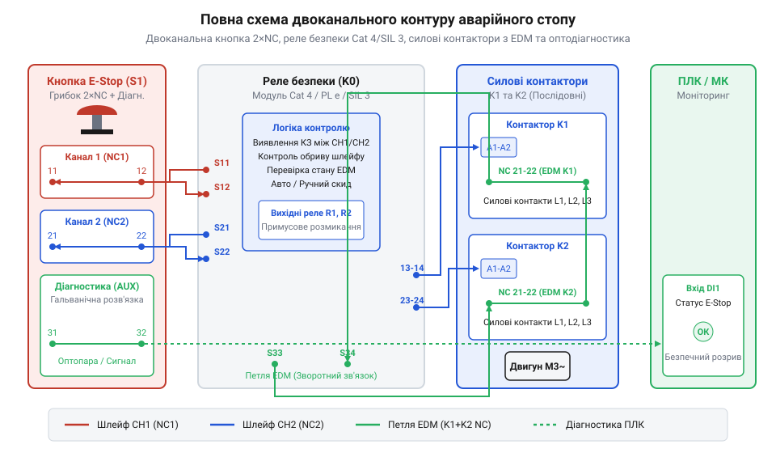

# Побудова двоканального контуру аварійного стопу з реле безпеки та моніторингом EDM

<preknowlist>
- [Тактильні кнопки з ковпачками](root:cat-hw-controls/tactile-buttons) — Принципи роботи механічних пружинних контактів.
- [Тумблери, захисні ковпачки Mollie та блокування важелів (Switch Guards)](root:cat-hw-controls/toggle-switches-and-switch-guards) — Фіксація станів органів керування та різниця між робочими й аварійними перемикачами.
</preknowlist>

## Задача та вибір апаратних компонентів

У промислових автоматизованих системах одноканальне аварійне вимкнення створює високий ризик: якщо контактний місток звариться від електричної дуги або провідник закоротить на корпус, притискання кнопки не зупинить обладнання. Для досягнення вищих категорій безпеки (Cat 4 / SIL 3) за міжнародними стандартами застосовують двоканальне дублювання. Контур будується на базі грибоподібної кнопки з двома нормально замкненими контактами (2×NC), спеціалізованого реле безпеки (@@en|safety relay@@) та двох силових контакторів із примусово керованими контактами (@@en|positively guided contacts@@). Відповідно до стандарту @@en|ISO 13849-1@@, вибір між категоріями стійкості Cat 3 та Cat 4 визначається принципом обробки накопичення відмов та рівнем охоплення діагностикою (англ. @@en|diagnostic coverage@@, DC), який математично виражається відношенням інтенсивності виявлених небезпечних відмов до їхньої загальної суми (DC = ∑ λ_dd / ∑ λ_d). У структурах Cat 3 допускається середня діагностика з рівнем DC від 60% до 90%, через що поодинока несправність не спричиняє аварію одразу, але накопичення прихованих дефектів може заблокувати відключення згодом. Натомість категорія Cat 4 вимагає високої діагностики з охопленням DC ≥ 99%, де автоматична перевірка тестовими імпульсами виявляє будь-яке пошкодження лінії чи зварювання контактів миттєво, заблоковуючи повторний пуск системи. На відміну від звичайних [тумблерів із захисними ковпачками](root:cat-hw-controls/toggle-switches-and-switch-guards), така математично підтверджена повнота моніторингу гарантує абсолютну відмовостійкість контуру.

Основою системи є грибоподібна кнопка E-Stop із механізмом примусового розмикання. Два її NC-контакти розмикаються одночасно при механічному тиску на шток. Реле безпеки формує тестові імпульси для двох незалежних шлейфів (CH1 та CH2), а для розриву силового живлення трифазної мережі використовуються два контактори, увімкнені послідовно.

*Повна монтажно-принципова схема двоканального контуру з кнопкою 2×NC, реле безпеки, контакторами та ланцюгом EDM.*

## Монтаж двоканального шлейфу кнопки E-Stop

Підключення грибоподібної кнопки до реле безпеки виконується двома окремими парами дротів. Перший NC-контакт кнопки (клеми 11-12) вмикається в канал CH1 (між виходом тестового сигналу T1 та входом S12). Другий NC-контакт (клеми 21-22) вмикається в канал CH2 (між виходом T2 та входом S22). Для збереження форми коротких випробувальних імпульсів (тривалістю 0.5–2 мс) та запобігання їх спотворенню електрична ємність кабельного шлейфу між провідниками каналів не повинна перевищувати 100 нФ, що обмежує граничну довжину траси значенням 200–500 м залежно від перерізу жил та питомого опору провідника (до 100 Ом на фазу). Крім ємності, в умовах високої вологості чи конденсату критичне значення має питомий опір витоку ізоляції (англ. @@en|insulation leakage resistance@@) між жилами. Падіння опору витоку нижче 100 кОм через зволоження клемників створює резистивний місток між каналами, що викликає запливання фронтів коротких імпульсів T1/T2, перехресний перетік струму й хибні блокування реле безпеки. На відміну від герметичних [тактильних кнопок з ковпачками](root:cat-hw-controls/tactile-buttons), довгі аварійні траси вимагають застосування кабельних вводів ступеня захисту IP67 та регулярного контролю ізоляції мегаомметром.

Реле безпеки періодично подає на виходи T1 і T2 імпульсні тестові сигнали, які зсунуті у часі один відносно одного. Якщо внаслідок пошкодження ізоляції виникне коротке замикання між провідниками CH1 і CH2 або замикання на землю, реле виявить неузгодженість тестових імпульсів за час, менший за 1 мілісекунду, і миттєво зніме живлення з вихідних реле. Монтаж виконується екранованим кабелем із підключенням до окремих клемних блоків у шафі керування.

## Силовий розрив та зворотний зв'язок EDM

Для надійного знеструмлення трифазного двигуна або силового верстата застосовують послідовне увімкнення двох контакторів K1 та K2. Котушки керування контакторів підключаються до силових безпечних вихідних контактів реле безпеки. Якщо один із контакторів залипне або його силові контакти зваряться, другий контактор гарантовано розірве коло живлення. Під час миттєвого розмикання котушок виникає висока зворотна ЕРС (англ. @@en|back electromotive force@@, back-EMF), амплітуда якої обчислюється як V_EMF = -L · (di / dt), де L — індуктивність котушки (0.5–5 Гн), а di / dt — швидкість обриву струму. Без застосування захисних RC-дугогасників чи варисторів ця індуктивна сплескова напруга сягає 1–3 кВ, що провокує електричну дугу й підгарання вихідних контактів реле. Для коректного розпізнавання стану контактів реле безпеки налаштовують на допустиме часове вікно моніторингу `T_EDM` (англ. @@en|External Device Monitoring time window@@). Тривалість `T_EDM` розраховують виходячи з сумарного механічного часу відпускання котушок контакторів та замикання їхніх допоміжних NC-контактів (зазвичай `15..50 мс`) з урахуванням технологічного запасу. На відміну від кола комутації [тумблерів із захисними ковпачками](root:cat-hw-controls/toggle-switches-and-switch-guards), якщо розмикання або замикання допоміжних ліній перевищує встановлений ліміт `T_EDM` (типово від `100 мс` до `500 мс`), реле сприймає це як апаратну відмову механіки й блокує повторне ввімкнення силового контуру.

Для виявлення залипання силових контакторів застосовують петлю моніторингу зовнішніх пристроїв — EDM (англ. @@en|External Device Monitoring@@). У коло скидання (Reset) реле безпеки послідовно вмикають додаткові нормально замкнені (NC) допоміжні контакти контакторів K1 та K2. Якщо після зупинки один із контакторів не повернувся у вихідний стан, його NC-контакт лишиться розімкненим, і реле безпеки заблокує повторний пуск системи при натисканні кнопки Reset.

## Гальванічна розв'язка діагностики для ПЛК

Основний контур безпеки (кнопка 2×NC — реле безпеки — контактори) працює незалежно від обчислювального контролера чи програмованого логічного контролера (ПЛК). Проте ПЛК повинен знати стан кнопки для відображення на операторській панелі та реєстрації подій у журналі. Пряме підключення вхідних ліній ПЛК до шлейфів T1/T2 заборонено, оскільки це створює паразитний витік струму й викривляє тестові імпульси. Для безпечного передавання стану в низковольтну мережу ПЛК застосовують оптичні ізолятори (англ. @@en|optical isolator@@) з електропрочність гальванічного бар'єра до `2.5 кВ`. Вхід світлодіода такої оптопари комутується окремим допоміжним сухим контактом реле безпеки, що повністю унеможливлює потрапляння силових наводок чи високовольтних імпульсів перенапруги на цифрові входи контролера.

Для зняття діагностичного сигналу застосовують або додатковий ізольований NO-контакт кнопки E-Stop, або оптопару (опторозв'язку) у допоміжному колі. Низьковольтний сигнал з оптопари подається на дискретний вхід мікроконтролера чи ПЛК. Програмне забезпечення ПЛК здійснює неблокувальне опитування сигналу із пригніченням брязкоту контактів (дебаунсом) та веде облік аварійних подій.

:::tabs
:::code proj-dual-channel-estop-circuit/c/estop_diag.h
:::code proj-dual-channel-estop-circuit/c/estop_diag.c
:::code proj-dual-channel-estop-circuit/c/main.c
:::code proj-dual-channel-estop-circuit/cpp/estop_types.h
:::code proj-dual-channel-estop-circuit/cpp/estop_driver.h
:::code proj-dual-channel-estop-circuit/cpp/estop_driver.cpp
:::code proj-dual-channel-estop-circuit/cpp/main.cpp
:::

## Методика тестування відмов і введення

Перед введенням обладнання в експлуатацію зібраний контур безпеки підлягає обов'язковій перевірці на стійкість до поодиноких відмов, результати якої заносять до протоколу первинного контролю безпеки (англ. @@en|safety commissioning protocol@@). Документування випробувань вимагає покрокової реєстрації кожного тесту з фіксацією дати, серійних номерів реле й контакторів, виміряного часу відключення та підписів сертифікованого інженера. На відміну від локальних ланцюгів на основі [тумблерів із захисними ковпачками](root:cat-hw-controls/toggle-switches-and-switch-guards), введення в експлуатацію аварійного контуру допускається лише після повного підписання протоколу та передбачає послідовне проведення чотирьох регламентних тестів:

1. **Тест спрацьовування кнопки:** натискання грибка під час роботи має викликати негайний розрив ліній K1/K2 та зупинку силового обладнання.
2. **Тест обриву лінії:** від'єднання одного з провідників CH1 викликає блокування реле безпеки; спроба натискання скиду (Reset) не повинна вмикати контактори.
3. **Тест короткого замикання каналів:** встановлення перемички між CH1 та CH2 викликає спрацьовування діагностики T1/T2 і блокування пуску.
4. **Тест примусового залипання контактора (EDM):** імітація замкненого стану силового контактора K1 не дозволяє схемі пройти скидання й повторно запуститися.

Після успішного виконання всіх тестів складається акт введення в експлуатацію, а контур безпеки пломбується.
