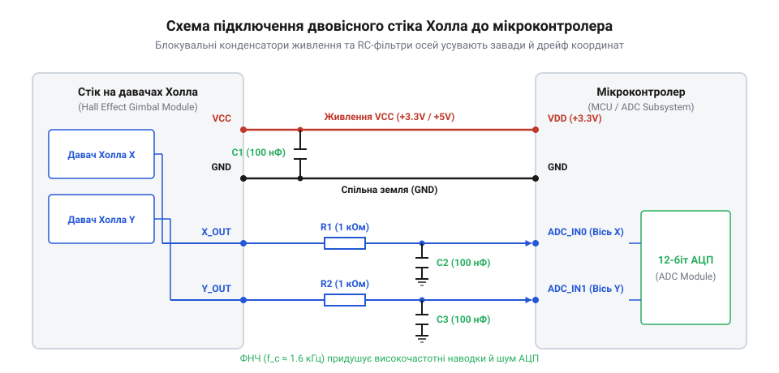

# Залізний інтерфейс підключення підвісу на давачах Холла

<preknowlist>
- [KY-023 — джойстик-модуль](root:cat-hw-controls/ky-023-joystick) — Різниця між резистивною та магнітоелектричною будовою аналогових органів керування.
- [Поворотний потенціометр](root:cat-hw-controls/rotary-potentiometer) — Принцип формування аналогового дільника напруги.
</preknowlist>

## Призначення виводів та рівні напруги

У сучасних системах керування двовісний магнітоелектричний стік (англ. @@en|gimbal@@ — кардановий підвіс) витісняє механічні дільники напруги [джойстик-модуля KY-023](root:cat-hw-controls/ky-023-joystick). Апаратний інтерфейс підвісу на елементах Холла (англ. @@en|Hall Effect@@ — ефект Холла, за прізвищем фізика Едвіна Холла) виведено на стандартний чотири- або п'ятиконтактний роз'єм: клем живлення @@en|VCC@@, спільного провідника @@en|GND@@ та двох незалежних аналогових виходів осей @@en|X_OUT@@ і @@en|Y_OUT@@.

Внутрішні аналогові сенсори формують вихідну напругу, пропорційну куту відхилення ручки. На відміну від контактних резисторів [поворотного потенціометра](root:cat-hw-controls/rotary-potentiometer), виходи сенсорів Холла є пропорційними (англ. @@en|ratiometric@@ — ратіометричними) до напруги живлення @@en|VCC@@. При номінальному живленні 5 В центральному положенню важеля відповідає напруга спокою 2.5 В (50% @@en|VCC@@), а максимальним кутам відхилення — діапазон від 0.5 В (10% @@en|VCC@@) до 4.5 В (90% @@en|VCC@@). При живленні від 3.3 В вихідний діапазон відповідно масштабується до 0.33–2.97 В із центром на рівні 1.65 В. Проте стабільність цієї залежності визначається температурним дрейфом напівпровідникового елемента: зміна температури кристала змінює рухливість носіїв заряду й спричиняє температурну залежність ратіометричного коефіцієнта `K_r(T) = V_out / VCC` (близько `±0.05% / °C`). За одночасної зміни напруги живлення та нагрівання пропорційне відстеження трохи спотворюється, тому сучасні давачі містять внутрішню схему термокомпенсації для збереження точності вихідного масштабу. Технологічне обмеження діапазону до 10–90% @@en|VCC@@ застосовується для апаратної діагностики: вихід напруги за межі цього вікна миттєво сигналізує мікроконтролеру про обрив або коротке замикання лінії.

## Схемотехніка живлення та фільтрація завад

Висока чутливість елементів Холла до магнітного поля робить їх вразливими до високочастотних пульсацій на лінії живлення та електромагнітних наводок від силових моторів чи [поворотного енкодера](root:cat-hw-controls/ky-040-encoder). Будь-яка нестабільність напруги на виводі @@en|VCC@@ безпосередньо транслюється у зміщення вихідних координат осей.

Для забезпечення стабільної роботи безпосередньо біля роз'єму підвісу встановлюють шунтувальні розв'язувальні конденсатори (англ. @@en|decoupling capacitor@@ — розв'язувальний конденсатор): керамічний конденсатор ємністю 100 нФ для придушення високочастотного шуму та паралельний електролітичний або танталовий конденсатор ємністю 10 мкФ для компенсації низькочастотних просідань струму. Вибір типів конденсаторів диктується їхнім еквівалентним послідовним опором (англ. @@en|Equivalent Series Resistance@@, @@en|ESR@@, від лат. *aequivalens* — рівноцінний) та тангенсом кута втрат `tan(δ)`: електролітичні ємності мають відносно високий @@en|ESR@@, тому на високих частотах їхній імпеданс обмежується власним опором і не здатен шунтувати швидкі імпульсні завади. Натомість багатошарові керамічні конденсатори мають мікроскопічний @@en|ESR@@ (одиниці міліомів) і низький тангенс кута діелектричних втрат, що дозволяє миттєво скидати високочастотні наводки на землю. Сигнальні виходи @@en|X_OUT@@ та @@en|Y_OUT@@ додатково захищають аналоговими фільтрами низьких частот (англ. @@en|RC filter@@ — RC-фільтр). Послідовно встановлений резистор номіналом 1 кОм разом із шунтувальним конденсатором 100 нФ утворює пасивну ланку з частотою зрізу близько 1.6 кГц, де низький @@en|ESR@@ кераміки забезпечує глибоке подавлення завад вище частоти зрізу без утворення паразитних резистивних полиць, ефективно відсікаючи наведені завади та дрібний шум механічних вібрацій.

*Принципова схема підключення підвісу Холла до АЦП із розв'язувальними конденсаторами C1, C2 та RC-ланцюгами фільтрації R1-C3, R2-C4.*

## Узгодження з АЦП та трасування землі

Передача відфільтрованого напругового сигналу до аналого-цифрового перетворювача (англ. @@en|ADC@@, від @@en|Analog-to-Digital Converter@@ — аналого-цифровий перетворювач) мікроконтролера вимагає врахування вихідного опору сенсора та динаміки вибірки АЦП. Внутрішній конденсатор пристрою вибірки та утримання (англ. @@en|Sample and Hold@@ — вибірка та утримання) АЦП під час комутації створює короткочасний кидок струму. Якщо вихідний опір сигнальної лінії надто високий, вхідна ємність АЦП не встигає зарядитися за час вибірки, що спричиняє похибку вимірювання та взаємне накладання каналів. Резистор RC-фільтра номіналом 1 кОм забезпечує оптимальне узгодження імпедансу для більшості стандартних мікроконтролерів.

Критичним чинником точності є трасування друкованих провідників землі. Струми цифрових перемикань периферії, що протікають через спільну землю, створюють падіння напруги на опорі мідного треку, яке АЦП зчитує як дрейф нульової точки стіка. Щоб усунути цей ефект, землю підвісу Холла та фільтраційних конденсаторів з'єднують із виводом аналогової землі (англ. @@en|AGND@@) мікроконтролера за топологією «зірка» або виділеним провідником, розмежованим із цифровою землею (англ. @@en|DGND@@). Приєднана за цими правилами аналогова лінія забезпечує чистий сигнал координат із відсутністю дрейфу нуля.
