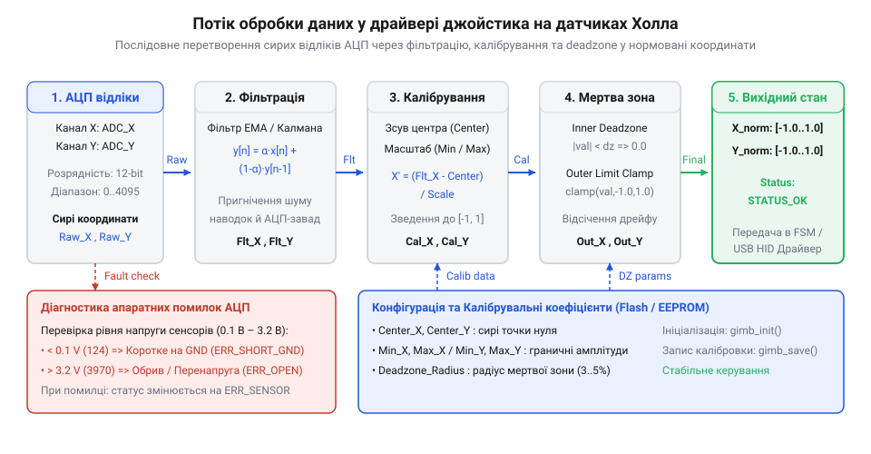

# Програмний інтерфейс драйвера стіка на давачах Холла

<preknowlist>
- [KY-023 — джойстик-модуль](root:cat-hw-controls/ky-023-joystick) — принцип двовісного аналогового зчитування координат Х та Y.
- [Поворотний потенціометр](root:cat-hw-controls/rotary-potentiometer) — основи обробки аналогового сигналу та нормування вихідних значень.
</preknowlist>

## Принцип побудови програмного драйвера джойстика

У механічних аналогових органах керування, таких як класичний [джойстик-модуль KY-023](root:cat-hw-controls/ky-023-joystick) чи [поворотний потенціометр](root:cat-hw-controls/rotary-potentiometer), сирі значення АЦП зазнають впливу високочастотних завад і дрейфу механічного нуля. Програмний @@en|driver@@ (англ. *driver* — керуюча програма) ізолює специфічні регістри мікроконтролера та надає прикладній системі уніфікований @@en|API@@ (англ. *Application Programming Interface* — прикладний програмний інтерфейс).

Архітектура драйвера отримує аналогові відліки АЦП по осях X і Y, виконує цифрове фільтрування за допомогою експоненційного ковзного середнього `y[n] = α · x[n] + (1 - α) · y[n-1]` (де коефіцієнт згладжування `α ≈ 0.2` пригнічує високочастотний шум АЦП без помітної затримки відгуку), застосовує коефіцієнти калібрування, відсікає центральну @@en|deadzone@@ (англ. *deadzone* — мертва зона) та формує нормований вектор координат у діапазоні `[-1.0, 1.0]`. Вибір величини `α` безпосередньо залежить від частоти дискретизації АЦП `f_s` та являє собою компроміс між фільтрацією шуму й фазовою затримкою відгуку стіка. За високої частоти опитування (наприклад, `f_s = 1000 Гц`) зменшення `α` до `0.05` знижує частоту зрізу фільтра `f_c ≈ 8 Гц`, пригнічуючи високочастотні наводки, але створює відчутне часове запізнення регулювання до 20 мс; навпаки, значення `α > 0.5` усуває часову затримку, але пропускає завади АЦП, спричиняючи мікротремтіння вихідного вектора. Для динамічного системного керування значення `α = 0.15 ... 0.25` забезпечує оптимальне згладжування амплітудних сплесків при збереженні реакції драйвера в межах 10 мс.


*Схема потоку даних програмного драйвера від сирих значень АЦП через фільтрацію, deadzone й калібрування до підсумкових нормованих координат Х/Y та статусів помилок.*

Стан джойстика інкапсулюється у C-структурі `joystick_state_t`:

```c
typedef struct {
    float x;
    float y;
    bool button;
    uint32_t status_flags;
} joystick_state_t;
```

## Ініціалізація периферії та зчитування координат

Перед отриманням координат додаток викликає метод ініціалізації joystick_init(), який конфігурує канали АЦП, завантажує коефіцієнти калібрування та налаштовує фонове асинхронне зчитування сигналів. Щоб запобігти затримкам основного циклу програми у системах реального часу, драйвер конфігурує апаратний таймер для періодичного запуску перетворень АЦП і спрямовує оцифровані відліки через прямий доступ до пам'яті (англ. @@en|Direct Memory Access@@, DMA) у кільцевий буфер (англ. @@en|circular buffer@@). Апаратне тактування запускає вимірювання із чітким інтервалом без залучення процесора, а DMA-контролер автоматично перезаписує буфер по колу, оновлюючи значення осей у пам'яті. Завдяки цьому фонове опитування не створює навантаження на обчислювальне ядро, а функція joystick_read_axes() не блокує виконання й миттєво повертає останні готові відліки, заповнюючи структуру joystick_state_t.

```c
typedef struct {
    uint8_t adc_channel_x;
    uint8_t adc_channel_y;
    float deadzone_radius;
} joystick_config_t;

int joystick_init(const joystick_config_t *config);
int joystick_read_axes(joystick_state_t *state);
```

Для інтеграції у різні програмні середовища надаються ідіоматичні реалізації C та C++:

:::tabs
```c|esp-idf
#include "hall_joystick.h"

joystick_config_t cfg = {
    .adc_channel_x = 0,
    .adc_channel_y = 1,
    .deadzone_radius = 0.05f
};

if (joystick_init(&cfg) == 0) {
    joystick_state_t state;
    if (joystick_read_axes(&state) == 0) {
        // Поточні нормовані координати state.x та state.y
    }
}
```
```cpp|arduino
#include <HallJoystick.h>

HallJoystick joystick(A0, A1);

void setup() {
    joystick.begin();
    joystick.setDeadzone(0.05f);
}

void loop() {
    JoystickState state = joystick.read();
    float x = state.x;
    float y = state.y;
}
```
:::

## Конфігурація deadzone та збереження калібрування

Через допуски механічного збирання підвісу нейтральне положення стіка може зсуватися відносно геометричного центру. Алгоритм радіальної @@en|deadzone@@ обчислює відстань від центру `r = sqrt(x² + y²)`. Якщо `r < r_dead`, координати примусово обнуляються; у разі перевищення порога вихідний вектор плавно масштабується від `0.0` до `1.0`. Щоб гарантувати точність порогів, драйвер застосовує триточкове автокалібрування, фіксуючи сирі значення АЦП у крайніх положеннях `V_min` і `V_max` та у точці спокою `V_center`. Триточковий метод розділяє нормування аналогового сигналу на дві несиметричні ділянки: для значень нижче нуля координата масштабується в діапазон `[-1.0, 0.0]` за формулою `(V_raw - V_center) / (V_center - V_min)`, а для значень вище нуля — у діапазон `[0.0, 1.0]` за `(V_raw - V_center) / (V_max - V_center)`. Це усуває нелінійність аналогового тракту, характерну для [поворотних потенціометрів](root:cat-hw-controls/rotary-potentiometer) та давачів Холла, забезпечуючи точний вихід на крайні значення в упорах.

Коефіцієнти зсуву нуля та @@en|gain@@ (англ. *gain* — коефіцієнт підсилення) зберігаються у пам'яті @@en|EEPROM@@ (англ. *Electrically Erasable Programmable Read-Only Memory*) або @@en|NVM@@ (англ. *Non-Volatile Memory*).

```c
int joystick_set_deadzone(float radius);
int joystick_calibrate_center(void);
int joystick_save_calibration(void);
```

## Обробка помилок та діагностика стану

Датчики Холла чутливі до обриву провідників живлення, виходу магніту з робочої зони чи падіння напруги. Якщо потенціал АЦП виходить за межі діапазону `0.2 В ... 3.1 В` (для шкали `3.3 В`), @@en|driver@@ встановлює відповідні прапорці помилок. Щоб запобігти хибним аварійним зупиненням системи через короткочасні імпульсні завади чи наводки на аналогових лініях, у драйвері реалізовано лічильник збоїв (англ. @@en|error counter@@) з алгоритмом придушення завад (англ. @@en|debounce@@, від англ. *debounce* — усунення брязкіту). Кожен відлік поза допуском збільшує внутрішній лічильник `err_count`, а коректне вимірювання — зменшує його до нуля. Лише після досягнення фіксованого порога послідовних збоїв (наприклад, 5 послідовних циклів опитування) драйвер вважає відмову підтвердженою та виставляє відповідні прапорці помилок:

- `JOYSTICK_ERR_OUT_OF_RANGE` — вихід аналогового сигналу за межі допуску;
- `JOYSTICK_ERR_DISCONNECTED` — відсутність відгуку датчика Холла.

```c
#define JOYSTICK_ERR_OK           0x00
#define JOYSTICK_ERR_OUT_OF_RANGE 0x01
#define JOYSTICK_ERR_DISCONNECTED 0x02

if (state.status_flags & JOYSTICK_ERR_OUT_OF_RANGE) {
    // Переведення виконавчих механізмів у безпечний стан
}
```

Така обробка виняткових ситуацій гарантує, що прикладний код вчасно виявить несправність органу керування та запобіжить видачі хибних команд.
