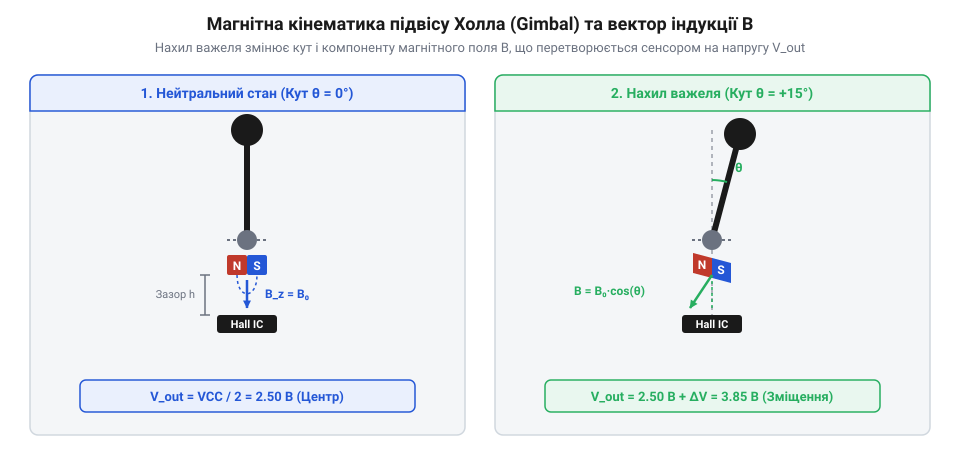
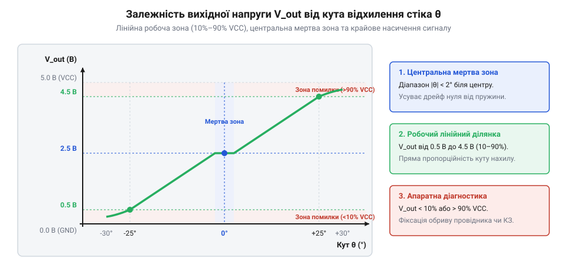
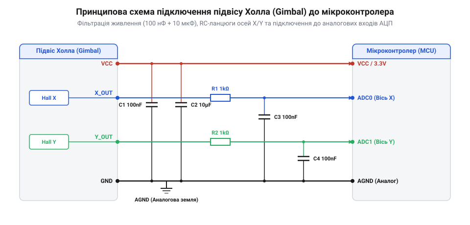

# Стік на давачах Холла (Hall Effect Gimbal)

<preknowlist>
- [KY-023 — джойстик-модуль](root:cat-hw-controls/ky-023-joystick) — принципи роботи двовісного аналогового джойстика на потенціометрах та причини виникнення дрейфу нуля
- [Поворотний потенціометр](root:cat-hw-controls/rotary-potentiometer) — зняття аналогової напруги, пропорційної куту відхилення вала
</preknowlist>

## Проблема дрейфу та безконтактне зчитування

Будь-який аналоговий джойстик, побудований на ззвичайних потенціометрах (як-от [джойстик-модуль KY-023](root:cat-hw-controls/ky-023-joystick)), з часом стикається з неминучою деградацією. Механічний контакт повзунка, який тисячі разів ковзає вугільною доріжкою, стирає провідний шар. Графітовий пил накопичується всередині корпуса, створює нестабільний опір і призводить до того, що в нейтральному положенні ручки сигнал постійно зсувається. Цю неприємність називають [дрейфом нуля](root:cat-hw-controls/stick-drift-mitigation) (англ. *stick drift*): персонаж у грі починає рухатися сам по собі, а безпілотник відхиляється від курсу без торкання до важелів.

Щоб позбутися тертя та зношування, фізичний контакт замінюють магнітним полюсом. Якщо на рухомий важіль закріпити постійний неодимовий магніт, а поруч установити нерухомий [лінійний давач Холла](root:hw-sensing/linear-hall-effect-sensor) (названий на честь Едвіна Холла, англ. *Hall effect*), кут нахилу ручки можна вимірювати без жодного механічного дотику.

Коли важіль відхиляється, магніт наближається або повертається відносно чутливої поверхні напівпровідникового кристала. Зміна вектора @@en|магнітної індукції@@ перетинає кремнієву пластину, крізь яку пропускається стабільний струм. У перпендикулярному магнітному полі на рухомі носії заряду починає діяти сила Лоренця (англ. @@en|Lorentz force@@, на честь фізика Хендріка Лоренца). Ця сила зсуває електрони до однієї з бічних граней напівпровідника, викликуючи просторове розділення зарядів. Накопичення носіїв з одного боку та їхній брак з іншого створюють поперечну різницю потенціалів — напругу Холла, величина якої чітко відповідає куту нахилу важеля. Оскільки магніт і давач розділені повітряним проміжком, у вимірювальному вузлі повністю відсутнє тертя. Детальніше про еволюцію органів вводу можна прочитати в [історії переходу до давачів Холла](root:cat-hw-controls/hall-effect-gimbal-joystick/hist-hall-gimbals.md).

Така конструкція забезпечує практично нескінченний механічний ресурс: зношуються лише опорні підшипники та пружини повернення, тоді як сам електронний вузол зчитування не втрачає точності роками. Проте, окрім температурної нестабільності (коливання температури змінюють концентрацію та рухливість носіїв заряду в кремнії, викликаючи термодрейф (англ. @@en|thermal drift@@) нульового рівня та зміну чутливості, що усувається внутрішніми схемами термокомпенсації, англ. @@en|temperature compensation@@), на чутливий напівпровідник діють зовнішні магнітні поля від електродвигунів або силових кабелів. Щоб відсікати такі однорідні зовнішні завади, у сучасних сенсорних чипах застосовують диференціальну пару (від лат. *differentia* — різниця, англ. @@en|differential pair@@) кристалів Холла, розміщених симетрично відносно рухомого магніту. Корисне магнітне поле важеля діє на паралельні кристали у протилежних напрямках (один елемент фіксує збільшення індукції, а інший — зменшення), тоді як стороннє зовнішнє поле створює в обох точках однакову синфазну заваду (англ. @@en|common-mode interference@@). Під час віднімання сигналів двох елементів однакові завади повністю взаємно компенсуються, а корисна різниця напруг подвоюється, забезпечуючи високу завадозахищеність вимірювального вузла.

## Будова підвісу та магнітна геометрія

Для незалежного вимірювання двох координат — нахилу вперед-назад (вісь Y) та ліворуч-праворуч (вісь X) — важіль закріплюють у спеціальній карданній рамці, яку називають @@en|підвісом@@ (англ. *gimbal*). Вал кожної осі обертається в прецизійних шарикопідшипниках і має власну пружину повернення у нейтральний центр.

На торці кожної з двох осей обертання встановлюють невеликий постійний неодимовий магніт із чітко орієнтованими полюсами N та S. Напроти кожного магніту на нерухомому каркасі плати монтують аналоговий @@en|давач Холла@@.

*Конструкція підвісу Hall Gimbal. Дві ортогональні осі спираються на підшипники й мають власні неодимові магніти, які обертаються напроти нерухомих давачів Холла.*

Коли ручка перебуває в строго центральному положенні, вектор магнітного поля орієнтований паралельно поверхні давача, а перпендикулярна складова @@en|магнітної індукції@@ дорівнює нулю. При нахилі важеля за відповідною віссю магніт обертається разом із валом карданової рамки на кут `θ`, змінюючи орієнтацію силових ліній поля відносно чутливого кристала. Перпендикулярна складова індукції `B_⊥`, що пронизує напівпровідникову пластину, підпорядковується кутовій залежності `B_⊥ = B₀ · sin θ`, де `B₀` — повна напруженість магнітного поля. На малих кутах відхилення синус практично дорівнює куту (`sin θ ≈ θ`), тому перпендикулярний потік магнітного поля зростає майже лінійно або змінює напрямок на протилежний при зміні знака кута, викликаючи пропорційну зміну вихідного аналогового сигналу сенсора.

Оскільки кожна вісь має власну ортогональну пару «магніт — сенсор», рух за однією віссю майже не впливає на основний потік іншої. Проте через близьке розташування у компактному корпусі підвісу силові лінії магніту однієї осі можуть частково пронизувати кристал Холла сусідньої осі, викликаючи паразитне магнітне наведення (англ. @@en|magnetic cross-talk@@). Цей перехресний зв'язок призводить до того, що крайні відхилення важеля за віссю `X` спричиняють незначний зсув нульової точки осі `Y`. Для пригнічення цього ефекту геометрію підвісу розраховують із максимальним просторовим рознесенням сенсорів, а магнітні полюси орієнтують строго перпендикулярно. Крім того, на геометрію поля істотно впливає механічний люфт (від нім. *Luft* — повітря, англ. @@en|backlash@@) підшипників та осей кардана: мінімальний радіальний чи осьовий зсув вала навіть на частки міліметра змінює повітряний проміжок між магнітом і кристалом. У результаті погіршується повторюваність (англ. @@en|repeatability@@) вимірювань — після відпускання важеля магніт зупиняється в трохи різних позиціях залежно від напрямку попереднього руху, що створює механічний гістерезис сигналу. Детальні тригонометричні рівняння та розрахунок силових ліній описано в [математичній моделі магнітного зчитування](root:cat-hw-controls/hall-effect-gimbal-joystick/math-hall-sensing-geometry.md).

## Характеристики сигналу та стабільність живлення

Аналогові давачі Холла, що застосовуються в підвісах, мають логометричний (раціометричний) вихід: їхня нейтральна вихідна напруга в стані спокою дорівнює точно половині напруги живлення (V_CC / 2). У разі відхилення важеля в один бік напруга зростає до верхньої межі, а в протилежний бік — спадає до нижньої.

*Характеристика вихідної напруги осей X та Y. У центральній зоні вихідний сигнал лінійний, а біля фізичних упорів спостерігається незначний вигин через геометрію магнітного поля.*

У робочому діапазоні кутів (зазвичай до ±20°–25°) залежність напруги від кута відхилення має високу лінійність. Проте при максимальних кутах нахилу ручки силові лінії магнітного поля вигинаються, що викликає помірне відхилення від прямої лінії. Цю особливість ураховують під час програмної обробки значень [АЦП](root:cat-hw-controls/rotary-potentiometer).

Оскільки вихідний сигнал прямо пропорційний напрузі живлення `V_CC`, будь-які пульсації чи високочастотні завади живлення давача безпосередньо транслюються у вихідну напругу, призводячи до дрижання виміряних координат. Для забезпечення високої точності відліків підвіс живлять від виділеного лінійного регулятора з низьким падінням напруги (англ. @@en|LDO@@, від @@en|Low-Dropout Regulator@@) та мінімальним рівнем власних шумів. Стабільна та чиста напруга від LDO знижує амплітуду завад нижче рівня найменшого розряду АЦП, зберігаючи повну ефективну роздільну здатність (англ. @@en|ENOB@@) перетворення без втрати точності молодших бітів, а обов'язкове шунтування керамічними конденсаторами безпосередньо біля виводів кожного сенсора відсікає наведення у широкій смузі частот.

Крім того, магнітна система стіка чутлива до зовнішніх сильних магнітних полів — сильних силових кабелів, потужних динаміків чи електромоторів. Для захисту від таких завад металевий корпус підвісу виконують із феромагнітного сплаву з високою магнітною проникністю, який слугує екраном і шунтує зовнішні силові лінії в обхід сенсорів. Товщину стінок екрана (зазвичай `0.5–1.2 мм`) розраховують виходячи з межі магнітного насичення (англ. @@en|magnetic saturation@@) матеріалу: надто тонкий шар сталі в потужному полі швидко насичується й втрачає екрануючі властивості, тоді як надлишкова товщина невиправдано збільшує масу підвісу. Вибір конкретного сплаву визначається природою завад: для екранування потужних постійних полів використовують м'яке залізо (англ. @@en|soft iron@@), яке володіє високою межею насичення й не перенасичується біля силових провідників, тоді як для шунтування слабких і високочастотних змінних полів застосовують пермаллой (від англ. *permeability* — проникність та *alloy* — сплав, англ. @@en|Permalloy@@). Колосальна магнітна проникність пермаллою миттєво перенаправляє високочастотні хвилі в обхід кристала, хоча він швидко досягає насичення у сильних полях, через що у високоточних підвісах іноді комбінують обидва матеріали. Повний перелік електричних параметрів викладено у [схемотехнічних вимогах підключення](root:cat-hw-controls/hall-effect-gimbal-joystick/api-hall-gimbal-hardware.md), а практичну реалізацію зчитування сигналів дано у [готовому алгоритмі прошивки](root:cat-hw-controls/hall-effect-gimbal-joystick/proj-hall-gimbal-reading.md) та в [документації програмного драйвера](root:cat-hw-controls/hall-effect-gimbal-joystick/api-hall-gimbal-software.md).

## Підключення підвісу до мікроконтролера

Підключення безконтактного джойстика до мікроконтролера вимагає уваги до електричної чистоти ліній живлення та узгодження напруг. Типовий джойстик має чотири основні виводи: живлення `VCC`, спільна земля `GND` та два аналогові виходи `X_OUT` і `Y_OUT`. На відміну від звичайних потенціометричних модулів на кшталт [KY-023](root:cat-hw-controls/ky-023-joystick), де резистивна доріжка безпосередньо ділить напругу живлення, аналоговий [лінійний давач Холла](root:hw-sensing/linear-hall-effect-sensor) містить активну електронну схему підсилення та термокомпенсації.

Оскільки давачі Холла формують @@en|ratiometric@@ напругу, вихідний сигнал пропорційний напрузі живлення `VCC`. Якщо мікроконтролер живить сенсори від `5 В`, а вимірює напругу через @@en|ADC@@ із власною опорною напругою `3.3 В`, вихідний сигнал перевантажить аналоговий вхід або зріжеться на межі вимірювання. Для точного зчитування опорна напруга АЦП повинна дорівнювати напрузі живлення давачів або бути з нею строго узгодженою. При використанні 3.3-вольтових мікроконтролерів самі давачі Холла також слід заживлювати від лінії `3.3 В`.

Для запобігання високочастотним завадам та аналоговим наведенням безпосередньо біля виводів живлення модуля встановлюють керамічний @@en|decoupling capacitor@@ ємністю `0.1 мкФ` паралельно з електролітичним конденсатором на `10 мкФ`. На сигнальних лініях `X_OUT` та `Y_OUT` рекомендовано розміщувати пасивний @@en|RC filter@@ (резистор `1 кОм` та конденсатор `100 нФ`), який зрізає високочастотний шум до того, як сигнал потрапить на вхід @@en|ADC@@. Опір резистора обирають помірним (не більше `1 кОм`), щоб не обмежити вихідний імпеданс джерела й забезпечити швидке заряджання внутрішньої ємності вибірки (англ. @@en|sample-and-hold capacitor@@) АЦП за короткий час вибірки, тоді як зовнішній конденсатор фільтра слугує накопичувачем заряду, що запобігає просіданню напруги при комутації аналогового входу.

*Принципова схема підключення ліній живлення та аналогових сигналів джойстика Холла до АЦП мікроконтролера із захисними та фільтруючими конденсаторами.*

Окремої уваги вимагає розв'язка заземлення: для усунення високочастотних цифрових наведень від процесорного ядра застосовують топологію заземлення «зіркою» (від @@en|star grounding@@). Аналогова земля сенсорів Холла `AGND` та цифрова земля мікроконтролера `DGND` трасуються окремими фізичними провідниками й з'єднуються строго в одній спільній точці біля виводу живлення АЦП. Таке розділення запобігає проходженню вихрових струмів цифрових перемикань через чутливий аналоговий контур зчитування. Якщо ж підвіс винесено на значну відстань від плати мікроконтролера у складі довгого кабельного джгута, слаботочний сигнал Холла стає вразливим до електромагнітних наведень і ємнісного навантаження лінії. Для надійної передачі сигналу на віддалі безпосередньо біля сенсорів установлюють буферний операційний підсилювач (англ. @@en|buffer operational amplifier@@) з низьким вихідним імпедансом або диференціальний підсилювач (від лат. *differentia* — різниця, англ. @@en|differential amplifier@@). Буфер перешкоджає спотворенню сигналу ємністю кабелю, тоді як дифпідсилювач формує симетричну паралельну лінію, що дозволяє приймачу повністю відсікати зовнішні завади. Детальні схемотехнічні вимоги та варіанти розводки виводів описано в [документації залізного інтерфейсу підвісу](root:cat-hw-controls/hall-effect-gimbal-joystick/api-hall-gimbal-hardware.md). Еволюцію механічних та магнітних органів вводу показує [історія джойстиків Холла](root:cat-hw-controls/hall-effect-gimbal-joystick/hist-hall-gimbals.md), а розрахунок кутових залежностей розкрито в [матеріалі про геометрію магнітного зчитування](root:cat-hw-controls/hall-effect-gimbal-joystick/math-hall-sensing-geometry.md).

## Програмне калібрування та згладжування шуму

Навіть за ідеального електричного підключення сирий цифровий код з @@en|ADC@@ не забезпечує готові координати від `-100%` до `+100%`. Через механічні допуски пружинного повернення, технологічний розкид параметрів давачів та неідеальну симетрію магнітів центральне положення вала рідко відповідає точно половині діапазону живлення. Для точного керування необхідне програмне [калібрування та компенсація дрейфу органів вводу](root:cat-hw-controls/stick-drift-mitigation).

Процес калібрування (англ. *calibration*, від арабського *qālib* — форма) полягає у визначенні та фіксації трьох базових значень для кожної осі: мінімального ходу `ADC_MIN`, механічного центру `ADC_CENTER` та максимального ходу `ADC_MAX`. У стані спокою прошивка зчитує поточні покази АЦП і приймає їх за нульову точку. Під час повного відхилення ручки по колу фіксуються крайові екстремуми. Отримані значення масштабують сигнал окремо для від'ємного та додатного напівдіапазонів, що усуває асиметрію ходу.

Наступним кроком є формування центральної зони нечутливості — @@en|deadzone@@. Оскільки пружини підвісу після відпускання стіка повертають його в центр із невеликим механічним розкидом (через гістерезис (англ. *hysteresis*, від грецького *hysteresis* — запізнення) та тертя в підшипниках), значення АЦП можуть відрізнятися від записаного `ADC_CENTER` на кілька одиниць. Якщо не відсікати ці мікрозміщення, керований об'єкт буде повільно дрейфувати у спокої. Програмний поріг у `2–5%` від повного ходу примусово обнуляє вихідний сигнал у межах центрального радіуса, після чого алгоритм розраховує окремі диференціальні коефіцієнти масштабування для від'ємного та додатного напівдіапазонів: `k_neg = 1.0 / (ADC_CENTER - ADC_MIN - deadzone)` та `k_pos = 1.0 / (ADC_MAX - ADC_CENTER - deadzone)`. Множення відхилення на відповідний коефіцієнт усуває механічну асиметрію ходу важеля й вирівнює чутливість осі в обох напрямках. Аналогічно на краях ходу додається крайова @@en|deadzone@@, яка гарантує досягнення `100%` виходу навіть при незначному недоході ручки до механічного упору.

Незважаючи на відсутність механічного тертя в підвісі Холла, аналоговий сигнал схильний до дрижання молодших розрядів АЦП під впливом електромагнітних завад. Для усунення цього ефекту застосовують математичне згладжування — @@en|smoothing@@. Найпростішим методом є експоненційне ковзне середнє — @@en|exponential moving average@@:

    Y_filtered[n] = α × X_raw[n] + (1 - α) × Y_filtered[n-1]    [експоненційне згладжування]

де `α` — коефіцієнт фільтрації у діапазоні від `0.05` до `0.2`. Мале значення `α` ефективно пригнічує шум, але створює помітний часовий затрим реакції, тоді як велике значення зберігає дрижання. Оптимальний вибір `α` забезпечує плавну динаміку без втрати чутливості.

Для усунення компромісу між затримкою та шумом у розширених драйверах застосовують адаптивну фільтрацію з динамічним розрахунком коефіцієнта `α`. Прошивка обчислює модуль миттєвої швидкості відхилення `ΔX = |X_raw[n] - Y_filtered[n-1]|`: у стані спокою при малих `ΔX` коефіцієнт знижується до `0.05` для максимального пригнічення шуму АЦП, а під час різких маневрів, коли `ΔX` перевищує заданий поріг, `α` динамічно зростає до `0.7–0.9`. Це забезпечує миттєвий відгук системи без часової затримки при швидкому пілотуванні, зберігаючи абсолютну стабільність виходу у центрі. Однак у середовищах із інтенсивними механічними вібраціями (наприклад, на борту мультикоптерів або промислової техніки) навіть адаптивне згладжування плутає високочастотні коливання підвісу з навмисними маневрами оператора. Для оцінки реального положення важеля в таких умовах замість ковзного середнього застосовують дискретний фільтр Калмана (названий на честь математика Рудольфа Калмана, англ. @@en|Kalman filter@@). Алгоритм циклічно виконує крок прогнозування (англ. @@en|prediction step@@) на основі фізичної моделі руху та крок оновлення (англ. @@en|update step@@) за показами АЦП. Оптимально співвідносячи матриці шуму процесу та вимірювання, фільтр відокремлює зовнішні вібраційні завади від справжньої траєкторії руху стіка, не створюючи затримки у керуванні. Готовий C++ клас із реалізацією таких алгоритмів зчитування, калібрування та фільтрації сигналів міститься у [прошивці для опрацювання стіка Холла](root:cat-hw-controls/hall-effect-gimbal-joystick/proj-hall-gimbal-reading.md). Детальний опис функцій та методів драйвера наведено в [програмному інтерфейсі драйвера стіка](root:cat-hw-controls/hall-effect-gimbal-joystick/api-hall-gimbal-software.md).
