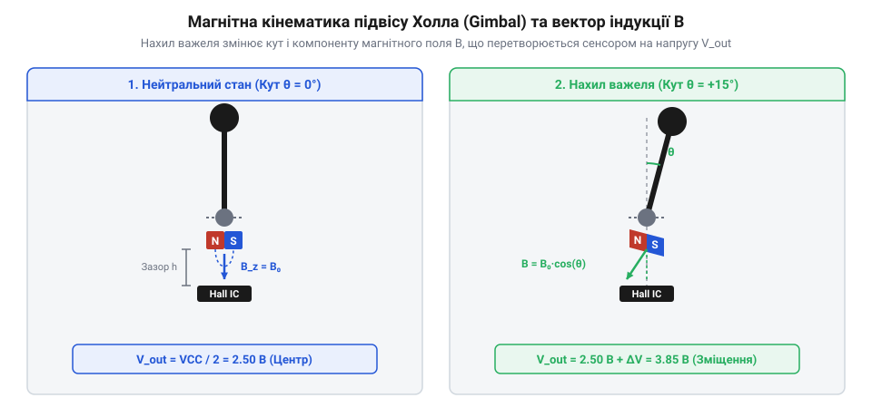
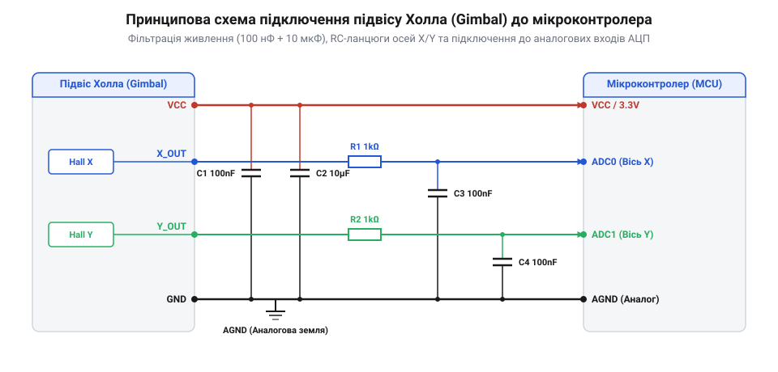

# Стік на давачах Холла (Hall Effect Gimbal)

<preknowlist>
- [KY-023 — джойстик-модуль](root:cat-hw-controls/ky-023-joystick) — причини виникнення дрейфу нуля через механічний знос потенціометрів
- [Поворотний потенціометр](root:cat-hw-controls/rotary-potentiometer) — принцип зняття аналогової напруги, пропорційної куту відхилення
</preknowlist>

## Безконтактне зчитування та пригнічення дрейфу

Традиційний [джойстик-модуль KY-023](root:cat-hw-controls/ky-023-joystick) під час тривалої експлуатації стикається з механічним зносом провідної доріжки. Постійне тертя металевого повзунка об вугільне напилення створює графітовий пил та викривляє опір контактної групи. У результаті вихідна напруга в центральному стані ручки починає самовільно зсуватися, викликаючи дрейф нуля (від англ. *stick drift* — зсув важеля, @@en|stick drift@@): керований механізм починає рухатися без торкання до органів вводу.

Для усунення тертя механічний контакт замінюють вимірюванням зміщення магнітного поля. Якщо на рухомому важелі зафіксувати постійний магніт, а поруч установити нерухомий напівпровідниковий елемент, кут відхилення можна визначати за допомогою ефекту Холла (від англ. *Hall effect*, на честь Едвіна Холла, @@en|Hall effect@@). Коли важіль нахиляється, магнітне поле перетинає кристал із струмом. Під дією сили Лоренця (від англ. *Lorentz force*, на честь Хендріка Лоренца, @@en|Lorentz force@@) носії заряду відхиляються до бічної грані, утворюючи поперечну напругу, пропорційну куту нахилу. Оскільки магніт і кристал розділені повітряним проміжком, у вузлі зчитування повністю відсутнє тертя, що забезпечує практично нескінченний механічний ресурс. Проте напівпровідниковій структурі притаманна чутливість до нагріву: зміна температури навколишнього середовища чи самонагрівання кристала змінює концентрацію та рухливість носіїв заряду, а також власний опір матеріалу. Це викликає температурний дрейф (від англ. *temperature drift*, @@en|temperature drift@@) нульової точки, коли вихідна напруга давача в нейтральному положенні важеля незначно зміщується навіть за відсутності механічного нахилу, що вимагає застосування диференційних мостових схем та термокомпенсації.

## Будова підвісу та ортогональна геометрія

Для незалежного вимірювання нахилу за двома координатно-просторовими осями важіль закріплюють у карданній рамці — підвісі (від англ. *gimbal* — підвіс, @@en|gimbal@@). Кожна вісь обертається в прецизійних шарикопідшипниках і має власну пружину повернення в центр.

*Конструкція підвісу Hall Gimbal із ортогональними неодимовими магнітами та нерухомими сенсорами.*

На торці кожної осі встановлено неодимовий магніт, напроти якого зафіксовано аналоговий сенсор. При відхиленні важеля перпендикулярна складова магнітної індукції `B_⊥` змінюється за законом `B_⊥ = B₀ · sin θ`. На малих кутах нахилу залежність близька до лінійної. Ортогональне розташування двох осей гарантує взаємну незалежність сигналів X та Y, а використання диференціальних пар кристалів пригнічує зовнішні електромагнітні завади.

## Характеристики сигналу та калібрування дрейфу

Вихідна напруга сенсора має логометричний (від англ. *ratiometric* — пропорційний, @@en|ratiometric@@) характер: у центральному стані спокою напруга дорівнює точно `V_CC / 2`. Оскільки рівень сигналу масштабується пропорційно напрузі живлення, лінію `V_CC` живлять від стабільного малошумного джерела та шунтують керамічним розв'язувальним конденсатором (від англ. *decoupling capacitor*, @@en|decoupling capacitor@@). На сигнальних лініях встановлюють пасивний RC-фільтр (від англ. *RC filter*, @@en|RC filter@@) для пригнічення високочастотних наведень.

*Принципова схема з'єднання ліній VCC, GND, X_OUT та Y_OUT з АЦП мікроконтролера.*

Через механічний допуск пружин після відпускання ручка зупиняється з невеликим розкидом. Для запобігання дрейфу прошивка формує центральну мертву зону (від англ. *deadzone*, @@en|deadzone@@), яка примусово обнуляє вихід у межах радіуса спокою, а також застосовує алгоритми згладжування (від англ. *smoothing*, @@en|smoothing@@) для усунення шуму перетворення. На відміну від класичних пристроїв, де працює звичайний [поворотний потенціометр](root:cat-hw-controls/rotary-potentiometer), підвіс Холла зберігає калібрувальні параметри в пам'яті мікроконтролера без втрати точності.
