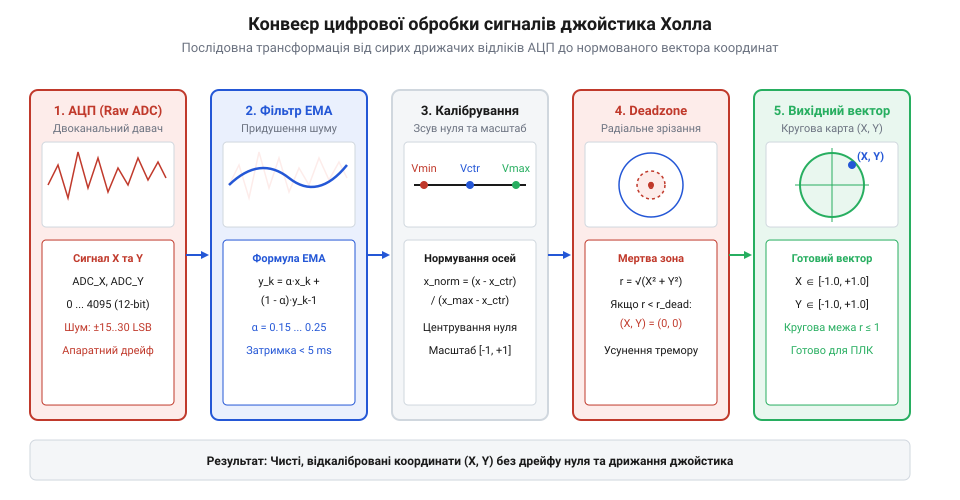

# Прошивка для зчитування, калібрування та згладжування стіка Холла

<preknowlist>
- [Поворотний потенціометр](root:cat-hw-controls/rotary-potentiometer) — Принципи аналогового знімання напруги з подільника та робота з АЦП.
- [KY-023 — джойстик-модуль](root:cat-hw-controls/ky-023-joystick) — Двовісна геометрія зчитування координат X/Y та відмінності потенціометричних джойстиків від давачів Холла.
</preknowlist>

## Проблема шуму АЦП та нелінійності Холла

У безконтактних джойстиках на елементах Холла відсутній механічний знос контактних доріжок, притаманний традиційним пристроям, таким як [Поворотний потенціометр](root:cat-hw-controls/rotary-potentiometer) або резистивний [KY-023 — джойстик-модуль](root:cat-hw-controls/ky-023-joystick). Однак зчитування позиції магнітного важеля за допомогою аналогового цифрового перетворювача (АЦП) створює низку специфічних апаратних проблем: високочастотний електромагнітний шум, температурний дрейф напівпровідникового кристала Холла та початкове зсунення нейтрального положення через пружну асиметрію пружин підвісу.

Якщо зчитувати 12-бітні значення АЦП напряму без обробки, сигнал виявляє постійне дрижання (амплітудою до `±15..30 LSB`). Додаткове ускладнення створює температурний коефіцієнт (@@en|temperature coefficient@@) напівпровідникового кристала Холла: при нагріванні мікросхеми змінюється рухливість носіїв заряду, що викликає повільний температурний дрейф (@@en|temperature drift@@) початкового рівня напруги вхідного сигналу. У результаті робототехнічна платформа або квадрокоптер отримує дрібні хибні команди й спонтанно зсувається з місця навіть тоді, коли важіль джойстика відпущений і перебуває у нейтральному стані. Для перетворення хаотичних і зсунутих відліків на чистий координатний вектор застосовують послідовний конвеєр цифрової обробки.

Фізична природа температурного зсуву полягає в залежності електропровідності напівпровідника від температури навколишнього середовища та власних втрат мікросхеми. Типовий температурний коефіцієнт чутливості кремнієвих сенсорів Холла становить близько `-0.05%`..`-0.2%` на кожне градусне відхилення за Цельсієм (@@en|temperature coefficient@@). При зміні температури корпусу пристрою на `20 °C` це призводить до зміщення нульової точки напруги спокою на `1%`..`2%` від шкали живлення. У 12-бітному АЦП таке зміщення відповідає зсуву нейтрального рівня на `40`..`80 LSB`, що повністю виводить реальний центр важеля за межі зафіксованого під час ініціалізації константного значення `V_center`. Без апаратного термоелемента компенсації або програмного автокалібрування та радіального відсікання дрейфу нульова позиція джойстика незворотно зміщується, спричиняючи накопичувальний хибний дрейф виконавчих механізмів.

*Конвеєр обробки сигналу: послідовна трансформація сирих відліків АЦП через ЕМА-фільтр, розрахунок центру та радіальну мертву зону.*

## Фільтрація шуму та програмне калібрування

Першим етапом обробки є придушення високочастотних завад АЦП. Застосування звичайного середнього арифметичного у ковзному вікні створює відчутну затримку відгуку важеля, що неприпустимо для оперативного керування. Замість цього застосовують алгоритм експоненційного згладжування — @@en|Exponential Moving Average@@ (від англ. *Exponential Moving Average*, @@en|EMA@@), у якому кожне нове відфільтроване значення обчислюється через ваговий коефіцієнт `α`. Вибір `α` напряму залежить від частоти дискретизації АЦП `f_s` (вимірюваної у Гц) та необхідної постійної часу згладжування `τ` за співвідношенням `α = 1 / (1 + τ · f_s)` (або спрощено `α ≈ 2π · f_c / f_s` через частоту зрізу `f_c`). Наприклад, за типової частоти опитування `f_s = 100 Гц` значення `α = 0.2` дає постійну часу `τ = 40 мс` і фазову затримку менше `10 мс`, що ефективно придушує брязкіт АЦП без втрати чутливості. Якщо частоту опитування підвищити до `f_s = 1000 Гц` (1 кГц), то для збереження аналогічного рівня згладжування коефіцієнт слід зменшити до `α ≈ 0.025`, інакше занадто великий `α` пропускатиме високочастотні завади. Натомість при низьких частотах дискретизації (наприклад, `f_s = 50 Гц`) коефіцієнт `α` доводиться підвищувати до `0.35`–`0.5`, щоб уникнути відчуття млявості важеля, тому обчислення `y_k` виконують за формулою:

    y_k = α · x_k + (1 - α) · y_k-1

Коефіцієнт `α` обирають у діапазоні від `0.15` до `0.25`, що забезпечує згладжування шуму з фазовою затримкою менше `5 мс`.

Однак фільтр ЕМА є безперервним рекурсивним алгоритмом: при виникненні поодинокого апаратного імпульсного викиду АЦП (наприклад, через наведення від силового ключа чи сплеск у колі живлення) згладжування не обнуляє заваду, а розмазує її амплітуду по наступних відліках у вигляді загасаючої експоненційної хвилі. Натомість медіанний фільтр (@@en|median filter@@) у короткому ковзному вікні з `3`..`5` відліків повністю відсікає такі одиночні аномальні піки, оскільки відсортоване серединне значення ігнорує будь-які екстремальні викиди. Ціною застосування медіанного фільтра є невелике зростання обчислювальної складності та фіксована затримка буфера на `(N - 1) / 2` відліків. Для досягнення максимальної завадозахищеності в критичних системах застосовують комбінований підхід: первинна медіанна обробка виключає імпульсні аномалії АЦП, а наступна фільтрація ЕМА формує абсолютно гладкий траєкторний сигнал.

Другим етапом є двосегментне калібрування осій. Через толерантність монтажу магнітів реальне значення АЦП у центрі `V_center` майже ніколи не дорівнює точній середині 12-бітного діапазону `2048`. Якщо використовувати однорідне масштабування, центр зсунеться, а максимальні відхилення вліво та вправо стануть асиметричними. Тому обчислення нормованого значення від `-1.0` до `+1.0` виконують окремо для негативного `[V_min, V_center]` та позитивного `[V_center, V_max]` півдіапазонів.

У C-реалізації драйвера структура калібрування та функція двосегментного нормування мають наступний вигляд:

:::code proj-hall-gimbal-reading/c/hall_gimbal.h 14-27
:::code proj-hall-gimbal-reading/c/hall_gimbal.c 26-39

## Формування мертвої зони та нормування

Навіть після фільтрації механічний дрейф важеля після відпускання залишає координати у невеликому радіусі довкола абсолютного нуля. Для усунення цього ефекту застосовують мертву зону — @@en|deadzone@@ (від англ. *dead zone* — нечутлива зона).

Існує дві принципові схеми відсікання: прямокутна (осьова) та радіальна (кругова). Прямокутна мертва зона обробляє осі X та Y незалежно, через що у кутах діаграм виникає неприродне "прилипання" важеля до головних осей та викривлення кута напрямку. У якісних системах керування використовують радіальну мертву зону, у якій спочатку обчислюють евклідів радіус вектора відхилення `r = √(X² + Y²)` та кут напрямку `θ = atan2(Y, X)`. Під час лінійного ресштабування амплітуди після межі мертвої зони `r_dead` нове нормоване значення `r_scaled = (r - r_dead) / (1.0 - r_dead)` множиться на орт напрямку `(cos θ, sin θ) = (X / r, Y / r)`. Оскільки обидві координати оновлюються через спільний скалярний множник `k = r_scaled / r`, відношення `Y_scaled / X_scaled = Y / X` лишається тотожним, тому відносний зсув кута вектора напрямку дорівнює нулю (`Δθ = 0`). Це повністю виключає кутові спотворення керування при будь-яких діагональних відхиленнях, а сам евклідів радіус вектора відхилення обчислюють за формулою:

    r = √(X² + Y²)

Якщо радіус `r` не перевищує поріг `r_dead` (зазвичай `5%..8%` від повного ходу), вектор примусово обнуляють. Для відсутності стрибка на межі мертвої зони амплітуду вектора після виходу за поріг плавно масштабують у діапазоні від `0.0` до `1.0`:

Для задач прецизійного пілотування (наприклад, у польотних контролерах дрон-платформ чи системах наведення оптичних підвісів) лінійного масштабування амплітуди буває недостатньо, оскільки воно забезпечує однаковий приріст швидкості як при мікровідхиленнях, так і при максимальному нахилі важеля. Щоб забезпечити високу точність мікрокоригування поблизу центру без втрати максимальної динаміки, до нормованого радіуса `r_scaled` застосовують нелінійну експоненційну функцію чутливості — @@en|expo@@ (від англ. *exponential curve*). У кубічній моделі ресштабування вихідний радіус обчислюють як `r_out = r_scaled³` або через комбінований коефіцієнт `c`: `r_out = c · r_scaled³ + (1 - c) · r_scaled`. Завдяки цьому при малому відхиленні важеля `r_scaled = 0.2` вихідна амплітуда зменшується до `0.008`, забезпечуючи ювелірну точність маневрування, але при повному відхиленні важеля `r_scaled = 1.0` вектор досягає `1.0` без обмеження максимального відгуку.

    r_scaled = (r - r_dead) / (1.0 - r_dead)

Алгоритм обробки сирих значень з урахуванням апаратного контролю меж, ЕМА-фільтрації та радіальної мертвої зони реалізовано у C-функції `hall_gimbal_process`:

:::code proj-hall-gimbal-reading/c/hall_gimbal.c 41-85

## Архітектура C++ класу та інтеграція

Для сучасних вбудованих систем на C++ алгоритм обробки сигналів джойстика Холла обгортають у компактний клас `HallGimbal`. Клас інкапсулює внутрішній стан ЕМА-фільтрів, параметри калібрування та надає метод `update(raw_x, raw_y)`, який повертає структуру з нормованими координатами `(x, y)` та прапором валідності.

Захисна перевірка на вихід за допустимі межі `raw_x` та `raw_y` із технологічним зазором `margin = 50 LSB` дозволяє миттєво діагностувати апаратні відмови — такі як обрив лінії живлення сенсора Холла чи механічний зсув магніту з кріплення. Щоб зберегти виміряні межі осей між перезавантаженнями системи й не вимагати від користувача повторного калібрування при кожному включенні живлення, бінарну структуру `GimbalConfig` записують у неенергозалежну пам'ять — @@en|EEPROM@@ або фіксований сектор @@en|Flash@@-пам'яті (NVS). При старті мікроконтролера прошивка зчитує збережену структуру, перевіряє сигнатуру ідентифікатора (маркер `magic_byte`), обчислює контрольну суму @@en|CRC-16@@ та контролює виконання базового інваріанта `min_raw < center_raw < max_raw`. У разі виявлення пошкодження даних чи порожньої пам'яті драйвер ігнорує зчитування й завантажує безпечну фабричну конфігурацію за замовчуванням, гарантуючи надійний запуск системи.

Заголовочний файл та реалізація об'єктно-орієнтованого драйвера джойстика наведені нижче:

:::code proj-hall-gimbal-reading/cpp/HallGimbal.hpp 10-30
:::code proj-hall-gimbal-reading/cpp/HallGimbal.cpp 30-74

Демонстраційна програма показує роботу драйвера на наборі контрольних випробувальних образів, зокрема в умовах нейтралі, повних відхилень та апаратної відмови:

:::code proj-hall-gimbal-reading/cpp/main.cpp 34-51
