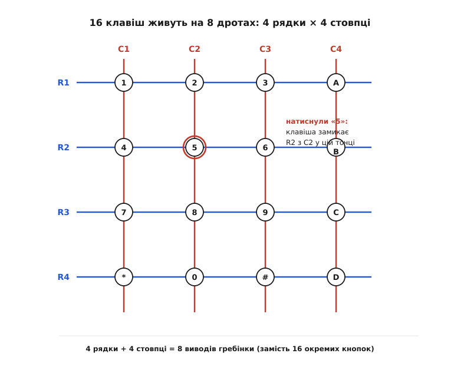
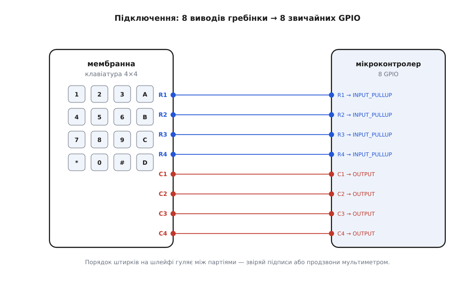
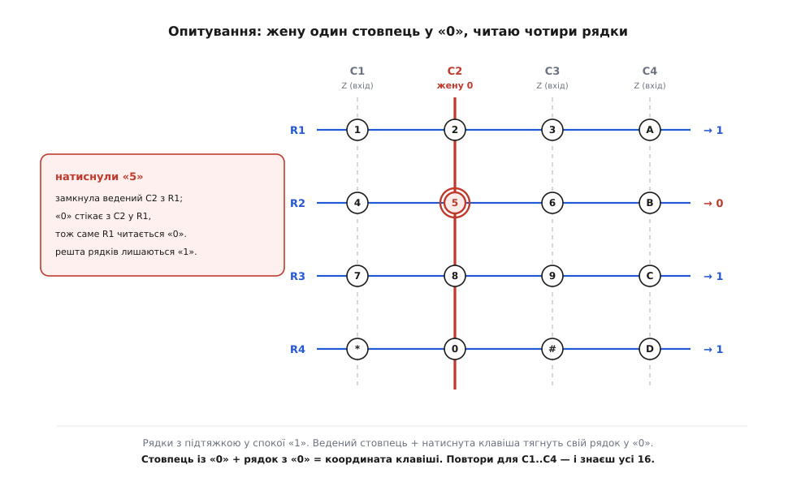
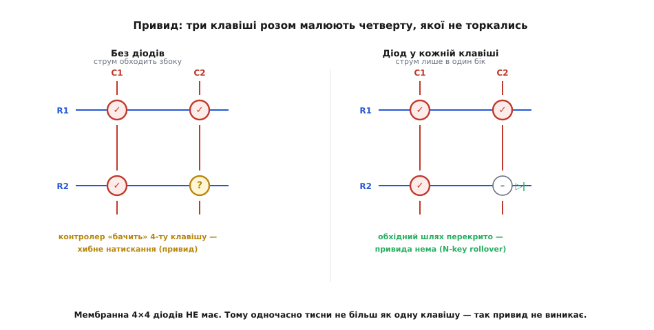

# Матрична клавіатура 4×4 (мембранна)

## Чому 16 кнопок на 8 дротах

Підключення шістнадцяти окремих кнопок потребує сімнадцяти виводів мікроконтролера, що виснажує доступні ніжки чипа. @@la|Матрична клавіатура@@ (лат. *matrix* — «основа») докорінно змінює цю геометрію: кнопки розміщують у вузлах сітки на перетинах чотирьох рядків і чотирьох стовпців. Натискання клавіші замикає її рядок зі стовпцем лише в одній точці.

Оскільки кількість кнопок росте як добуток сторін сітки (4 × 4 = 16), а кількість ліній — лише як їхня сума (4 + 4 = 8), вісім дротів повністю комутують усі шістнадцять клавіш.

Ця вигода стає ще разючішою зі зростанням розміру сітки. Для клавіатури 5×5 добуток дає 25 кнопок усього на 10 дротах, а повнорозмірна сітка 8×8 комутує 64 клавіші за допомогою 16 ліній замість шістдесяти п'яти окремих провідників. Що більша @@la|матриця@@, то виразнішою є економія виводів мікроконтролера.

*Кожна з 16 клавіш сидить на перетині рядка й стовпця. Натиск з'єднує їх у тій точці, зменшуючи кількість дротів із 16 до 8.*

## Будова мембранної плівки та шлейфа

Гнучка @@la|мембрана@@ (лат. *membrana* — «перетинка») складається з трьох плівок: верхньої з рядками, нижньої зі стовпцями та середньої диелектричної прокладки з отворами під клавішами. Натиск прогинає верхню плівку крізь отвір, зімикаючи струмопровідні срібні п'ятачки. На відміну від [тактильної матриці 4×4](root:cat-hw-controls/keypad-4x4-tactile), де стоять механічні кнопки, плівкове контактне покриття має опір у сотні ом і комутує лише слабострумові логічні сигнали.

Виводи виходять на гнучкий шлейф, порядок яких не є стандартизованим. Перед підключенням розводку відновлюють мультиметром у режимі продзвонювання, вишукуючи замкнену пару для кожної клавіші.

*Шлейф клавіатури підключають безпосередньо до цифрових виводів. Чотири рядки налаштовують входами, чотири стовпці — виходами.*

## Принцип покрокового сканування сітки

Пасивна сітка опитується мікроконтролером через @@la|сканування@@ (лат. *scandere* — «розбирати крок за кроком»). Рядки налаштовують входами з внутрішньою підтяжкою, які у спокої тримають високий рівень «1». Стовпці працюють виходами. 

Мікроконтролер по черзі подає логічний нуль «0» на один стовпець, відпускаючи інші в стан високого опору для запобігання коротким замиканням. Якщо клавіша натиснута, нуль зі стовпця стікає в її рядок і падає в «0». Пара активного стовпця та притягнутого рядка дає точну координату клавіші.

*Ведений стовпець у логічному нулі стікає в рядок через замкнену кнопку, змінюючи його рівень з одиниці на нуль.*

## Придушення брязкоту та фантомні замикання

Механічний дотичний контакт у перші мілісекунди викликує брязкіт, через що один натиск сприймається як серія. Для його усунення застосовують програмне @@en|придушення брязкоту@@ (англ. *debounce*) із короткими затримками зчитування.

При одночасному натисканні трьох кнопок у кутах прямокутника струм проходить обхідним шляхом, викликаючи @@en|привид@@ (англ. *ghosting*) — хибне читання четвертої кнопки. Оскільки мембранна клавіатура не має захисних діодів, вона вимагає суворого поклавішного набору.

*Три натиснуті кнопки утворюють обхідний шлях струму, через що контролер фігурує хибну четверту клавішу.*
