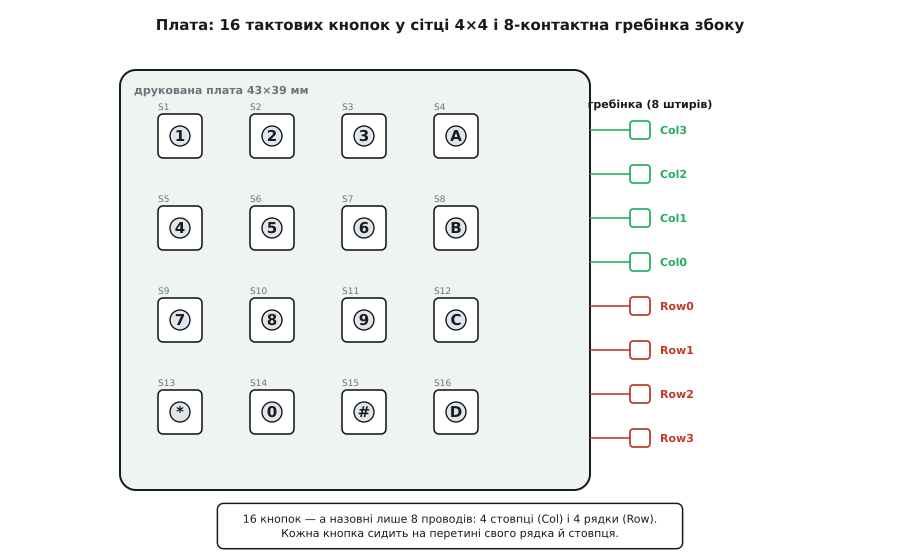
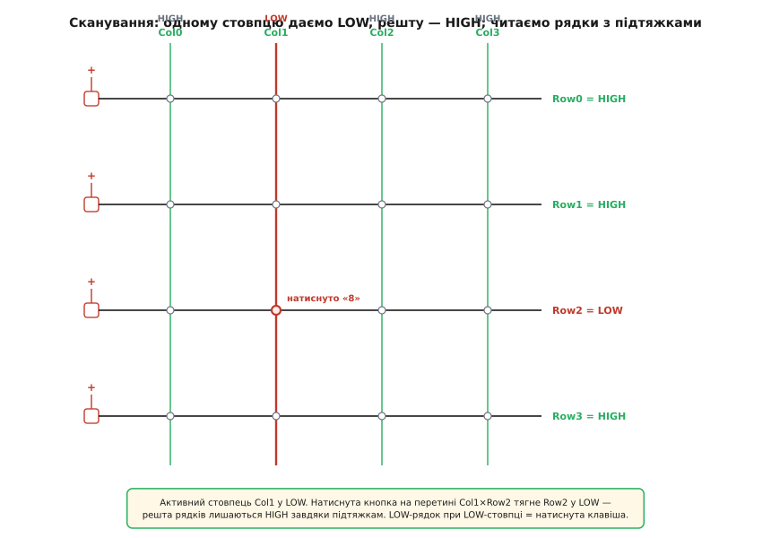
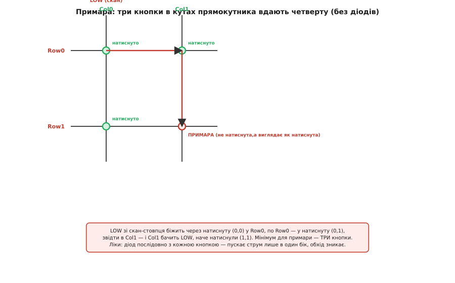
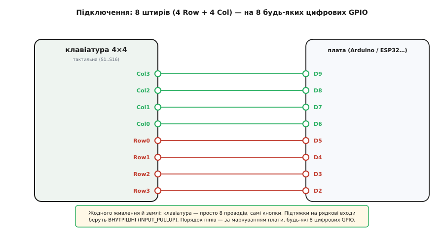

# Матрична клавіатура 4×4 (тактильна)

<preknowlist>
- [Тактильні кнопки з ковпачками](root:cat-hw-controls/tactile-buttons) — будова тактильної кнопки та замикання контакту під час натискання
</preknowlist>

## Дефіцит виводів мікроконтролера та матрична сітка

Коли у проєкті потрібно створити панель введення даних для PIN-коду чи набору чисел, найпростіша ідея — підключити шістнадцять окремих кнопок. Проте це вимагає шістнадцяти окремих цифрових виводів мікроконтролера, що є надмірною витратою обмежених ресурсів плати.

Замість окремих ліній використовують @@en|матричну сітку@@. Шістнадцять кнопок розставляють у квадрат 4×4 і розміщують на перетинах чотирьох рядків та чотирьох стовпців. Кожна [тактильна кнопка](root:cat-hw-controls/tactile-buttons) (англ. @@en|tactile@@, від лат. *tactilis* — дотиковий) у розімкненому стані не з'єднує лінії, а при натисканні замикає свій рядок зі своїм стовпцем. Завдяки такій геометрії шістнадцять клавіш обслуговуються лише вісьмома проводами.

*Шістнадцять кнопок розміщено в сітці з чотирьох рядків і чотирьох стовпців, що виводить назовні лише вісім проводів.*

## Принцип сканування сітки рядків і стовпців

Кожна кнопка має унікальну адресу у вигляді пари «рядок–стовпець». Щоб дізнатися, яку кнопку натиснуто, мікроконтролер виконує циклічне опитування (@@en|сканування@@). Чотири стовпці налаштовують як виходи, а чотири рядки — як входи з внутрішньою підтяжкою (@@en|INPUT_PULLUP@@) до плюса живлення, щоб без натискань на них тримався високий логічний рівень (@@en|HIGH@@).

Мікроконтролер по черзі виставляє на один зі стовпців низький рівень (@@en|LOW@@), залишаючи інші високими, і зчитує стан усіх рядків. Якщо кнопку натиснуто, вона з'єднує активний стовпець із відповідним рядком, притискаючи цей рядок до нуля (@@en|LOW@@). Поєднання активного стовпця та просілого рядка точно визначає координати натиснутої клавіші.

*Активний стовпець у стані LOW притискає рядок замкненої кнопки до нуля, показуючи її точні координати.*

## Брязкіт контактів і примарні натиски

Механічні контакти кнопок під час стулення кілька разів відскакують протягом перших кількох мілісекунд. Цей брязкіт сприймається мікроконтролером як серія швидких натискань, тому в програмі обов'язково застосовують антибрязкіт — витримку паузи для стабілізації сигналу.

Інше обмеження бездіодної матриці виникає при одночасному натисканні трьох кнопок, що утворюють кути прямокутника. Струм з активного стовпця проходить через дві затиснуті кнопки у спільний рядок, а звідти через третю кнопку повертається в сусідній стовпець. Це явище називають @@en|ghosting@@ (від англ. @@en|ghost@@ — привид), оскільки система зчитує хибний четвертий кут. Тому така матриця розрахована лише на поклавішне введення.

*Три одночасно натиснуті кнопки створюють обхідний шлях для струму, формуючи примарний четвертий натиск.*

## Підключення до мікроконтролера та вибір виконання

Модуль не містить активних електронних компонентів і не потребує окремих ліній живлення та землі. Усі вісім штирів гребінки підключаються безпосередньо до цифрових виводів @@en|GPIO@@ мікроконтролера. Клавіатура однаково працює з напругою 5 В та 3.3 В, оскільки логічні рівні визначаються самими виводами плати.

Таку матрицю виготовляють у двох варіантах. Жорстка тактильна плата має механічні кнопки з чітким акустичним та дотиковим відгуком, тоді як [мембранна клавіатура](root:cat-hw-controls/keypad-4x4-membrane) виконана у вигляді гнучкої пласкої плівки з клейкою основою. Електрично обидва виконання ідентичні й використовують той самий алгоритм опитування.

*Усі вісім проводів матриці підключаються напряму до цифрових виводів мікроконтролера без зовнішніх резисторів.*
