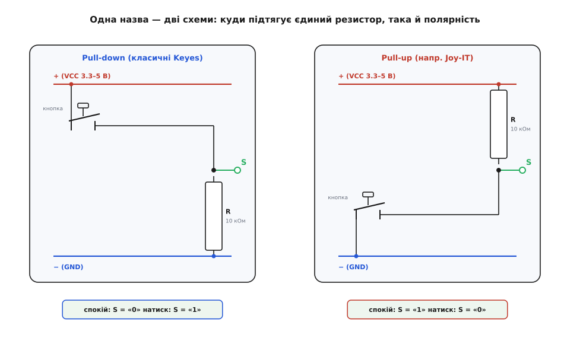
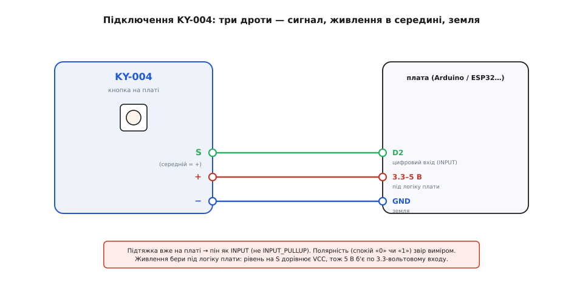

# KY-004 — тактильна кнопка на платі

## Потреба підтяжки та призначення KY-004

Пряме підключення кнопкового контакту до входу мікроконтролера викликає проблему «висячого» виводу у розімкненому стані. Вільна лінія зчитує електромагнітні завади довкілля й довільно змінює свій логічний рівень між 0 та 1. Для надійної роботи вхід має бути прив'язаний резистором до фіксованого потенціалу.

Модуль KY-004 розв'язує цю проблему апаратно, об'єднуючи на одній друкованій платі [тактильну кнопку](root:cat-hw-controls/tactile-buttons) (англ. @@en|tactile@@, від лат. *tactilis* — дотиковий) FZ1713 та підтягувальний резистор опором 10 кОм. Модуль має трипінову гребінку із виводом живлення (VCC) посередині, сигнальним піном (S) та землею (-). Напруга живлення VCC повинна суворо відповідати логічним рівням мікроконтролера (3.3 В або 5 В), щоб підтяжка формувала допустимий потенціал для входу.

*Резистор підтяжки фіксує вихідний рівень сигналу, усуваючи плаваючий стан входу у спокої.*

## Дві протилежні полярності підтяжки модуля

На ринку співіснують два зовні невідрізні варіанти модуля KY-004, які мають протилежну розводку резистора. Перша версія використовує підтяжку до землі (англ. @@en|pull-down@@), залишаючи лінію у спокої з низьким рівнем (@@en|LOW@@, 0 В) і видаючи високий рівень (@@en|HIGH@@, VCC) при натисканні. Друга версія підтягнута до живлення (англ. @@en|pull-up@@), тому у спокої формує рівень @@en|HIGH@@, а при замиканні кнопочних контактів осідає у @@en|LOW@@.

Жорстка прив'язка програми до одного конкретного рівня призводить до дзеркальної поведінки при зміні плати. Оскільки маркування компонентів одинакове, перед використанням реальну полярність підтяжки перевіряють мультиметром або тестовим заміром напруги на сигнальному піні у спокійному стані.

## Правильне підключення та інваріантний код

При підключенні виводу S до мікроконтролера відповідний цифровий пін @@en|GPIO@@ (англ. @@en|General Purpose Input/Output@@) налаштовують у звичайний режим входу `INPUT`. Увімкнення режиму `INPUT_PULLUP` заборонено, оскільки внутрішній підтягувальний резистор мікроконтролера увійде в конфлікт із платною підтяжкою модуля KY-004, викривляючи дільник напруги.

Для створення надійного коду застосовують інваріантний підхід: під час ініціалізації програма зчитує та запам'ятовує початковий стан сигналу як рівень спокою. Будь-яка зміна цього значення вважається фактом натискання кнопки, що робить скетч незалежним від полярності плати. Також обов'язково застосовують антибрязкіт контактів із витримкою 5–10 мілісекунд для усунення хибних повторних перемикань при механічному замиканні.

*Трьохпровідне підключення з'єднує сигнал S з входом GPIO, а живлення VCC та землю — з відповідними шинами плати.*

## Сфера застосування та межі кнопки

Модуль KY-004 ідеально підходить для фіксації поодиноких дискретних подій — запуску системи, скидання параметрів чи підтвердження вибору в меню. На відміну від складних вхідних вузлів на [тактильних матричних клавіатурах](root:cat-hw-controls/keypad-4x4-tactile), одиночна кнопка віддає лише один біт інформації за один натиск.

Спроба використати KY-004 для плавної зміни величин чи переліку багаторівневих списків призводить до незручного та повільного інтерфейсу. У таких задачах кнопка поступиться енкодерам або потенціометрам, проте в ролі разового аварійного чи пускового тригера вона забезпечує найпростішу та найстійкішу схемотехніку.
