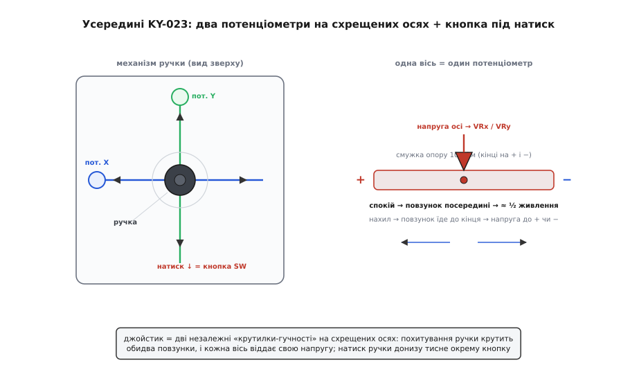
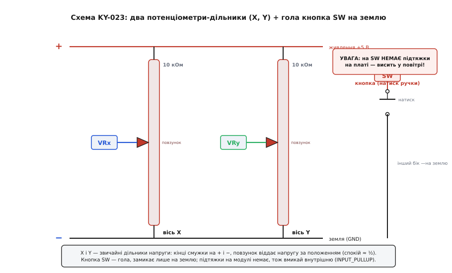
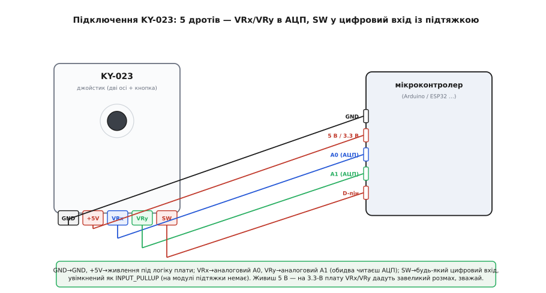

# KY-023 — джойстик-модуль

## Дві осі на потенціометрах і кнопка

Коли виникає потреба плавно регулювати напрямок і швидкість руху в двох вимірах, звичайних кнопок стає замало. Двовісний аналоговий @@en|джойстик@@ розв'язує це поєднанням двох механізмів [поворотного потенціометра](root:cat-hw-controls/rotary-potentiometer), розташованих під прямим кутом один до одного. Ручка на пружині повертає обидві осі в центр, а нахил пальцем зміщує повзунки, змінюючи відданий опір. На відміну від [поворотного енкодера KY-040](root:cat-hw-controls/ky-040-encoder), що рахує оберти без зупину, джойстик є органом миттєвого керування напрямком, а не вимірювачем кута. Додатковий натиск ручки донизу продавлює тактову кнопку для підтвердження дій.

Усередині маніпулятора ручка проходить крізь дві взаємно перпендикулярні рухомі дуги @@en|gimbal@@ (від лат. *gemellus* — подвійний) підвісу. Нахил важеля в будь-який бік повертає одну або обидві дуги одночасно, а ті передають обертальний рух безпосередньо на осі відповідних потенціометрів. Діагональне відхилення важеля пропорційно розкладається на кути повороту обох валів, зміщуючи струмознімачі по резистивних доріжках осей X та Y. Фізичний контакт і тертя ковзання у цьому механічному вузлі з часом спричиняють знос доріжок, на відміну від безконтактних рішень, де застосовують [стік на давачах Холла](root:cat-hw-controls/hall-effect-gimbal-joystick).

*Два перпендикулярні потенціометри ловлять відхилення по осях X та Y, а вертикальний натиск замкне внутрішню кнопку.*

## Схема плати та підтяжка кнопки

Електрично кожна вісь являє собою класичний @@la|дільник напруги@@: краї опору 10 кОм підключені до плюса й землі, а рухомий повзунок знімає аналоговий рівень. У спокої на виході присутня половина живлення, а відхилення важеля плавно зміщує напругу від нуля до повного значення VCC. Головна пастка модуля — це кнопка, один контакт якої під'єднано до землі, а другий виведено на пін без жодного внутрішнього резистора. Якщо в коді не увімкнути режим підтяжки до одиниці, сигнальна лінія кнопки висітиме у повітрі й ловитиме випадкові наводки.

*Аналогові осі завжди віддають стабільний поділ напруги, тоді як кнопка вимагає зовнішньої або внутрішньої підтяжки.*

## Підключення п'яти виводів шлейфа

Модуль віддає п'ять штирків гребінки: два для живлення, два аналогові виходи осей VRx і VRy та один цифровий вивід кнопки. Виходи осей підключають до @@en|АЦП@@ (аналогово-цифрового перетворювача) мікроконтролера, а напруга живлення модуля повинна чітко відповідати опорному рівню АЦП, щоб уникнути перевантаження входів. Кнопку підключають до цифрового піну з обов'язковим програмним режимом підтяжки `INPUT_PULLUP`. Для вимогливих завдань без механічного зносу застосовують [стік на давачах Холла](root:cat-hw-controls/hall-effect-gimbal-joystick).

*Осі підключають до аналогових входів АЦП, а кнопку — до цифрового виводу з внутрішньою підтяжкою.*

## Калібрування центру та мертва зона

Через механічні допуски пружини та розкид опору нерухомий джойстик у спокої рідко видає ідеальні 512 одиниць. Для точного керування при старті програми вимірюють реальні нулі осей і віднімають їх від поточних значень. Додатково навколо центрального положення програмно задають @@en|мертву зону@@ (англ. *deadzone*), яка ігнорує дрібні коливання від шуму АЦП. Також обов'язково враховують фізичну орієнтацію модуля та давлять брязкіт контактів кнопки затримкою читання.
