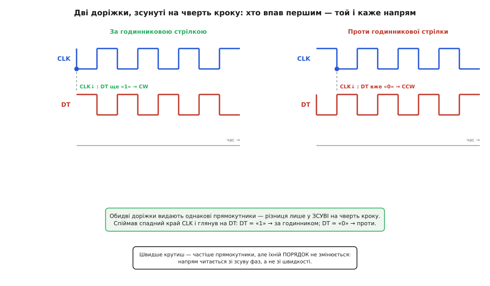
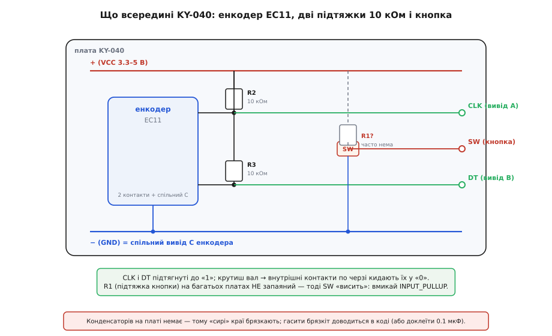
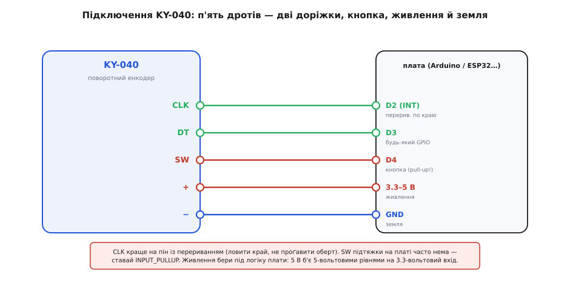

# KY-040 — поворотний енкодер

## Відносне керування та будова енкодера

Звичайний [поворотний потенціометр](root:cat-hw-controls/rotary-potentiometer) обмежений крайніми упорами вала й прив'язкою кута до напруги: після вимкнення пристрою його стан суперечить зміненому значенню в пам'яті. Цю проблему розв'язує **інкрементний** (від латинського *incrementum* — приріст; @@en|incremental@@) поворотний @@en|ротаційний енкодер@@ **KY-040**. Ручка енкодера обертається нескінченно в будь-який бік, видаючи не кут, а лише приріст кроків, які мікроконтролер накопичує у змінній.

Модуль побудовано на базі механічного енкодера **EC11**. Пружинний фіксатор (від латинського *fixus* — закріплений; англійською @@en|detent@@) дає 20–30 тактильних клацань на оберт, а натискання на вал замикає тактову кнопку **SW** (від англійської @@en|switch@@ — перемикач) для підтвердження вибору або входу в меню.

> 🔧 **Навіщо це.**
> Енкодер надає відносне керування без фізичних обмежень: одна ручка дозволяє гортати списки будь-якої довжини, виставляти значення та підтверджувати дію натисканням.

## Квадратурне кодування та визначення напрямку

Один контакт видавав би однакові імпульси в обидва боки й не дозволив би визначити напрямок. Для цього в KY-040 застосовано двохканальне **квадратурне** (від латинського *quadra* — чверть; @@en|quadrature@@) кодування: обертовий диск замикає на землю два контакти **CLK** (від англійської @@en|clock@@ — такт) та **DT** (від англійської @@en|data@@ — дані), сигнали яких зсунуті на чверть періоду.

*Дві квадратурні доріжки зсунуті на чверть кроку: за годинниковою стрілкою першим падає CLK, а проти годинникової стрілки — DT.*

Напрямок обчислюється за принципом «хто впав першим»: на спадному краї (перехід із «1» у «0») CLK мікроконтролер зчитує лінію DT. Якщо DT утримує рівень «1» (@@en|HIGH@@) — обертання йде за годинниковою стрілкою; якщо DT вже впав у «0» (@@en|LOW@@) — проти. Зсув фаз гарантує точний відлік за будь-якої швидкості обертання ручки.

## Схемотехніка KY-040 та апаратні пастки

Схема KY-040 містить енкодер EC11, 5-контактну гребінку та два резистори підтяжки (від англійської @@en|pull-up@@) 10 кОм на виходах CLK і DT.

*Схема KY-040: виходи CLK і DT підтягнуті резисторами 10 кОм до живлення, контакт кнопки SW виведений напряму, а апаратна фільтрація брязкоту відсутня.*

Слід враховувати три апаратні пастки модуля:
1. **Відсутність підтяжки кнопки.** Посадкове місце під резистор `R1` для кнопки SW зазвичай порожнє, через що незадіяна лінія висить у плаваючому стані (@@en|floating pin@@).
2. **Відсутність дебаунсу.** Плата не містить фільтруючих конденсаторів проти [брязкоту контактів](root:hw-digital/contact-debounce) (@@en|contact bounce@@), тому брязкіт викликає стрибки лічильника в коді.
3. **Рівноправність ліній.** Переплутані виходи CLK і DT лише дзеркально змінюють напрямок відліку.

## Підключення, програмне зчитування та застосування

*Підключення KY-040: лінія CLK заводиться на пін з апаратним перериванням, DT — на цифровий GPIO, SW — на вхід із внутрішньою підтяжкою, а живлення подається відповідно до логічних рівнів процесора.*

Щоб не пропустити швидкі оберти, лінію CLK заводять на пін з апаратним перериванням (@@en|hardware interrupt@@), DT — на звичайний вхід [GPIO](root:hw-digital/gpio), а кнопку SW — на пін із підтяжкою `INPUT_PULLUP`. Живлення `+` подають відповідно до логіки плати (3.3 В або 5 В).

Для надійного зчитування сигналів застосовують програмний @@en|debounce@@ за допомогою затримок або [скінченного автомата](root:sf-devices/finite-state-machine) (@@en|finite-state machine@@, FSM).

Енкодер зручний для нескінченного гортання в меню. Якщо ж потрібне вимірювання абсолютного кута вала, застосовують [поворотний потенціометр](root:cat-hw-controls/rotary-potentiometer) або [джойстик-модуль KY-023](root:cat-hw-controls/ky-023-joystick).
